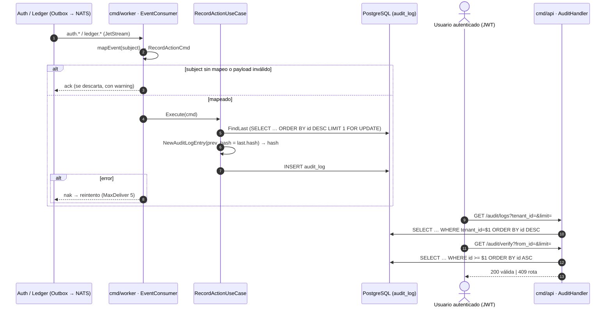
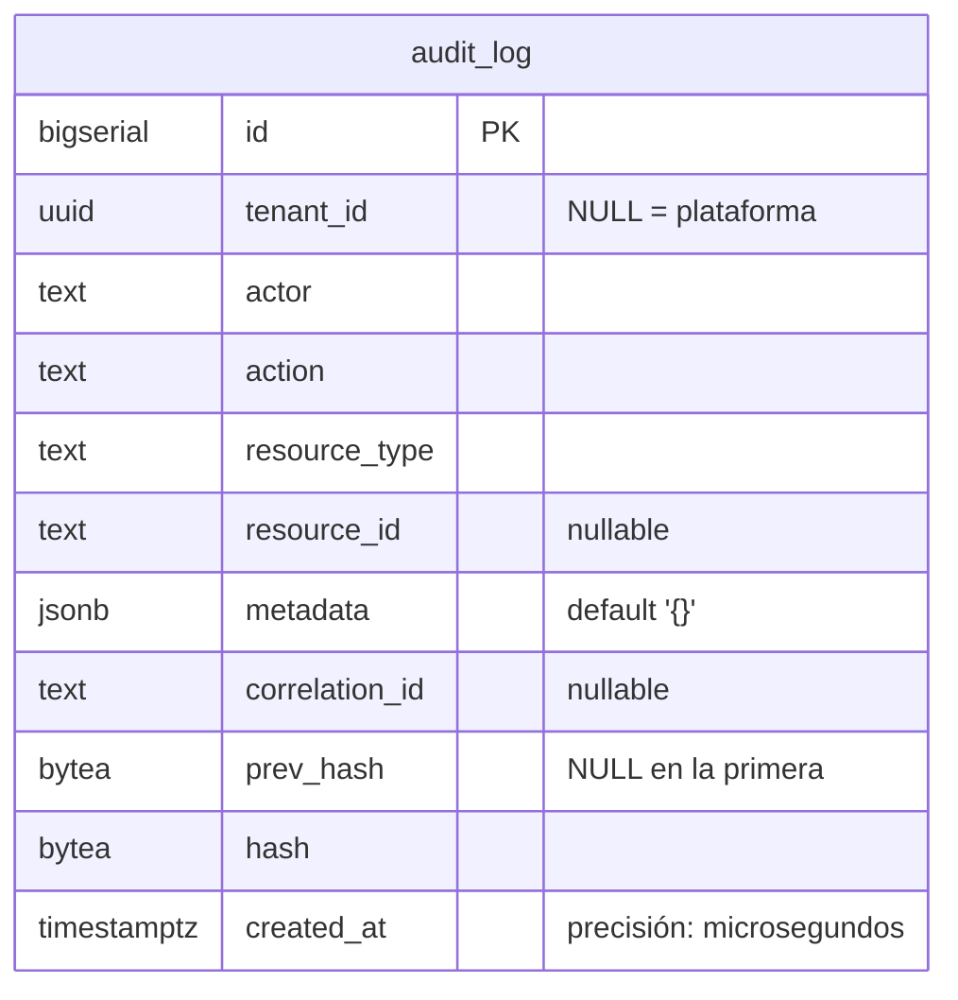

# Audit — Documentación técnico-funcional

> **Bounded Context:** `context/audit`
> **Migración:** [`000004_audit_init`](../../migrations/000004_audit_init.up.sql)
> **Streams NATS consumidos:** `AUTH` (`auth.>`), `LEDGER` (`ledger.>`) — no publica eventos

---

## 1. Propósito

Audit mantiene una **bitácora de acciones sensibles** de la plataforma:
altas y suspensiones de comercios, usuarios, API keys, cambios de rol y
movimientos contables. Cada registro queda encadenado al anterior con un
**hash chain** (SHA-256): si alguien modifica una fila, la verificación de la
cadena lo detecta.

El contexto es **escritura reactiva + consulta**:

- La *escritura* ocurre en `cmd/worker`: consumers de `AUTH` y `LEDGER`
  traducen cada evento de dominio a una entrada del log. No hay endpoint HTTP
  que escriba en la bitácora.
- La *consulta* (listar entradas) y la *verificación de integridad* de la
  cadena ocurren en `cmd/api`.

### Fuera de alcance (hoy)

- Auditoría de los demás contextos: Onboarding, Payment, Payout, Billing,
  Dispute, Webhook y Compliance (incluidas las decisiones four-eyes) **no** se
  registran (§10).
- Acciones que no pasan por un evento: `auth.user.login` / `auth.user.logout`
  están definidas en el dominio pero nadie las registra.
- Anclaje externo de la cadena (publicar periódicamente el último hash fuera
  de la base): sin él, quien controla la base puede reescribir la cadena
  completa de forma consistente.

---

## 2. Lenguaje ubicuo

| Término | Significado |
|---|---|
| **Entrada** (`AuditLogEntry`) | Registro inmutable de una acción: quién (`actor`), qué (`action`), sobre qué (`resource_type`/`resource_id`), de qué comercio (`tenant_id`) y cuándo (`created_at`). |
| **Acción** (`Action`) | Hecho auditado con convención `<contexto>.<hecho>`, p. ej. `auth.tenant.suspended`. Coincide con el subject del evento sin el sufijo de versión. |
| **Recurso** (`ResourceType`) | Tipo de objeto afectado: `tenant`, `user`, `api_key`, `journal_entry`, `ledger_account`. |
| **Actor** | Quién ejecutó la acción. Hoy casi siempre `system` (§5.1). |
| **Hash chain** | Cada entrada guarda el hash de la anterior (`prev_hash`) y el propio (`hash`). Romper un eslabón rompe la verificación. |
| **Payload canónico** | String determinista sobre el que se calcula el hash (§4.3). |
| **Verificación de cadena** | Recorrido que recalcula cada hash y comprueba cada enlace (`VerifyChain`). |
| **Tamper-evident** | La manipulación no se impide, se **evidencia**: el log no es inviolable, pero alterarlo deja rastro. |

---

## 3. Actores y flujo funcional



---

## 4. Modelo de dominio

### 4.1 Entidad `AuditLogEntry`

Archivo: [domain/log_entry.go](../../context/audit/domain/log_entry.go)

| Campo | Tipo | Notas |
|---|---|---|
| `id` | `int64` | `BIGSERIAL` asignado por Postgres; define el orden de la cadena (no el timestamp). `0` hasta persistir. |
| `tenantID` | `string` | Vacío para acciones de plataforma (en DB, `NULL`). |
| `actor` | `string` | userID, `system`. Vacío → `system`. |
| `action` | `Action` | Ver §4.4. |
| `resourceType` / `resourceID` | `ResourceType` / `string` | Recurso afectado. |
| `metadata` | `map[string]string` | Contexto libre; hoy `{event_subject}`. **No entra en el hash.** |
| `correlationID` | `string` | Header `correlation-id` del mensaje. **No entra en el hash.** |
| `prevHash` | `[]byte` | Hash de la entrada anterior; `nil` en la primera del sistema. |
| `hash` | `[]byte` | SHA-256 del payload canónico (32 bytes). |
| `createdAt` | `time.Time` | Reloj del worker al registrar (UTC), no la hora del evento. |

API de la entidad:

- `NewAuditLogEntry(..., prevHash, createdAt, computeHash)` → construye la
  entrada y calcula su hash. La función de hash se inyecta (el dominio no
  depende de `crypto`).
- `ReconstituteAuditLogEntry(...)` → reconstrucción desde DB sin recalcular.
- `VerifyHash(computeHash)` → recalcula y compara con el hash guardado.
- `ChainLinksTo(prev)` → `prevHash == prev.hash` (con `prev == nil`, exige
  `prevHash` vacío).
- `HashHex()` / `PrevHashHex()` → hex para la API.

No hay mutaciones: una entrada no cambia después de creada.

### 4.2 Invariantes

1. **Append-only**: no hay UPDATE ni DELETE en el código. En la base **no**
   está reforzado (sin trigger ni permisos revocados, §10).
2. **Encadenamiento**: `prev_hash(n) = hash(n−1)` según el orden de `id`.
3. **Primera entrada**: `prev_hash` vacío.
4. **Hash determinista**: mismo payload canónico ⇒ mismo hash.

### 4.3 Payload canónico y hash

```
hash_n = SHA-256( hex(prev_hash) | tenant_id | actor | action | resource_type | resource_id | created_at RFC3339Nano UTC )
```

Campos unidos con `|` en ese orden fijo (no debe cambiar: invalidaría toda la
cadena existente). `metadata` y `correlation_id` **quedan fuera**: se pueden
modificar sin que la verificación lo detecte (§10).

Implementación del hash: [crypto/sha256_hasher.go](../../context/audit/infrastructure/adapters/outbound/crypto/sha256_hasher.go)
(`SHA256Hasher.Compute`, sin salt: el payload ya incluye `prev_hash` y timestamp).

### 4.4 Value Objects y errores

Archivos: [domain/vo.go](../../context/audit/domain/vo.go),
[domain/errors.go](../../context/audit/domain/errors.go)

| Elemento | Regla |
|---|---|
| `Action` | String no vacío (`ParseAction` solo rechaza vacío: **no** valida contra el catálogo). Catálogo: 8 de Auth, 3 de Ledger, `auth.user.login`/`logout` (sin uso). |
| `ResourceType` | `tenant`, `user`, `api_key`, `journal_entry`, `ledger_account` (`ParseResourceType` valida). |
| `ErrInvalidAction` | Acción vacía. |
| `ErrInvalidResourceType` | Recurso fuera del catálogo. |
| `ErrLogEntryNotFound`, `ErrChainBroken` | Definidos, **sin uso**. |

---

## 5. Casos de uso

Paquete: [application/](../../context/audit/application/)

| Caso de uso | Archivo | Actor/trigger | Resultado |
|---|---|---|---|
| `RecordActionUseCase` | `record_action.go` | JetStream (`auth.>`, `ledger.>`) vía `EventConsumer` | Nueva entrada encadenada |
| `ListLogsUseCase` | `list_logs.go` | HTTP | `[]LogEntryView` (limit default 50, máx 200) |
| `VerifyChainUseCase` | `verify_chain.go` | HTTP | `VerifyChainResult` |

Puertos ([application/ports.go](../../context/audit/application/ports.go)):
`AuditLogRepository`, `HashComputer`, `Clock`.

### 5.1 Registro (`RecordAction`)

```
1. ParseAction / ParseResourceType               → error si inválidos (nak)
2. last := repo.FindLast()                        → nil si la tabla está vacía
3. prevHash := last.hash (o nil)
4. entry := NewAuditLogEntry(..., prevHash, clock.Now(), hasher.Compute)
5. repo.Save(entry)
```

El comentario del caso de uso afirma que la inserción está serializada con
`SELECT … FOR UPDATE` "dentro de la misma transacción". **No es así**: no hay
`RunInTx`; `FindLast` y `Save` corren cada uno en autocommit sobre el pool, y
el lock se libera al terminar la propia consulta (§10, #2).

Mapeo evento → entrada ([inbound/nats/event_consumer.go](../../context/audit/infrastructure/adapters/inbound/nats/event_consumer.go)):

| Subject | `action` | `resource_type` | `resource_id` | `actor` |
|---|---|---|---|---|
| `auth.tenant.created.v1` | `auth.tenant.created` | `tenant` | `tenant_id` | `system` |
| `auth.tenant.activated.v1` | `auth.tenant.activated` | `tenant` | `tenant_id` | `system` |
| `auth.tenant.suspended.v1` | `auth.tenant.suspended` | `tenant` | `tenant_id` | `system` |
| `auth.user.registered.v1` | `auth.user.registered` | `user` | `user_id` | `system` |
| `auth.user.suspended.v1` | `auth.user.suspended` | `user` | `user_id` | `system` |
| `auth.apikey.issued.v1` | `auth.apikey.issued` | `api_key` | `api_key_id` | `system` |
| `auth.apikey.revoked.v1` | `auth.apikey.revoked` | `api_key` | `api_key_id` | `system` |
| `auth.role.assigned.v1` | `auth.role.assigned` | `user` | `user_id` | `assigned_by` del payload |
| `ledger.account.created.v1` | `ledger.account.created` | `ledger_account` | `account_id` | `system` |
| `ledger.entry.posted.v1` | `ledger.entry.posted` | `journal_entry` | `entry_id` | `system` |
| `ledger.entry.reversed.v1` | `ledger.entry.reversed` | `journal_entry` | `entry_id` | `system` |

`tenant_id` sale del payload del evento; `metadata = {event_subject}`;
`correlation_id` del header `correlation-id`.

Manejo de errores del consumer: subject sin mapeo o payload que no es JSON →
**ack con warning** (se pierde la entrada, "el audit no debe ser un punto de
falla"); error del caso de uso → **nak** (reintento hasta `MaxDeliver: 5`).

### 5.2 Consulta (`ListLogs`)

- `limit ≤ 0` → 50; `> 200` → 200.
- Con `TenantID` → `ListByTenant` (`WHERE tenant_id = $1`); sin él →
  `ListRecent` (toda la plataforma).
- Orden descendente por `id`. La vista expone `prev_hash` y `hash` en hex y
  `created_at` en RFC3339 (sin fracciones de segundo).

### 5.3 Verificación (`VerifyChain`)

```
entries := repo.ListFromID(from_id, limit)     (limit ≤ 0 → 500; sin máximo)
para cada entrada i:
    VerifyHash falla                → Valid=false, FirstInvalidID=id, "hash mismatch …"
    i > 0 y !ChainLinksTo(entries[i-1]) → Valid=false, "chain broken …"
    i = 0 y from_id = 0 y prev_hash ≠ vacío → Valid=false, "first entry … unexpected prev_hash"
→ Valid=true, EntriesChecked=len(entries)
```

Alcance real de la verificación:

- Verifica **un lote** (`limit` filas desde `from_id`); recorrer la cadena
  completa requiere paginar desde el cliente.
- Con `from_id > 0` no se verifica que la primera fila del lote enlace con su
  predecesora: la verificación por lotes deja sin chequear los bordes.
- No detecta el **borrado de las últimas filas** (truncar la cola deja una
  cadena consistente).

---

## 6. API HTTP

Archivo: [inbound/http/audit_handler.go](../../context/audit/infrastructure/adapters/inbound/http/audit_handler.go)
Cableado: [cmd/api/main.go](../../cmd/api/main.go) (sección *Audit*),
`audithttp.RegisterRoutes(protected, …)` — **sin guards de rol**.

| Método | Ruta | Descripción | Éxito |
|---|---|---|---|
| `GET` | `/api/v1/audit/logs?tenant_id=&limit=` | Entradas recientes. Sin `tenant_id`, usa el tenant del JWT. | `200 {entries, count}` |
| `GET` | `/api/v1/audit/verify?from_id=&limit=` | Verifica un lote de la cadena. | `200 VerifyChainResult` si es válida, `409` si está rota |

Errores: cualquier fallo del caso de uso → `500 {"error":"internal server error"}`.
Parámetros numéricos inválidos se ignoran (quedan en su default).

Los comentarios de `RegisterRoutes` dicen "admin" / "solo platform_support",
pero **no hay `RequireRole`**: cualquier usuario autenticado puede leer la
bitácora de **otro** comercio pasando `tenant_id`, y verificar la cadena
global (§10, #3).

Ejemplo de `LogEntryView`:

```json
{
  "id": 4,
  "tenant_id": "a2b4…",
  "actor": "system",
  "action": "auth.user.registered",
  "resource_type": "user",
  "resource_id": "9f8e…",
  "metadata": {"event_subject": "auth.user.registered.v1"},
  "correlation_id": "c0ff…",
  "prev_hash": "5e1a…",
  "hash": "b7c2…",
  "created_at": "2026-10-27T02:04:43Z"
}
```

`VerifyChainResult`: `{Valid, EntriesChecked, FirstInvalidID, FirstInvalidMsg}`
(sin tags JSON: los campos salen en PascalCase).

---

## 7. Eventos

Audit **no publica** eventos de dominio.

### 7.1 Consumidores (este BC consume)

Se arrancan en [cmd/worker/main.go](../../cmd/worker/main.go) como dos
goroutines durables **concurrentes**:

| Consumer | Stream | Filtro | MaxDeliver |
|---|---|---|---|
| `audit-auth-consumer` | `AUTH` | `auth.>` | 5 |
| `audit-ledger-consumer` | `LEDGER` | `ledger.>` | 5 |

Eventos de Auth sin mapeo (se descartan con ack): ninguno a la fecha. Eventos
de otros streams: no se consumen.

---

## 8. Persistencia

Archivo: [000004_audit_init.up.sql](../../migrations/000004_audit_init.up.sql)



Índices: `idx_audit_log_tenant_created (tenant_id, created_at DESC) WHERE
tenant_id IS NOT NULL`, `idx_audit_log_id_asc (id)` (redundante con la PK).

Sin RLS: es un log global; el aislamiento por tenant depende del `WHERE` de
cada consulta. La migración deja como comentario que en producción habría que
revocar UPDATE/DELETE al rol de la aplicación; no hay trigger ni permisos que
lo impidan.

Queries ([outbound/postgres/audit_log_repo.go](../../context/audit/infrastructure/adapters/outbound/postgres/audit_log_repo.go)):

| Método | Query | Notas |
|---|---|---|
| `Save` | `INSERT INTO audit_log (…) VALUES (…)` | Autocommit sobre el pool. Vacíos → `NULL`. No lee el `id` asignado. |
| `FindLast` | `SELECT … ORDER BY id DESC LIMIT 1 FOR UPDATE` | Fuera de transacción: el lock no persiste hasta el `Save`. |
| `ListRecent` | `SELECT … ORDER BY id DESC LIMIT $1` | |
| `ListByTenant` | `SELECT … WHERE tenant_id=$1 ORDER BY id DESC LIMIT $2` | |
| `ListFromID` | `SELECT … WHERE id >= $1 ORDER BY id ASC LIMIT $2` | Base de `VerifyChain`. |

Al leer, `ParseAction`/`ParseResourceType` ignoran errores: un valor fuera del
catálogo se reconstituye como vacío.

---

## 9. Seguridad y multi-tenancy

- **Integridad**: tamper-evident, no tamper-proof. Detecta cambios en los
  campos del payload canónico de filas intermedias; no detecta cambios en
  `metadata`/`correlation_id`, borrado de la cola ni la reescritura completa
  de la cadena (no hay anclaje externo).
- **Inmutabilidad**: solo por convención del código (§4.2).
- **Aislamiento**: por `WHERE tenant_id` en la consulta. La API **no**
  restringe el parámetro `tenant_id` (§6).
- **Datos**: `metadata` y `resource_id` no contienen datos sensibles hoy (IDs
  y el subject del evento).

---

## 10. Limitaciones conocidas y deuda técnica

| # | Tema | Detalle | Impacto |
|---|---|---|---|
| 1 | **La verificación falla siempre** | El hash se calcula con `created_at` en nanosegundos (`time.Now()`, formato RFC3339Nano), pero `TIMESTAMPTZ` guarda microsegundos. Al releer, el payload canónico cambia y `VerifyHash` falla. Verificado en la base de desarrollo: las 4 entradas existentes fallan; `GET /audit/verify` responde `409` en la entrada 1. | **Alto** |
| 2 | **Bifurcación de la cadena** | `FindLast … FOR UPDATE` y `Save` corren en autocommit, sin `RunInTx`: el lock se libera antes del INSERT. Los consumers de `AUTH` y `LEDGER` son concurrentes, así que dos eventos simultáneos pueden leer el mismo último hash y crear dos entradas con el mismo `prev_hash`. No reproducido (la base de dev tiene 4 filas), pero no hay nada que lo impida. | **Alto** |
| 3 | **Lectura cross-tenant** | `/audit/logs` y `/audit/verify` no tienen guard de rol: cualquier usuario autenticado lee la bitácora de cualquier comercio con `?tenant_id=`. | **Alto** |
| 4 | Cobertura parcial | Solo `AUTH` y `LEDGER`. No se auditan Onboarding (decisiones KYC), Payment, Payout, Billing, Dispute, Webhook ni Compliance (holds, four-eyes, cambios de watchlist). `login`/`logout` definidos y sin uso. | Medio |
| 5 | Actor genérico | Todo queda como `system` salvo `role.assigned`: no se sabe qué operador suspendió un tenant o revocó una key (los eventos no traen el actor). | Medio |
| 6 | Campos fuera del hash | `metadata` y `correlation_id` no entran en el payload canónico: se pueden alterar sin que la verificación lo detecte. | Medio |
| 7 | Append-only no reforzado | Sin trigger ni permisos revocados; el borrado de la cola de la cadena no es detectable y no hay anclaje externo del último hash. | Medio |
| 8 | Verificación por lotes incompleta | Con `from_id > 0` no se verifica el enlace con la fila previa; límite sin máximo (un `limit` enorme carga todo en memoria). `VerifyChainResult` sin tags JSON. | Bajo |
| 9 | Duplicados ante re-entrega | No hay idempotencia por ID de evento: si el ack se pierde tras el INSERT, la re-entrega crea una segunda entrada. | Bajo |
| 10 | Pérdidas silenciosas | Subject sin mapeo o payload inválido → ack con warning: la entrada se pierde sin alerta. `ParseAction` acepta cualquier string; errores `ErrLogEntryNotFound`/`ErrChainBroken` sin uso; código muerto en `mapEvent` (`_ = postgres.WithTenantID`). | Bajo |
| 11 | Hora de procesamiento | `created_at` es la hora del worker, no el header `occurred-at` del evento. | Bajo |

---

## 11. Testing

| Capa | Archivos | Tipo |
|---|---|---|
| Dominio | `domain/log_entry_test.go`, `vo_test.go` | Unitarios: hash determinista, campos fuera del hash, `VerifyHash` con manipulación, `ChainLinksTo`, parseo de VOs. |
| Aplicación | `application/record_action_test.go`, `verify_chain_test.go`, `list_logs_test.go` (+ `mocks_test.go`) | Unitarios con repo en memoria: encadenamiento, cadena rota, límites. |
| HTTP | `inbound/http/audit_handler_test.go` | Handlers Gin con `httptest`: tenant por defecto del JWT, 200/409/500, rutas. |
| NATS | `inbound/nats/event_consumer_test.go` | `mapEvent` por subject, ack de desconocidos, nak ante error, configs de consumers. |
| Crypto | `outbound/crypto/sha256_hasher_test.go` | SHA-256 real. |
| Postgres | `outbound/postgres/audit_log_repo_test.go`, `audit_log_repo_pgxmock_test.go` | `scanEntry` con filas falsas y SQL esperado con pgxmock. |

```bash
go test ./context/audit/...
```

Hueco que explica el bug #1: ningún test hace el viaje de ida y vuelta contra
PostgreSQL real (guardar y verificar), que es donde se pierde la precisión. Los
tests de dominio usan timestamps sin fracción de segundo.

---

## 12. Mapa de código

```
context/audit/
├── domain/
│   ├── log_entry.go      # AuditLogEntry, payload canónico, VerifyHash, ChainLinksTo
│   ├── vo.go             # Action (catálogo), ResourceType
│   └── errors.go
├── application/
│   ├── ports.go          # AuditLogRepository, HashComputer, Clock
│   ├── commands.go       # RecordActionCmd, VerifyChainQuery/Result, ListLogsQuery, LogEntryView
│   ├── record_action.go
│   ├── list_logs.go
│   └── verify_chain.go
└── infrastructure/adapters/
    ├── inbound/
    │   ├── http/audit_handler.go     # AuditHandler + RegisterRoutes (2 rutas, sin guards)
    │   └── nats/event_consumer.go    # consumers AUTH + LEDGER, mapEvent
    └── outbound/
        ├── crypto/sha256_hasher.go
        └── postgres/audit_log_repo.go
```

Cableado: [cmd/api/main.go](../../cmd/api/main.go) (`ListLogs`, `VerifyChain`)
y [cmd/worker/main.go](../../cmd/worker/main.go) (`RecordAction` + los dos
consumers).
