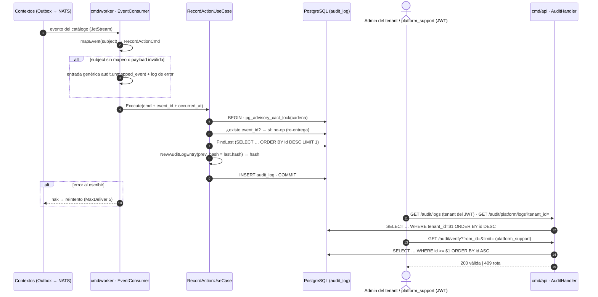
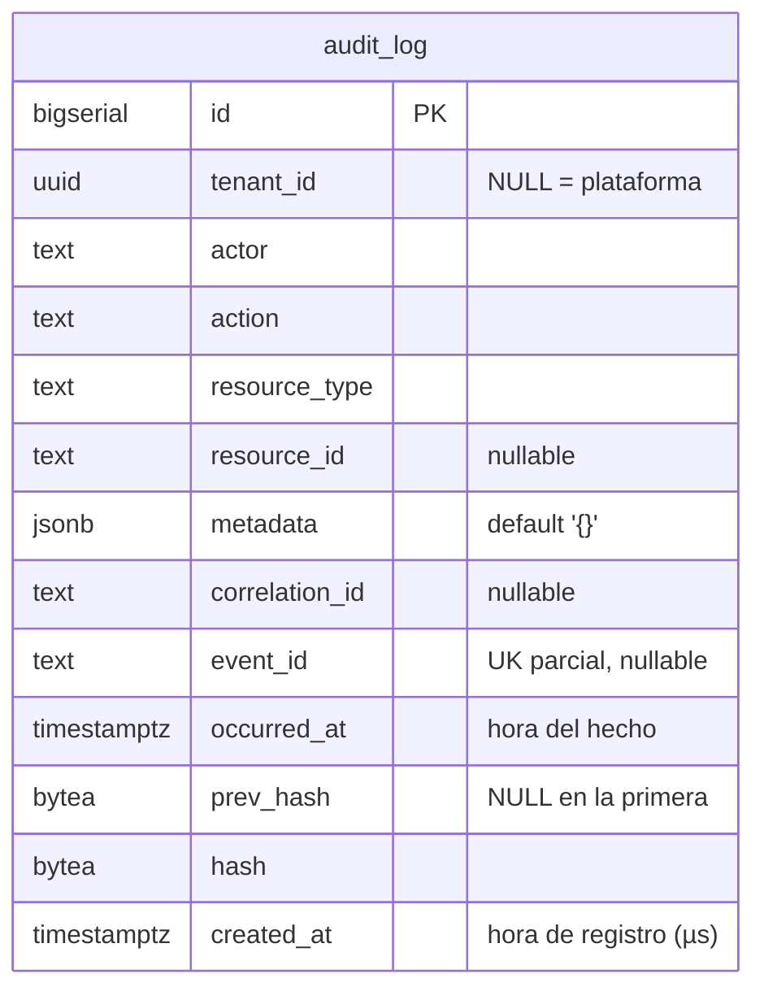

# Audit — Documentación técnico-funcional

> **Bounded Context:** `context/audit`
> **Migraciones:** [`000004_audit_init`](../../migrations/000004_audit_init.up.sql),
> [`000024_audit_chain_integrity`](../../migrations/000024_audit_chain_integrity.up.sql),
> [`000025_audit_hash_payload`](../../migrations/000025_audit_hash_payload.up.sql),
> [`000026_audit_event_source`](../../migrations/000026_audit_event_source.up.sql)
> **Streams NATS consumidos:** `AUTH`, `LEDGER`, `ONBOARDING`, `PAYMENT`, `PAYOUT`, `BILLING`, `DISPUTE`, `WEBHOOK`, `COMPLIANCE`, `RECONCILIATION` (§7.1) — no publica eventos

---

## 1. Propósito

Audit mantiene una **bitácora de acciones sensibles** de la plataforma:
comercios, usuarios, sesiones, API keys y roles; movimientos contables;
decisiones de KYC; reembolsos, desembolsos y disputas; planes de billing;
configuración de webhooks; alertas y decisiones de cumplimiento; y
conciliaciones. Cada registro queda encadenado al anterior con un
**hash chain** (SHA-256): si alguien modifica una fila, la verificación de la
cadena lo detecta.

El contexto es **escritura reactiva + consulta**:

- La *escritura* ocurre en `cmd/worker`: un consumer por stream (§7.1)
  traduce cada evento de dominio del catálogo (§5.1) a una entrada del log. No hay endpoint HTTP
  que escriba en la bitácora.
- La *consulta* (listar entradas) y la *verificación de integridad* de la
  cadena ocurren en `cmd/api`.

### Fuera de alcance (hoy)

- Eventos de alto volumen que no son acciones sensibles: `payment.captured` /
  `payment.failed` (el movimiento de dinero ya queda auditado por
  `ledger.entry.posted`) y `webhook.delivery.*` (operación interna).
- Intentos de login fallidos: solo se audita el login exitoso.
- Anclaje externo de la cadena (publicar periódicamente el último hash fuera
  de la base): sin él, quien controla la base puede reescribir la cadena
  completa de forma consistente.

---

## 2. Lenguaje ubicuo

| Término | Significado |
|---|---|
| **Entrada** (`AuditLogEntry`) | Registro inmutable de una acción: quién (`actor`), qué (`action`), sobre qué (`resource_type`/`resource_id`), de qué comercio (`tenant_id`) y cuándo (`created_at`). |
| **Acción** (`Action`) | Hecho auditado con convención `<contexto>.<hecho>`, p. ej. `auth.tenant.suspended`. Coincide con el subject del evento sin el sufijo de versión. |
| **Recurso** (`ResourceType`) | Tipo de objeto afectado: `tenant`, `user`, `api_key`, `journal_entry`, `ledger_account`. |
| **Actor** | Quién ejecutó la acción: userID del JWT, `apikey:<id>` o `system` (procesos del worker). Viaja en el header `actor` de cada evento (§5.1). |
| **Hash chain** | Cada entrada guarda el hash de la anterior (`prev_hash`) y el propio (`hash`). Romper un eslabón rompe la verificación. |
| **Payload canónico** | String determinista sobre el que se calcula el hash (§4.3). |
| **Verificación de cadena** | Recorrido que recalcula cada hash y comprueba cada enlace (`VerifyChain`). |
| **Tamper-evident** | La manipulación no se impide, se **evidencia**: el log no es inviolable, pero alterarlo deja rastro. |

---

## 3. Actores y flujo funcional



---

## 4. Modelo de dominio

### 4.1 Entidad `AuditLogEntry`

Archivo: [domain/log_entry.go](../../context/audit/domain/log_entry.go)

| Campo | Tipo | Notas |
|---|---|---|
| `id` | `int64` | `BIGSERIAL` asignado por Postgres; define el orden de la cadena (no el timestamp). `0` hasta persistir. |
| `tenantID` | `string` | Vacío para acciones de plataforma (en DB, `NULL`). |
| `actor` | `string` | userID, `apikey:<id>` o `system`. Vacío → `system`. |
| `action` | `Action` | Ver §4.4. |
| `resourceType` / `resourceID` | `ResourceType` / `string` | Recurso afectado. |
| `metadata` | `map[string]string` | Contexto libre; hoy `{event_subject}`. Entra en el hash. |
| `correlationID` | `string` | Header `correlation-id` del mensaje. Entra en el hash. |
| `eventID` | `string` | ID del evento de dominio (`Nats-Msg-Id`). Clave de idempotencia: una entrada por evento. Vacío si la acción no viene de un evento. Entra en el hash. |
| `occurredAt` | `time.Time` | **Cuándo ocurrió el hecho**: header `occurred-at` del evento (si falta, = `createdAt`). Truncado a µs. Entra en el hash. |
| `prevHash` | `[]byte` | Hash de la entrada anterior; `nil` en la primera del sistema. |
| `hash` | `[]byte` | SHA-256 del payload canónico (32 bytes). |
| `createdAt` | `time.Time` | **Cuándo se registró** en la bitácora: reloj del worker, en UTC y truncado a microsegundos (`TruncateToStorage`), la precisión de `TIMESTAMPTZ`. `createdAt − occurredAt` = demora del pipeline. |

API de la entidad:

- `NewAuditLogEntry(EntryInput, prevHash, createdAt, computeHash)` → construye
  la entrada y calcula su hash. La función de hash se inyecta (el dominio no
  depende de `crypto`).
- `ReconstituteAuditLogEntry(EntrySnapshot)` → reconstrucción desde DB sin
  recalcular ni validar (los valores tal como están guardados).
- `VerifyHash(computeHash)` → recalcula y compara con el hash guardado.
- `ChainLinksTo(prev)` → `prevHash == prev.hash` (con `prev == nil`, exige
  `prevHash` vacío).
- `HashHex()` / `PrevHashHex()` → hex para la API.

No hay mutaciones: una entrada no cambia después de creada.

### 4.2 Invariantes

1. **Append-only**: no hay UPDATE ni DELETE en el código. En la base **no**
   está reforzado (sin trigger ni permisos revocados, §10).
2. **Encadenamiento**: `prev_hash(n) = hash(n−1)` según el orden de `id`.
   Ningún eslabón tiene dos sucesores: `UNIQUE (prev_hash)` (migración 000024).
3. **Primera entrada**: `prev_hash` vacío, y es única (índice único parcial
   sobre `prev_hash IS NULL`).
4. **Hash determinista**: mismo payload canónico ⇒ mismo hash.

### 4.3 Payload canónico y hash

```
hash_n = SHA-256( JSON[ hex(prev_hash), tenant_id, actor, action, resource_type,
                        resource_id, created_at, correlation_id, metadata,
                        event_id, occurred_at ] )
```

El payload canónico es un **array JSON** con todos los campos de la entrada,
en ese orden fijo (no debe cambiar: invalidaría la cadena existente). Así
cualquier campo modificado rompe la verificación, y un valor que contenga
caracteres especiales no puede hacer colisionar dos entradas distintas (con un
separador de texto plano, `("x|y","z")` y `("x","y|z")` darían el mismo
payload).

- `created_at` y `occurred_at`: RFC3339Nano UTC, truncados a microsegundos **antes** de hashear
  (`TruncateToStorage`). `TIMESTAMPTZ` guarda microsegundos: con los
  nanosegundos de `time.Now()` el payload cambiaría al releer la fila.
- `metadata`: objeto JSON con las claves ordenadas (`encoding/json` ordena los
  mapas); `nil` equivale a `{}`. El payload es idéntico antes de persistir y
  después de leer de `JSONB`, incluso con acentos, comillas o `<>&`.

Implementación del hash: [crypto/sha256_hasher.go](../../context/audit/infrastructure/adapters/outbound/crypto/sha256_hasher.go)
(`SHA256Hasher.Compute`, sin salt: el payload ya incluye `prev_hash` y timestamp).

### 4.4 Value Objects y errores

Archivos: [domain/vo.go](../../context/audit/domain/vo.go),
[domain/errors.go](../../context/audit/domain/errors.go)

| Elemento | Regla |
|---|---|
| `Action` | Formato `<contexto>.<hecho>`: dos o más segmentos en minúscula separados por punto (`ParseAction`). El catálogo cerrado vive en el mapeo de eventos; la acción se deriva del subject sin el sufijo de versión. `audit.unmapped_event` = evento sin mapeo. |
| `ResourceType` | `tenant`, `user`, `api_key`, `journal_entry`, `ledger_account`, `application`, `payment`, `payout`, `billing_plan`, `tenant_plan`, `dispute`, `webhook_endpoint`, `aml_alert`, `reconciliation_run`, `event` (evento sin mapeo) (`ParseResourceType` valida). |
| `ErrInvalidAction` | Acción con formato inválido. |
| `ErrInvalidResourceType` | Recurso fuera del catálogo. |

---

## 5. Casos de uso

Paquete: [application/](../../context/audit/application/)

| Caso de uso | Archivo | Actor/trigger | Resultado |
|---|---|---|---|
| `RecordActionUseCase` | `record_action.go` | JetStream (`auth.>`, `ledger.>`) vía `EventConsumer` | Nueva entrada encadenada |
| `ListLogsUseCase` | `list_logs.go` | HTTP | `[]LogEntryView` (limit default 50, máx 200) |
| `VerifyChainUseCase` | `verify_chain.go` | HTTP | `VerifyChainResult` |

Puertos ([application/ports.go](../../context/audit/application/ports.go)):
`AuditLogRepository`, `HashComputer`, `Clock`.

### 5.1 Registro (`RecordAction`)

```
1. ParseAction / ParseResourceType               → error si inválidos (nak)
2. txManager.RunInTx {
3.   repo.LockChain()                             → pg_advisory_xact_lock (global)
4.   event_id ≠ "" y repo.ExistsByEventID()       → no-op (re-entrega)
5.   last := repo.FindLast()                      → nil si la tabla está vacía
6.   entry := NewAuditLogEntry(..., last.hash, clock.Now(), hasher.Compute)
7.   repo.Save(entry)
   }
```

**Serialización**: los consumers de `AUTH` y `LEDGER` corren en paralelo (y
puede haber varias instancias del worker). El advisory lock transaccional
cubre la lectura del último hash y el INSERT, así dos registros simultáneos no
se encadenan al mismo eslabón. Un `SELECT … FOR UPDATE` de la última fila **no
alcanza**, ni siquiera dentro de la transacción: en READ COMMITTED el segundo
lector, al obtener el lock, revalida la misma fila vieja en lugar de ver la
recién insertada.

**Idempotencia**: JetStream re-entrega un evento si el ack se pierde después
del INSERT. Con el lock tomado, `ExistsByEventID` descarta la re-entrega antes
de leer el último hash; el índice único `uq_audit_log_event_id` es el respaldo
en la base.

Catálogo evento → entrada ([inbound/nats/event_consumer.go](../../context/audit/infrastructure/adapters/inbound/nats/event_consumer.go),
mapa `mappings`). `action` = subject sin el sufijo de versión
(`auth.tenant.created.v1` → `auth.tenant.created`); cada subject declara el
tipo de recurso y el campo del payload con su ID:

| Subjects | `resource_type` | `resource_id` | Notas |
|---|---|---|---|
| `auth.tenant.{created,activated,suspended}.v1` | `tenant` | `tenant_id` | |
| `auth.user.{registered,suspended}.v1` | `user` | `user_id` | |
| `auth.user.{login,logout}.v1` | `user` | `user_id` | actor = `user_id` del payload |
| `auth.apikey.{issued,revoked}.v1` | `api_key` | `api_key_id` | |
| `auth.role.assigned.v1` | `user` | `user_id` | actor = `assigned_by` del payload |
| `ledger.account.created.v1` | `ledger_account` | `account_id` | |
| `ledger.entry.posted.v1` | `journal_entry` | `entry_id` | |
| `ledger.entry.reversed.v1` | `journal_entry` | `reverse_entry_id` | `metadata.original_entry_id` |
| `onboarding.application.{submitted,sent_for_review,approved,rejected,more_info,reopened}.v1` | `application` | `application_id` | |
| `payment.refunded.v1` | `payment` | `payment_id` | |
| `payout.{initiated,confirmed,failed,unknown}.v1` | `payout` | `payout_id` | |
| `billing.plan.{created,updated,deactivated}.v1` | `billing_plan` | `plan_id` | sin tenant (plataforma) |
| `billing.plan.assigned.v1` | `tenant_plan` | `tenant_plan_id` | |
| `dispute.{opened,resolved}.v1` | `dispute` | `dispute_id` | |
| `webhook.endpoint.{registered,deactivated}.v1` | `webhook_endpoint` | `endpoint_id` | |
| `compliance.alert.{raised,review_proposed,proposal_rejected,resolved}.v1` | `aml_alert` | `alert_id` | |
| `compliance.sanction.{matched,cleared,confirmed}.v1` | `aml_alert` | `alert_id` | |
| `reconciliation.run.completed.v1` | `reconciliation_run` | `run_id` | |

Agregar un evento auditado = una línea en `mappings` (y, si es de un stream
nuevo, una entrada en `Subscriptions`). `TestCatalogConsistency` falla si un
subject mapeado no lo entrega ninguna suscripción, si una suscripción no tiene
subjects mapeados o si un tipo de recurso no existe en el dominio.

`tenant_id` sale del payload del evento; `metadata = {event_subject}` (más los
campos extra que declare el mapeo).

**Actor y correlation ID**: el `EventPublisher` del outbox
([pkg/outbox/outbox.go](../../pkg/outbox/outbox.go)) agrega a **todo** evento
los headers `actor` (`postgres.ActorFromContext`: userID del JWT,
`apikey:<id>`, o `system` si el evento nace en el worker) y `correlation-id`
(el de `CorrelationIDMiddleware`, si lo hay). El relay los conserva y Audit
los usa como `actor` y `correlation_id` de la entrada. Sin header `actor`
queda `system`. Si el mapeo declara un campo de actor en el payload (login,
logout, asignación de rol), ese tiene prioridad: es el sujeto del hecho (en un
login todavía no hay JWT). Los webhooks reenvían solo el payload: los
headers no le llegan al comercio.

**Origen**: `event_id` = ID del mensaje (`Nats-Msg-Id`, el UUID del evento) y
`occurred_at` = header `occurred-at`.

Manejo de errores del consumer: un evento **nunca se descarta**. Si el subject
no está en el catálogo o el payload no es JSON, se registra igual como
`audit.unmapped_event` (`resource_type = event`, `resource_id = event_id`,
`metadata = {event_subject, reason}`, tenant del payload si se puede leer) y
se loguea como **error**: señal de que el catálogo quedó atrás de los eventos
publicados. Solo un fallo al escribir hace **nak** (reintento hasta
`MaxDeliver: 5`).

### 5.2 Consulta (`ListLogs`)

- `limit ≤ 0` → 50; `> 200` → 200.
- Con `TenantID` → `ListByTenant` (`WHERE tenant_id = $1`); sin él →
  `ListRecent` (toda la plataforma).
- Orden descendente por `id`. La vista expone `prev_hash` y `hash` en hex y
  `created_at` en RFC3339 (sin fracciones de segundo).

### 5.3 Verificación (`VerifyChain`)

```
entries := repo.ListFromID(from_id, limit)     (limit ≤ 0 → 500; sin máximo)
para cada entrada i:
    VerifyHash falla                → Valid=false, FirstInvalidID=id, "hash mismatch …"
    i > 0 y !ChainLinksTo(entries[i-1]) → Valid=false, "chain broken …"
    i = 0 y from_id = 0 y prev_hash ≠ vacío → Valid=false, "first entry … unexpected prev_hash"
→ Valid=true, EntriesChecked=len(entries)
```

Alcance real de la verificación:

- Verifica **un lote** (`limit` filas desde `from_id`); recorrer la cadena
  completa requiere paginar desde el cliente.
- Con `from_id > 0` no se verifica que la primera fila del lote enlace con su
  predecesora: la verificación por lotes deja sin chequear los bordes.
- No detecta el **borrado de las últimas filas** (truncar la cola deja una
  cadena consistente).

---

## 6. API HTTP

Archivo: [inbound/http/audit_handler.go](../../context/audit/infrastructure/adapters/inbound/http/audit_handler.go)
Cableado: [cmd/api/main.go](../../cmd/api/main.go) (sección *Audit*). Cada
ruta exige un guard de rol (`RouteGuards`, inyectados desde `cmd/api`;
`RegisterRoutes` entra en pánico si falta alguno). Sin el rol → `403`.

| Método | Ruta | Descripción | Rol | Éxito |
|---|---|---|---|---|
| `GET` | `/api/v1/audit/logs?limit=` | Bitácora **del comercio autenticado** (tenant del JWT). | `admin`, `platform_support` | `200 {entries, count}` |
| `GET` | `/api/v1/audit/platform/logs?tenant_id=&limit=` | Vista de plataforma: un comercio con `tenant_id`, toda la plataforma sin él. | `platform_support` | `200 {entries, count}` |
| `GET` | `/api/v1/audit/verify?from_id=&limit=` | Verifica un lote de la cadena (global). | `platform_support` | `200 VerifyChainResult` si es válida, `409` si está rota |

Aislamiento en `/audit/logs`: el tenant sale **siempre** del JWT. Un
`tenant_id` en la query distinto del propio → `403` (leer otro comercio solo
por la ruta de plataforma). Sin tenant en el contexto → `403`: nunca cae a la
vista de toda la plataforma.

Errores: cualquier fallo del caso de uso → `500 {"error":"internal server error"}`.
Parámetros numéricos inválidos se ignoran (quedan en su default).

Ejemplo de `LogEntryView`:

```json
{
  "id": 4,
  "tenant_id": "a2b4…",
  "actor": "system",
  "action": "auth.user.registered",
  "resource_type": "user",
  "resource_id": "9f8e…",
  "metadata": {"event_subject": "auth.user.registered.v1"},
  "correlation_id": "c0ff…",
  "event_id": "7d3e…",
  "occurred_at": "2026-10-27T02:04:42Z",
  "prev_hash": "5e1a…",
  "hash": "b7c2…",
  "created_at": "2026-10-27T02:04:43Z"
}
```

`VerifyChainResult`: `{Valid, EntriesChecked, FirstInvalidID, FirstInvalidMsg}`
(sin tags JSON: los campos salen en PascalCase).

---

## 7. Eventos

Audit **no publica** eventos de dominio.

### 7.1 Consumidores (este BC consume)

Se arrancan en [cmd/worker/main.go](../../cmd/worker/main.go), una goroutine
durable por suscripción (`auditnats.Subscriptions`), **concurrentes** entre sí
y serializadas al escribir por `LockChain` (§5.1). `MaxDeliver: 5`.

| Consumer | Stream | Filtro |
|---|---|---|
| `audit-auth-consumer` | `AUTH` | `auth.>` |
| `audit-ledger-consumer` | `LEDGER` | `ledger.>` |
| `audit-onboarding-consumer` | `ONBOARDING` | `onboarding.>` |
| `audit-payment-consumer` | `PAYMENT` | `payment.refunded.>` |
| `audit-payout-consumer` | `PAYOUT` | `payout.>` |
| `audit-billing-consumer` | `BILLING` | `billing.>` |
| `audit-dispute-consumer` | `DISPUTE` | `dispute.>` |
| `audit-webhook-consumer` | `WEBHOOK` | `webhook.endpoint.>` |
| `audit-compliance-consumer` | `COMPLIANCE` | `compliance.>` |
| `audit-reconciliation-consumer` | `RECONCILIATION` | `reconciliation.>` |

Los filtros de `PAYMENT` y `WEBHOOK` dejan afuera los eventos de alto volumen
(capturas y fallos de pago, entregas de webhooks).

---

## 8. Persistencia

Archivo: [000004_audit_init.up.sql](../../migrations/000004_audit_init.up.sql)



Índices: `idx_audit_log_tenant_created (tenant_id, created_at DESC) WHERE
tenant_id IS NOT NULL`, `idx_audit_log_id_asc (id)` (redundante con la PK),
`uq_audit_log_prev_hash (prev_hash) WHERE prev_hash IS NOT NULL` y
`uq_audit_log_genesis ((prev_hash IS NULL)) WHERE prev_hash IS NULL` (000024):
una bifurcación de la cadena falla con violación de unicidad en vez de
persistirse; `uq_audit_log_event_id (event_id) WHERE event_id IS NOT NULL`
(000026): una entrada por evento.

Sin RLS: es un log global; el aislamiento por tenant depende del `WHERE` de
cada consulta. La migración deja como comentario que en producción habría que
revocar UPDATE/DELETE al rol de la aplicación; no hay trigger ni permisos que
lo impidan.

Queries ([outbound/postgres/audit_log_repo.go](../../context/audit/infrastructure/adapters/outbound/postgres/audit_log_repo.go)):

| Método | Query | Notas |
|---|---|---|
| `LockChain` | `SELECT pg_advisory_xact_lock(hashtextextended('audit_log_chain', 0))` | Lock transaccional global de la cadena; se libera al commit/rollback. |
| `Save` | `INSERT INTO audit_log (…) VALUES (…)` | En la tx del contexto. Vacíos → `NULL`. No lee el `id` asignado. |
| `FindLast` | `SELECT … ORDER BY id DESC LIMIT 1` | En la tx del contexto, después de `LockChain`. |
| `ListRecent` | `SELECT … ORDER BY id DESC LIMIT $1` | |
| `ListByTenant` | `SELECT … WHERE tenant_id=$1 ORDER BY id DESC LIMIT $2` | |
| `ListFromID` | `SELECT … WHERE id >= $1 ORDER BY id ASC LIMIT $2` | Base de `VerifyChain`. |

Al leer, `ParseAction`/`ParseResourceType` ignoran errores: un valor fuera del
catálogo se reconstituye como vacío.

---

## 9. Seguridad y multi-tenancy

- **Integridad**: tamper-evident, no tamper-proof. Detecta cambios en
  cualquier campo de filas intermedias; no detecta el borrado de la cola ni la
  reescritura completa de la cadena (no hay anclaje externo).
- **Inmutabilidad**: solo por convención del código (§4.2).
- **Aislamiento**: por `WHERE tenant_id` en la consulta, con el tenant tomado
  del JWT en `/audit/logs`. La lectura de otros comercios y la verificación
  global requieren `platform_support` (§6).
- **Datos**: `metadata` y `resource_id` no contienen datos sensibles hoy (IDs
  y el subject del evento).

---

## 10. Limitaciones conocidas y deuda técnica

| # | Tema | Detalle | Impacto |
|---|---|---|---|
| 1 | Append-only no reforzado | Sin trigger ni permisos revocados; el borrado de la cola de la cadena no es detectable y no hay anclaje externo del último hash. | Medio |
| 2 | Verificación por lotes incompleta | Con `from_id > 0` no se verifica el enlace con la fila previa; límite sin máximo (un `limit` enorme carga todo en memoria). `VerifyChainResult` sin tags JSON. | Bajo |

---

## 11. Testing

| Capa | Archivos | Tipo |
|---|---|---|
| Dominio | `domain/log_entry_test.go`, `vo_test.go` | Unitarios: hash determinista, todos los campos cubiertos (incl. `metadata`/`correlation_id`), orden de claves y `nil` vs `{}`, sin colisiones por separador, `VerifyHash` con manipulación, `ChainLinksTo`, parseo de VOs. |
| Aplicación | `application/record_action_test.go`, `verify_chain_test.go`, `list_logs_test.go` (+ `mocks_test.go`) | Unitarios con repo en memoria: encadenamiento, orden lock → existe → último → insert en una tx, idempotencia por `event_id`, hora del evento vs. de registro, cadena rota, límites. |
| HTTP | `inbound/http/audit_handler_test.go` | Handlers Gin con `httptest`: tenant por defecto del JWT, 200/409/500, rutas. |
| NATS | `inbound/nats/event_consumer_test.go` | `mapEvent` por subject del catálogo, actor (header vs payload) y correlation ID, eventos sin mapeo o inválidos registrados (no descartados), re-entregas registradas una vez, `occurred-at`, nak ante error, consistencia catálogo ↔ suscripciones ↔ dominio, nombres de durables. |
| Outbox | `pkg/outbox/publisher_test.go` | Headers `actor` y `correlation-id` desde el contexto (request y worker). |
| Crypto | `outbound/crypto/sha256_hasher_test.go` | SHA-256 real. |
| Postgres | `outbound/postgres/audit_log_repo_test.go`, `audit_log_repo_pgxmock_test.go` | `scanEntry` con filas falsas y SQL esperado con pgxmock. |

```bash
go test ./context/audit/...
```

`TestNewAuditLogEntry_storagePrecision` cubre la precisión del timestamp
(nanosegundos que vuelven de la base truncados a microsegundos).
`TestRecordActionUseCase_Execute` verifica que `LockChain → FindLast → Save`
ocurran en orden y dentro de la misma transacción. Los guards y el aislamiento
por tenant están en `audit_handler_test.go`.

---

## 12. Mapa de código

```
context/audit/
├── domain/
│   ├── log_entry.go      # AuditLogEntry, payload canónico, VerifyHash, ChainLinksTo
│   ├── vo.go             # Action (catálogo), ResourceType
│   └── errors.go
├── application/
│   ├── ports.go          # TxManager, AuditLogRepository (LockChain), HashComputer, Clock
│   ├── commands.go       # RecordActionCmd, VerifyChainQuery/Result, ListLogsQuery, LogEntryView
│   ├── record_action.go
│   ├── list_logs.go
│   └── verify_chain.go
└── infrastructure/adapters/
    ├── inbound/
    │   ├── http/audit_handler.go     # AuditHandler + RouteGuards + RegisterRoutes (3 rutas)
    │   └── nats/event_consumer.go    # Subscriptions (10 streams), catálogo mappings, mapEvent
    └── outbound/
        ├── crypto/sha256_hasher.go
        └── postgres/audit_log_repo.go
```

Cableado: [cmd/api/main.go](../../cmd/api/main.go) (`ListLogs`, `VerifyChain`,
`RouteGuards`) y [cmd/worker/main.go](../../cmd/worker/main.go)
(`RecordAction` con `TxManager` + un consumer por suscripción).
