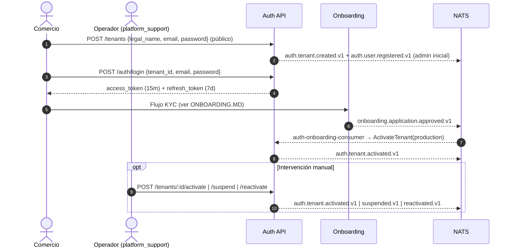
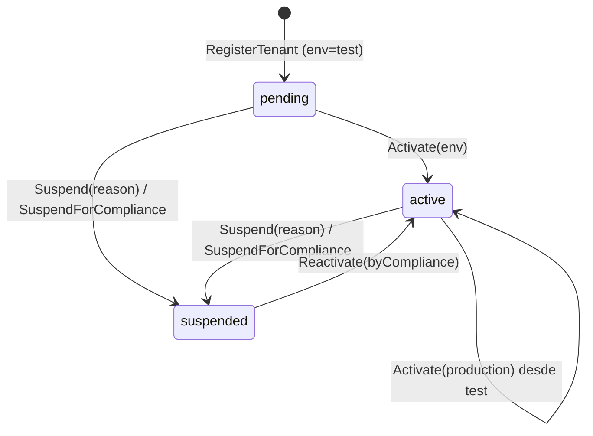
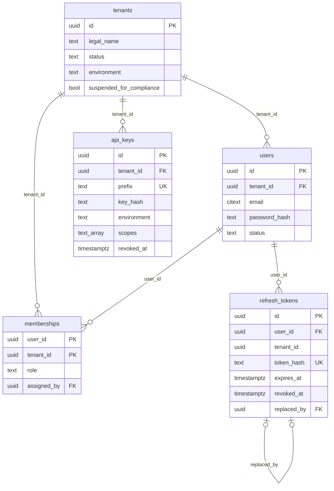

# Auth & Multi-Tenant — Documentación técnico-funcional

> **Bounded Context:** `context/auth`
> **Migraciones:** [`000002_auth_init`](../../migrations/000002_auth_init.up.sql), [`000050_auth_rls`](../../migrations/000050_auth_rls.up.sql), [`000051_tenant_compliance_suspension`](../../migrations/000051_tenant_compliance_suspension.up.sql)
> **Stream NATS:** `AUTH` (`auth.>`)

---

## 1. Propósito

Auth es la **raíz del multi-tenant** de la plataforma. Gestiona:

- El ciclo de vida del **comercio** (`Tenant`): alta, activación, pase a producción, suspensión y reactivación.
- Los **usuarios** de cada comercio y su **rol** (RBAC).
- La **autenticación** interactiva (JWT de acceso + refresh token con rotación).
- Las **API keys** para integraciones server-to-server.
- La **propagación del tenant** al resto del sistema: el `JWTMiddleware` pone el `tenant_id` en el `context.Context`, y el `TxManager` lo usa para configurar el RLS de PostgreSQL en todos los BCs.

Todos los demás contextos dependen de Auth para saber "quién es el tenant" de un request. Solo Payment (`StatusGate`) y Payout (`PayoutGate`) leen el estado del tenant antes de mover dinero (ver §10).

### Fuera de alcance (hoy)

- Recuperación o cambio de contraseña, verificación de email y MFA.
- Rate limiting y bloqueo por intentos fallidos (login, refresh, `POST /tenants`): van en el API gateway, un repo aparte con Redis, no en Auth.
- Gestión de usuarios: listar, suspender o borrar (el dominio tiene `User.Suspend()` pero no hay caso de uso).
- Usuarios en varios tenants: el modelo de `Membership` lo contempla, pero `users.tenant_id` ata cada usuario a un único tenant.

---

## 2. Lenguaje ubicuo

| Término | Significado |
|---|---|
| **Tenant** | Comercio cliente de la plataforma. Unidad de aislamiento de datos. |
| **Ambiente** (`Environment`) | `test` o `production`. Solo `active` + `production` puede mover dinero real (`CanProcessRealPayments`). |
| **Usuario** (`User`) | Persona con credenciales (email + contraseña) dentro de **un** tenant. |
| **Membership** | Vínculo usuario ↔ tenant ↔ rol. |
| **Rol** | `admin`, `operator`, `accountant`, `read_only`, `platform_support`, `compliance_officer`. |
| **`platform_support`** | Rol "interno" del operador de la plataforma, que actúa sobre cualquier tenant. No se puede otorgar desde la API (`Role.IsTenantAssignable()`): se provisiona con el CLI `cmd/provision` (`make provision`). |
| **`compliance_officer`** | Rol interno de la plataforma: analista de cumplimiento que revisa alertas AML de todos los comercios (four-eyes, ver [COMPLIANCE.md](COMPLIANCE.md)). Igual que `platform_support`, no es asignable desde un tenant. No tiene permisos de la matriz de tenant. |
| **Hold de cumplimiento** | Bloqueo preventivo y reversible de cobros y payouts por `(tenant, alerta)`, en `tenant_compliance_holds`. No cambia `tenants.status`. |
| **Access token** | JWT HS256 de 15 minutos con `sub`, `tid`, `role` y `env`. |
| **Refresh token** | Secreto opaco de 7 días, guardado como SHA-256, que se rota en cada uso. |
| **API key** | Credencial server-to-server `<env>_<prefix>_<secret>` con scopes. |
| **Scope** | Permiso de una API key: `payments:write`, `payments:read`, `webhooks:write`, `reports:read`. |

---

## 3. Flujo funcional

### 3.1 Ciclo de vida de un comercio



### 3.2 Autenticación de un request

| Mecanismo | Header | Dónde se usa |
|---|---|---|
| JWT | `Authorization: Bearer <jwt>` | Todas las rutas protegidas de todos los BCs (`protected` en `cmd/api`). |
| API key | `X-Api-Key: <env>_<prefix>_<secret>` | Rutas montadas con `JWTOrApiKeyMiddleware`: hoy **`/api/v1/payments`**. El grupo `/api/v1/integrations` sigue vacío. |

El `JWTMiddleware` valida firma y expiración y confía en los claims, salvo en un punto: el estado del tenant. Tanto el JWT como la API key pasan por `TenantStatusChecker` (`CachedTenantStatus`, que lee `tenants` con una caché de 30 s por réplica). Un tenant suspendido recibe `403 tenant is suspended` a lo sumo 30 s después, y uno inexistente, `401`. Un cambio de rol, en cambio, recién se refleja cuando el usuario obtiene un token nuevo (hasta 15 minutos después).

---

## 4. Modelo de dominio

### 4.1 Agregado `Tenant`

Archivo: [domain/tenant.go](../../context/auth/domain/tenant.go)

| Campo | Notas |
|---|---|
| `id` | UUID generado en el alta. |
| `legalName` | Obligatorio (`ErrEmptyLegalName`). |
| `status` | `pending` → `active` / `suspended`. |
| `environment` | Nace en `test`; se define al activar y puede pasar de `test` a `production`. |
| `suspendedForCompliance` | La suspensión vigente es por cumplimiento: solo la levanta un `compliance_officer`. |



- `Activate` desde `pending`, o desde `active(test)` con `production` (pase a producción). Activar en el ambiente que ya tiene es un no-op sin evento. `production → test` y `Activate` sobre un suspendido → `ErrTenantCannotTransition`.
- `Suspend` desde cualquier estado excepto `suspended`. `SuspendForCompliance` suspende con el motivo genérico y marca `suspendedForCompliance`; si ya estaba suspendido, solo marca (sin otro evento).
- `Reactivate(byCompliance)`: `suspended → active` con el ambiente que tenía (un tenant suspendido estando `pending` queda activo en `test`). La suspensión por cumplimiento solo la levanta cumplimiento (`byCompliance=true`), y la del operador solo el operador. Si no → `ErrReactivationNotAllowed` (403).
- `IsActive()` = `status == active`. `CanProcessRealPayments()` = `active && production`.

### 4.2 Agregado `User`

Archivo: [domain/user.go](../../context/auth/domain/user.go)

- Pertenece a **un** tenant (`tenantID`).
- `email` (VO `Email`): se guarda en minúsculas y sin espacios, y debe tener `@` y un dominio con punto. En DB es `CITEXT` y es único por tenant.
- `passwordHash`: nunca vacío. El hash lo calcula el caso de uso con el puerto `PasswordHasher`.
- `status`: `active` | `suspended`. Un usuario suspendido no puede autenticarse (`CanAuthenticate`).
- `Suspend()` y `UpdatePasswordHash()` existen en el dominio pero **ningún caso de uso los usa**.

### 4.3 Entidad `Membership` y permisos

Archivo: [domain/membership.go](../../context/auth/domain/membership.go)

Clave `(user_id, tenant_id)` con `role` y `assignedBy`. Define una matriz de permisos por acción:

| Acción | admin | operator | accountant | read_only | platform_support |
|---|:-:|:-:|:-:|:-:|:-:|
| `users:manage` | ✅ | | | | ✅ |
| `apikeys:manage` | ✅ | | | | |
| `payments:create` | ✅ | ✅ | | | |
| `payments:read` | ✅ | ✅ | ✅ | ✅ | ✅ |
| `payments:refund` | ✅ | | | | |
| `reports:read` | ✅ | | ✅ | ✅ | ✅ |
| `webhooks:manage` | ✅ | | | | |
| `disputes:manage` | ✅ | | | | |
| `payouts:create` | ✅ | | | | |
| `onboarding:manage` | ✅ | | | | |
| `notifications:manage` | ✅ | | | | |

La matriz se consulta con `RoleHasPermission(role, action)`, que usa el middleware `RequirePermission` (§6.7). Hoy la aplican **Payments** (cobrar, consultar, reembolsar), **Webhooks**, **Reporting**, **Payouts** (desembolsar con `payouts:create`, sin API key; consultar con `payments:read`) y **Disputes** (contestar/aceptar con `disputes:manage`, consultar con `payments:read`; abrir y resolver con `RequireRole(platform_support)`). Las rutas de Auth, Audit, Billing, Reconciliation, Compliance y Ledger usan `RequireRole`. Onboarding exige `onboarding:manage` para las escrituras del comercio (incluida la cuenta bancaria) y `platform_support` para revisar. Notification exige `notifications:manage` para cambiar las preferencias del tenant. Leer la solicitud y el historial de notificaciones no lleva guard de rol.

### 4.4 Agregado `ApiKey`

Archivo: [domain/apikey.go](../../context/auth/domain/apikey.go)

```
<env>_<prefix>_<secret>
test_Xk3mPQrS_Xk3mPQrS7fGhJ9kLpQrStUvWxYzAb12
      └prefix┘ └──────── secret (32 chars base62) ───────┘
```

- `secret`: 32 caracteres base62 generados con `crypto/rand`. `prefix` son sus **primeros 8 caracteres**.
- Se persiste `prefix` (único global) y `key_hash` = Argon2id(secret). La key completa **solo se devuelve al emitirla**.
- Requiere `name` y al menos un `scope`.
- `Revoke()` es definitivo (`ErrApiKeyAlreadyRevoked` si se repite).
- Los scopes se aplican vía `RequirePermission` (§6.7). Hoy los usan las rutas de Payments.

### 4.5 Refresh token (artefacto de aplicación)

Archivo: [application/token.go](../../context/auth/application/token.go)

No es un agregado: es un registro en `refresh_tokens` con `token_hash` (SHA-256 hex, determinístico, para poder buscar por igualdad), `expires_at` (emisión + 7 días), `revoked_at` y `replaced_by` (el token sucesor tras la rotación). `replaced_by` distingue un token rotado de uno cerrado por logout: solo el reuso de uno rotado se trata como robo.

### 4.6 Value Objects y errores

Archivos: [domain/vo.go](../../context/auth/domain/vo.go), [domain/errors.go](../../context/auth/domain/errors.go)

| Error | HTTP |
|---|---|
| `ErrInvalidEmail`, `ErrInvalidRole`, `ErrInvalidEnvironment`, `ErrInvalidID`, `ErrEmptyLegalName`, `ErrEmptyPassword`, `ErrWeakPassword`, `ErrInvalidScope`, `ErrApiKeyNameRequired`, `ErrApiKeyScopesRequired`, `ErrSuspensionReasonRequired` | 400 |
| `ErrInvalidCredentials`, `ErrApiKeyRevoked` | 401 |
| `ErrTenantSuspended`, `ErrUserSuspended`, `ErrTenantNotActive`, `ErrTenantNotInProduction`, `ErrRoleNotAssignable`, `ErrReactivationNotAllowed` | 403 |
| `ErrTenantNotFound`, `ErrUserNotFound`, `ErrApiKeyNotFound`, `ErrMembershipNotFound` | 404 |
| `ErrEmailAlreadyExists`, `ErrApiKeyAlreadyRevoked` | 409 |
| `ErrTenantCannotTransition` | 422 |
| Cualquier otro (infraestructura) | 500, sin detalle |

---

## 5. Casos de uso

Directorio: [application/](../../context/auth/application/)

| Caso de uso | Precondiciones | Efecto | Evento |
|---|---|---|---|
| `RegisterTenant` | `legal_name` no vacío; email válido; password de 12 a 128 caracteres | Tenant `pending` / `test` + usuario `admin` inicial con su Membership, en una tx | `auth.tenant.created.v1`, `auth.user.registered.v1` |
| `ActivateTenant` | Tenant `pending`, o `active(test)` → `production`; env válido | `active` + env. Ya activo en ese env: no-op | `auth.tenant.activated.v1` |
| `ReactivateTenant` | Tenant `suspended`; rol que puede levantar esa suspensión | `active`, mismo env. No libera holds de cumplimiento | `auth.tenant.reactivated.v1` |
| `SuspendTenant` | Motivo no vacío; tenant no suspendido | `suspended` | `auth.tenant.suspended.v1` |
| `RegisterUser` | Tenant existe y **no** suspendido (puede estar `pending`); email válido; password de 12 a 128 caracteres; rol válido y asignable por el tenant (no `platform_support` ni `compliance_officer`) | User `active` + Membership | `auth.user.registered.v1` |
| `AssignRole` | Tenant **activo**; el usuario pertenece al tenant; rol asignable por el tenant (no `platform_support` ni `compliance_officer`) | Crea o actualiza la Membership | `auth.role.assigned.v1` |
| `Authenticate` | Password correcto; después, tenant no suspendido, usuario activo y membership existente | Access + refresh token (el refresh token y el evento se guardan en la misma tx) | `auth.user.login.v1` |
| `RefreshToken` | Token vigente y no revocado; usuario y tenant OK | Nuevo par; revoca el anterior (`replaced_by`) en la misma tx, condicionado a que siga vigente. Reuso de un token rotado, o carrera perdida: revoca todas las sesiones del usuario | — |
| `Logout` | — (idempotente) | Revoca el refresh token (en tx con el evento) | `auth.user.logout.v1` |
| `IssueApiKey` | Tenant **activo**; para `production`, el tenant debe estar en `production`; ≥1 scope válido | API key nueva | `auth.apikey.issued.v1` |
| `RevokeApiKey` | La key pertenece al tenant del caller | Revocada | `auth.apikey.revoked.v1` |
| `ProvisionPlatformUser` | Solo CLI ([cmd/provision](../../cmd/provision/main.go)); rol de **plataforma** (`compliance_officer`/`platform_support`), el inverso de `RegisterUser`; mismas validaciones de tenant, email y password | User `active` + Membership | `auth.user.registered.v1` |
| `PlaceComplianceHold` | `compliance.sanction.matched.v1` | Hold vigente `(tenant, alerta)`; idempotente | — (anti tipping-off) |
| `ReleaseComplianceHold` | `compliance.sanction.cleared.v1` | `released_at` del hold; tolera llegar antes que el place | — |
| `SuspendForCompliance` | `compliance.sanction.confirmed.v1` | Suspende con `ComplianceReviewReason` (genérico) y marca `suspended_for_compliance`. Si ya estaba suspendido, solo marca | `auth.tenant.suspended.v1` (no si ya estaba suspendido) |

Detalles relevantes:

- **Transacciones:** los comandos que mutan agregados usan `RunInTx { repo.Save/Update; publisher.Publish }` (Outbox). `Authenticate` y `Logout` guardan/revocan el refresh token y publican el evento de sesión (auditoría) en la misma tx. `RefreshToken` guarda el token nuevo y revoca el anterior en una tx.
- **Hash fuera de la tx:** `RegisterUser` e `IssueApiKey` calculan Argon2 (~80 ms) antes de abrir la transacción.
- **Anti-enumeración en login:** tenant o email inexistente, email mal formado, contraseña incorrecta o usuario sin membership → `401 invalid credentials`. La contraseña se verifica siempre, también sin usuario (contra un hash señuelo calculado una vez), para que el tiempo de respuesta no delate si el email existe. Tenant o usuario suspendido (403) se informa **solo después** de validar la contraseña.
- **`RegisterTenant` y `RegisterUser` no publican `RoleAssigned`:** el rol inicial queda registrado solo en `user.registered.v1`, que no incluye el rol.

---

## 6. API HTTP

Directorio: [infrastructure/adapters/inbound/http/](../../context/auth/infrastructure/adapters/inbound/http/) · Router: [router.go](../../context/auth/infrastructure/adapters/inbound/http/router.go)

| Método | Ruta | Auth | Rol | Éxito |
|---|---|---|---|---|
| `GET` | `/health` | — | — | `200 {"status":"ok"}` |
| `POST` | `/api/v1/tenants` | **Pública** | — | `201 {"tenant_id", "user_id"}` (crea el admin inicial) |
| `POST` | `/api/v1/auth/login` | Pública | — | `200 tokenResponse` |
| `POST` | `/api/v1/auth/refresh` | Pública | — | `200 tokenResponse` |
| `POST` | `/api/v1/auth/logout` | Pública | — | `204` |
| `POST` | `/api/v1/tenants/:tenantID/users` | JWT | `admin`, `platform_support` | `201 {"user_id"}` |
| `PUT` | `/api/v1/tenants/:tenantID/members/:userID/role` | JWT | `admin`, `platform_support` | `204` |
| `POST` | `/api/v1/tenants/:tenantID/api-keys` | JWT | `admin`, `platform_support` | `201` |
| `DELETE` | `/api/v1/tenants/:tenantID/api-keys/:keyID` | JWT | `admin`, `platform_support` | `204` |
| `POST` | `/api/v1/tenants/:tenantID/activate` | JWT | `platform_support` | `204` |
| `POST` | `/api/v1/tenants/:tenantID/suspend` | JWT | `platform_support` | `204` |
| `POST` | `/api/v1/tenants/:tenantID/reactivate` | JWT | `platform_support`, `compliance_officer` | `204` |

Reglas transversales:

- En las rutas de usuarios y API keys, el handler exige `:tenantID == claims.tid`. Si no coincide → `403`. Esto aplica **también a `platform_support`**, que entonces solo puede gestionar usuarios y keys de su propio tenant.
- `activate`, `suspend` y `reactivate` **no** comparan `:tenantID` con el token: actúan sobre cualquier tenant.
- Todo request recibe o propaga `X-Correlation-ID` (`CorrelationIDMiddleware`).
- Un body inválido o al que le falta un campo `required` → `400 {"error":"invalid request body"}`.

### 6.1 Login — `POST /api/v1/auth/login`

```json
{ "tenant_id": "a2b4c6d8-…", "email": "admin@elsol.com.ar", "password": "••••••" }
```

```json
{
  "access_token": "eyJhbGciOiJIUzI1NiIs…",
  "refresh_token": "q2V9…base64url…",
  "expires_in": 900,
  "token_type": "Bearer"
}
```

El cliente debe conocer el `tenant_id` (UUID): no hay login solo por email.

Claims del JWT:

```json
{ "sub": "<user_id>", "tid": "<tenant_id>", "role": "admin", "env": "test",
  "iat": 1761480000, "exp": 1761480900, "jti": "<uuid>" }
```

### 6.2 Refresh / Logout

```json
{ "refresh_token": "q2V9…" }
```

El refresh devuelve un par nuevo y revoca el token presentado (`replaced_by`). Si se reusa un token ya rotado, responde `401` y revoca **todas** las sesiones del usuario, porque alguien más tiene el token. Dos refresh simultáneos con el mismo token cuentan como reuso: gana uno, y el otro revoca todo, incluido el par del ganador. Un token cerrado por logout solo responde `401`. El logout es idempotente.

### 6.3 Registrar usuario — `POST /api/v1/tenants/:tenantID/users`

```json
{ "email": "contador@elsol.com.ar", "password": "••••••", "role": "accountant" }
```

Política de contraseñas (`domain.ValidatePassword`): entre 12 y 128 caracteres (runas), sin reglas de composición, como recomienda NIST SP 800-63B. Si no se cumple → `400`. Aplica al alta de tenant, al de usuario y a `cmd/provision`, pero no al login: los usuarios anteriores a la política siguen entrando con la contraseña que tienen. `role: "platform_support"` → `403 role cannot be assigned by a tenant`.

### 6.4 Asignar rol — `PUT /api/v1/tenants/:tenantID/members/:userID/role`

```json
{ "role": "operator" }
```

Requiere el tenant `active`. Tampoco acepta `platform_support` (→ `403`).

### 6.5 Emitir API key — `POST /api/v1/tenants/:tenantID/api-keys`

```json
{ "name": "Integración WooCommerce", "environment": "test", "scopes": ["payments:write", "payments:read"] }
```

```json
{ "api_key_id": "…", "full_key": "test_Xk3mPQrS_Xk3mPQrS7fGh…", "prefix": "Xk3mPQrS" }
```

Errores particulares:

- Tenant no activo, o key de `production` en un tenant `test` → `403`.
- Scope inválido → `400 invalid scope: "<scope>"`.

### 6.6 Activar / suspender / reactivar — `POST /api/v1/tenants/:tenantID/activate | /suspend | /reactivate`

```json
{ "environment": "production" }
{ "reason": "Contracargos por encima del umbral" }
```

`activate` también pasa un tenant de `test` a `production`. `reactivate` no lleva body: decide por el rol del token. Un `platform_support` levanta las suspensiones del operador y un `compliance_officer` las de cumplimiento. Si el rol no corresponde → `403 this suspension cannot be lifted by your role`.

### 6.7 Middlewares para otros BCs

| Middleware | Qué hace |
|---|---|
| `JWTMiddleware` | Bearer JWT → claims (`sub`, `tid`, `role`, `env`) + tenant y actor en el contexto. Tenant suspendido → 403 (§3.2). |
| `ApiKeyMiddleware` | `X-Api-Key` → claims de integración (el `<env>` del header debe coincidir con el guardado, si no → 401) (`TenantID`, `Environment`, `ApiKeyID`, `Scopes`; sin `UserID` ni `Role`) + tenant y actor `apikey:<id>`. Sin header, deja pasar. Tenant suspendido → 403. |
| `JWTOrApiKeyMiddleware` | Si viene `X-Api-Key` autentica con la key (una key inválida da 401, sin caer al JWT). Si no, con el JWT. |
| `RequireRole(roles…)` | El rol del JWT debe estar en la lista. |
| `RequirePermission(acción, scopes…)` | JWT: `RoleHasPermission(rol, acción)`. API key: tener al menos uno de los scopes; sin scopes, la ruta es solo para usuarios. |

---

## 7. Eventos de dominio

Archivo: [domain/events.go](../../context/auth/domain/events.go). Se publican por Outbox en el stream `AUTH` con los headers estándar (`Nats-Msg-Id`, `event-type`, `content-type`, `occurred-at`, `actor` y `correlation-id`; ver ONBOARDING.MD §7 y AUDIT.MD §5.1).

| Subject | Payload | Emitido por |
|---|---|---|
| `auth.tenant.created.v1` | `tenant_id`, `legal_name` | `RegisterTenant` |
| `auth.tenant.activated.v1` | `tenant_id`, `environment` | `ActivateTenant` (HTTP o consumer) |
| `auth.tenant.suspended.v1` | `tenant_id`, `reason` | `SuspendTenant`, `SuspendForCompliance` |
| `auth.tenant.reactivated.v1` | `tenant_id`, `environment` (sin el motivo de la suspensión) | `ReactivateTenant` |
| `auth.user.registered.v1` | `tenant_id`, `user_id`, `email` | `RegisterUser` |
| `auth.user.suspended.v1` | `tenant_id`, `user_id` | **Nunca** (no hay caso de uso) |
| `auth.user.login.v1` | `tenant_id`, `user_id` | `Authenticate` (login exitoso) |
| `auth.user.logout.v1` | `tenant_id`, `user_id` | `Logout` (sesión revocada) |
| `auth.apikey.issued.v1` | `tenant_id`, `api_key_id`, `prefix`, `environment` | `IssueApiKey` |
| `auth.apikey.revoked.v1` | `tenant_id`, `api_key_id` | `RevokeApiKey` |
| `auth.role.assigned.v1` | `tenant_id`, `user_id`, `role`, `assigned_by` | `AssignRole` |

### 7.1 Consumidores de eventos de Auth

| Consumidor | Filtro | Acción |
|---|---|---|
| **Audit** | `auth.>` | Registra cada evento en la bitácora encadenada. |
| **Notification** | `auth.tenant.suspended.>` | Email de suspensión al comercio. |
| **Webhook** | `auth.tenant.>` | Entrega a los endpoints del comercio (los eventos de sesión `auth.user.*` no se reenvían). |

> Ningún BC de negocio reacciona a `auth.tenant.suspended.v1`: no hace falta, porque los middlewares de Auth cortan las credenciales del tenant suspendido en a lo sumo 30 s (§3.2). Payment y Payout además leen `tenants.status` y los holds de cumplimiento antes de mover dinero, sin caché.

### 7.2 Eventos que consume Auth

| Durable | Filtro | Acción | Archivo |
|---|---|---|---|
| `auth-onboarding-consumer` | `onboarding.application.approved.v1` | `ActivateTenant{env: production}` | [onboarding_consumer.go](../../context/auth/infrastructure/adapters/inbound/nats/onboarding_consumer.go) |
| `auth-compliance-consumer` | `compliance.sanction.>` (stream `COMPLIANCE`) | `matched` → `PlaceComplianceHold`; `cleared` → `ReleaseComplianceHold`; `confirmed` → `SuspendForCompliance`. `MaxDeliver: 10`. | [compliance_consumer.go](../../context/auth/infrastructure/adapters/inbound/nats/compliance_consumer.go) |

**Anti tipping-off:** Webhook reenvía `auth.tenant.>` al endpoint del
comercio, por eso el hold **no** emite eventos de Auth y la suspensión por
cumplimiento usa el motivo genérico `domain.ComplianceReviewReason`. Los gates
que leen el hold (Payment `StatusGate`, Payout `PayoutGate`) responden con el
mismo error que para cualquier tenant inhabilitado.

`MaxDeliver: 5`. Si un operador ya lo había activado en `test`, la aprobación lo pasa a `production`. Si ya está en `production`, es un no-op (re-entrega). Si está suspendido, falla con `ErrTenantCannotTransition` y el mensaje se descarta tras 5 intentos: la aprobación del KYC no levanta una suspensión.

---

## 8. Persistencia

Archivo: [migrations/000002_auth_init.up.sql](../../migrations/000002_auth_init.up.sql)



| Tabla | RLS | Aislamiento |
|---|---|---|
| `tenants` | No | Raíz del sistema. `suspended_for_compliance` (000051) marca quién puede levantar la suspensión. |
| `users` | Sí (000050: `NULLIF(current_setting('app.current_tenant', true), '')::uuid`) | `UNIQUE(tenant_id, email)` con `CITEXT`. |
| `memberships` | Sí (ídem) | PK `(user_id, tenant_id)`; `Save` usa `ON CONFLICT DO NOTHING`. |
| `api_keys` | No | `prefix` único global: el middleware la busca antes de conocer el tenant. El aislamiento se hace en código (`RevokeApiKey` compara el tenant). |
| `refresh_tokens` | No | Se busca por `token_hash` global, antes de conocer el tenant. |
| `tenant_compliance_holds` | No | PK `(tenant_id, alert_id)`, FK a `tenants` con `ON DELETE CASCADE`; vigente = `released_at IS NULL` (índice parcial). Lo leen los gates de Payment y Payout. Migración 000020. |

La violación de `UNIQUE(tenant_id, email)` (`23505`) se mapea a `ErrEmailAlreadyExists` → `409`.

### 8.1 Credenciales y criptografía

| Elemento | Algoritmo | Archivo |
|---|---|---|
| Passwords y secretos de API key | Argon2id `m=64MiB, t=3, p=2`, salt aleatorio de 16 B, salida PHC | [argon2_hasher.go](../../context/auth/infrastructure/adapters/outbound/crypto/argon2_hasher.go) |
| Access token | JWT HS256, secret ≥ 32 caracteres (`JWT_SECRET`), TTL 15 min | [jwt_issuer.go](../../context/auth/infrastructure/adapters/outbound/token/jwt_issuer.go) |
| Refresh token | 32 B de `crypto/rand` en base64url; se persiste `SHA-256(raw)` en hex. Al ser un secreto aleatorio de 256 bits no necesita un KDF lento ni salt, y el hash determinístico permite buscarlo por igualdad. | `JWTIssuer.IssueRefreshToken`, `hashRefreshToken` en [application/crypto.go](../../context/auth/application/crypto.go) |
| Secreto de API key | 32 caracteres base62 de `crypto/rand` (con un sesgo de módulo leve, documentado) | [application/crypto.go](../../context/auth/application/crypto.go) |

---

## 9. Multi-tenancy (cómo usan Auth los demás BCs)

```
Request ─► CorrelationIDMiddleware ─► JWTMiddleware
                                        ├─ postgres.WithTenantID(ctx, claims.tid)
                                        ├─ postgres.WithActor(ctx, claims.sub)
                                        └─ c.Set("auth_claims", claims)
        ─► handler ─► caso de uso ─► TxManager.RunInTx
                                        └─ SELECT set_config('app.current_tenant', tid, true)
```

- Los handlers de otros BCs obtienen el tenant con `postgres.TenantIDFromContext(ctx)`.
- Los repos de `users` y `memberships` corren cada método en la sesión RLS ([rls.go](../../context/auth/infrastructure/adapters/outbound/postgres/rls.go)): con el tenant de la entidad al escribir, el pedido en `FindByEmail` / `FindByUserAndTenant` / `ListByTenant` y el del llamador en `FindByID`. Login y alta de tenant no traen JWT y funcionan igual, porque reciben el tenant. El refresh pone en el contexto el tenant del token guardado antes de leer el usuario.
- La app conecta hoy como `cobros`, owner de las tablas, que saltea RLS. El aislamiento se verifica con un rol sin `BYPASSRLS` (§11): pasar a un rol sin bypass no requiere cambios en Auth.

---

## 10. Limitaciones conocidas y deuda técnica

| # | Severidad | Tema | Detalle |
|---|---|---|---|
| 1 | Baja | Rol inicial no auditado | `RegisterTenant` y `RegisterUser` no emiten `auth.role.assigned.v1`: Audit no registra el rol con que nace el usuario. |
| 2 | Producto | Alcance | Sin sandbox: el entorno (`test`/`production`) de la key y del tenant no cambia nada en los BCs, así que una key `test` en un tenant `production` cobra con dinero real. Separarlos requiere un PSP y un banco de prueba por entorno. Falta gestión de usuarios: listar, suspender, cambiar o recuperar la contraseña. `auth.user.suspended.v1` nunca se emite y `SuspendUserCmd` está sin uso. Tampoco hay verificación de email ni MFA. `POST /tenants` no verifica el email del admin. Usuarios en varios tenants: `users.tenant_id` ata cada usuario a uno. |

---

## 11. Testing

| Capa | Archivos | Tipo |
|---|---|---|
| Dominio | `domain/*_test.go` | Unitarios: FSM de Tenant, User, ApiKey, VOs, eventos, permisos. |
| Aplicación | `application/*_test.go` (+ `mocks_test.go`) | Unitarios con repos, hasher y token issuer falsos. `TestHashRefreshToken_IsDeterministic` cubre la regresión del refresh que nunca encontraba el token. |
| HTTP | `infrastructure/adapters/inbound/http/*_test.go` | Handlers, middleware (JWT, ApiKey, RequireRole; tenant suspendido → 403, inexistente → 401), guards de tenant, router y mapeo de errores. |
| NATS | `inbound/nats/onboarding_consumer_test.go`, `compliance_consumer_test.go` | Consumer de aprobación de onboarding; enforcement de cumplimiento (hold, release, suspensión genérica, acks/naks). |
| Crypto / Token | `outbound/crypto`, `outbound/token` | Argon2 real y JWT real. |
| Postgres | `outbound/postgres/*_test.go` | Integración contra PostgreSQL (`DATABASE_URL`); se saltan si no hay DB. `compliance_hold_repo_mock_test.go` usa pgxmock (SQL idempotente). `refresh_race_test.go`: dos refresh concurrentes con el mismo token (gana uno, no queda ninguna sesión vigente). `rls_test.go` corre con un rol sin `BYPASSRLS` (`auth_rls_probe`): login sin tenant en el contexto, aislamiento entre tenants y escritura rechazada con la sesión de otro tenant. |

```bash
go test ./context/auth/...
```

Pendiente: un test de integración login → refresh → logout contra PostgreSQL real.

---

## 12. Mapa de código

```
context/auth/
├── domain/
│   ├── tenant.go          # Agregado Tenant + FSM
│   ├── user.go            # Agregado User
│   ├── membership.go      # Membership + matriz de permisos (RequirePermission)
│   ├── apikey.go          # Agregado ApiKey + ParseRawApiKey
│   ├── vo.go              # IDs, Email, Role, Environment, Scope
│   ├── events.go          # 11 eventos
│   └── errors.go
├── application/
│   ├── ports.go           # Repos, PasswordHasher, TokenIssuer, EventPublisher, Clock
│   ├── token.go           # AccessTokenClaims, RefreshToken, TokenPair
│   ├── commands.go
│   ├── crypto.go          # generateSecret (base62)
│   └── <caso_de_uso>.go   # 10 casos de uso (Logout vive en refresh_token.go)
└── infrastructure/adapters/
    ├── inbound/http/      # router, middleware (JWT, ApiKey, RequireRole, CorrelationID), handlers, response
    ├── inbound/nats/      # OnboardingConsumer, ComplianceConsumer
    └── outbound/
        ├── postgres/      # tenant, user, membership, apikey, refresh_token, compliance_hold repos
        ├── crypto/        # Argon2Hasher
        └── token/         # JWTIssuer (HS256)
```

Cableado:

- [cmd/api/main.go](../../cmd/api/main.go): sección `Auth`. Construye el router base sobre el que se montan los demás BCs con `protected := router.Group("/api/v1")` + `JWTMiddleware`.
- [cmd/worker/main.go](../../cmd/worker/main.go): `authOnboardingConsumer`, `authComplianceConsumer`.
