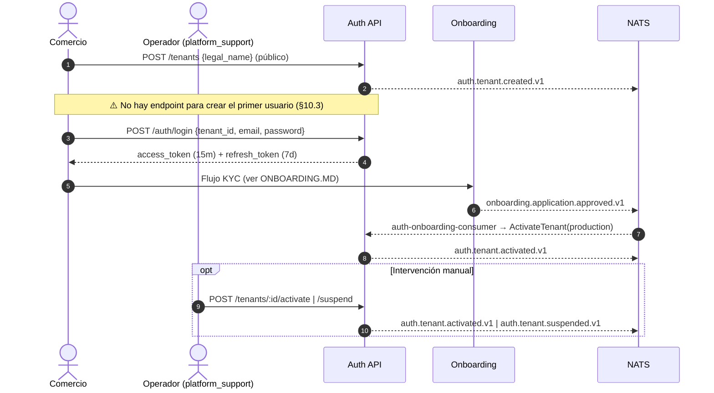
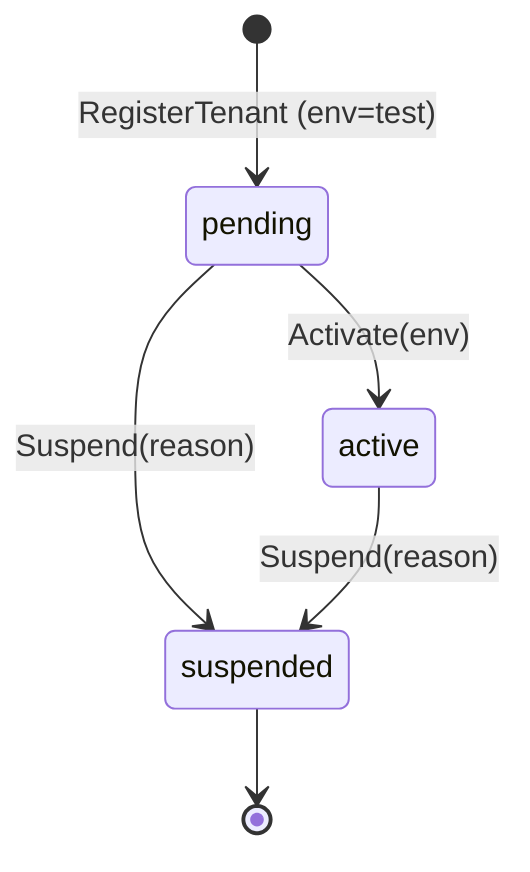
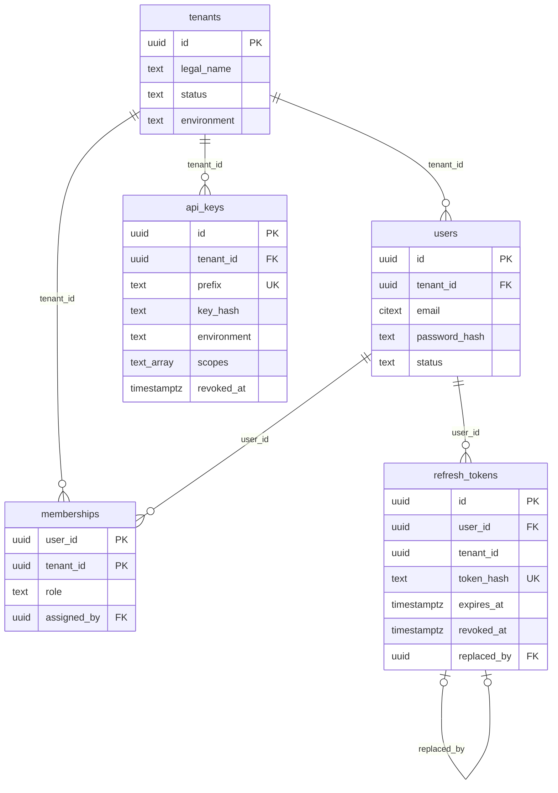

# Auth & Multi-Tenant — Documentación técnico-funcional

> **Bounded Context:** `context/auth`
> **Migración:** [`000002_auth_init`](../../migrations/000002_auth_init.up.sql)
> **Stream NATS:** `AUTH` (`auth.>`)

---

## 1. Propósito

Auth es la **raíz del multi-tenant** de la plataforma. Gestiona:

- El ciclo de vida del **comercio** (`Tenant`): alta, activación y suspensión.
- Los **usuarios** de cada comercio y su **rol** (RBAC).
- La **autenticación** interactiva (JWT de acceso + refresh token con rotación).
- Las **API keys** para integraciones server-to-server.
- La **propagación del tenant** al resto del sistema: el `JWTMiddleware` pone el `tenant_id` en el `context.Context`, y el `TxManager` lo usa para configurar el RLS de PostgreSQL en todos los BCs.

Todos los demás contextos dependen de Auth para saber "quién es el tenant" de un request. Ninguno consulta el estado del tenant por su cuenta (ver §10).

### Fuera de alcance (hoy)

- Alta del primer usuario de un tenant (ver §10, punto 3).
- Recuperación o cambio de contraseña, verificación de email y MFA.
- Gestión de usuarios: listar, suspender o borrar (el dominio tiene `User.Suspend()` pero no hay caso de uso).
- Usuarios en varios tenants: el modelo de `Membership` lo contempla, pero `users.tenant_id` ata cada usuario a un único tenant.

---

## 2. Lenguaje ubicuo

| Término | Significado |
|---|---|
| **Tenant** | Comercio cliente de la plataforma. Unidad de aislamiento de datos. |
| **Ambiente** (`Environment`) | `test` o `production`. Solo `active` + `production` puede mover dinero real (`CanProcessRealPayments`). |
| **Usuario** (`User`) | Persona con credenciales (email + contraseña) dentro de **un** tenant. |
| **Membership** | Vínculo usuario ↔ tenant ↔ rol. |
| **Rol** | `admin`, `operator`, `accountant`, `read_only`, `platform_support`, `compliance_officer`. |
| **`platform_support`** | Rol "interno" del operador de la plataforma, que actúa sobre cualquier tenant. No se puede otorgar desde la API (`Role.IsTenantAssignable()`): se provisiona por fuera. |
| **`compliance_officer`** | Rol interno de la plataforma: analista de cumplimiento que revisa alertas AML de todos los comercios (four-eyes, ver [COMPLIANCE.md](COMPLIANCE.md)). Igual que `platform_support`, no es asignable desde un tenant. No tiene permisos de la matriz de tenant. |
| **Hold de cumplimiento** | Bloqueo preventivo y reversible de cobros y payouts por `(tenant, alerta)`, en `tenant_compliance_holds`. No cambia `tenants.status`. |
| **Access token** | JWT HS256 de 15 minutos con `sub`, `tid`, `role` y `env`. |
| **Refresh token** | Secreto opaco de 7 días, guardado como SHA-256, que se rota en cada uso. |
| **API key** | Credencial server-to-server `<env>_<prefix>_<secret>` con scopes. |
| **Scope** | Permiso de una API key: `payments:write`, `payments:read`, `webhooks:write`, `reports:read`. |

---

## 3. Flujo funcional

### 3.1 Ciclo de vida de un comercio



### 3.2 Autenticación de un request

| Mecanismo | Header | Dónde se usa |
|---|---|---|
| JWT | `Authorization: Bearer <jwt>` | Todas las rutas protegidas de todos los BCs (`protected` en `cmd/api`). |
| API key | `X-Api-Key: <env>_<prefix>_<secret>` | Rutas montadas con `JWTOrApiKeyMiddleware`: hoy **`/api/v1/payments`**. El grupo `/api/v1/integrations` sigue vacío. |

El `JWTMiddleware` **no consulta la base**: valida firma y expiración y confía en los claims. Por eso un cambio de rol o una suspensión recién se refleja cuando el usuario obtiene un token nuevo (hasta 15 minutos después).

---

## 4. Modelo de dominio

### 4.1 Agregado `Tenant`

Archivo: [domain/tenant.go](../../context/auth/domain/tenant.go)

| Campo | Notas |
|---|---|
| `id` | UUID generado en el alta. |
| `legalName` | Obligatorio (`ErrEmptyLegalName`). |
| `status` | `pending` → `active` / `suspended`. |
| `environment` | Nace en `test`; se define al activar. |



- `Activate` **solo desde `pending`**. No existe la transición `active(test)` → `active(production)` ni la reactivación de un tenant suspendido.
- `Suspend` desde cualquier estado excepto `suspended`.
- `IsActive()` = `status == active`. `CanProcessRealPayments()` = `active && production`.

### 4.2 Agregado `User`

Archivo: [domain/user.go](../../context/auth/domain/user.go)

- Pertenece a **un** tenant (`tenantID`).
- `email` (VO `Email`): se guarda en minúsculas y sin espacios, y debe tener `@` y un dominio con punto. En DB es `CITEXT` y es único por tenant.
- `passwordHash`: nunca vacío. El hash lo calcula el caso de uso con el puerto `PasswordHasher`.
- `status`: `active` | `suspended`. Un usuario suspendido no puede autenticarse (`CanAuthenticate`).
- `Suspend()` y `UpdatePasswordHash()` existen en el dominio pero **ningún caso de uso los usa**.

### 4.3 Entidad `Membership` y permisos

Archivo: [domain/membership.go](../../context/auth/domain/membership.go)

Clave `(user_id, tenant_id)` con `role` y `assignedBy`. Define una matriz de permisos por acción:

| Acción | admin | operator | accountant | read_only | platform_support |
|---|:-:|:-:|:-:|:-:|:-:|
| `users:manage` | ✅ | | | | ✅ |
| `apikeys:manage` | ✅ | | | | |
| `payments:create` | ✅ | ✅ | | | |
| `payments:read` | ✅ | ✅ | ✅ | ✅ | ✅ |
| `payments:refund` | ✅ | | | | |
| `reports:read` | ✅ | | ✅ | ✅ | ✅ |
| `webhooks:manage` | ✅ | | | | |

La matriz se consulta con `RoleHasPermission(role, action)`, que usa el middleware `RequirePermission` (§6.7). Hoy la aplican **Payments** (cobrar, consultar, reembolsar). Las rutas de Auth usan `RequireRole`, y Onboarding y Ledger usan `RequireRole(platform_support)` en sus escrituras. Los demás BCs todavía no aplican control por rol.

### 4.4 Agregado `ApiKey`

Archivo: [domain/apikey.go](../../context/auth/domain/apikey.go)

```
<env>_<prefix>_<secret>
test_Xk3mPQrS_Xk3mPQrS7fGhJ9kLpQrStUvWxYzAb12
      └prefix┘ └──────── secret (32 chars base62) ───────┘
```

- `secret`: 32 caracteres base62 generados con `crypto/rand`. `prefix` son sus **primeros 8 caracteres**.
- Se persiste `prefix` (único global) y `key_hash` = Argon2id(secret). La key completa **solo se devuelve al emitirla**.
- Requiere `name` y al menos un `scope`.
- `Revoke()` es definitivo (`ErrApiKeyAlreadyRevoked` si se repite).
- Los scopes se aplican vía `RequirePermission` (§6.7). Hoy los usan las rutas de Payments.

### 4.5 Refresh token (artefacto de aplicación)

Archivo: [application/token.go](../../context/auth/application/token.go)

No es un agregado: es un registro en `refresh_tokens` con `token_hash` (SHA-256 hex, determinístico, para poder buscar por igualdad), `expires_at` (emisión + 7 días), `revoked_at` y `replaced_by` (el token sucesor tras la rotación).

### 4.6 Value Objects y errores

Archivos: [domain/vo.go](../../context/auth/domain/vo.go), [domain/errors.go](../../context/auth/domain/errors.go)

| Error | HTTP |
|---|---|
| `ErrInvalidEmail`, `ErrInvalidRole`, `ErrInvalidEnvironment`, `ErrInvalidID`, `ErrEmptyLegalName`, `ErrEmptyPassword` | 400 |
| `ErrInvalidCredentials`, `ErrApiKeyRevoked` | 401 |
| `ErrTenantSuspended`, `ErrUserSuspended`, `ErrTenantNotActive`, `ErrRoleNotAssignable` | 403 |
| `ErrTenantNotFound`, `ErrUserNotFound`, `ErrApiKeyNotFound`, `ErrMembershipNotFound` | 404 |
| `ErrEmailAlreadyExists`, `ErrApiKeyAlreadyRevoked` | 409 |
| `ErrTenantCannotTransition` | 422 |
| Cualquier otro (incluye errores con `fmt.Errorf` sin tipar) | 500 |

---

## 5. Casos de uso

Directorio: [application/](../../context/auth/application/)

| Caso de uso | Precondiciones | Efecto | Evento |
|---|---|---|---|
| `RegisterTenant` | `legal_name` no vacío | Tenant `pending` / `test` | `auth.tenant.created.v1` |
| `ActivateTenant` | Tenant `pending`; env válido | `active` + env | `auth.tenant.activated.v1` |
| `SuspendTenant` | Motivo no vacío; tenant no suspendido | `suspended` | `auth.tenant.suspended.v1` |
| `RegisterUser` | Tenant existe y **no** suspendido (puede estar `pending`); email válido; password no vacío; rol válido y asignable por el tenant (no `platform_support` ni `compliance_officer`) | User `active` + Membership | `auth.user.registered.v1` |
| `AssignRole` | Tenant **activo**; el usuario pertenece al tenant; rol asignable por el tenant (no `platform_support` ni `compliance_officer`) | Crea o actualiza la Membership | `auth.role.assigned.v1` |
| `Authenticate` | Tenant no suspendido; usuario activo; password correcto; membership existente | Access + refresh token | — |
| `RefreshToken` | Token vigente y no revocado; usuario y tenant OK | Nuevo par; revoca el anterior (`replaced_by`) | — |
| `Logout` | — (idempotente) | Revoca el refresh token | — |
| `IssueApiKey` | Tenant **activo**; para `production`, el tenant debe estar en `production`; ≥1 scope válido | API key nueva | `auth.apikey.issued.v1` |
| `RevokeApiKey` | La key pertenece al tenant del caller | Revocada | `auth.apikey.revoked.v1` |
| `PlaceComplianceHold` | `compliance.sanction.matched.v1` | Hold vigente `(tenant, alerta)`; idempotente | — (anti tipping-off) |
| `ReleaseComplianceHold` | `compliance.sanction.cleared.v1` | `released_at` del hold; tolera llegar antes que el place | — |
| `SuspendForCompliance` | `compliance.sanction.confirmed.v1` | `SuspendTenant` con `ComplianceReviewReason` (genérico); ya suspendido = no-op | `auth.tenant.suspended.v1` |

Detalles relevantes:

- **Transacciones:** los comandos que mutan agregados usan `RunInTx { repo.Save/Update; publisher.Publish }` (Outbox). `Authenticate`, `RefreshToken` y `Logout` **no** usan transacción: escriben directo al pool.
- **Hash fuera de la tx:** `RegisterUser` e `IssueApiKey` calculan Argon2 (~80 ms) antes de abrir la transacción.
- **Anti-enumeración en login:** email inexistente o tenant inexistente → `ErrInvalidCredentials`. Pero un tenant suspendido (403) o un usuario suspendido (403) se informan **antes** de verificar la contraseña.
- **`RegisterUser` no publica `RoleAssigned`:** el rol inicial queda registrado solo en `user.registered.v1`, que no incluye el rol.

---

## 6. API HTTP

Directorio: [infrastructure/adapters/inbound/http/](../../context/auth/infrastructure/adapters/inbound/http/) · Router: [router.go](../../context/auth/infrastructure/adapters/inbound/http/router.go)

| Método | Ruta | Auth | Rol | Éxito |
|---|---|---|---|---|
| `GET` | `/health` | — | — | `200 {"status":"ok"}` |
| `POST` | `/api/v1/tenants` | **Pública** | — | `201 {"tenant_id"}` |
| `POST` | `/api/v1/auth/login` | Pública | — | `200 tokenResponse` |
| `POST` | `/api/v1/auth/refresh` | Pública | — | `200 tokenResponse` |
| `POST` | `/api/v1/auth/logout` | Pública | — | `204` |
| `POST` | `/api/v1/tenants/:tenantID/users` | JWT | `admin`, `platform_support` | `201 {"user_id"}` |
| `PUT` | `/api/v1/tenants/:tenantID/members/:userID/role` | JWT | `admin`, `platform_support` | `204` |
| `POST` | `/api/v1/tenants/:tenantID/api-keys` | JWT | `admin`, `platform_support` | `201` |
| `DELETE` | `/api/v1/tenants/:tenantID/api-keys/:keyID` | JWT | `admin`, `platform_support` | `204` |
| `POST` | `/api/v1/tenants/:tenantID/activate` | JWT | `platform_support` | `204` |
| `POST` | `/api/v1/tenants/:tenantID/suspend` | JWT | `platform_support` | `204` |

Reglas transversales:

- En las rutas de usuarios y API keys, el handler exige `:tenantID == claims.tid`. Si no coincide → `403`. Esto aplica **también a `platform_support`**, que entonces solo puede gestionar usuarios y keys de su propio tenant.
- `activate` y `suspend` **no** comparan `:tenantID` con el token: actúan sobre cualquier tenant.
- Todo request recibe o propaga `X-Correlation-ID` (`CorrelationIDMiddleware`).
- Un body inválido o al que le falta un campo `required` → `400 {"error":"invalid request body"}`.

### 6.1 Login — `POST /api/v1/auth/login`

```json
{ "tenant_id": "a2b4c6d8-…", "email": "admin@elsol.com.ar", "password": "••••••" }
```

```json
{
  "access_token": "eyJhbGciOiJIUzI1NiIs…",
  "refresh_token": "q2V9…base64url…",
  "expires_in": 900,
  "token_type": "Bearer"
}
```

El cliente debe conocer el `tenant_id` (UUID): no hay login solo por email.

Claims del JWT:

```json
{ "sub": "<user_id>", "tid": "<tenant_id>", "role": "admin", "env": "test",
  "iat": 1761480000, "exp": 1761480900, "jti": "<uuid>" }
```

### 6.2 Refresh / Logout

```json
{ "refresh_token": "q2V9…" }
```

El refresh devuelve un par nuevo y revoca el token presentado (`replaced_by`). Si se reusa un token ya rotado, responde `401`. El logout es idempotente.

### 6.3 Registrar usuario — `POST /api/v1/tenants/:tenantID/users`

```json
{ "email": "contador@elsol.com.ar", "password": "••••••", "role": "accountant" }
```

No hay política de contraseñas (longitud ni complejidad): solo que no sea vacía. `role: "platform_support"` → `403 role cannot be assigned by a tenant`.

### 6.4 Asignar rol — `PUT /api/v1/tenants/:tenantID/members/:userID/role`

```json
{ "role": "operator" }
```

Requiere el tenant `active`. Tampoco acepta `platform_support` (→ `403`).

### 6.5 Emitir API key — `POST /api/v1/tenants/:tenantID/api-keys`

```json
{ "name": "Integración WooCommerce", "environment": "test", "scopes": ["payments:write", "payments:read"] }
```

```json
{ "api_key_id": "…", "full_key": "test_Xk3mPQrS_Xk3mPQrS7fGh…", "prefix": "Xk3mPQrS" }
```

Errores particulares:

- Tenant no activo → `403`.
- Key de `production` en un tenant `test` → **500**: el error es un `fmt.Errorf` no tipado.
- Scope inválido → **500**, por el mismo motivo.

### 6.6 Activar / suspender — `POST /api/v1/tenants/:tenantID/activate | /suspend`

```json
{ "environment": "production" }
{ "reason": "Contracargos por encima del umbral" }
```

### 6.7 Middlewares para otros BCs

| Middleware | Qué hace |
|---|---|
| `JWTMiddleware` | Bearer JWT → claims (`sub`, `tid`, `role`, `env`) + tenant y actor en el contexto. |
| `ApiKeyMiddleware` | `X-Api-Key` → claims de integración (`TenantID`, `Environment`, `ApiKeyID`, `Scopes`; sin `UserID` ni `Role`) + tenant y actor `apikey:<id>`. Sin header, deja pasar. |
| `JWTOrApiKeyMiddleware` | Si viene `X-Api-Key` autentica con la key (una key inválida da 401, sin caer al JWT). Si no, con el JWT. |
| `RequireRole(roles…)` | El rol del JWT debe estar en la lista. |
| `RequirePermission(acción, scopes…)` | JWT: `RoleHasPermission(rol, acción)`. API key: tener al menos uno de los scopes; sin scopes, la ruta es solo para usuarios. |

---

## 7. Eventos de dominio

Archivo: [domain/events.go](../../context/auth/domain/events.go). Se publican por Outbox en el stream `AUTH` con los headers estándar (`Nats-Msg-Id`, `event-type`, `content-type` y `occurred-at`; ver ONBOARDING.MD §7).

| Subject | Payload | Emitido por |
|---|---|---|
| `auth.tenant.created.v1` | `tenant_id`, `legal_name` | `RegisterTenant` |
| `auth.tenant.activated.v1` | `tenant_id`, `environment` | `ActivateTenant` (HTTP o consumer) |
| `auth.tenant.suspended.v1` | `tenant_id`, `reason` | `SuspendTenant` |
| `auth.user.registered.v1` | `tenant_id`, `user_id`, `email` | `RegisterUser` |
| `auth.user.suspended.v1` | `tenant_id`, `user_id` | **Nunca** (no hay caso de uso) |
| `auth.apikey.issued.v1` | `tenant_id`, `api_key_id`, `prefix`, `environment` | `IssueApiKey` |
| `auth.apikey.revoked.v1` | `tenant_id`, `api_key_id` | `RevokeApiKey` |
| `auth.role.assigned.v1` | `tenant_id`, `user_id`, `role`, `assigned_by` | `AssignRole` |

### 7.1 Consumidores de eventos de Auth

| Consumidor | Filtro | Acción |
|---|---|---|
| **Audit** | `auth.>` | Registra cada evento en la bitácora encadenada. |
| **Notification** | `auth.tenant.suspended.>` | Email de suspensión al comercio. |
| **Webhook** | `auth.tenant.>` | Entrega a los endpoints del comercio. |

> Ningún BC de negocio (Payment, Payout, Ledger, etc.) reacciona a `auth.tenant.suspended.v1` ni consulta `tenants.status`. Un tenant suspendido sigue operando con los tokens y API keys vigentes.

### 7.2 Eventos que consume Auth

| Durable | Filtro | Acción | Archivo |
|---|---|---|---|
| `auth-onboarding-consumer` | `onboarding.application.approved.v1` | `ActivateTenant{env: production}` | [onboarding_consumer.go](../../context/auth/infrastructure/adapters/inbound/nats/onboarding_consumer.go) |
| `auth-compliance-consumer` | `compliance.sanction.>` (stream `COMPLIANCE`) | `matched` → `PlaceComplianceHold`; `cleared` → `ReleaseComplianceHold`; `confirmed` → `SuspendForCompliance`. `MaxDeliver: 10`. | [compliance_consumer.go](../../context/auth/infrastructure/adapters/inbound/nats/compliance_consumer.go) |

**Anti tipping-off:** Webhook reenvía `auth.tenant.>` al endpoint del
comercio, por eso el hold **no** emite eventos de Auth y la suspensión por
cumplimiento usa el motivo genérico `domain.ComplianceReviewReason`. Los gates
que leen el hold (Payment `StatusGate`, Payout `PayoutGate`) responden con el
mismo error que para cualquier tenant inhabilitado.

`MaxDeliver: 5`. Si el tenant no está `pending` (por ejemplo, un operador ya lo activó en `test`), `Activate` falla con `ErrTenantCannotTransition` en los 5 intentos y el mensaje se descarta: **el tenant queda en `test` aunque el KYC esté aprobado**, mientras Ledger sí crea sus cuentas.

---

## 8. Persistencia

Archivo: [migrations/000002_auth_init.up.sql](../../migrations/000002_auth_init.up.sql)



| Tabla | RLS | Aislamiento |
|---|---|---|
| `tenants` | No | Raíz del sistema. |
| `users` | Sí | `UNIQUE(tenant_id, email)` con `CITEXT`. |
| `memberships` | Sí | PK `(user_id, tenant_id)`; `Save` usa `ON CONFLICT DO NOTHING`. |
| `api_keys` | No | `prefix` único global (se busca sin tenant); el aislamiento se hace en código. |
| `refresh_tokens` | No | Se busca por `token_hash` global. |
| `tenant_compliance_holds` | No | PK `(tenant_id, alert_id)`, FK a `tenants` con `ON DELETE CASCADE`; vigente = `released_at IS NULL` (índice parcial). Lo leen los gates de Payment y Payout. Migración 000020. |

La violación de `UNIQUE(tenant_id, email)` (`23505`) se mapea a `ErrEmailAlreadyExists` → `409`.

### 8.1 Credenciales y criptografía

| Elemento | Algoritmo | Archivo |
|---|---|---|
| Passwords y secretos de API key | Argon2id `m=64MiB, t=3, p=2`, salt aleatorio de 16 B, salida PHC | [argon2_hasher.go](../../context/auth/infrastructure/adapters/outbound/crypto/argon2_hasher.go) |
| Access token | JWT HS256, secret ≥ 32 caracteres (`JWT_SECRET`), TTL 15 min | [jwt_issuer.go](../../context/auth/infrastructure/adapters/outbound/token/jwt_issuer.go) |
| Refresh token | 32 B de `crypto/rand` en base64url; se persiste `SHA-256(raw)` en hex. Al ser un secreto aleatorio de 256 bits no necesita un KDF lento ni salt, y el hash determinístico permite buscarlo por igualdad. | `JWTIssuer.IssueRefreshToken`, `hashRefreshToken` en [application/crypto.go](../../context/auth/application/crypto.go) |
| Secreto de API key | 32 caracteres base62 de `crypto/rand` (con un sesgo de módulo leve, documentado) | [application/crypto.go](../../context/auth/application/crypto.go) |

---

## 9. Multi-tenancy (cómo usan Auth los demás BCs)

```
Request ─► CorrelationIDMiddleware ─► JWTMiddleware
                                        ├─ postgres.WithTenantID(ctx, claims.tid)
                                        ├─ postgres.WithActor(ctx, claims.sub)
                                        └─ c.Set("auth_claims", claims)
        ─► handler ─► caso de uso ─► TxManager.RunInTx
                                        └─ SELECT set_config('app.current_tenant', tid, true)
```

- Los handlers de otros BCs obtienen el tenant con `postgres.TenantIDFromContext(ctx)`.
- El RLS solo se aplica dentro de `RunInTx` y siempre que el rol de DB no lo saltee. La app conecta como `cobros`, owner de las tablas y sin `FORCE ROW LEVEL SECURITY`, así que **hoy el RLS no filtra nada**. El aislamiento real depende de que cada query filtre por `tenant_id` (ver ONBOARDING.MD §10.2).

---

## 10. Limitaciones conocidas y deuda técnica

| # | Tema | Detalle | Impacto |
|---|---|---|---|
| 1 | ~~Refresh y logout rotos~~ ✅ **Resuelto** | Se buscaba por un hash Argon2 con salt aleatorio, que nunca coincidía. Ahora se usa `hashRefreshToken` (SHA-256 determinístico), y `RefreshToken`/`Logout` ya no dependen del `PasswordHasher`. Los tokens guardados con el esquema anterior quedan inválidos: los usuarios deben volver a loguearse. El comentario de `token_hash` en la migración `000002` sigue diciendo argon2id (no se editan migraciones aplicadas). | — |
| 2 | ~~Escalada a `platform_support`~~ ✅ **Resuelto** | `RegisterUser` y `AssignRole` rechazan `platform_support` con `ErrRoleNotAssignable` (403). Contrapartida: no hay forma de crear usuarios `platform_support` por API; se provisionan por fuera, igual que el primer usuario (#3). | — |
| 3 | No hay alta del primer usuario | `POST /tenants` es público pero no crea usuario, y `POST /tenants/:id/users` requiere un JWT admin de ese tenant. Un comercio recién registrado no puede loguearse. No hay seed ni bootstrap en el repo. | **Alto (funcional)** |
| 4 | Suspensión sin efecto operativo | El JWT no consulta el estado del tenant (vale hasta 15 min), `ApiKeyMiddleware` tampoco, y ningún BC reacciona a `auth.tenant.suspended.v1`. | Alto |
| 5 | API keys — uso parcial | Ya se usan en Payments, con scopes vía `RequirePermission`. Pendiente: `ApiKeyMiddleware` no verifica que el `<env>` de la key coincida con el guardado, ni el estado del tenant (Payments lo cubre con su `TenantGate`). | Medio |
| 6 | RBAC parcial | `RequirePermission` aplica la matriz en Payments; Onboarding y Ledger exigen `platform_support` en sus escrituras. El resto de los BCs de negocio todavía no aplica control por rol. | Medio |
| 7 | Transiciones de tenant incompletas | No hay `test → production` ni reactivación desde `suspended`. Combinado con el consumer de onboarding (§7.2), una activación manual previa en `test` bloquea el pase a producción. | Medio |
| 8 | Errores no tipados → 500 | Scope inválido, key `production` en tenant `test`, `suspension reason is required`, `api key name is required`. | Bajo |
| 9 | Enumeración en login | Tenant o usuario suspendido devuelven 403 antes de verificar la contraseña. Un email inexistente responde más rápido, porque no corre Argon2 (timing). | Bajo |
| 10 | Refresh sin atomicidad ni detección de reuso | `Save` del nuevo token y `Revoke` del anterior no son transaccionales. Ante el reuso de un token revocado solo se rechaza; no se revoca la familia. | Bajo (bloqueado por #1) |
| 11 | Sin gestión de usuarios | No hay listar, suspender ni cambiar password; `auth.user.suspended.v1` nunca se emite; `SuspendUserCmd` está sin uso. | Funcional |
| 12 | Sin política de contraseñas | Solo se exige que no sea vacía. | Medio |
| 13 | Rol inicial no auditado | `RegisterUser` no emite `auth.role.assigned.v1`, así que Audit no registra el rol inicial. | Bajo |

---

## 11. Testing

| Capa | Archivos | Tipo |
|---|---|---|
| Dominio | `domain/*_test.go` | Unitarios: FSM de Tenant, User, ApiKey, VOs, eventos, permisos. |
| Aplicación | `application/*_test.go` (+ `mocks_test.go`) | Unitarios con repos, hasher y token issuer falsos. `TestHashRefreshToken_IsDeterministic` cubre la regresión del bug #1. |
| HTTP | `infrastructure/adapters/inbound/http/*_test.go` | Handlers, middleware (JWT, ApiKey, RequireRole), guards de tenant, router y mapeo de errores. |
| NATS | `inbound/nats/onboarding_consumer_test.go`, `compliance_consumer_test.go` | Consumer de aprobación de onboarding; enforcement de cumplimiento (hold, release, suspensión genérica, acks/naks). |
| Crypto / Token | `outbound/crypto`, `outbound/token` | Argon2 real y JWT real. |
| Postgres | `outbound/postgres/*_test.go` | Integración contra PostgreSQL (`DATABASE_URL`); se saltan si no hay DB. `compliance_hold_repo_mock_test.go` usa pgxmock (SQL idempotente). |

```bash
go test ./context/auth/...
```

Pendiente: un test de integración login → refresh → logout contra PostgreSQL real.

---

## 12. Mapa de código

```
context/auth/
├── domain/
│   ├── tenant.go          # Agregado Tenant + FSM
│   ├── user.go            # Agregado User
│   ├── membership.go      # Membership + matriz de permisos (sin uso)
│   ├── apikey.go          # Agregado ApiKey + ParseRawApiKey
│   ├── vo.go              # IDs, Email, Role, Environment, Scope
│   ├── events.go          # 8 eventos
│   └── errors.go
├── application/
│   ├── ports.go           # Repos, PasswordHasher, TokenIssuer, EventPublisher, Clock
│   ├── token.go           # AccessTokenClaims, RefreshToken, TokenPair
│   ├── commands.go
│   ├── crypto.go          # generateSecret (base62)
│   └── <caso_de_uso>.go   # 10 casos de uso (Logout vive en refresh_token.go)
└── infrastructure/adapters/
    ├── inbound/http/      # router, middleware (JWT, ApiKey, RequireRole, CorrelationID), handlers, response
    ├── inbound/nats/      # OnboardingConsumer, ComplianceConsumer
    └── outbound/
        ├── postgres/      # tenant, user, membership, apikey, refresh_token, compliance_hold repos
        ├── crypto/        # Argon2Hasher
        └── token/         # JWTIssuer (HS256)
```

Cableado:

- [cmd/api/main.go](../../cmd/api/main.go): sección `Auth`. Construye el router base sobre el que se montan los demás BCs con `protected := router.Group("/api/v1")` + `JWTMiddleware`.
- [cmd/worker/main.go](../../cmd/worker/main.go): `authOnboardingConsumer`, `authComplianceConsumer`.
