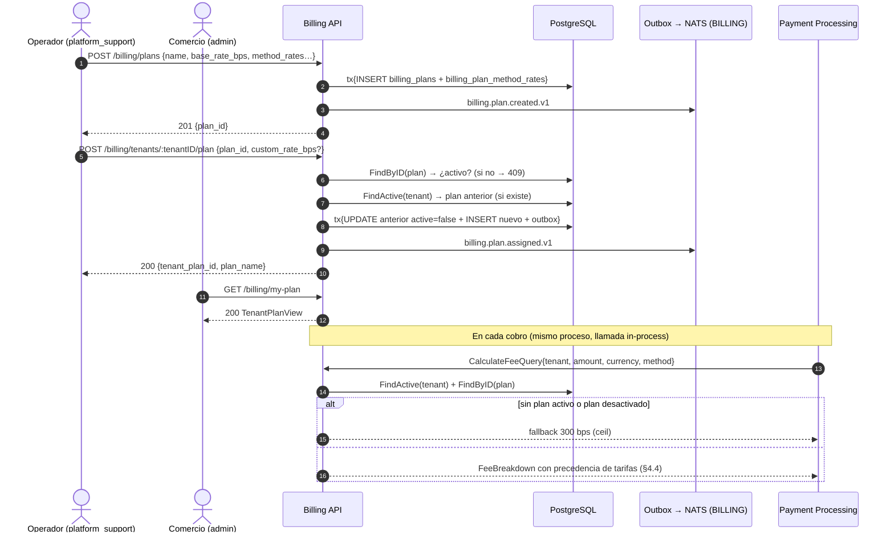

# Billing & Fees — Documentación técnico-funcional

> **Bounded Context:** `context/billing`
> **Migración:** [`000008_billing_init`](../../migrations/000008_billing_init.up.sql)
> **Stream NATS:** `BILLING` (`billing.>`)

---

## 1. Propósito

Billing es el contexto que fija **cuánto cobra la plataforma** por cada transacción. Gestiona:

- El catálogo de **`PricingPlan`** (planes de tarifas): tasa base en basis points, monto fijo, suscripción mensual y overrides por método de pago.
- La **asignación de planes a tenants** (`TenantPlan`), con posibilidad de **tarifas negociadas** individuales.
- El **cálculo determinístico de la comisión** (`CalculateFee`) que consume Payment Processing en cada cobro.

Reemplaza al `FixedRateCalculator` placeholder de la Fase 2: hoy Payment cablea `fees.BillingFeeCalculator`, que delega in-process en `billing.CalculateFeeUseCase` (ver §5.3 y §9).

### Estado actual de las integraciones

| Puerto / dependencia | Implementación cableada | Comentario |
|---|---|---|
| `PlanRepository` | `billingpg.NewPlanRepository(pool)` | Tablas `billing_plans` + `billing_plan_method_rates`. |
| `TenantPlanRepository` | `billingpg.NewTenantPlanRepository(pool)` | Tabla `billing_tenant_plans` con RLS. |
| `EventPublisher` | `outbox.NewEventPublisher[billingdomain.Event]` | Publicación transaccional vía Outbox (stream `BILLING`). |
| `TxManager` | Compartido con el resto de contextos (`cmd/api/main.go`) | Propaga `app.current_tenant` para RLS. |
| Fallback de tarifa | `NewCalculateFeeUseCase(..., 300)` en `cmd/api/main.go` | 300 bps (3.00%) cuando el tenant no tiene plan activo. |

### Fuera de alcance (hoy)

- **Facturación de la suscripción mensual:** `monthly_fee` se almacena y expone, pero no existe caso de uso que la cobre ni la refleje en Ledger.
- **Cambio de tarifa retroactivo:** los pagos ya capturados conservan la comisión con la que se procesaron; no hay recálculo ni notas de crédito de comisiones.
- **Desactivar un plan desde la API:** el dominio tiene `PricingPlan.Deactivate()` y el repo tiene `Update`, pero no hay endpoint ni caso de uso que los invoquen.
- **Historial de asignaciones por API:** `TenantPlanRepository.ListByTenant` existe, pero ningún caso de uso ni ruta lo expone.
- **Consumidores de eventos `billing.*`:** nadie (ni Ledger, ni Reporting, ni Notification, ni Webhook) suscribe `billing.plan.created.v1` ni `billing.plan.assigned.v1`.
- **Overrides por moneda o por volumen** (tarifas escalonadas por tramos).

---

## 2. Lenguaje ubicuo

| Término | Significado |
|---|---|
| **PricingPlan** (`plan`) | Agregado raíz. Define tarifa base (`base_rate_bps` + `base_fixed_amount`), overrides por método y suscripción mensual (`monthly_fee`). Global de la plataforma, sin tenant. |
| **Basis point (bps)** | 1 bps = 0.01 %. Rango válido 0–10000 (0 %–100 %). Toda la aritmética de comisiones usa enteros (`int64`), nunca float. |
| **Method rate** | Override de tarifa para un método de pago concreto dentro de un plan (`card`, `wallet`, `transfer`, `qr`). Reemplaza *ambos* componentes base (tasa y fijo). |
| **TenantPlan** | Asignación de un plan a un tenant, con snapshot del nombre (`plan_name`) y overrides negociados opcionales (`custom_rate_bps`, `custom_fixed_amount`). Solo uno activo por tenant. |
| **Override negociado** | Tarifa personalizada para un tenant específico. Prevalece sobre cualquier tarifa del plan (base o por método). |
| **FeeBreakdown** | Desglose de cómo se calculó una comisión: tasa aplicada, parte proporcional, parte fija, total, plan y flags de override. |
| **Fallback** | Tarifa interna (`FallbackRateBps`, cableado en 300 bps) que aplica cuando el tenant no tiene plan activo o el plan fue desactivado. `PlanID` reportado: `"fallback"`. |
| **`platform_fee`** | Nombre que recibe en Payment/Ledger el resultado de `CalculateFeeResult.FeeAmount`. |

---

## 3. Flujo funcional



---

## 4. Modelo de dominio

### 4.1 Agregado `PricingPlan`

Archivo: [domain/plan.go](../../context/billing/domain/plan.go)

| Campo | Invariantes |
|---|---|
| `id` (`PlanID`) | UUID generado por la aplicación (`NewPlanID`). |
| `name` | No vacío (`ErrPlanNameEmpty`). |
| `baseRateBps` | 0–10000 (`ErrInvalidRateBps`). |
| `baseFixedAmount` | ≥ 0, en centavos (`ErrInvalidFixedAmount`). |
| `methodRates` | `map[PaymentMethod]MethodRate`; cada entrada validada igual que la base (`AddMethodRate`). |
| `monthlyFee` | ≥ 0 (`ErrInvalidMonthlyFee`). Se guarda, no se factura. |
| `currency` | ISO 4217 de 3 letras (`ErrInvalidCurrency`). Un plan es mono-moneda. |
| `active` | `NewPricingPlan` nace activo; `Deactivate()` lo apaga (sin API). |

`NewPricingPlan` registra `PlanCreatedEvent` (evento de plataforma: `tenantID` vacío). `ReconstitutePricingPlan` reconstruye desde persistencia **sin** emitir eventos.

### 4.2 Entidad `TenantPlan`

Archivo: [domain/tenant_plan.go](../../context/billing/domain/tenant_plan.go)

- Referencia al plan (`planID`) + **snapshot** de `planName` al momento de asignar (para reportes históricos aunque el plan cambie o se renombre).
- `customRateBps` / `customFixedAmount`: punteros; `nil` = sin override (la capa HTTP envía `-1` para indicar "sin override"). Validados en el mismo rango que la base.
- Rechaza planes inactivos (`ErrPlanInactive`) al crear la asignación.
- `Deactivate()` fija `active=false` y `validUntil=now()`.
- Registra `PlanAssignedEvent` con el `tenantID`.

### 4.3 Value Objects

Archivo: [domain/vo.go](../../context/billing/domain/vo.go)

| VO | Notas |
|---|---|
| `PlanID`, `TenantPlanID`, `FeeID`, `TenantID` | Wrapper de UUID. `FeeID` está definido pero **sin uso** (no se persisten fee rows). |
| `PaymentMethod` | Duplicado intencionalmente del tipo de Payment para mantener el aislamiento entre contextos: `card`, `wallet`, `transfer`, `qr`. |
| `Money` | Monto en unidades mínimas (centavos) + moneda. `NewMoney` rechaza negativos y monedas ≠ 3 letras. `ReconstituteMoney` evita validación en re-hidratación. |
| `MethodRate` | `{RateBps, FixedAmount}` de un override por método. |
| `FeeBreakdown` | Resultado del cálculo: `RateBpsApplied`, `RateAmount`, `FixedAmount`, `TotalFee Money`, `PlanID`, `MethodOverride bool`. |

### 4.4 Cálculo de comisión — precedencia de tarifas

```
fee = ceil(amount × rate_bps / 10_000) + fixed_amount
```

El `ceil` se implementa con enteros: `(amount×rateBps + 9999) / 10000` — nunca redondea en favor del comercio.

Resolución de `(rate_bps, fixed_amount)`, de mayor a menor precedencia:

| # | Fuente | Efecto |
|---|---|---|
| 1 | `TenantPlan.customRateBps` / `customFixedAmount` | Reemplazan **solo la parte que personalizan**; si solo hay `custom_rate_bps`, el `fixed_amount` sigue viniendo del breakdown del plan. Anula el flag `MethodOverride` (queda `false`). |
| 2 | `PricingPlan.methodRates[method]` | Reemplaza **ambos** componentes base. Marca `MethodOverride=true`. |
| 3 | `PricingPlan.baseRateBps` / `baseFixedAmount` | Tarifa default del plan para todos los métodos. |
| 4 | Fallback interno (`FallbackRateBps`, 300 bps) | Sin plan activo, o plan desactivado después de asignar. `PlanID="fallback"`, `fixed=0`. |

Validaciones previas en `PricingPlan.CalculateFee`: `amount > 0` y **moneda coincidente** (`plan.currency` vs `payment currency`; si no, error → Payment lo trata como fallo de fee).

Ejemplos (plan Pro: base 250 bps + 50 fijo; card 280/50; wallet 200/0):

| Pago | Método | Condición | Comisión |
|---|---|---|---|
| $1.000 (100.000 ¢) | card | sin override → method rate 280 bps + 50 | 280 + 50 = **330 ¢** ($3.30) |
| $1.000 | wallet | sin override → method rate 200 bps + 0 | **200 ¢** ($2.00) |
| $1.000 | card | con `custom_rate_bps=200` → fixed 50 heredado del breakdown | 200 + 50 = **250 ¢** ($2.50) |
| $1.000 | qr | sin method rate → base 250 bps + 50 | 250 + 50 = **300 ¢** ($3.00) |

### 4.5 Errores de dominio

Archivo: [domain/errors.go](../../context/billing/domain/errors.go) — 11 sentinelas:

| Error | Cuándo | HTTP |
|---|---|---|
| `ErrPlanNotFound` | Plan inexistente (repo mapea `pgx.ErrNoRows` a este error) | 404 |
| `ErrTenantPlanNotFound` | Tenant sin plan activo (también es señal de "usar fallback" en `CalculateFee`) | 404 |
| `ErrPlanInactive` | Asignar un plan desactivado | 409 |
| `ErrTenantPlanAlreadySet` | Definido y mapeado a 409, pero **nunca se emite**: `AssignPlan` desactiva el anterior en vez de fallar | 409 |
| `ErrPlanNameEmpty`, `ErrInvalidRateBps`, `ErrInvalidFixedAmount`, `ErrInvalidMonthlyFee`, `ErrInvalidPaymentMethod` | Validaciones de invariantes | 400 |
| `ErrInvalidCurrency` | Moneda ≠ 3 letras (no está en el switch del handler) | 500 ⚠️ debería ser 400 |
| `ErrFeeCalculationInvalid` | Overflow defensivo (`totalFee < 0`); inalcanzable en la práctica | 500 |

### 4.6 Eventos

Archivo: [domain/events.go](../../context/billing/domain/events.go). Se publican **por Outbox** en la misma transacción que la escritura, stream `BILLING`.

| Subject | Emisor | Payload |
|---|---|---|
| `billing.plan.created.v1` | `NewPricingPlan` (vía `CreatePlan`) | `plan_id`, `plan_name`, `rate_bps` (+ `event_id`, `occurred_at`; `tenant_id` vacío: evento de plataforma) |
| `billing.plan.assigned.v1` | `NewTenantPlan` (vía `AssignPlan`) | `tenant_plan_id`, `tenant_id`, `plan_id`, `plan_name` |

Ningún contexto consume estos subjects hoy (§1, fuera de alcance). El worker arranca consumers de otros streams; Billing no aporta ninguno.

---

## 5. Casos de uso

Archivos en [application/](../../context/billing/application). Puertos en `ports.go`: `PlanRepository`, `TenantPlanRepository`, `EventPublisher`, `TxManager`.

### 5.1 `CreatePlan`

`CreatePlanCmd{Name, Description, BaseRateBps, BaseFixedAmount, MonthlyFee, Currency, MethodRates[]}`

1. `domain.NewPricingPlan` valida invariantes y genera el evento.
2. Por cada `MethodRateInput`: `ParsePaymentMethod` + `AddMethodRate` (un método inválido aborta todo: `"method rate %q: …"`).
3. Tx: `planRepo.Save` (insert plan + upsert de method rates) y `publisher.Publish(events)`.

Resultado: `{plan_id}`. No hay deduplicación por nombre: dos planes pueden llamarse igual.

### 5.2 `AssignPlan`

`AssignPlanCmd{TenantID, PlanID, CustomRateBps, CustomFixedAmount, ValidFrom}` (con `-1` = sin override; `ValidFrom` zero → `now()`).

1. Parse de IDs; `planRepo.FindByID` → debe existir y estar activo.
2. `tenantPlanRepo.FindActive(tenant)` captura el plan anterior (si existe).
3. `domain.NewTenantPlan` valida y genera `PlanAssignedEvent`.
4. Tx: desactivar anterior (`Update`: `active=false`, `valid_until=now`) → `Save` del nuevo → publicar evento.

La unicidad "un plan activo por tenant" está además garantizada en BD por el índice parcial único `idx_billing_tenant_plans_active` (una carrera entre dos asignaciones falla por `UNIQUE` → 500).

Resultado: `{tenant_plan_id, plan_name}` (struct sin tags JSON → PascalCase en la respuesta).

### 5.3 `CalculateFee` — el caso de uso central

Entrada: `CalculateFeeQuery{TenantID, Amount, Currency, PaymentMethod}`. Salida: `CalculateFeeResult` con desglose completo (`FeeAmount`, `RateBpsApplied`, `RateAmount`, `FixedAmount`, `PlanID`, `PlanName`, `MethodOverride`, `TenantOverride`).

```
Execute
  ├─ valida tenantID (UUID), método (∈ card|wallet|transfer|qr) y amount > 0
  ├─ TenantPlanRepo.FindActive(tenant)
  │    ├─ ErrTenantPlanNotFound → calculateFallback (300 bps por defecto)
  │    └─ otro error → aborta (Payment reintenta el cobro más tarde)
  ├─ PlanRepo.FindByID(tp.PlanID)
  │    └─ plan inactivo → calculateFallback
  └─ tp.CalculateFee(plan, amount, currency, method) → breakdown → result
```

Detalles:
- `TenantOverride = true` si el tenant tiene cualquiera de los dos customs.
- El constructor normaliza `fallbackRateBps <= 0` a 300.
- Es **lectura pura**: no abre transacción ni publica eventos.
- Payment solo consume `FeeAmount` + `Currency`; el resto del desglose queda disponible para auditoría/reportes futuros.

### 5.4 Consultas: `GetPlan`, `ListPlans`, `GetTenantPlan`

Proyectan `PlanView` / `TenantPlanView` (snake_case en JSON). `PlanView` incluye `base_rate_percent` y `rate_percent` legibles (`formatRatePercent`: 250 → `"2.50%"`). `ListPlans` solo lista planes **activos**, ordenados por nombre. `GetTenantPlan` lee el plan activo del tenant (404 con `ErrTenantPlanNotFound` si no tiene).

---

## 6. API HTTP

Archivo: [billing_handler.go](../../context/billing/infrastructure/adapters/inbound/http/billing_handler.go). Montada en el grupo `/api/v1` con `JWTMiddleware` de Auth.

⚠️ **Estado real del cableado:** `RegisterRoutes(protected, handler)` no añade guards por rol. Las rutas de operador quedan accesibles para **cualquier JWT válido** (el README del contexto documenta `[platform_support]` como intención, aún no implementado). Ver §10.1.

| Método | Ruta | Rol previsto | Éxito |
|---|---|---|---|
| `POST` | `/api/v1/billing/plans` | `platform_support` | `201 {"plan_id": "…"}` |
| `GET` | `/api/v1/billing/plans` | `platform_support` | `200 {"plans":[PlanView…], "count":n}` |
| `GET` | `/api/v1/billing/plans/:planID` | `platform_support` | `200 PlanView` |
| `POST` | `/api/v1/billing/tenants/:tenantID/plan` | `platform_support` | `200 {"TenantPlanID","PlanName"}` (PascalCase ⚠️) |
| `GET` | `/api/v1/billing/my-plan` | `admin` (tenant autenticado) | `200 TenantPlanView` |

### 6.1 Crear plan — `POST /billing/plans`

```json
{
  "name": "Pro",
  "description": "Plan para comercios con alto volumen",
  "base_rate_bps": 250,
  "base_fixed_amount": 0,
  "monthly_fee": 500000,
  "currency": "ARS",
  "method_rates": [
    { "method": "card",   "rate_bps": 280, "fixed_amount": 50 },
    { "method": "wallet", "rate_bps": 200, "fixed_amount": 0  }
  ]
}
```

Requeridos (binding): `name`, `base_rate_bps`, `currency`. ⚠️ `base_rate_bps` con `binding:"required"` rechaza el valor `0` (plan 100 % gratis imposible por API; el dominio sí lo permite).

### 6.2 Asignar plan — `POST /billing/tenants/:tenantID/plan`

```json
{ "plan_id": "…", "custom_rate_bps": 200 }
```

`custom_*` ausentes o `null` = sin override. Respuesta: `{"TenantPlanID":"…","PlanName":"Pro"}`.

### 6.3 Mi plan — `GET /billing/my-plan`

El tenant sale del contexto JWT (`postgres.TenantIDFromContext`). Si nunca se le asignó plan → `404 "tenant has no active pricing plan assigned"`, aunque Payment le esté cobrando con el fallback de 300 bps (inconsistencia percibida, ver §10.4).

### Mapeo de errores (`respondDomainError`)

| Dominio | HTTP |
|---|---|
| `ErrPlanNotFound`, `ErrTenantPlanNotFound` | 404 |
| `ErrPlanInactive`, `ErrTenantPlanAlreadySet` | 409 |
| `ErrInvalidRateBps`, `ErrInvalidFixedAmount`, `ErrInvalidMonthlyFee`, `ErrPlanNameEmpty`, `ErrInvalidPaymentMethod` | 400 |
| Body inválido (binding) | 400 `invalid request body` |
| Resto (incl. `ErrInvalidCurrency`, errores de repo/tx) | 500 `internal server error` |

No hay endpoint de cálculo de fee: `CalculateFee` se expone **solo in-process** a Payment (§9).

---

## 7. Eventos y consumidores

### 7.1 Producidos

| Subject | Trigger | Consumidores actuales |
|---|---|---|
| `billing.plan.created.v1` | `POST /billing/plans` | Ninguno con lógica de negocio. |
| `billing.plan.assigned.v1` | `POST /billing/tenants/:tenantID/plan` | Ninguno. |

Payloads según §4.6; entrega garantizada vía Outbox + relay (`pkg/outbox`), dedupe JetStream por `Nats-Msg-Id`.

### 7.2 Consumidos

Ninguno. Billing no tiene adapters inbound NATS.

### 7.3 Lecturas directas

Ningún contexto lee las tablas `billing_*` directamente. La única integración activa es la llamada in-process de Payment (§9).

---

## 8. Persistencia

Migración [000008_billing_init](../../migrations/000008_billing_init.up.sql):

| Tabla | Propósito | Columnas clave |
|---|---|---|
| `billing_plans` | Catálogo global (**sin RLS**) | `id PK`, `name`, `description`, `base_rate_bps CHECK 0–10000`, `base_fixed_amount ≥0`, `monthly_fee ≥0`, `currency CHAR(3)`, `active`, `created_at`, `updated_at` |
| `billing_plan_method_rates` | Overrides por método | PK compuesto `(plan_id, method)`; `method IN ('card','wallet','transfer','qr')`; FK `ON DELETE CASCADE`; `rate_bps CHECK 0–10000`; `fixed_amount ≥0` |
| `billing_tenant_plans` | Asignaciones (**con RLS** por `tenant_id`) | `id PK`, `tenant_id`, `plan_id FK`, `plan_name` (snapshot), `custom_rate_bps`/`custom_fixed_amount` (nullable, mismos CHECKs), `active`, `valid_from`, `valid_until`, `created_at` |

- **Unicidad funcional:** índice parcial único `ON billing_tenant_plans (tenant_id) WHERE active = true`.
- Índice de historial: `(tenant_id, valid_from DESC)`.
- RLS de `billing_tenant_plans` viaja con `app.current_tenant` que pone el `TxManager` (igual que el resto de contextos; no filtra mientras la app conecte como owner).
- `FindActive` resuelve con `WHERE tenant_id=$1 AND active=true ORDER BY valid_from DESC LIMIT 1`.
- `PlanRepository.Update` reescribe tarifas + `active` + hace **upsert** de method rates (no borra las que faltan: quitar un override requiere UPDATE manual en BD). `TenantPlanRepository.Update` solo toca `active` y `valid_until`.

---

## 9. Integración con Payment Processing

El puerto `FeeCalculator` de Payment se satisface con `fees.BillingFeeCalculator` ([billing_calculator.go](../../context/payment/infrastructure/adapters/outbound/fees/billing_calculator.go)), que arma un `CalculateFeeQuery` con el tenant/monto/moneda/método del pago y devuelve `Money{FeeAmount, Currency}`:

```go
// cmd/api/main.go
calculateFeeUC  := billingapp.NewCalculateFeeUseCase(planRepo, tenantPlanRepo, 300)
feeCalculator   := fees.NewBillingFeeCalculator(calculateFeeUC)
processPayment  := paymentapp.NewProcessPaymentUseCase(..., feeCalculator, ...)
```

Reglas de frontera:

- **Dirección de dependencia:** el adaptador vive en `context/payment` e importa `context/billing/application`. El dominio y application de Payment no conocen Billing; Billing no conoce Payment (duplica `PaymentMethod` a propósito).
- **Síncrono, mismo proceso:** si `CalculateFee` falla (p. ej. mismatch de moneda, error de BD), `ProcessPayment` marca el pago `failed` con error de fee; no hay reintento automático.
- `FixedRateCalculator` (tasa fija global, mínimo de 1 ¢) sigue en el paquete pero **no está cableado**.
- La comisión calculada viaja al Ledger como `platform_fee` dentro de `payment.captured.v1`; Billing no participa del asiento.

---

## 10. Limitaciones conocidas y deuda técnica

| # | Tema | Detalle | Impacto |
|---|---|---|---|
| 1 | **Sin autorización por rol** | `RegisterRoutes` no recibe guards; cualquier tenant autenticado puede crear planes y asignárselos (incluso con `custom_rate_bps: 0`). Debería exigir `platform_support` como Ledger/Onboarding. | **Crítico (dinero)** |
| 2 | Moneda dura | `CalculateFee` exige `currency == plan.currency`. Un tenant con plan ARS que cobre en USD cae en error de dominio → el pago falla (Payment trata el error de fee como rechazo). No hay conversión ni planes multi-moneda. | Alto |
| 3 | `monthly_fee` decorativo | Se crea, se lista, nunca se factura ni impacta Ledger. | Medio (producto) |
| 4 | Fallback silencioso | Sin plan (o plan desactivado) se cobra 300 bps sin alerta ni evento; `my-plan` responde 404 mientras el comercio es facturado igualmente. Un plan desactivado deja de aplicarse **retroactivamente** a nuevas transacciones sin reasignar al tenant. | Medio |
| 5 | Contrato inconsistente | `CreatePlanResult`/`AssignPlanResult` sin tags JSON (PascalCase) vs Views snake_case; `binding:"required"` en `base_rate_bps` impide tasa 0; `ErrInvalidCurrency` termina en 500. | Bajo/Medio |
| 6 | Sin endpoints de gestión | No hay PUT/PATCH de planes, desactivación, listado de asignaciones ni historial (`ListByTenant` sin usar). Corregir una tarifa mal escrita pasa por SQL. | Funcional |
| 7 | `ErrTenantPlanAlreadySet` muerto | Definido y mapeado a 409 pero nunca emitido (la semántica elegida es "reemplazar", no "rechazar"). | Bajo |
| 8 | Method rates sin delete | El upsert del repo nunca elimina overrides retirados del agregado. | Bajo |
| 9 | Sin listados/paginación de asignaciones | Solo lectura del plan activo propio. | Funcional |
| 10 | Campos VOs sin uso | `FeeID`/`NewFeeID` definidos sin tabla ni flujo asociado. | Bajo |

---

## 11. Testing

| Capa | Archivos | Cobertura principal |
|---|---|---|
| Dominio | `plan_test.go`, `tenant_plan_test.go`, `vo_test.go`, `events_test.go` | Invariantes, redondeo ceil, override por método, precedencia de customs, plan mismatch, tipos/timestamps de eventos. |
| Aplicación | `create_plan_test.go`, `assign_plan_test.go`, `calculate_fee_test.go`, `get_plans_test.go` (+ `mocks_test.go`) | Éxito, validaciones, propagación de errores de repo/publisher/tx, desactivación del anterior, fallback por ausencia y por plan inactivo, default 300. |
| HTTP | `billing_handler_test.go` | Happy paths y mapeo 400/404/409 de `respondDomainError`. |
| Postgres | `plan_repo_test.go`, `tenant_plan_repo_test.go` (+ `setup_test.go`) | pgxmock: save/find/update, upsert de method rates on-conflict, scan de NULLs en customs. |
| Cruzado | `context/payment/.../fees/fees_test.go` | `BillingFeeCalculator` con el use case real de Billing + repos fake (camino de fallback). |

```bash
go test ./context/billing/... ./context/payment/...
make test   # go test -race -count=1 ./...
```

Faltan: tests de concurrencia en `AssignPlan` (índice único), mismatch de moneda end-to-end desde Payment, y cualquier prueba de autorización (no existe el guard).

---

## 12. Mapa de código

```
context/billing/
├── domain/
│   ├── plan.go          # Agregado PricingPlan + CalculateFee (ceil, method rates)
│   ├── tenant_plan.go   # TenantPlan + CalculateFee con overrides negociados
│   ├── vo.go            # PlanID, TenantPlanID, FeeID*, Money, PaymentMethod, MethodRate, FeeBreakdown
│   ├── events.go        # billing.plan.created.v1 / billing.plan.assigned.v1
│   └── errors.go        # 11 errores de negocio
├── application/
│   ├── ports.go         # PlanRepository, TenantPlanRepository, EventPublisher, TxManager
│   ├── commands.go      # Cmd/Query DTOs + PlanView, TenantPlanView, CalculateFeeResult
│   ├── create_plan.go
│   ├── assign_plan.go
│   ├── calculate_fee.go # Caso de uso central (fallback 300 bps)
│   └── get_plans.go     # GetPlan, ListPlans, GetTenantPlan
└── infrastructure/adapters/
    ├── inbound/http/billing_handler.go       # 5 rutas + respondDomainError
    └── outbound/postgres/
        ├── plan_repo.go         # billing_plans + billing_plan_method_rates (upsert)
        └── tenant_plan_repo.go  # billing_tenant_plans (FindActive/ListByTenant)

Integración saliente:
context/payment/infrastructure/adapters/outbound/fees/billing_calculator.go  # FeeCalculator → CalculateFeeUseCase
Cableado: cmd/api/main.go, sección "Billing & Fees" (grupo protected, fallback 300 bps)
```
