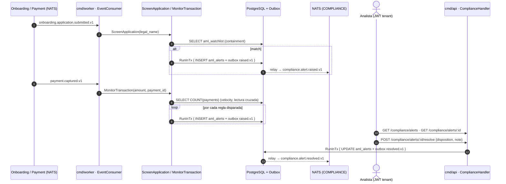
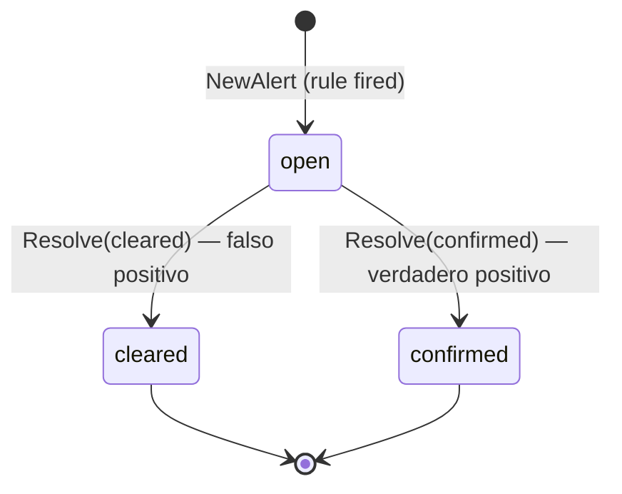
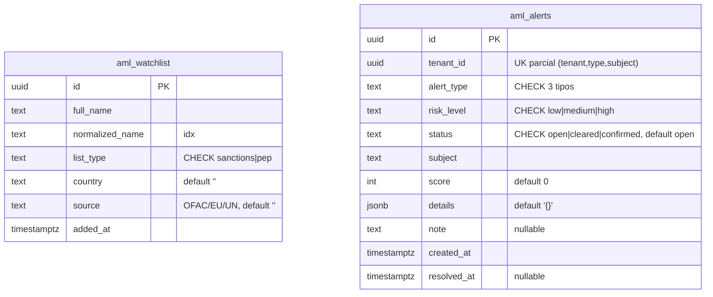

# Compliance & AML — Documentación técnico-funcional

> **Bounded Context:** `context/compliance`
> **Migración:** [`000014_compliance_init`](../../migrations/000014_compliance_init.up.sql)
> **Stream NATS:** `COMPLIANCE` (`compliance.>`)

---

## 1. Propósito

Compliance detecta y registra **señales de riesgo AML** (anti-lavado): screening
de comercios contra listas de vigilancia (sanciones/PEP) y monitoreo
transaccional sobre pagos capturados. El resultado siempre es una **alerta para
revisión manual** de un analista del comercio.

El contexto es **escritura reactiva + consulta/gestión**:

- La *generación* de alertas ocurre en `cmd/worker`, consumiendo eventos de
  otros contextos (Onboarding y Payment). No hay endpoint HTTP que cree alertas.
- La *consulta y disposición* (listar/ver/resolver alertas) y la *gestión de la
  watchlist* ocurren en `cmd/api`.

### Fuera de alcance (hoy)

- **Enforcement automático**: no suspende tenants, no bloquea pagos ni payouts.
  La alerta se *registra*; el evento `compliance.alert.raised.v1` queda disponible
  en el stream `COMPLIANCE` para que otros contextos reaccionen a futuro (p. ej.
  Auth suspendiendo el tenant). Hoy ningún contexto consume esos eventos.
- Listas oficiales reales: la watchlist es una tabla propia sembrada por
  migración con datos de ejemplo; no se integra con OFAC/EU/UN.
- Fuzzy matching / similitud fonética: el match es **containment** exacto sobre
  nombres normalizados (§8.2).

---

## 2. Lenguaje ubicuo

| Término | Significado |
|---|---|
| **Alerta** (`Alert`) | Agregado raíz. Señal de riesgo detectada por una regla. Nace `open`; un analista la dispone. |
| **Watchlist** (`WatchlistEntry`) | Entrada de la lista de vigilancia **global** de la plataforma (sanciones o PEP). |
| **Screening** | Comparar la razón social de un onboarding contra la watchlist. Match → alerta `sanctions_match`. |
| **Monitoreo transaccional** | Evaluar un pago capturado contra las reglas de umbral y velocity. |
| **Subject** | Lo que disparó la alerta: `legal_name` (screening) o `payment_id` (monitoreo). Parte de la clave de idempotencia. |
| **Score** | Puntaje 0..100 de confianza/severidad; mapea a `RiskLevel` (≥90 high, ≥60 medium, resto low). |
| **Disposition** | Decisión del analista sobre una alerta abierta: `cleared` (falso positivo) o `confirmed` (verdadero positivo). |

---

## 3. Actores y flujo funcional



---

## 4. Modelo de dominio

### 4.1 Agregado raíz: `Alert`

Archivo: [domain/alert.go](../../context/compliance/domain/alert.go)

| Campo | Tipo | Notas |
|---|---|---|
| `id` | `AlertID` (UUID) | Generado por el caso de uso (`domain.NewAlertID()`). |
| `tenantID` | `TenantID` (UUID) | Del evento origen (worker) o del JWT (resolver). |
| `alertType` | `AlertType` | `sanctions_match` \| `transaction_threshold` \| `transaction_velocity`. |
| `riskLevel` | `RiskLevel` | `low` \| `medium` \| `high`. |
| `status` | `AlertStatus` | `open` \| `cleared` \| `confirmed`. |
| `subject` | `string` | `legal_name` o `payment_id` que disparó la alerta. Clave de idempotencia junto a `(tenant, tipo)`. |
| `score` | `int` | 0..100. |
| `details` | `map[string]string` | Contexto (lista matched, monto, ventana, etc.). Se persiste como JSONB. |
| `note` | `string` | Nota del analista al disponer (no tiene setter separado: viaja en `Resolve`). |
| `createdAt` / `resolvedAt` | `time.Time` / `*time.Time` | `resolvedAt` se setea solo al resolver. |

API del agregado:

- `NewAlert(...)` → crea en `open` y **registra** `AlertRaisedEvent`.
- `Resolve(status, note, now)` → única mutación posible; exige `open`;
  **registra** `AlertResolvedEvent`.
- `ReconstituteAlert(...)` → reconstrucción desde DB sin eventos.
- `PullEvents()` → drena los eventos pendientes (los casos de uso los publican
  al Outbox dentro de la misma transacción).

### 4.2 Máquina de estados



| Estado | ¿Accesible? | Final |
|---|---|---|
| `open` | única fuente de acción (`POST .../resolve`) | No |
| `cleared` | — | **Sí** |
| `confirmed` | — | **Sí** |

No existe transición `cleared ↔ confirmed` ni reapertura: resolver dos veces
devuelve `ErrAlertNotOpen` → **409**.

### 4.3 Invariantes

1. **Unicidad `(tenant_id, alert_type, subject)`** — garantizada por constraint
   en DB; el repo la traduce a `ErrDuplicateAlert` (§6.5).
2. Una alerta solo puede disponerse desde `open`.
3. `ParseDisposition` acepta únicamente `cleared` o `confirmed`.
4. `score` se calcula por regla (no lo fija el cliente): screening = score del
   mejor match (hoy 90); threshold = escala por ratio monto/umbral (§5.2);
   velocity = fijo 90.

### 4.4 Value Objects y helpers

Archivo: [domain/vo.go](../../context/compliance/domain/vo.go),
[domain/watchlist.go](../../context/compliance/domain/watchlist.go)

| Elemento | Regla |
|---|---|
| `AlertID` / `TenantID` | UUID string; `ParseAlertID` / `ParseTenantID` validan formato. |
| `AlertType` | `sanctions_match`, `transaction_threshold`, `transaction_velocity` (hay `CHECK` en DB). |
| `RiskLevel` | `low`, `medium`, `high`. |
| `AlertStatus` | `open`, `cleared`, `confirmed`. |
| `NormalizeName(s)` | `strings.ToLower(strings.Join(strings.Fields(s), " "))` → minúsculas + espacios colapsados. Se usa al sembrar la watchlist y al evaluar. Idempotente. |
| `RiskFromScore(score)` | `≥90 → high`, `≥60 → medium`, resto `low`. |
| `Match` | `{Entry WatchlistEntry, Score int}` — resultado del screening. |

### 4.5 Errores de dominio

Archivo: [domain/errors.go](../../context/compliance/domain/errors.go)

| Error | Causa | HTTP (handler) |
|---|---|---|
| `ErrAlertNotFound` | Alerta inexistente o de otro tenant | 404 |
| `ErrDuplicateAlert` | Viola `(tenant, tipo, subject)` | n/a — tratado como **no-op** (idempotencia) |
| `ErrAlertNotOpen` | Re-resolver una alerta ya dispuesta | 409 |
| `ErrInvalidDisposition` | Disposición ≠ `cleared`/`confirmed` | 400 |
| Cualquier otro (incl. errores no tipados de parseo de IDs) | — | 400 en Get/Resolve, 500 en List |

---

## 5. Casos de uso

Paquetes: [application/](../../context/compliance/application/)

| Caso de uso | Archivo | Actor/trigger | Resultado | Evento |
|---|---|---|---|---|
| `ScreenApplicationUseCase` | `screen_application.go` | JetStream (`onboarding.application.submitted.v1`) | Si hay match: 1 alerta `sanctions_match` (mejor match) | `raised.v1` |
| `MonitorTransactionUseCase` | `monitor_transaction.go` | JetStream (`payment.captured.v1`) | Hasta 2 alertas independientes (`transaction_threshold`, `transaction_velocity`) | `raised.v1` × N |
| `ResolveAlertUseCase` | `resolve_alert.go` | HTTP (analista) | `cleared`/`confirmed` + nota | `resolved.v1` |
| `ListAlertsUseCase` | `queries.go` | HTTP | `[]AlertView` (limit default 50, máx 200) | — |
| `GetAlertUseCase` | `queries.go` | HTTP | `AlertView` (verifica pertenencia al tenant) | — |
| `AddWatchlistEntryUseCase` | `queries.go` | HTTP | Insert en `aml_watchlist` (global) | — |
| `ListWatchlistUseCase` | `queries.go` | HTTP | `[]WatchlistEntryView` (limit default 100, máx 500) | — |

Puertos ([application/ports.go](../../context/compliance/application/ports.go)):
`AlertRepository`, `WatchlistRepository`, `TransactionReader`, `TxManager`,
`EventPublisher`, `Clock`.

### 5.1 Screening (`ScreenApplication`)

```
1. ParseTenantID(cmd.TenantID)                       → error si no es UUID
2. LegalName == ""                                   → no-op (nil)
3. watchlist.Screen(NormalizeName(LegalName))        → []Match
4. Sin matches                                       → no-op (nil)
5. best = max score entre matches
6. NewAlert(sanctions_match, RiskFromScore(best), subject=LegalName,
            score=best.Score, details={application_id, matched_name,
            list_type, country, source})
7. raiseAlert(...)                                   → tx Save + Publish
```

Una sola alerta por aplicación aunque haya múltiples coincidencias.

### 5.2 Monitoreo transaccional (`MonitorTransaction`)

Reglas configurables vía `MonitoringRules` (inyectado desde `cmd/worker` con
`DefaultMonitoringRules()`):

| Regla | Condición | Alerta | Riesgo | Score |
|---|---|---|---|---|
| Umbral | `Amount ≥ ThresholdAmount` (default `1_000_000` centavos = $10.000) | `transaction_threshold` | `medium` | `riskScoreForAmount`: `60 + (amount/threshold)*10`, tope 100; umbral ≤ 0 → 80 |
| Velocity | `CountCapturedSince(now − VelocityWindow) ≥ VelocityCount` (default 10 pagos / 10 min) | `transaction_velocity` | `high` | 90 fijo |

Detalles persistidos: threshold → `{payment_id, amount, currency, threshold,
payment_method}`; velocity → `{payment_id, count, window, threshold}`.
Subject en ambas: `payment_id`. Ambas reglas pueden dispararse en el mismo pago
(dos alertas distintas).

> La alerta de velocity se genera **por pago**, no una vez por ventana: tras el
> décimo captura, cada pago adicional crea su propia alerta (subject distinto).

### 5.3 Resolución (`ResolveAlert`)

```
1. ParseTenantID / ParseAlertID / ParseDisposition     → 400 si inválidos
2. repo.FindByID(alertID)                              → fuera de tx
3. alert.TenantID() != tenantID                        → ErrAlertNotFound (404)
4. alert.Resolve(status, note, clock.Now())            → ErrAlertNotOpen (409)
5. txManager.RunInTx { repo.Update + publisher.Publish(resolved.v1) }
```

### 5.4 Patrón transaccional e idempotencia

Toda escritura pasa por `raiseAlert` ([application/raise.go](../../context/compliance/application/raise.go)):

```
txManager.RunInTx(ctx, func(ctx) {
    if err := repo.Save(alert); err != nil {
        if errors.Is(err, domain.ErrDuplicateAlert) { return nil }  // no-op
        return err
    }
    return publisher.Publish(alert.PullEvents()...)                 // outbox
})
```

La re-entrega de un evento de JetStream intenta insertar la misma alerta, choca
con la constraint `UNIQUE (tenant_id, alert_type, subject)` (SQLSTATE 23505 →
`ErrDuplicateAlert`) y el caso de uso la descarta **sin publicar el evento de
nuevo**. En el mismo `RunInTx`, `pkg/postgres.TxManager` hace
`set_config('app.current_tenant', …, true)` cuando el ctx trae tenant, activando
RLS en `aml_alerts`.

---

## 6. API HTTP

Archivo: [inbound/http/handler.go](../../context/compliance/infrastructure/adapters/inbound/http/handler.go)
Cableado: [cmd/api/main.go](../../cmd/api/main.go) (sección *Compliance & AML*).

Todas las rutas cuelgan de `/api/v1/compliance` bajo `JWTMiddleware`; el
`tenant_id` se toma del token (`postgres.TenantIDFromContext`), nunca del body.

| Método | Ruta | Descripción | Éxito |
|---|---|---|---|
| `GET` | `/compliance/alerts?status=&limit=` | Alertas del tenant (recientes primero) | `200 {alerts, count}` |
| `GET` | `/compliance/alerts/:alertID` | Detalle de una alerta | `200 AlertView` |
| `POST` | `/compliance/alerts/:alertID/resolve` | Disponer la alerta | `204` |
| `GET` | `/compliance/watchlist?limit=` | Lista global de vigilancia | `200 {watchlist, count}` |
| `POST` | `/compliance/watchlist` | Agregar entrada global | `201` (sin body) |

Parámetros de query: `limit` de `alerts` default 50 (≤0 o >200 → 50); el de
`watchlist` default 100 (≤0 o >500 → 100). `status` filtra por igualdad exacta
(`open`/`cleared`/`confirmed`); cualquier otro valor simplemente no devuelve
filas.

### 6.1 Resolver alerta — `POST /compliance/alerts/:alertID/resolve`

```json
{ "disposition": "confirmed", "note": "Cliente real en lista OFAC" }
```

| Escenario | Respuesta |
|---|---|
| OK | `204` |
| Body JSON inválido | `400 {"error":"invalid request body"}` |
| `disposition` inválida / ID no UUID | `400 {"error": "<err>"}` |
| Alerta inexistente o de otro tenant | `404 {"error":"alert not found"}` |
| Ya resuelta | `409 {"error":"alert already resolved"}` |

### 6.2 Ejemplo de `AlertView`

```json
{
  "id": "3b1c…",
  "tenant_id": "a2b4…",
  "alert_type": "transaction_threshold",
  "risk_level": "medium",
  "status": "open",
  "subject": "9f8e…",
  "score": 70,
  "details": {"payment_id": "9f8e…", "amount": "1500000", "currency": "ARS",
               "threshold": "1000000", "payment_method": "card"},
  "created_at": "2026-10-20T14:03:11Z"
}
```

`details`, `note` y `resolved_at` se omiten cuando están vacíos/nulos.

### 6.3 Watchlist — `POST /compliance/watchlist`

```json
{ "full_name": "Vladimir Petrov", "list_type": "sanctions", "country": "RU", "source": "OFAC" }
```

Requeridos: `full_name`, `list_type`. Sin validación de dominio sobre
`list_type`/`country`/`source` (el `CHECK` de DB solo admite `sanctions|pep`).

> ⚠️ **Gestión global sin control de rol**: estos endpoints están solo detrás
> del JWT genérico (§9).

---

## 7. Eventos de dominio

Archivo: [domain/events.go](../../context/compliance/domain/events.go)

Se publican vía Outbox y el relay de `cmd/worker` los envía al stream
`COMPLIANCE` (`compliance.>`). Metadatos como headers NATS:
`Nats-Msg-Id` = `EventID()` (dedup JetStream), `event-type` = `EventType()`,
`occurred-at` (agregado por el relay).

| Subject | Cuándo | Payload |
|---|---|---|
| `compliance.alert.raised.v1` | Se crea una alerta (screening o monitoreo) | `alert_id`, `tenant_id`, `alert_type`, `risk_level`, `subject`, `score` |
| `compliance.alert.resolved.v1` | Un analista dispone una alerta | `alert_id`, `tenant_id`, `status` (`cleared`\|`confirmed`) |

`OccurredAt()` del evento usa `time.Now().UTC()` interno de `newBase` (no el
`Clock` inyectado).

### 7.1 Consumidores (este BC consume)

Ambos se arrancan en [cmd/worker/main.go](../../cmd/worker/main.go) como
goroutines durables (`Durable = Name`, `MaxDeliver: 5`):

| Consumer | Stream | Filtro | Acción |
|---|---|---|---|
| `compliance-onboarding-consumer` | `ONBOARDING` | `onboarding.application.submitted.>` | `ScreenApplication` |
| `compliance-payment-consumer` | `PAYMENT` | `payment.captured.>` | `MonitorTransaction` |

Manejo de errores en [inbound/nats/event_consumer.go](../../context/compliance/infrastructure/adapters/inbound/nats/event_consumer.go):
payload malformado o sin `tenant_id` → **ack silencioso** (retorna `nil`);
error del caso de uso → log + **nak** (reintento hasta MaxDeliver).

### 7.2 Consumidores de los eventos de Compliance

**Ninguno hoy.** Los streams/consumers de Webhook y Notification no filtran
`compliance.>` (verificado en `cmd/worker`), por lo que los eventos emitidos
quedan disponibles en JetStream pero sin reacciones automáticas — enforcement
pasivo por diseño.

---

## 8. Persistencia

Archivo: [migrations/000014_compliance_init.up.sql](../../migrations/000014_compliance_init.up.sql)

### 8.1 Tablas



Índices: `idx_aml_watchlist_normalized (normalized_name)`,
`idx_aml_alerts_tenant (tenant_id, created_at DESC)`,
`idx_aml_alerts_status (tenant_id, status)`.

RLS: **solo `aml_alerts`** (`ENABLE ROW LEVEL SECURITY` + policy por
`current_setting('app.current_tenant', true)::uuid`). `aml_watchlist` es
global, sin RLS. La migración además **siembra 4 entradas de ejemplo**
(Vladimir Petrov, Ivan Sokolov, Kim Jong Trading Co, Global Shell Holdings).

### 8.2 Queries clave

| Puerto | Query | Notas |
|---|---|---|
| `AlertRepository.Save` | `INSERT INTO aml_alerts …` (11 columnas explícitas) | Usa la conexión del ctx (tx dentro de `RunInTx`). `note` vacío → NULL. `23505` → `ErrDuplicateAlert`. |
| `AlertRepository.Update` | `UPDATE aml_alerts SET status, note, resolved_at WHERE id=$1` | Solo toca los campos de la disposición. |
| `AlertRepository.FindByID` | `SELECT … WHERE id=$1` | `pgx.ErrNoRows` → `ErrAlertNotFound`. |
| `AlertRepository.ListByTenant` | `WHERE tenant_id=$1 [AND status=$2] ORDER BY created_at DESC LIMIT $n` | Corre **sobre el pool directo** (fuera de tx). |
| `WatchlistRepository.Screen` | `SELECT … FROM aml_watchlist WHERE position(normalized_name IN $1) > 0` | **Containment**: la entrada está contenida en el nombre evaluado. Todo match → score 90. |
| `WatchlistRepository.Add/List` | `INSERT …` / `SELECT … ORDER BY full_name LIMIT $1` | Pool directo, sin tenant. |
| `TransactionReader.CountCapturedSince` | `SELECT COUNT(*) FROM payments WHERE tenant_id=$1 AND status='captured' AND captured_at >= $2` | **Lectura cruzada** a la tabla de Payment (misma BD), patrón compartido con reconciliation/notification. Acopla Compliance al esquema `payments`. |

Consecuencias del containment: la entrada `"vladimir petrov"` coincide con el
comercio `"Vladimir Petrov Holdings S.A."` (normalizado), pero **no** con
`"Vladimir Ivanovich Petrov"` (nombre medio interrumpe la cadena) ni con
variantes ortográficas.

---

## 9. Seguridad y multi-tenancy

- **Alertas**: tenant-scoped. `ListByTenant` filtra por `tenant_id` explícito
  (del JWT); `GetAlert`/`ResolveAlert` buscan por `alert_id` y comparan
  `alert.TenantID()` devolviendo 404 ante mismatch (no se filtra por RLS en la
  lectura, que corre fuera de tx).
- **Escrituras** (`Save`/`Update`) corren dentro de `RunInTx`, que setea
  `app.current_tenant` → RLS activo sobre `aml_alerts`.
- **Watchlist**: deliberadamente global (sin `tenant_id`, sin RLS). Su gestión
  HTTP (`GET/POST /compliance/watchlist`) **no exige rol de plataforma**, a
  diferencia de otros módulos que usan `RequireRole(RolePlatformSupport)`.
  Cualquier usuario autenticado puede agregar entradas que afectarán el
  screening de todos los comercios (ver §10.1).
- **Resolución de alertas**: tampoco exige rol; cualquier miembro autenticado
  del tenant puede disponer sus propias alertas (el MVP no modela el rol
  "analista de cumplimiento").

---

## 10. Limitaciones conocidas y deuda técnica

| # | Tema | Detalle | Impacto |
|---|---|---|---|
| 1 | Watchlist editable sin control de rol | `POST /compliance/watchlist` solo requiere JWT; no hay guard `platform_support`. Permite inyectar entradas globales desde cualquier tenant. | **Alto** |
| 2 | Resolución sin rol dedicado | Cualquier usuario del tenant puede marcar `cleared` una alerta (falso positivo) sin segregación de funciones. | Medio |
| 3 | Matching limitado a containment | Sin fuzzy/fonético; variaciones ("Petrov Vladimir", acentos, abreviaturas) pasan de largo. Falsos positivos posibles por substrings casuales. | Medio |
| 4 | Sin enforcement automático | Nadie consume `compliance.alert.raised.v1` (webhook/notification/auth). El evento vive en el stream pero no dispara acciones. | Funcional (por diseño MVP) |
| 5 | Velocity por pago, no por ventana | Tras el umbral, cada pago captura genera una alerta nueva (subject = payment_id). Puede producir ráfagas de alertas en picos legítimos. | Bajo/Medio |
| 6 | Sin métricas monetarias en velocity | La regla cuenta operaciones; no considera montos acumulados en la ventana. | Funcional |
| 7 | Sin concurrencia optimista en resolve | `FindByID` fuera de tx + `UPDATE` sin versión: dos resoluciones simultáneas publican dos `resolved.v1` (last write wins en estado final). | Bajo |
| 8 | Errores no tipados → códigos irregulares | Parseo de `tenant_id` fallido en `ListAlerts` responde 500 (y lista con tenant vacío → 0 filas); `ErrNoRows` no mapeado en otros repos respondería 400 con detalle interno. Con JWT válido no ocurre en práctica. | Bajo |
| 9 | Lectura cruzada acoplada | `TransactionReader` depende del esquema `payments` (`status='captured'`, `captured_at`). Cambios en Payment rompen velocity. | Arquitectura |
| 10 | Sin expiración/rechazo de entradas | `aml_watchlist` no tiene `removed_at`/versionado; borrar requiere SQL directo (no hay endpoint DELETE). | Funcional |
| 11 | Semilla de ejemplo en producción | La migración inserta nombres ficticios; conviene separar la carga real de listas (OFAC/EU/UN) en un proceso aparte. | Operativo |

---

## 11. Testing

| Capa | Archivos | Tipo |
|---|---|---|
| Dominio | `domain/alert_test.go`, `events_test.go`, `vo_test.go`, `watchlist_test.go` | Unitarios: FSM, eventos, parseo de VOs, `NormalizeName`, `RiskFromScore`, `ParseDisposition`. |
| Aplicación | `application/screen_application_test.go`, `monitor_transaction_test.go`, `resolve_alert_test.go`, `queries_test.go` (+ `mocks_test.go`) | Unitarios con puertos en memoria/fake: cubre match único/mejor score, reglas de umbral/velocity, idempotencia `ErrDuplicateAlert`, límites de paginación, mappers. |
| HTTP inbound | `inbound/http/handler_test.go` | Handlers Gin con `httptest` y fakes de puertos; incluye el mapeo de errores a códigos. |
| NATS inbound | `inbound/nats/event_consumer_test.go` | Configs de consumers (stream/filtro/MaxDeliver) y handlers con payloads válidos/malformados y errores nak/ack. |
| Postgres outbound | `outbound/postgres/*_test.go` | **pgxmock** (`github.com/pashagolub/pgxmock/v4`): SQL esperado por operación, scan de alertas, traducción de `23505` → `ErrDuplicateAlert`, containment de `Screen`, `CountCapturedSince`. |

```bash
go test ./context/compliance/...
```

No hay tests de integración contra PostgreSQL real en este BC (todo mock).

---

## 12. Mapa de código

```
context/compliance/
├── domain/
│   ├── alert.go          # Agregado Alert + FSM + PullEvents
│   ├── vo.go             # IDs, AlertType, RiskLevel, AlertStatus, ParseDisposition
│   ├── watchlist.go      # WatchlistEntry, Match, NormalizeName, RiskFromScore
│   ├── events.go         # AlertRaisedEvent, AlertResolvedEvent
│   └── errors.go         # 4 errores sentinela
├── application/
│   ├── ports.go          # TxManager, AlertRepository, WatchlistRepository, TransactionReader, EventPublisher, Clock
│   ├── commands.go       # ScreenApplicationCmd, MonitorTransactionCmd, ResolveAlertCmd, AddWatchlistEntryCmd
│   ├── queries.go        # ListAlerts, GetAlert, Add/ListWatchlist + AlertView/WatchlistEntryView + mapper
│   ├── screen_application.go
│   ├── monitor_transaction.go  # MonitoringRules + DefaultMonitoringRules + riskScoreForAmount
│   ├── resolve_alert.go
│   └── raise.go          # helper tx: Save + Publish, idempotente ante ErrDuplicateAlert
└── infrastructure/adapters/
    ├── inbound/
    │   ├── http/handler.go            # ComplianceHandler + RegisterRoutes (5 rutas)
    │   └── nats/event_consumer.go     # consumers ONBOARDING + PAYMENT
    └── outbound/postgres/
        ├── alert_repo.go              # AlertRepository (RLS-aware en tx)
        ├── watchlist_repo.go          # WatchlistRepository (global)
        └── transaction_reader.go      # lectura cruzada de payments (velocity)
```

Cableado: [cmd/api/main.go](../../cmd/api/main.go) (consulta/gestión) y
[cmd/worker/main.go](../../cmd/worker/main.go) (generación: consumers +
`DefaultMonitoringRules()`). El publisher es el genérico
`outbox.NewEventPublisher[compliancedomain.Event]`; el reloj inyectado es
`realClock{}` (`time.Now().UTC()`). Stream provisionado en
[pkg/eventbus/stream.go](../../pkg/eventbus/stream.go): `COMPLIANCE → compliance.>`.
