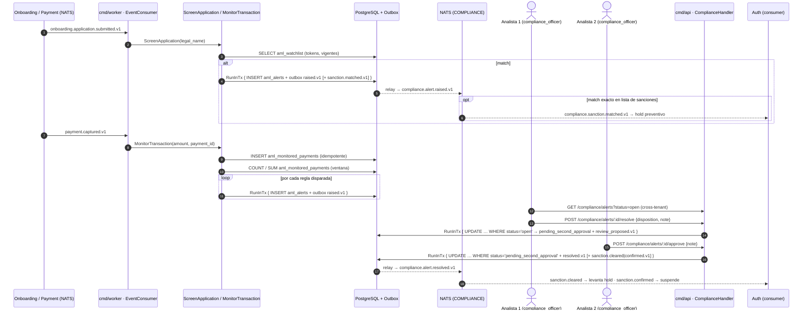
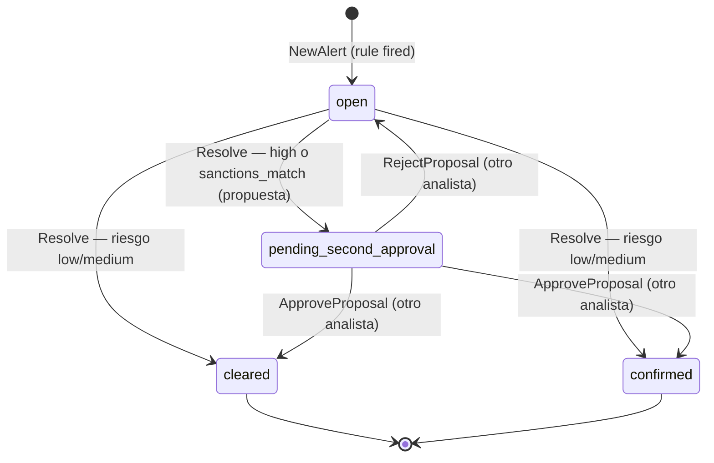
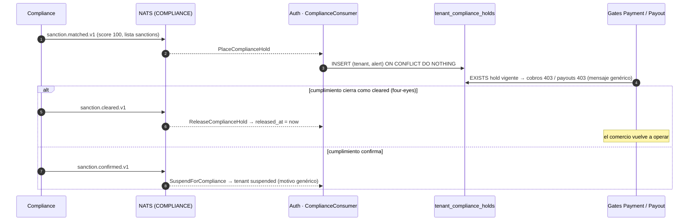
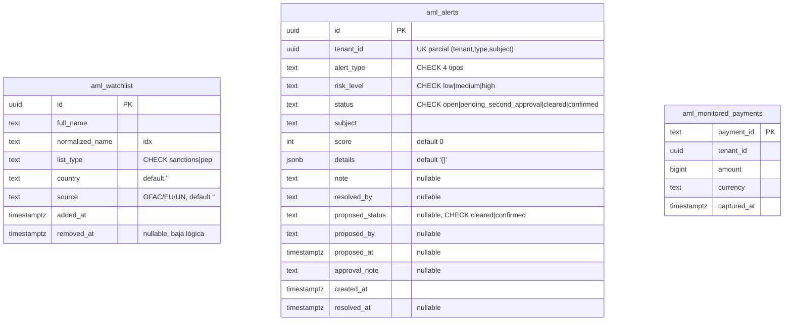

# Compliance & AML — Documentación técnico-funcional

> **Bounded Context:** `context/compliance`
> **Migraciones:** [`000014_compliance_init`](../../migrations/000014_compliance_init.up.sql),
> [`000018_compliance_hardening`](../../migrations/000018_compliance_hardening.up.sql),
> [`000019_compliance_four_eyes`](../../migrations/000019_compliance_four_eyes.up.sql),
> [`000020_compliance_holds`](../../migrations/000020_compliance_holds.up.sql)
> **Stream NATS:** `COMPLIANCE` (`compliance.>`)

---

## 1. Propósito

Compliance detecta y registra **señales de riesgo AML** (anti-lavado): screening
de comercios contra listas de vigilancia (sanciones/PEP) y monitoreo
transaccional sobre pagos capturados. El resultado es una **alerta que revisa
el equipo de cumplimiento de la plataforma** (rol `compliance_officer`), nunca
el propio comercio. Un match exacto contra una lista de sanciones pone además
al comercio en **hold preventivo y reversible** (§7.3).

El contexto es **escritura reactiva + revisión/gestión**:

- La *generación* de alertas ocurre en `cmd/worker`, consumiendo eventos de
  otros contextos (Onboarding y Payment). No hay endpoint HTTP que cree alertas.
- La *revisión* (listar/ver/disponer alertas de cualquier comercio, con
  four-eyes) y la *gestión de la watchlist* ocurren en `cmd/api`.
- El *enforcement* (hold, levantamiento, suspensión) lo aplica Auth al consumir
  `compliance.sanction.*` (§7.3).

### Fuera de alcance (hoy)

- **Bloqueo por alertas transaccionales o matches parciales**: solo un match
  exacto (score 100) en lista de sanciones dispara el hold. El resto queda para
  revisión manual sin consecuencias automáticas.
- Listas oficiales reales: la watchlist es una tabla propia cargada por API
  (`compliance_officer`/`platform_support`); no se integra con OFAC/EU/UN. La
  semilla de ejemplo es solo para desarrollo (`make seed-dev`).
- Fuzzy matching / similitud fonética: el match es **por tokens completos**
  sobre nombres normalizados sin acentos ni puntuación (§8.2); no tolera errores
  de tipeo ni transliteraciones.

---

## 2. Lenguaje ubicuo

| Término | Significado |
|---|---|
| **Alerta** (`Alert`) | Agregado raíz. Señal de riesgo detectada por una regla. Nace `open`; cumplimiento la dispone. |
| **Analista de cumplimiento** | Usuario de la plataforma con rol `compliance_officer`. Revisa alertas de todos los comercios. No es asignable por un tenant. |
| **Four-eyes** | Doble control: las alertas `high` o `sanctions_match` necesitan dos analistas distintos (propuesta + aprobación). |
| **Hold preventivo** | Bloqueo reversible de cobros y payouts del comercio mientras se revisa un match exacto de sanciones. No cambia el estado del tenant. |
| **Tipping-off** | Delatarle al comercio que está bajo sospecha AML. Prohibido: los mensajes hacia el comercio son genéricos. |
| **Watchlist** (`WatchlistEntry`) | Entrada de la lista de vigilancia **global** de la plataforma (sanciones o PEP). |
| **Screening** | Comparar la razón social de un onboarding contra la watchlist. Match → alerta `sanctions_match`. |
| **Monitoreo transaccional** | Evaluar un pago capturado contra las reglas de umbral, velocity y volumen. |
| **Subject** | Lo que disparó la alerta: `legal_name` (screening), `payment_id` (umbral) o el pago que cruzó una regla de ventana (`velocity:<payment_id>`, `volume:<moneda>:<payment_id>`). Parte de la clave de idempotencia. |
| **Score** | Puntaje 0..100 de confianza/severidad; mapea a `RiskLevel` (≥90 high, ≥60 medium, resto low). |
| **Proyección de pagos** | `aml_monitored_payments`: copia propia de cada `payment.captured.v1`, sobre la que cuentan las reglas de ventana. |
| **Disposition** | Decisión sobre una alerta: `cleared` (falso positivo) o `confirmed` (verdadero positivo). En alertas four-eyes, la del primer analista es una **propuesta**. |

---

## 3. Actores y flujo funcional



---

## 4. Modelo de dominio

### 4.1 Agregado raíz: `Alert`

Archivo: [domain/alert.go](../../context/compliance/domain/alert.go)

| Campo | Tipo | Notas |
|---|---|---|
| `id` | `AlertID` (UUID) | Generado por el caso de uso (`domain.NewAlertID()`). |
| `tenantID` | `TenantID` (UUID) | Del evento origen (worker). |
| `alertType` | `AlertType` | `sanctions_match` \| `transaction_threshold` \| `transaction_velocity` \| `transaction_volume`. |
| `riskLevel` | `RiskLevel` | `low` \| `medium` \| `high`. |
| `status` | `AlertStatus` | `open` \| `pending_second_approval` \| `cleared` \| `confirmed`. |
| `subject` | `string` | `legal_name` o `payment_id` (con prefijo `velocity:`/`volume:<moneda>:` en reglas de ventana, §5.2). Clave de idempotencia junto a `(tenant, tipo)`. |
| `score` | `int` | 0..100. |
| `details` | `map[string]string` | Contexto (lista matched, monto, ventana, etc.). Se persiste como JSONB. |
| `note` | `string` | Nota del analista que dispone o propone (viaja en `Resolve`). Se limpia si la propuesta se rechaza. |
| `resolvedBy` | `string` | Analista que **cerró** la alerta (en four-eyes, el segundo). userID del JWT vía `postgres.ActorFromContext`. |
| `createdAt` / `resolvedAt` | `time.Time` / `*time.Time` | `resolvedAt` se setea solo al cerrar. |
| `proposedStatus` / `proposedBy` / `proposedAt` | `AlertStatus` / `string` / `*time.Time` | Propuesta del primer analista (four-eyes). Se conservan tras la aprobación. |
| `approvalNote` | `string` | Nota del segundo analista al aprobar. |

API del agregado:

- `NewAlert(...)` → crea en `open` y **registra** `AlertRaisedEvent`. Si es
  `sanctions_match` contra lista `sanctions` con score 100, registra además
  `SanctionMatchedEvent` (dispara el hold).
- `RequiresSecondApproval()` → `risk_level = high` **o** `sanctions_match`.
- `Resolve(status, note, analyst, now)` → primera disposición, solo desde
  `open`. Sin four-eyes cierra la alerta (`AlertResolvedEvent`); con four-eyes
  la deja en `pending_second_approval` (`AlertReviewProposedEvent`).
- `ApproveProposal(note, analyst, now)` → segunda intervención: cierra con la
  disposición propuesta. Exige `analyst ≠ proposedBy` (`ErrSameAnalyst`).
- `RejectProposal(note, analyst, now)` → segunda intervención: descarta la
  propuesta y vuelve a `open` (`AlertProposalRejectedEvent`). Mismo control.
- Al cerrar una alerta de lista de sanciones registra además
  `SanctionClearedEvent` (cleared) o `SanctionConfirmedEvent` (confirmed).
- `ReconstituteAlert(AlertSnapshot)` → reconstrucción desde DB sin eventos.
- `PullEvents()` → drena los eventos pendientes (los casos de uso los publican
  al Outbox dentro de la misma transacción).

### 4.2 Máquina de estados



| Estado | Acciones válidas | Final |
|---|---|---|
| `open` | `POST .../resolve` | No |
| `pending_second_approval` | `POST .../approve`, `POST .../reject` (analista ≠ el que propuso) | No |
| `cleared` | — | **Sí** |
| `confirmed` | — | **Sí** |

No existe transición `cleared ↔ confirmed` ni reapertura de una alerta cerrada.
Errores: resolver una cerrada → `ErrAlertNotOpen` (409); resolver una pendiente
→ `ErrAlertPendingApproval` (409); aprobar/rechazar sin propuesta →
`ErrAlertNotPendingApproval` (409); el mismo analista (o uno anónimo) en la
segunda intervención → `ErrSameAnalyst` (403).

### 4.3 Invariantes

1. **Unicidad `(tenant_id, alert_type, subject)`** — garantizada por constraint
   en DB; el repo la traduce a `ErrDuplicateAlert` (§6.5).
2. Una alerta solo puede disponerse desde `open`; una propuesta solo puede
   aprobarse o rechazarse desde `pending_second_approval`.
3. `ParseDisposition` acepta únicamente `cleared` o `confirmed`.
4. **Four-eyes**: quien aprueba o rechaza una propuesta es distinto de quien
   la hizo. En DB, una alerta pendiente siempre tiene propuesta completa
   (`CHECK aml_alerts_pending_has_proposal`).
5. Solo alertas `sanctions_match` con `details.list_type = sanctions` tienen
   enforcement (hold/suspensión). PEP no bloquea: exige diligencia reforzada,
   no prohíbe operar.
6. `score` se calcula por regla (no lo fija el cliente): screening = score del
   mejor match (100/90/80, §8.2); threshold y volumen = escala por ratio
   monto/umbral (§5.2); velocity = fijo 90.

### 4.4 Value Objects y helpers

Archivo: [domain/vo.go](../../context/compliance/domain/vo.go),
[domain/watchlist.go](../../context/compliance/domain/watchlist.go)

| Elemento | Regla |
|---|---|
| `AlertID` / `TenantID` | UUID string; `ParseAlertID` / `ParseTenantID` validan formato. |
| `AlertType` | `sanctions_match`, `transaction_threshold`, `transaction_velocity`, `transaction_volume` (hay `CHECK` en DB). |
| `RiskLevel` | `low`, `medium`, `high`. |
| `AlertStatus` | `open`, `pending_second_approval`, `cleared`, `confirmed`. `ParseStatusFilter` valida el filtro de listado (`""` = sin filtro). |
| `NormalizeName(s)` | NFD + descarta diacríticos, minúsculas, todo lo que no sea letra/dígito → espacio, espacios colapsados (`"Pérez-Gómez, S.A."` → `"perez gomez s a"`). Se usa al cargar la watchlist y al evaluar. Idempotente. La migración 000018 replica la regla en SQL. |
| `MatchScore(entry, name)` | Por tokens completos: igualdad → 100, secuencia contigua → 90, todos los tokens en otro orden/intercalados → 80, si falta alguno → 0. |
| `NewWatchlistEntry(...)` | Valida `list_type ∈ {sanctions, pep}` y que el nombre conserve tokens tras normalizar; recorta espacios y pasa `country` a mayúsculas. |
| `RiskFromScore(score)` | `≥90 → high`, `≥60 → medium`, resto `low`. |
| `Match` | `{Entry WatchlistEntry, Score int}` — resultado del screening. |

### 4.5 Errores de dominio

Archivo: [domain/errors.go](../../context/compliance/domain/errors.go)

| Error | Causa | HTTP (handler) |
|---|---|---|
| `ErrAlertNotFound` | Alerta inexistente | 404 |
| `ErrDuplicateAlert` | Viola `(tenant, tipo, subject)` | n/a — tratado como **no-op** (idempotencia) |
| `ErrAlertNotOpen` | Re-resolver una alerta cerrada, o revisión concurrente | 409 |
| `ErrAlertPendingApproval` | `resolve` sobre una alerta pendiente de segunda aprobación | 409 |
| `ErrAlertNotPendingApproval` | `approve`/`reject` sin propuesta pendiente | 409 |
| `ErrSameAnalyst` | Segunda intervención del mismo analista que propuso | 403 |
| `ErrInvalidDisposition` | Disposición ≠ `cleared`/`confirmed` | 400 |
| `ErrInvalidTenantID` / `ErrInvalidAlertID` | ID no UUID (en `vo.go`) | 400 |
| `ErrInvalidStatusFilter` | `?status=` fuera de los 4 estados | 400 |
| `ErrInvalidListType` / `ErrInvalidWatchlistName` | Alta de watchlist inválida | 400 |
| `ErrWatchlistEntryNotFound` | Baja de entrada inexistente o ya dada de baja | 404 |
| Cualquier otro | — | 500 (`"internal server error"`, sin detalle interno) |

---

## 5. Casos de uso

Paquetes: [application/](../../context/compliance/application/)

| Caso de uso | Archivo | Actor/trigger | Resultado | Evento |
|---|---|---|---|---|
| `ScreenApplicationUseCase` | `screen_application.go` | JetStream (`onboarding.application.submitted.v1`) | Si hay match: 1 alerta `sanctions_match` (mejor match; ante empate, lista de sanciones) | `raised.v1` [+ `sanction.matched.v1`] |
| `MonitorTransactionUseCase` | `monitor_transaction.go` | JetStream (`payment.captured.v1`) | Registra el pago en la proyección y levanta hasta 3 alertas independientes (`transaction_threshold`, `transaction_velocity`, `transaction_volume`) | `raised.v1` × N |
| `ResolveAlertUseCase` | `resolve_alert.go` | HTTP (`compliance_officer`) | Cierra, o deja propuesta si es four-eyes | `resolved.v1` [+ `sanction.*`] o `review_proposed.v1` |
| `ApproveAlertProposalUseCase` | `resolve_alert.go` | HTTP (otro `compliance_officer`) | Cierra con la disposición propuesta | `resolved.v1` [+ `sanction.*`] |
| `RejectAlertProposalUseCase` | `resolve_alert.go` | HTTP (otro `compliance_officer`) | Vuelve a `open` | `proposal_rejected.v1` |
| `ListAlertsUseCase` | `queries.go` | HTTP | `[]AlertView` cross-tenant, filtro opcional por tenant y estado (limit default 50, máx 200) | — |
| `GetAlertUseCase` | `queries.go` | HTTP | `AlertView` de cualquier comercio | — |
| `AddWatchlistEntryUseCase` | `queries.go` | HTTP (`compliance_officer`/`platform_support`) | Valida y crea entrada en `aml_watchlist` (global); retorna la vista | — |
| `RemoveWatchlistEntryUseCase` | `queries.go` | HTTP (`compliance_officer`/`platform_support`) | Baja lógica (`removed_at`) | — |
| `ImportWatchlistUseCase` | `import_watchlist.go` | HTTP (`compliance_officer`/`platform_support`) | Sincroniza una fuente con un feed (alta/reemplazo/baja), atómico, con `dry_run` | — |
| `ListWatchlistUseCase` | `queries.go` | HTTP | `[]WatchlistEntryView` (limit default 100, máx 500) | — |

Puertos ([application/ports.go](../../context/compliance/application/ports.go)):
`AlertRepository`, `WatchlistRepository`, `TransactionLog`, `TxManager`,
`EventPublisher`, `Clock`.

### 5.1 Screening (`ScreenApplication`)

```
1. ParseTenantID(cmd.TenantID)                       → error si no es UUID
2. LegalName == ""                                   → no-op (nil)
3. watchlist.Screen(NormalizeName(LegalName))        → []Match (MatchScore > 0)
4. Sin matches                                       → no-op (nil)
5. best = max score entre matches
6. NewAlert(sanctions_match, RiskFromScore(best), subject=LegalName,
            score=best.Score, details={application_id, matched_name,
            list_type, country, source})
7. raiseAlert(...)                                   → tx Save + Publish
```

Una sola alerta por aplicación aunque haya múltiples coincidencias.

### 5.2 Monitoreo transaccional (`MonitorTransaction`)

Reglas configurables vía `MonitoringRules` (inyectado desde `cmd/worker` con
`DefaultMonitoringRules()`):

**Hora del evento.** Todas las reglas se evalúan en `at` = hora real de la
captura: el header `occurred-at` del mensaje, que el relay del outbox toma de
la tx de Payment que capturó el pago. Si falta o es inválido, `at =
clock.Now()`. Las alertas de monitoreo nacen con `created_at = at`, y procesar
un backlog no altera las ventanas.

Antes de evaluar, el pago se registra en `aml_monitored_payments`
(`TransactionLog.Record`, `ON CONFLICT (payment_id) DO NOTHING`) con
`captured_at = at`. Las reglas de ventana cuentan sobre esa proyección.

| Regla | Condición | Alerta | Subject | Riesgo | Score |
|---|---|---|---|---|---|
| Umbral | `Amount ≥ ThresholdAmount` (default `1_000_000` centavos = $10.000) | `transaction_threshold` | `payment_id` | `medium` | `riskScoreForAmount`: `60 + (amount/threshold)*10`, tope 100; umbral ≤ 0 → 80 |
| Velocity | `CountInWindow(at − VelocityWindow, at) ≥ VelocityCount` (default 10 pagos / 10 min, todas las monedas) | `transaction_velocity` | `velocity:<payment_id>` | `high` | 90 fijo |
| Volumen | `SumAmountInWindow(moneda del pago, at − VelocityWindow, at) ≥ VolumeAmount` (default `5_000_000` = $50.000; `0` desactiva) | `transaction_volume` | `volume:<moneda>:<payment_id>` | `high` | `riskScoreForAmount(total, VolumeAmount)` |

**Ventana deslizante** `(at − VelocityWindow, at]`: no hay buckets de reloj, así
que una ráfaga se mide igual sin importar dónde caiga.

**Cooldown** en lugar de bucket: `AlertRepository.SaveUnlessRecent` no inserta
una alerta de velocity (o de volumen en esa moneda) si el tenant ya tiene otra
del mismo tipo creada dentro de la ventana; un pico sostenido genera **una
sola alerta**, y una nueva solo después de una ventana completa sin alertas.
Dentro de la tx toma `pg_advisory_xact_lock(hashtextextended('aml_window:<tenant>:<prefijo>'))`
antes de chequear, así dos pagos concurrentes del mismo tenant no duplican la
alerta. Las re-entregas del mismo pago siguen siendo no-op por la unicidad
`(tenant, tipo, subject)`. `VelocityWindow ≤ 0` desactiva ambas reglas de
ventana.

Detalles persistidos: threshold → `{payment_id, amount, currency, threshold,
payment_method}`; velocity → `{payment_id, count, window, window_start,
threshold}`; volumen → `{payment_id, total_amount, currency, window,
window_start, threshold}` (`payment_id` = el pago que cruzó el umbral). Las
tres reglas pueden dispararse en el mismo pago.

### 5.3 Revisión (`ResolveAlert` / `ApproveAlertProposal` / `RejectAlertProposal`)

Los tres casos de uso comparten `reviewer.review`
([application/resolve_alert.go](../../context/compliance/application/resolve_alert.go)):

```
1. ParseAlertID (+ ParseDisposition en resolve)         → 400 si inválidos
2. txManager.RunInTx {
3.   alert := repo.FindByID(alertID)                    → 404 si no existe
4.   from  := alert.Status()
5.   transición de dominio (Resolve | ApproveProposal | RejectProposal)
6.   repo.Update(alert, from)   (… WHERE id=$1 AND status=$from)
                                                        → 0 filas ⇒ ErrAlertNotOpen (409)
7.   publisher.Publish(alert.PullEvents()...)
   }
```

No hay chequeo de tenant: la revisión es de la plataforma sobre cualquier
comercio. El aislamiento lo da el guard de rol más la política RLS de operador
(§9).

Concurrencia: el `UPDATE` condicional sobre el estado previo es el control
optimista. Si dos analistas actúan a la vez (dos aprobaciones, o aprobación vs.
rechazo), el segundo no afecta filas, la tx hace rollback y **no** se publican
eventos duplicados.

### 5.4 Patrón transaccional e idempotencia

Toda escritura pasa por `raiseAlert` ([application/raise.go](../../context/compliance/application/raise.go)):

```
txManager.RunInTx(ctx, func(ctx) {
    if err := repo.Save(alert); err != nil {
        if errors.Is(err, domain.ErrDuplicateAlert) { return nil }  // no-op
        return err
    }
    return publisher.Publish(alert.PullEvents()...)                 // outbox
})
```

La re-entrega de un evento de JetStream intenta insertar la misma alerta, choca
con la constraint `UNIQUE (tenant_id, alert_type, subject)` (SQLSTATE 23505 →
`ErrDuplicateAlert`) y el caso de uso la descarta **sin publicar el evento de
nuevo**. En el mismo `RunInTx`, `pkg/postgres.TxManager` hace
`set_config('app.current_tenant', …, true)` cuando el ctx trae tenant, activando
RLS en `aml_alerts`.

---

## 6. API HTTP

Archivo: [inbound/http/handler.go](../../context/compliance/infrastructure/adapters/inbound/http/handler.go)
Cableado: [cmd/api/main.go](../../cmd/api/main.go) (sección *Compliance & AML*).

Todas las rutas cuelgan de `/api/v1/compliance` bajo `JWTMiddleware` y son de
**uso interno de la plataforma**: ningún rol de tenant accede (un comercio no
ve ni dispone sus propias alertas). Cada ruta exige un guard de rol
(`RouteGuards`, inyectados desde `cmd/api`; `RegisterRoutes` entra en pánico si
falta alguno). Sin el rol → `403`. En las rutas de alertas, después del guard,
el middleware `platformOperator` marca el contexto con
`postgres.WithPlatformOperator` para la política RLS cross-tenant.

| Método | Ruta | Descripción | Rol | Éxito |
|---|---|---|---|---|
| `GET` | `/compliance/alerts?tenant_id=&status=&limit=` | Bandeja de alertas de toda la plataforma (recientes primero) | `compliance_officer`, `platform_support` | `200 {alerts, count}` |
| `GET` | `/compliance/alerts/:alertID` | Detalle de una alerta | `compliance_officer`, `platform_support` | `200 AlertView` |
| `POST` | `/compliance/alerts/:alertID/resolve` | Primera disposición (cierra o propone) | `compliance_officer` | `200 AlertView` |
| `POST` | `/compliance/alerts/:alertID/approve` | Segunda aprobación four-eyes | `compliance_officer` (≠ quien propuso) | `200 AlertView` |
| `POST` | `/compliance/alerts/:alertID/reject` | Rechazar la propuesta (vuelve a `open`) | `compliance_officer` (≠ quien propuso) | `200 AlertView` |
| `GET` | `/compliance/watchlist?limit=` | Lista global de vigilancia (vigentes) | `compliance_officer`, `platform_support` | `200 {watchlist, count}` |
| `POST` | `/compliance/watchlist` | Agregar entrada global | `compliance_officer`, `platform_support` | `201 WatchlistEntryView` |
| `DELETE` | `/compliance/watchlist/:entryID` | Dar de baja una entrada | `compliance_officer`, `platform_support` | `204` |
| `POST` | `/compliance/watchlist/import?source=&dry_run=` | Sincronizar una fuente completa con un feed CSV (§6.5) | `compliance_officer`, `platform_support` | `200 ImportWatchlistResult` |

Parámetros de query: `limit` de `alerts` default 50 (≤0 o >200 → 50); el de
`watchlist` default 100 (≤0 o >500 → 100). `status` acepta
`open`/`pending_second_approval`/`cleared`/`confirmed` (vacío = todos);
`tenant_id` (UUID) acota a un comercio. Otro valor → `400`.

### 6.1 Revisión — `resolve` / `approve` / `reject`

```json
POST /compliance/alerts/:alertID/resolve   { "disposition": "confirmed", "note": "Coincide documento" }
POST /compliance/alerts/:alertID/approve   { "note": "De acuerdo" }          // body opcional
POST /compliance/alerts/:alertID/reject    { "note": "Falta evidencia" }     // body opcional
```

Las tres responden `200` con la `AlertView` resultante, para que el analista
vea si la alerta quedó cerrada o `pending_second_approval`. El analista es el
userID del token (`postgres.ActorFromContext`).

| Escenario | Respuesta |
|---|---|
| OK | `200 AlertView` |
| Body JSON inválido | `400 {"error":"invalid request body"}` |
| `disposition` inválida | `400 {"error": "compliance: invalid disposition"}` |
| ID no UUID | `400 {"error":"invalid alert id"}` |
| Sin rol `compliance_officer` | `403` |
| Mismo analista que propuso (approve/reject) | `403 {"error":"compliance: second approval must come from a different analyst"}` |
| Alerta inexistente | `404 {"error":"alert not found"}` |
| Ya cerrada / revisión concurrente | `409 {"error":"alert already resolved"}` |
| `resolve` sobre pendiente, o `approve`/`reject` sin propuesta | `409` |

### 6.2 Ejemplo de `AlertView`

```json
{
  "id": "3b1c…",
  "tenant_id": "a2b4…",
  "alert_type": "transaction_threshold",
  "risk_level": "medium",
  "status": "open",
  "subject": "9f8e…",
  "score": 70,
  "details": {"payment_id": "9f8e…", "amount": "1500000", "currency": "ARS",
               "threshold": "1000000", "payment_method": "card"},
  "created_at": "2026-10-20T14:03:11Z",
  "requires_second_approval": false
}
```

`details`, `note`, `resolved_by`, `resolved_at`, `proposed_status`,
`proposed_by`, `proposed_at` y `approval_note` se omiten cuando están
vacíos/nulos. `requires_second_approval` siempre está presente.

### 6.3 Watchlist — `POST /compliance/watchlist`

```json
{ "full_name": "Vladimir Petrov", "list_type": "sanctions", "country": "RU", "source": "OFAC" }
```

Requeridos: `full_name`, `list_type`. `NewWatchlistEntry` valida
`list_type ∈ {sanctions, pep}` y que `full_name` tenga letras/dígitos (→ `400`
con el error de dominio); un error de persistencia → `500` sin detalle. La
respuesta `201` incluye la entrada creada (`id`, para darla de baja).

### 6.4 Baja — `DELETE /compliance/watchlist/:entryID`

Soft delete (`removed_at = now`): la entrada deja de participar del screening y
del listado, pero la fila se conserva para que las alertas pasadas sigan siendo
trazables. Inexistente, ya dada de baja o ID no UUID → `404`.

### 6.5 Ingesta de feeds — `POST /compliance/watchlist/import`

```
POST /api/v1/compliance/watchlist/import?source=OFAC&dry_run=true
Content-Type: text/csv

external_ref,full_name,list_type,country
SDN-36,Vladimir Petrov,sanctions,RU
SDN-41,"Sokolov, Ivan",sanctions,RU
```

- **Formato**: CSV UTF-8 con encabezado; columnas en cualquier orden;
  `external_ref`, `full_name` y `list_type` requeridas, `country` opcional. Se
  tolera BOM. Máximo 32 MB (`413` si se excede).
- **Semántica**: el feed **reemplaza a la fuente** (`source`, en mayúsculas).
  `domain.PlanWatchlistSync` calcula el delta contra las entradas vigentes de
  esa fuente con `external_ref`:
  - `external_ref` nuevo → alta;
  - existente con nombre/lista/país distintos → baja de la versión vieja + alta
    de la nueva (las alertas pasadas siguen apuntando a la versión que las
    disparó);
  - vigente que el feed ya no trae → baja (`removed_at`).

  Las entradas manuales (sin `external_ref`) no se tocan.
- **Atómico**: todo en una tx. Cualquier fila inválida (ref vacía o duplicada,
  `list_type` inválido, nombre sin letras) aborta el import completo →
  `422 {"error", "problems": ["line 5: …", …]}` (hasta 20). Un feed sin filas
  se rechaza: aplicarlo daría de baja la fuente entera. CSV mal formado → `400`.
- **`dry_run=true`**: calcula y devuelve el resumen sin escribir.
- **Respuesta**: `{"source","dry_run","added","updated","removed","unchanged"}`.
  Reimportar el mismo archivo da todo `unchanged`.

Unicidad: `uq_aml_watchlist_source_ref (source, external_ref)` parcial sobre
las vigentes (migración 000022).

---

## 7. Eventos de dominio

Archivo: [domain/events.go](../../context/compliance/domain/events.go)

Se publican vía Outbox y el relay de `cmd/worker` los envía al stream
`COMPLIANCE` (`compliance.>`). Metadatos como headers NATS:
`Nats-Msg-Id` = `EventID()` (dedup JetStream), `event-type` = `EventType()`,
`occurred-at` (agregado por el relay).

| Subject | Cuándo | Payload |
|---|---|---|
| `compliance.alert.raised.v1` | Se crea una alerta (screening o monitoreo) | `alert_id`, `tenant_id`, `alert_type`, `risk_level`, `subject`, `score` |
| `compliance.alert.resolved.v1` | Una alerta llega a su estado final | `alert_id`, `tenant_id`, `status` (`cleared`\|`confirmed`), `resolved_by`, `proposed_by` (four-eyes) |
| `compliance.alert.review_proposed.v1` | Primer analista propone en una alerta four-eyes | `alert_id`, `tenant_id`, `proposed_status`, `proposed_by` |
| `compliance.alert.proposal_rejected.v1` | Segundo analista rechaza la propuesta | `alert_id`, `tenant_id`, `proposed_status`, `proposed_by`, `rejected_by`, `note` |
| `compliance.sanction.matched.v1` | Match exacto (score 100) en lista de sanciones | `alert_id`, `tenant_id`, `matched_name`, `list_type`, `source`, `score` |
| `compliance.sanction.cleared.v1` | Alerta de sanciones cerrada como falso positivo | `alert_id`, `tenant_id` |
| `compliance.sanction.confirmed.v1` | Alerta de sanciones confirmada | `alert_id`, `tenant_id` |

Los `compliance.sanction.*` son **internos**: nunca deben reenviarse al
comercio (webhooks/notificaciones) porque delatarían el motivo.

`OccurredAt()` del evento usa `time.Now().UTC()` interno de `newBase` (no el
`Clock` inyectado).

### 7.1 Consumidores (este BC consume)

Ambos se arrancan en [cmd/worker/main.go](../../cmd/worker/main.go) como
goroutines durables (`Durable = Name`, `MaxDeliver: 5`):

| Consumer | Stream | Filtro | Acción |
|---|---|---|---|
| `compliance-onboarding-consumer` | `ONBOARDING` | `onboarding.application.submitted.>` | `ScreenApplication` |
| `compliance-payment-consumer` | `PAYMENT` | `payment.captured.>` | `MonitorTransaction` |

Manejo de errores en [inbound/nats/event_consumer.go](../../context/compliance/infrastructure/adapters/inbound/nats/event_consumer.go):
payload malformado o sin `tenant_id` → **ack silencioso** (retorna `nil`);
error del caso de uso → log + **nak** (reintento hasta MaxDeliver). Antes de
invocar el caso de uso, el consumer inyecta el `tenant_id` del evento en el
contexto (`postgres.WithTenantID`), así `RunInTx` fija `app.current_tenant` y
las escrituras pasan RLS aunque el rol de conexión no tenga `BYPASSRLS`.

### 7.2 Consumidores de los eventos de Compliance

| Consumer | Stream | Filtro | Acción |
|---|---|---|---|
| `auth-compliance-consumer` ([auth/.../nats/compliance_consumer.go](../../context/auth/infrastructure/adapters/inbound/nats/compliance_consumer.go)) | `COMPLIANCE` | `compliance.sanction.>` | Enforcement (§7.3). `MaxDeliver: 10`. Payload inválido → ack; error → nak. |

Webhook y Notification **no** filtran `compliance.>`: ningún evento de
Compliance llega al comercio.

### 7.3 Enforcement: hold preventivo reversible



| Evento | Acción en Auth | Reversible |
|---|---|---|
| `sanction.matched.v1` | Hold vigente por `(tenant, alert)`. **No cambia `tenants.status`**: si el match ocurre en el onboarding, el KYC puede aprobarse y el tenant activarse, pero los gates siguen bloqueando dinero mientras dure el hold. | Sí |
| `sanction.cleared.v1` | `released_at = now` del hold de esa alerta. Otros holds del tenant siguen vigentes. | — |
| `sanction.confirmed.v1` | `SuspendTenant` con `domain.ComplianceReviewReason`. Idempotente (ya suspendido = no-op). El hold se conserva. | No |

Propiedades:

- **Qué bloquea**: el gate de Payment (`EnsureCanProcessPayments` →
  `ErrTenantNotActive`, `403 tenant is not enabled to process payments`) y el
  de Payout (`EnsurePayoutsAllowed` → `ErrPayoutsNotAllowed`,
  `403 payouts are not available for this account`). Ambos leen
  `tenant_compliance_holds` en la misma query que `tenants.status`. Un payout
  iniciado **antes** del hold no se cancela.
- **Anti tipping-off**: el hold no emite eventos `auth.tenant.*` (Webhook
  reenvía `auth.tenant.>` al comercio). La suspensión por confirmación sí emite
  `auth.tenant.suspended.v1`, pero con el motivo genérico *"Cuenta en revisión
  preventiva por controles de seguridad"*. Los errores HTTP de los gates son los
  mismos que para cualquier tenant inhabilitado.
- **Idempotencia y orden**: `Place` es `ON CONFLICT DO NOTHING`; `Release` es
  un upsert que conserva el primer `released_at`. Si el release llega antes que
  el place (re-entrega desordenada), el place posterior no reactiva el hold.

---

## 8. Persistencia

Archivos: [000014_compliance_init.up.sql](../../migrations/000014_compliance_init.up.sql),
[000018_compliance_hardening.up.sql](../../migrations/000018_compliance_hardening.up.sql),
[000019_compliance_four_eyes.up.sql](../../migrations/000019_compliance_four_eyes.up.sql),
[000020_compliance_holds.up.sql](../../migrations/000020_compliance_holds.up.sql)

### 8.1 Tablas



Índices: `idx_aml_watchlist_normalized (normalized_name)`,
`idx_aml_watchlist_tokens` (GIN sobre `string_to_array(normalized_name, ' ')`,
parcial `WHERE removed_at IS NULL`),
`idx_aml_alerts_tenant (tenant_id, created_at DESC)`,
`idx_aml_alerts_status (tenant_id, status)`,
`idx_aml_alerts_review_queue (status, created_at DESC)` (bandeja cross-tenant),
`idx_aml_monitored_payments_window (tenant_id, captured_at)`.

RLS: `aml_alerts` y `aml_monitored_payments`, con policy
`tenant_id = NULLIF(current_setting('app.current_tenant', true), '')::uuid`
(el `NULLIF` evita el `22P02` cuando la conexión del pool conserva `''` tras
una tx previa). `aml_alerts` suma `aml_alerts_platform_operator` para la
revisión cross-tenant (§9). `aml_watchlist` es global, sin RLS.

**Retención de la proyección** (migración 000021): `ProjectionPurger`
([application/purge_projection.go](../../context/compliance/application/purge_projection.go))
corre en `cmd/worker` cada `DefaultPurgeInterval` (1 h, y una vez al arrancar)
y borra en lotes de 5.000 los pagos con `captured_at` anterior a
`DefaultProjectionRetention` (7 días). La retención nunca es menor que la
ventana de las reglas. Como corre sin tenant, usa la política RLS
`aml_monitored_payments_platform_operator`; con un rol sin `BYPASSRLS` la
política por tenant no vería filas. **`aml_alerts` no se purga**: las alertas
se conservan por exigencia normativa.

Enforcement (contexto Auth, migración 000020): `tenant_compliance_holds
(tenant_id FK tenants ON DELETE CASCADE, alert_id, placed_at, released_at)`,
PK `(tenant_id, alert_id)`, índice parcial de holds vigentes. Sin RLS, como
`tenants`.

Semilla: 000014 insertó 4 entradas ficticias (Vladimir Petrov, Ivan Sokolov,
Kim Jong Trading Co, Global Shell Holdings); 000018 las **da de baja**
(`removed_at`) para que no participen del screening en producción. En
desarrollo local se cargan con `make seed-dev`
([deploy/seed/compliance_watchlist.sql](../../deploy/seed/compliance_watchlist.sql),
idempotente).

### 8.2 Queries clave

| Puerto | Query | Notas |
|---|---|---|
| `AlertRepository.Save` | `INSERT INTO aml_alerts …` (11 columnas explícitas) | Usa la conexión del ctx (tx dentro de `RunInTx`). `note` vacío → NULL. `23505` → `ErrDuplicateAlert`. |
| `AlertRepository.Update` | `UPDATE aml_alerts SET status, note, resolved_at, resolved_by, proposed_*, approval_note WHERE id=$1 AND status=$2` (`$2` = estado previo) | Concurrencia optimista: 0 filas → `ErrAlertNotOpen`. |
| `AlertRepository.FindByID` | `SELECT … WHERE id=$1` | `pgx.ErrNoRows` → `ErrAlertNotFound`. Corre con las variables RLS del ctx (`RunWithAppTenant`): operador en la API. |
| `AlertRepository.List` | `[WHERE [tenant_id=$1] [AND status=$n]] ORDER BY created_at DESC LIMIT $n` | Cross-tenant con operador; con filtro de tenant fija además `app.current_tenant`. |
| `WatchlistRepository.Screen` | `… WHERE removed_at IS NULL AND string_to_array(normalized_name,' ') <@ string_to_array($1,' ')` | Prefiltro por **conjunto de tokens** (GIN); el score lo asigna `domain.MatchScore`. |
| `WatchlistRepository.ListActiveBySource` | `… WHERE removed_at IS NULL AND source=$1 AND external_ref IS NOT NULL` | Base del delta del import. Usa la tx del contexto (import atómico), igual que `Add`/`Remove`/`List`. |
| `WatchlistRepository.Add/Remove/List` | `INSERT …` / `UPDATE … SET removed_at WHERE id=$1 AND removed_at IS NULL` / `SELECT … WHERE removed_at IS NULL ORDER BY full_name LIMIT $1` | Pool directo, sin tenant. `Remove` con 0 filas → `ErrWatchlistEntryNotFound`. |
| `TransactionLog.Record` | `INSERT INTO aml_monitored_payments … ON CONFLICT (payment_id) DO NOTHING` | Dentro de `RunInTx` (tenant del evento). |
| `TransactionLog.CountInWindow` / `SumAmountInWindow` | `SELECT COUNT(*)` / `COALESCE(SUM(amount),0) FROM aml_monitored_payments WHERE tenant_id=$1 [AND currency=$2] AND captured_at > $since AND captured_at <= $until` | Ventana deslizante sobre la proyección propia. |
| `TransactionLog.PurgeBefore` | `DELETE … WHERE payment_id IN (SELECT … WHERE captured_at < $1 LIMIT $2)` | Purga por lotes como operador de plataforma (índice `captured_at`). |
| `AlertRepository.SaveUnlessRecent` | `pg_advisory_xact_lock(...)` + `EXISTS (… alert_type=$2 AND starts_with(subject,$3) AND created_at > $4)` + `INSERT` | Cooldown de reglas de ventana; reciente → `ErrDuplicateAlert` (no-op). |

Ejemplos del screening por tokens (entrada `"vladimir petrov"`):

| Nombre evaluado | Score |
|---|---|
| `Vladimir Petrov` | 100 (exacto) |
| `Vladimir Petrov Holdings S.A.` | 90 (secuencia contigua) |
| `Petrov, Vladimir` / `Vladimir Ivanovich Petrov` | 80 (tokens reordenados/intercalados → `medium`) |
| `Vladímir Petróv` | 100 (acentos normalizados) |
| `Vladimir Petrovsky` | sin match (token distinto) |

---

## 9. Seguridad y multi-tenancy

- **Alta de analistas**: los usuarios `compliance_officer` (y `platform_support`)
  se crean con el CLI [`cmd/provision`](../../cmd/provision/main.go), nunca por
  HTTP, en el tenant de la propia plataforma. Four-eyes requiere al menos dos:

  ```bash
  PROVISION_PASSWORD=... make provision TENANT=<uuid-tenant-plataforma> EMAIL=ana@plataforma.com
  PROVISION_PASSWORD=... make provision TENANT=<uuid-tenant-plataforma> EMAIL=beto@plataforma.com
  ```

  La contraseña va por entorno (`PROVISION_PASSWORD`) o por stdin
  (`-password-stdin`), nunca como argumento.
- **La plataforma revisa a los comercios.** Alertas y watchlist son de uso
  interno: `compliance_officer` revisa (y es el único que dispone),
  `platform_support` puede leer y gestionar la watchlist. Ningún rol de tenant
  (`admin`, `operator`, …) accede, y los roles de plataforma no son asignables
  desde un tenant (`Role.IsTenantAssignable`); se provisionan por fuera de la
  API.
- **RLS cross-tenant**: `aml_alerts` tiene, además de la política por tenant,
  la política `aml_alerts_platform_operator`
  (`current_setting('app.platform_operator', true) = 'on'`). Las políticas
  permisivas se combinan con OR. El handler fija la variable
  (`postgres.WithPlatformOperator`) solo **después** del guard de rol; el
  worker sigue escribiendo con `app.current_tenant` del evento.
- **Four-eyes**: la segunda intervención exige un analista distinto
  (`ErrSameAnalyst`); quedan firmados `proposed_by` y `resolved_by` en la fila
  y en los eventos.
- **Escrituras** (`Save`/`Update`/`Record`) corren dentro de `RunInTx` → RLS
  activo sobre `aml_alerts` y `aml_monitored_payments`.
- **Watchlist**: deliberadamente global (sin `tenant_id`, sin RLS).
- **Anti tipping-off**: ver §7.3.

---

## 10. Limitaciones conocidas y deuda técnica

| # | Tema | Detalle | Impacto |
|---|---|---|---|
| 1 | Hold solo por match exacto | Matches parciales (80/90) y reglas transaccionales no bloquean, aunque sean `high`; dependen de la revisión manual. Un payout iniciado antes del hold no se cancela. | Medio |
| 3 | Sin fuzzy/fonético | El matching por tokens cubre orden, acentos y puntuación, pero no errores de tipeo, transliteraciones ("Petrov"/"Petroff") ni abreviaturas. La réplica SQL de `NormalizeName` en 000018 solo cubre acentos latinos comunes. | Medio |
| 6 | Feeds oficiales en formato propio | La ingesta acepta un CSV propio: los archivos de OFAC/EU/UN hay que convertirlos a ese formato. No hay descarga automática programada. | Operativo |

---

## 11. Testing

| Capa | Archivos | Tipo |
|---|---|---|
| Dominio | `domain/alert_test.go`, `events_test.go`, `vo_test.go`, `watchlist_test.go` | Unitarios: FSM four-eyes completo (propuesta, aprobación, rechazo, mismo analista), eventos `sanction.*` (solo lista sanciones, score 100), parseo de VOs, `NormalizeName`, `RiskFromScore`. |
| Aplicación | `application/screen_application_test.go`, `monitor_transaction_test.go`, `resolve_alert_test.go`, `queries_test.go` (+ `mocks_test.go`) | Unitarios con puertos en memoria/fake: mejor match y desempate a favor de sanciones, reglas de umbral/velocity/volumen, revisión cross-tenant, `UPDATE` condicional sobre el estado previo, idempotencia, mappers. |
| HTTP inbound | `inbound/http/handler_test.go` | Handlers Gin con `httptest`: flujo four-eyes extremo a extremo, mapeo de errores, cada ruta detrás de su guard, middleware `platformOperator` (verifica `set_config('app.platform_operator','on')` con pgxmock). |
| NATS inbound | `inbound/nats/event_consumer_test.go` | Configs de consumers (stream/filtro/MaxDeliver) y handlers con payloads válidos/malformados y errores nak/ack. |
| Postgres outbound | `outbound/postgres/*_test.go` | **pgxmock** (`github.com/pashagolub/pgxmock/v4`): SQL esperado por operación, tx efímera de RLS (`set_config`), scan de alertas, `23505` → `ErrDuplicateAlert`, `UPDATE` condicional → `ErrAlertNotOpen`, screening por tokens, baja lógica, proyección `TransactionLog`. |

```bash
go test ./context/compliance/...
```

Enforcement fuera de este BC: `context/auth/.../nats/compliance_consumer_test.go`,
`context/auth/application/compliance_hold_test.go`,
`context/auth/.../postgres/compliance_hold_repo_mock_test.go`,
`context/payment/.../tenant/gate_test.go`, `context/payout/.../tenant/gate_test.go`.

No hay tests de integración contra PostgreSQL real en este BC (todo mock). Las
migraciones 000018 a 000020 se validaron up → down → up contra PostgreSQL 16;
en 000019/000020 además se verificó RLS con un rol sin `BYPASSRLS` (tenant ve solo lo
suyo, operador ve todo, sin variables 0 filas) y la semántica de place/release
fuera de orden.

---

## 12. Mapa de código

```
context/compliance/
├── domain/
│   ├── alert.go          # Agregado Alert + FSM four-eyes + AlertSnapshot
│   ├── vo.go             # IDs, AlertType, RiskLevel, AlertStatus, ParseDisposition, ParseStatusFilter
│   ├── watchlist.go      # WatchlistEntry, NewWatchlistEntry, Match, NormalizeName, MatchScore, RiskFromScore
│   ├── events.go         # alert.{raised,resolved,review_proposed,proposal_rejected} + sanction.{matched,cleared,confirmed}
│   └── errors.go         # errores sentinela
├── application/
│   ├── ports.go          # TxManager, AlertRepository, WatchlistRepository, TransactionLog, EventPublisher, Clock
│   ├── commands.go       # ScreenApplicationCmd, MonitorTransactionCmd, ResolveAlertCmd, Add/RemoveWatchlistEntryCmd
│   ├── queries.go        # ListAlerts, GetAlert, Add/Remove/ListWatchlist + AlertView/WatchlistEntryView + mappers
│   ├── screen_application.go
│   ├── monitor_transaction.go  # MonitoringRules + DefaultMonitoringRules + riskScoreForAmount
│   ├── resolve_alert.go  # Resolve / ApproveProposal / RejectProposal (reviewer compartido)
│   └── raise.go          # helper tx: Save + Publish, idempotente ante ErrDuplicateAlert
└── infrastructure/adapters/
    ├── inbound/
    │   ├── http/handler.go            # ComplianceHandler + RouteGuards + platformOperator + RegisterRoutes (8 rutas)
    │   └── nats/event_consumer.go     # consumers ONBOARDING + PAYMENT
    └── outbound/postgres/
        ├── alert_repo.go              # AlertRepository (RLS-aware en tx)
        ├── watchlist_repo.go          # WatchlistRepository (global, screening por tokens, baja lógica)
        └── transaction_log.go         # proyección aml_monitored_payments (velocity/volumen)
```

Cableado: [cmd/api/main.go](../../cmd/api/main.go) (consulta/gestión + `RouteGuards`) y
[cmd/worker/main.go](../../cmd/worker/main.go) (generación: consumers +
`DefaultMonitoringRules()`). El publisher es el genérico
`outbox.NewEventPublisher[compliancedomain.Event]`; el reloj inyectado es
`realClock{}` (`time.Now().UTC()`). Stream provisionado en
[pkg/eventbus/stream.go](../../pkg/eventbus/stream.go): `COMPLIANCE → compliance.>`.
