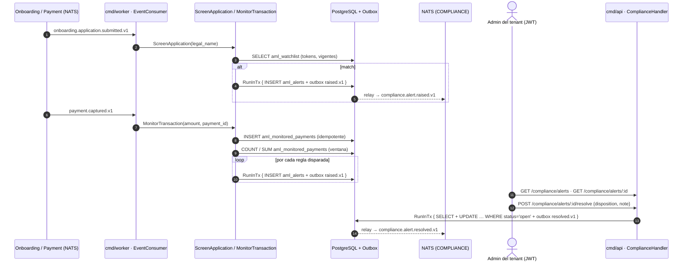
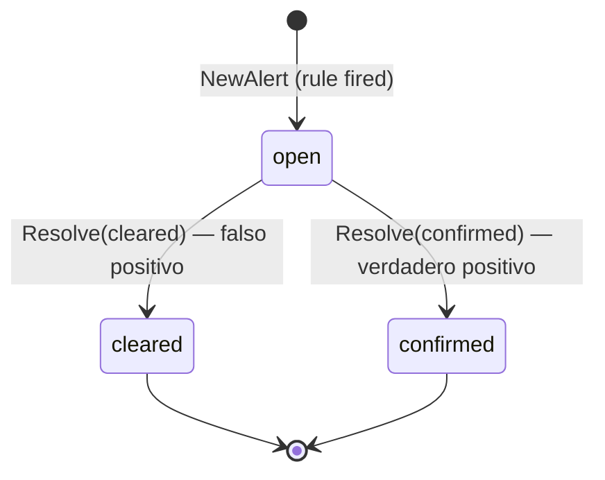
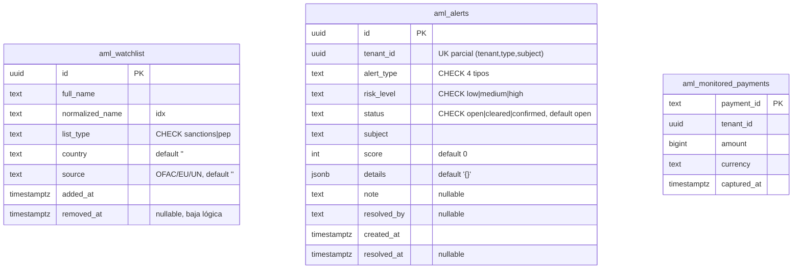

# Compliance & AML — Documentación técnico-funcional

> **Bounded Context:** `context/compliance`
> **Migraciones:** [`000014_compliance_init`](../../migrations/000014_compliance_init.up.sql),
> [`000018_compliance_hardening`](../../migrations/000018_compliance_hardening.up.sql)
> **Stream NATS:** `COMPLIANCE` (`compliance.>`)

---

## 1. Propósito

Compliance detecta y registra **señales de riesgo AML** (anti-lavado): screening
de comercios contra listas de vigilancia (sanciones/PEP) y monitoreo
transaccional sobre pagos capturados. El resultado siempre es una **alerta para
revisión manual** de un analista del comercio.

El contexto es **escritura reactiva + consulta/gestión**:

- La *generación* de alertas ocurre en `cmd/worker`, consumiendo eventos de
  otros contextos (Onboarding y Payment). No hay endpoint HTTP que cree alertas.
- La *consulta y disposición* (listar/ver/resolver alertas) y la *gestión de la
  watchlist* ocurren en `cmd/api`.

### Fuera de alcance (hoy)

- **Enforcement automático**: no suspende tenants, no bloquea pagos ni payouts.
  La alerta se *registra*; el evento `compliance.alert.raised.v1` queda disponible
  en el stream `COMPLIANCE` para que otros contextos reaccionen a futuro (p. ej.
  Auth suspendiendo el tenant). Hoy ningún contexto consume esos eventos.
- Listas oficiales reales: la watchlist es una tabla propia cargada por API
  (`platform_support`); no se integra con OFAC/EU/UN. La semilla de ejemplo es
  solo para desarrollo (`make seed-dev`).
- Fuzzy matching / similitud fonética: el match es **por tokens completos**
  sobre nombres normalizados sin acentos ni puntuación (§8.2); no tolera errores
  de tipeo ni transliteraciones.

---

## 2. Lenguaje ubicuo

| Término | Significado |
|---|---|
| **Alerta** (`Alert`) | Agregado raíz. Señal de riesgo detectada por una regla. Nace `open`; un analista la dispone. |
| **Watchlist** (`WatchlistEntry`) | Entrada de la lista de vigilancia **global** de la plataforma (sanciones o PEP). |
| **Screening** | Comparar la razón social de un onboarding contra la watchlist. Match → alerta `sanctions_match`. |
| **Monitoreo transaccional** | Evaluar un pago capturado contra las reglas de umbral, velocity y volumen. |
| **Subject** | Lo que disparó la alerta: `legal_name` (screening), `payment_id` (umbral) o el bucket de ventana (`velocity:<inicio>`, `volume:<moneda>:<inicio>`). Parte de la clave de idempotencia. |
| **Score** | Puntaje 0..100 de confianza/severidad; mapea a `RiskLevel` (≥90 high, ≥60 medium, resto low). |
| **Proyección de pagos** | `aml_monitored_payments`: copia propia de cada `payment.captured.v1`, sobre la que cuentan las reglas de ventana. |
| **Disposition** | Decisión del analista sobre una alerta abierta: `cleared` (falso positivo) o `confirmed` (verdadero positivo). |

---

## 3. Actores y flujo funcional



---

## 4. Modelo de dominio

### 4.1 Agregado raíz: `Alert`

Archivo: [domain/alert.go](../../context/compliance/domain/alert.go)

| Campo | Tipo | Notas |
|---|---|---|
| `id` | `AlertID` (UUID) | Generado por el caso de uso (`domain.NewAlertID()`). |
| `tenantID` | `TenantID` (UUID) | Del evento origen (worker) o del JWT (resolver). |
| `alertType` | `AlertType` | `sanctions_match` \| `transaction_threshold` \| `transaction_velocity` \| `transaction_volume`. |
| `riskLevel` | `RiskLevel` | `low` \| `medium` \| `high`. |
| `status` | `AlertStatus` | `open` \| `cleared` \| `confirmed`. |
| `subject` | `string` | `legal_name`, `payment_id` o bucket de ventana (§5.2). Clave de idempotencia junto a `(tenant, tipo)`. |
| `score` | `int` | 0..100. |
| `details` | `map[string]string` | Contexto (lista matched, monto, ventana, etc.). Se persiste como JSONB. |
| `note` | `string` | Nota del analista al disponer (no tiene setter separado: viaja en `Resolve`). |
| `resolvedBy` | `string` | Actor autenticado que dispuso (userID del JWT, vía `postgres.ActorFromContext`). |
| `createdAt` / `resolvedAt` | `time.Time` / `*time.Time` | `resolvedAt` se setea solo al resolver. |

API del agregado:

- `NewAlert(...)` → crea en `open` y **registra** `AlertRaisedEvent`.
- `Resolve(status, note, resolvedBy, now)` → única mutación posible; exige
  `open` y un estado terminal (`cleared`/`confirmed`); **registra**
  `AlertResolvedEvent`.
- `ReconstituteAlert(...)` → reconstrucción desde DB sin eventos.
- `PullEvents()` → drena los eventos pendientes (los casos de uso los publican
  al Outbox dentro de la misma transacción).

### 4.2 Máquina de estados



| Estado | ¿Accesible? | Final |
|---|---|---|
| `open` | única fuente de acción (`POST .../resolve`) | No |
| `cleared` | — | **Sí** |
| `confirmed` | — | **Sí** |

No existe transición `cleared ↔ confirmed` ni reapertura: resolver dos veces
devuelve `ErrAlertNotOpen` → **409**.

### 4.3 Invariantes

1. **Unicidad `(tenant_id, alert_type, subject)`** — garantizada por constraint
   en DB; el repo la traduce a `ErrDuplicateAlert` (§6.5).
2. Una alerta solo puede disponerse desde `open`.
3. `ParseDisposition` acepta únicamente `cleared` o `confirmed`.
4. `score` se calcula por regla (no lo fija el cliente): screening = score del
   mejor match (100/90/80, §8.2); threshold y volumen = escala por ratio
   monto/umbral (§5.2); velocity = fijo 90.

### 4.4 Value Objects y helpers

Archivo: [domain/vo.go](../../context/compliance/domain/vo.go),
[domain/watchlist.go](../../context/compliance/domain/watchlist.go)

| Elemento | Regla |
|---|---|
| `AlertID` / `TenantID` | UUID string; `ParseAlertID` / `ParseTenantID` validan formato. |
| `AlertType` | `sanctions_match`, `transaction_threshold`, `transaction_velocity`, `transaction_volume` (hay `CHECK` en DB). |
| `RiskLevel` | `low`, `medium`, `high`. |
| `AlertStatus` | `open`, `cleared`, `confirmed`. `ParseStatusFilter` valida el filtro de listado (`""` = sin filtro). |
| `NormalizeName(s)` | NFD + descarta diacríticos, minúsculas, todo lo que no sea letra/dígito → espacio, espacios colapsados (`"Pérez-Gómez, S.A."` → `"perez gomez s a"`). Se usa al cargar la watchlist y al evaluar. Idempotente. La migración 000018 replica la regla en SQL. |
| `MatchScore(entry, name)` | Por tokens completos: igualdad → 100, secuencia contigua → 90, todos los tokens en otro orden/intercalados → 80, si falta alguno → 0. |
| `NewWatchlistEntry(...)` | Valida `list_type ∈ {sanctions, pep}` y que el nombre conserve tokens tras normalizar; recorta espacios y pasa `country` a mayúsculas. |
| `RiskFromScore(score)` | `≥90 → high`, `≥60 → medium`, resto `low`. |
| `Match` | `{Entry WatchlistEntry, Score int}` — resultado del screening. |

### 4.5 Errores de dominio

Archivo: [domain/errors.go](../../context/compliance/domain/errors.go)

| Error | Causa | HTTP (handler) |
|---|---|---|
| `ErrAlertNotFound` | Alerta inexistente o de otro tenant | 404 |
| `ErrDuplicateAlert` | Viola `(tenant, tipo, subject)` | n/a — tratado como **no-op** (idempotencia) |
| `ErrAlertNotOpen` | Re-resolver una alerta ya dispuesta | 409 |
| `ErrInvalidDisposition` | Disposición ≠ `cleared`/`confirmed` | 400 |
| `ErrInvalidTenantID` / `ErrInvalidAlertID` | ID no UUID (en `vo.go`) | 400 |
| `ErrInvalidStatusFilter` | `?status=` ≠ `open`/`cleared`/`confirmed` | 400 |
| `ErrInvalidListType` / `ErrInvalidWatchlistName` | Alta de watchlist inválida | 400 |
| `ErrWatchlistEntryNotFound` | Baja de entrada inexistente o ya dada de baja | 404 |
| Cualquier otro | — | 500 (`"internal server error"`, sin detalle interno) |

---

## 5. Casos de uso

Paquetes: [application/](../../context/compliance/application/)

| Caso de uso | Archivo | Actor/trigger | Resultado | Evento |
|---|---|---|---|---|
| `ScreenApplicationUseCase` | `screen_application.go` | JetStream (`onboarding.application.submitted.v1`) | Si hay match: 1 alerta `sanctions_match` (mejor match) | `raised.v1` |
| `MonitorTransactionUseCase` | `monitor_transaction.go` | JetStream (`payment.captured.v1`) | Registra el pago en la proyección y levanta hasta 3 alertas independientes (`transaction_threshold`, `transaction_velocity`, `transaction_volume`) | `raised.v1` × N |
| `ResolveAlertUseCase` | `resolve_alert.go` | HTTP (analista) | `cleared`/`confirmed` + nota | `resolved.v1` |
| `ListAlertsUseCase` | `queries.go` | HTTP | `[]AlertView` (limit default 50, máx 200) | — |
| `GetAlertUseCase` | `queries.go` | HTTP | `AlertView` (verifica pertenencia al tenant) | — |
| `AddWatchlistEntryUseCase` | `queries.go` | HTTP (`platform_support`) | Valida y crea entrada en `aml_watchlist` (global); retorna la vista | — |
| `RemoveWatchlistEntryUseCase` | `queries.go` | HTTP (`platform_support`) | Baja lógica (`removed_at`) | — |
| `ListWatchlistUseCase` | `queries.go` | HTTP | `[]WatchlistEntryView` (limit default 100, máx 500) | — |

Puertos ([application/ports.go](../../context/compliance/application/ports.go)):
`AlertRepository`, `WatchlistRepository`, `TransactionLog`, `TxManager`,
`EventPublisher`, `Clock`.

### 5.1 Screening (`ScreenApplication`)

```
1. ParseTenantID(cmd.TenantID)                       → error si no es UUID
2. LegalName == ""                                   → no-op (nil)
3. watchlist.Screen(NormalizeName(LegalName))        → []Match (MatchScore > 0)
4. Sin matches                                       → no-op (nil)
5. best = max score entre matches
6. NewAlert(sanctions_match, RiskFromScore(best), subject=LegalName,
            score=best.Score, details={application_id, matched_name,
            list_type, country, source})
7. raiseAlert(...)                                   → tx Save + Publish
```

Una sola alerta por aplicación aunque haya múltiples coincidencias.

### 5.2 Monitoreo transaccional (`MonitorTransaction`)

Reglas configurables vía `MonitoringRules` (inyectado desde `cmd/worker` con
`DefaultMonitoringRules()`):

Antes de evaluar, el pago se registra en `aml_monitored_payments`
(`TransactionLog.Record`, `ON CONFLICT (payment_id) DO NOTHING`) con
`captured_at = clock.Now()`. Las reglas de ventana cuentan sobre esa proyección.

| Regla | Condición | Alerta | Subject | Riesgo | Score |
|---|---|---|---|---|---|
| Umbral | `Amount ≥ ThresholdAmount` (default `1_000_000` centavos = $10.000) | `transaction_threshold` | `payment_id` | `medium` | `riskScoreForAmount`: `60 + (amount/threshold)*10`, tope 100; umbral ≤ 0 → 80 |
| Velocity | `CountSince(now − VelocityWindow) ≥ VelocityCount` (default 10 pagos / 10 min, todas las monedas) | `transaction_velocity` | `velocity:<bucket>` | `high` | 90 fijo |
| Volumen | `SumAmountSince(moneda del pago, now − VelocityWindow) ≥ VolumeAmount` (default `5_000_000` = $50.000; `0` desactiva) | `transaction_volume` | `volume:<moneda>:<bucket>` | `high` | `riskScoreForAmount(total, VolumeAmount)` |

`<bucket>` = `now.Truncate(VelocityWindow)` en RFC3339 (ventanas fijas). Como el
subject es el bucket y no el pago, la unicidad `(tenant, tipo, subject)` deja
**una sola alerta por tenant y ventana** para velocity/volumen: los pagos
siguientes del mismo pico chocan con la constraint y son no-op. Una ráfaga que
cruza el borde de dos buckets puede generar dos alertas. `VelocityWindow ≤ 0`
desactiva ambas reglas de ventana.

Detalles persistidos: threshold → `{payment_id, amount, currency, threshold,
payment_method}`; velocity → `{payment_id, count, window, window_start,
threshold}`; volumen → `{payment_id, total_amount, currency, window,
window_start, threshold}` (`payment_id` = el pago que cruzó el umbral). Las
tres reglas pueden dispararse en el mismo pago.

### 5.3 Resolución (`ResolveAlert`)

```
1. ParseTenantID / ParseAlertID / ParseDisposition     → 400 si inválidos
2. txManager.RunInTx {
3.   repo.FindByID(alertID)
4.   alert.TenantID() != tenantID                      → ErrAlertNotFound (404)
5.   alert.Resolve(status, note, resolvedBy, now)      → ErrAlertNotOpen (409)
6.   repo.Update  (… WHERE id=$1 AND status='open')    → 0 filas ⇒ ErrAlertNotOpen (409)
7.   publisher.Publish(resolved.v1)
   }
```

Concurrencia: el `UPDATE` condicional es el control optimista. Si dos
resoluciones compiten, la segunda no afecta filas, el repo retorna
`ErrAlertNotOpen`, la tx hace rollback y **no** se publica un segundo
`resolved.v1`.

### 5.4 Patrón transaccional e idempotencia

Toda escritura pasa por `raiseAlert` ([application/raise.go](../../context/compliance/application/raise.go)):

```
txManager.RunInTx(ctx, func(ctx) {
    if err := repo.Save(alert); err != nil {
        if errors.Is(err, domain.ErrDuplicateAlert) { return nil }  // no-op
        return err
    }
    return publisher.Publish(alert.PullEvents()...)                 // outbox
})
```

La re-entrega de un evento de JetStream intenta insertar la misma alerta, choca
con la constraint `UNIQUE (tenant_id, alert_type, subject)` (SQLSTATE 23505 →
`ErrDuplicateAlert`) y el caso de uso la descarta **sin publicar el evento de
nuevo**. En el mismo `RunInTx`, `pkg/postgres.TxManager` hace
`set_config('app.current_tenant', …, true)` cuando el ctx trae tenant, activando
RLS en `aml_alerts`.

---

## 6. API HTTP

Archivo: [inbound/http/handler.go](../../context/compliance/infrastructure/adapters/inbound/http/handler.go)
Cableado: [cmd/api/main.go](../../cmd/api/main.go) (sección *Compliance & AML*).

Todas las rutas cuelgan de `/api/v1/compliance` bajo `JWTMiddleware`; el
`tenant_id` se toma del token (`postgres.TenantIDFromContext`), nunca del body.
Cada ruta exige además un guard de rol (`RouteGuards`, inyectados desde
`cmd/api`; `RegisterRoutes` entra en pánico si falta alguno). Sin el rol → `403`.

| Método | Ruta | Descripción | Rol | Éxito |
|---|---|---|---|---|
| `GET` | `/compliance/alerts?status=&limit=` | Alertas del tenant (recientes primero) | `admin`, `platform_support` | `200 {alerts, count}` |
| `GET` | `/compliance/alerts/:alertID` | Detalle de una alerta | `admin`, `platform_support` | `200 AlertView` |
| `POST` | `/compliance/alerts/:alertID/resolve` | Disponer la alerta | `admin` | `204` |
| `GET` | `/compliance/watchlist?limit=` | Lista global de vigilancia (vigentes) | `platform_support` | `200 {watchlist, count}` |
| `POST` | `/compliance/watchlist` | Agregar entrada global | `platform_support` | `201 WatchlistEntryView` |
| `DELETE` | `/compliance/watchlist/:entryID` | Dar de baja una entrada | `platform_support` | `204` |

Parámetros de query: `limit` de `alerts` default 50 (≤0 o >200 → 50); el de
`watchlist` default 100 (≤0 o >500 → 100). `status` acepta solo
`open`/`cleared`/`confirmed` (vacío = todos); otro valor → `400`.

### 6.1 Resolver alerta — `POST /compliance/alerts/:alertID/resolve`

```json
{ "disposition": "confirmed", "note": "Cliente real en lista OFAC" }
```

| Escenario | Respuesta |
|---|---|
| OK | `204` (persiste `resolved_by` = userID del token) |
| Body JSON inválido | `400 {"error":"invalid request body"}` |
| `disposition` inválida | `400 {"error": "compliance: invalid disposition"}` |
| ID no UUID | `400 {"error":"invalid tenant or alert id"}` |
| Rol distinto de `admin` | `403` |
| Alerta inexistente o de otro tenant | `404 {"error":"alert not found"}` |
| Ya resuelta | `409 {"error":"alert already resolved"}` |

### 6.2 Ejemplo de `AlertView`

```json
{
  "id": "3b1c…",
  "tenant_id": "a2b4…",
  "alert_type": "transaction_threshold",
  "risk_level": "medium",
  "status": "open",
  "subject": "9f8e…",
  "score": 70,
  "details": {"payment_id": "9f8e…", "amount": "1500000", "currency": "ARS",
               "threshold": "1000000", "payment_method": "card"},
  "created_at": "2026-10-20T14:03:11Z"
}
```

`details`, `note` y `resolved_at` se omiten cuando están vacíos/nulos.

### 6.3 Watchlist — `POST /compliance/watchlist`

```json
{ "full_name": "Vladimir Petrov", "list_type": "sanctions", "country": "RU", "source": "OFAC" }
```

Requeridos: `full_name`, `list_type`. `NewWatchlistEntry` valida
`list_type ∈ {sanctions, pep}` y que `full_name` tenga letras/dígitos (→ `400`
con el error de dominio); un error de persistencia → `500` sin detalle. La
respuesta `201` incluye la entrada creada (`id`, para darla de baja).

### 6.4 Baja — `DELETE /compliance/watchlist/:entryID`

Soft delete (`removed_at = now`): la entrada deja de participar del screening y
del listado, pero la fila se conserva para que las alertas pasadas sigan siendo
trazables. Inexistente, ya dada de baja o ID no UUID → `404`.

---

## 7. Eventos de dominio

Archivo: [domain/events.go](../../context/compliance/domain/events.go)

Se publican vía Outbox y el relay de `cmd/worker` los envía al stream
`COMPLIANCE` (`compliance.>`). Metadatos como headers NATS:
`Nats-Msg-Id` = `EventID()` (dedup JetStream), `event-type` = `EventType()`,
`occurred-at` (agregado por el relay).

| Subject | Cuándo | Payload |
|---|---|---|
| `compliance.alert.raised.v1` | Se crea una alerta (screening o monitoreo) | `alert_id`, `tenant_id`, `alert_type`, `risk_level`, `subject`, `score` |
| `compliance.alert.resolved.v1` | Un analista dispone una alerta | `alert_id`, `tenant_id`, `status` (`cleared`\|`confirmed`), `resolved_by` |

`OccurredAt()` del evento usa `time.Now().UTC()` interno de `newBase` (no el
`Clock` inyectado).

### 7.1 Consumidores (este BC consume)

Ambos se arrancan en [cmd/worker/main.go](../../cmd/worker/main.go) como
goroutines durables (`Durable = Name`, `MaxDeliver: 5`):

| Consumer | Stream | Filtro | Acción |
|---|---|---|---|
| `compliance-onboarding-consumer` | `ONBOARDING` | `onboarding.application.submitted.>` | `ScreenApplication` |
| `compliance-payment-consumer` | `PAYMENT` | `payment.captured.>` | `MonitorTransaction` |

Manejo de errores en [inbound/nats/event_consumer.go](../../context/compliance/infrastructure/adapters/inbound/nats/event_consumer.go):
payload malformado o sin `tenant_id` → **ack silencioso** (retorna `nil`);
error del caso de uso → log + **nak** (reintento hasta MaxDeliver). Antes de
invocar el caso de uso, el consumer inyecta el `tenant_id` del evento en el
contexto (`postgres.WithTenantID`), así `RunInTx` fija `app.current_tenant` y
las escrituras pasan RLS aunque el rol de conexión no tenga `BYPASSRLS`.

### 7.2 Consumidores de los eventos de Compliance

**Ninguno hoy.** Los streams/consumers de Webhook y Notification no filtran
`compliance.>` (verificado en `cmd/worker`), por lo que los eventos emitidos
quedan disponibles en JetStream pero sin reacciones automáticas — enforcement
pasivo por diseño.

---

## 8. Persistencia

Archivos: [000014_compliance_init.up.sql](../../migrations/000014_compliance_init.up.sql),
[000018_compliance_hardening.up.sql](../../migrations/000018_compliance_hardening.up.sql)

### 8.1 Tablas



Índices: `idx_aml_watchlist_normalized (normalized_name)`,
`idx_aml_watchlist_tokens` (GIN sobre `string_to_array(normalized_name, ' ')`,
parcial `WHERE removed_at IS NULL`),
`idx_aml_alerts_tenant (tenant_id, created_at DESC)`,
`idx_aml_alerts_status (tenant_id, status)`,
`idx_aml_monitored_payments_window (tenant_id, captured_at)`.

RLS: `aml_alerts` y `aml_monitored_payments`, con policy
`tenant_id = NULLIF(current_setting('app.current_tenant', true), '')::uuid`
(el `NULLIF` evita el `22P02` cuando la conexión del pool conserva `''` tras
una tx previa). `aml_watchlist` es global, sin RLS.

Semilla: 000014 insertó 4 entradas ficticias (Vladimir Petrov, Ivan Sokolov,
Kim Jong Trading Co, Global Shell Holdings); 000018 las **da de baja**
(`removed_at`) para que no participen del screening en producción. En
desarrollo local se cargan con `make seed-dev`
([deploy/seed/compliance_watchlist.sql](../../deploy/seed/compliance_watchlist.sql),
idempotente).

### 8.2 Queries clave

| Puerto | Query | Notas |
|---|---|---|
| `AlertRepository.Save` | `INSERT INTO aml_alerts …` (11 columnas explícitas) | Usa la conexión del ctx (tx dentro de `RunInTx`). `note` vacío → NULL. `23505` → `ErrDuplicateAlert`. |
| `AlertRepository.Update` | `UPDATE aml_alerts SET status, note, resolved_at, resolved_by WHERE id=$1 AND status='open'` | Concurrencia optimista: 0 filas → `ErrAlertNotOpen`. |
| `AlertRepository.FindByID` | `SELECT … WHERE id=$1` | `pgx.ErrNoRows` → `ErrAlertNotFound`. Si el ctx trae tenant, corre con `app.current_tenant` fijado (`RunWithAppTenant`). |
| `AlertRepository.ListByTenant` | `WHERE tenant_id=$1 [AND status=$2] ORDER BY created_at DESC LIMIT $n` | `RunWithAppTenant`: tx efímera con `app.current_tenant` = tenant listado. |
| `WatchlistRepository.Screen` | `… WHERE removed_at IS NULL AND string_to_array(normalized_name,' ') <@ string_to_array($1,' ')` | Prefiltro por **conjunto de tokens** (GIN); el score lo asigna `domain.MatchScore`. |
| `WatchlistRepository.Add/Remove/List` | `INSERT …` / `UPDATE … SET removed_at WHERE id=$1 AND removed_at IS NULL` / `SELECT … WHERE removed_at IS NULL ORDER BY full_name LIMIT $1` | Pool directo, sin tenant. `Remove` con 0 filas → `ErrWatchlistEntryNotFound`. |
| `TransactionLog.Record` | `INSERT INTO aml_monitored_payments … ON CONFLICT (payment_id) DO NOTHING` | Dentro de `RunInTx` (tenant del evento). |
| `TransactionLog.CountSince` / `SumAmountSince` | `SELECT COUNT(*)` / `COALESCE(SUM(amount),0) FROM aml_monitored_payments WHERE tenant_id=$1 [AND currency=$2] AND captured_at >= $n` | Proyección propia: Compliance ya no lee la tabla `payments`. |

Ejemplos del screening por tokens (entrada `"vladimir petrov"`):

| Nombre evaluado | Score |
|---|---|
| `Vladimir Petrov` | 100 (exacto) |
| `Vladimir Petrov Holdings S.A.` | 90 (secuencia contigua) |
| `Petrov, Vladimir` / `Vladimir Ivanovich Petrov` | 80 (tokens reordenados/intercalados → `medium`) |
| `Vladímir Petróv` | 100 (acentos normalizados) |
| `Vladimir Petrovsky` | sin match (token distinto) |

---

## 9. Seguridad y multi-tenancy

- **Alertas**: tenant-scoped. `ListByTenant` filtra por `tenant_id` explícito
  (del JWT) **y** fija `app.current_tenant`; `GetAlert`/`ResolveAlert` buscan
  por `alert_id` con el tenant del JWT como variable RLS y además comparan
  `alert.TenantID()` devolviendo 404 ante mismatch.
- **Escrituras** (`Save`/`Update`/`Record`) corren dentro de `RunInTx`, que
  setea `app.current_tenant` (del JWT en la API, del evento en el worker) →
  RLS activo sobre `aml_alerts` y `aml_monitored_payments`.
- **Roles**: ver/listar alertas requiere `admin` o `platform_support`;
  disponerlas, `admin` del tenant. La disposición queda firmada
  (`resolved_by` en la fila y en `resolved.v1`).
- **Watchlist**: deliberadamente global (sin `tenant_id`, sin RLS). Su lectura
  y gestión (`GET/POST/DELETE /compliance/watchlist`) exigen
  `RequireRole(RolePlatformSupport)`: un tenant no puede ver ni alterar la
  lista contra la que se lo evalúa.

---

## 10. Limitaciones conocidas y deuda técnica

| # | Tema | Detalle | Impacto |
|---|---|---|---|
| 1 | Sin enforcement automático | Nadie consume `compliance.alert.raised.v1` (webhook/notification/auth). Notificar o reaccionar requiere cuidado: avisar al propio comercio de un match de sanciones puede constituir *tipping-off*. | Funcional (por diseño MVP) |
| 2 | Sin rol dedicado de cumplimiento | La disposición la hace el `admin` del tenant (queda `resolved_by`), pero no hay rol "oficial de cumplimiento" ni doble control (*four-eyes*) para `cleared`. `platform_support` solo ve alertas de su propio tenant (el lookup compara con el tenant del JWT). | Medio |
| 3 | Sin fuzzy/fonético | El matching por tokens cubre orden, acentos y puntuación, pero no errores de tipeo, transliteraciones ("Petrov"/"Petroff") ni abreviaturas. La réplica SQL de `NormalizeName` en 000018 solo cubre acentos latinos comunes. | Medio |
| 4 | Ventanas fijas | Velocity/volumen se deduplican por bucket fijo (`Truncate`); un pico que cruza el borde genera dos alertas. `captured_at` de la proyección es la hora de procesamiento, no la del evento original. | Bajo |
| 5 | Proyección sin retención | `aml_monitored_payments` crece sin purga; solo se consulta la última ventana. | Operativo |
| 6 | Carga de listas oficiales | No hay proceso de importación OFAC/EU/UN; la watchlist se carga entrada por entrada por API. | Operativo |

---

## 11. Testing

| Capa | Archivos | Tipo |
|---|---|---|
| Dominio | `domain/alert_test.go`, `events_test.go`, `vo_test.go`, `watchlist_test.go` | Unitarios: FSM, eventos, parseo de VOs, `NormalizeName`, `RiskFromScore`, `ParseDisposition`. |
| Aplicación | `application/screen_application_test.go`, `monitor_transaction_test.go`, `resolve_alert_test.go`, `queries_test.go` (+ `mocks_test.go`) | Unitarios con puertos en memoria/fake: cubre match único/mejor score, reglas de umbral/velocity, idempotencia `ErrDuplicateAlert`, límites de paginación, mappers. |
| HTTP inbound | `inbound/http/handler_test.go` | Handlers Gin con `httptest` y fakes de puertos; incluye el mapeo de errores a códigos. |
| NATS inbound | `inbound/nats/event_consumer_test.go` | Configs de consumers (stream/filtro/MaxDeliver) y handlers con payloads válidos/malformados y errores nak/ack. |
| Postgres outbound | `outbound/postgres/*_test.go` | **pgxmock** (`github.com/pashagolub/pgxmock/v4`): SQL esperado por operación, tx efímera de RLS (`set_config`), scan de alertas, `23505` → `ErrDuplicateAlert`, `UPDATE` condicional → `ErrAlertNotOpen`, screening por tokens, baja lógica, proyección `TransactionLog`. |

```bash
go test ./context/compliance/...
```

No hay tests de integración contra PostgreSQL real en este BC (todo mock). La
migración 000018 se validó up → down → up contra PostgreSQL 16.

---

## 12. Mapa de código

```
context/compliance/
├── domain/
│   ├── alert.go          # Agregado Alert + FSM + PullEvents
│   ├── vo.go             # IDs, AlertType, RiskLevel, AlertStatus, ParseDisposition, ParseStatusFilter
│   ├── watchlist.go      # WatchlistEntry, NewWatchlistEntry, Match, NormalizeName, MatchScore, RiskFromScore
│   ├── events.go         # AlertRaisedEvent, AlertResolvedEvent
│   └── errors.go         # errores sentinela
├── application/
│   ├── ports.go          # TxManager, AlertRepository, WatchlistRepository, TransactionLog, EventPublisher, Clock
│   ├── commands.go       # ScreenApplicationCmd, MonitorTransactionCmd, ResolveAlertCmd, Add/RemoveWatchlistEntryCmd
│   ├── queries.go        # ListAlerts, GetAlert, Add/Remove/ListWatchlist + AlertView/WatchlistEntryView + mappers
│   ├── screen_application.go
│   ├── monitor_transaction.go  # MonitoringRules + DefaultMonitoringRules + riskScoreForAmount
│   ├── resolve_alert.go
│   └── raise.go          # helper tx: Save + Publish, idempotente ante ErrDuplicateAlert
└── infrastructure/adapters/
    ├── inbound/
    │   ├── http/handler.go            # ComplianceHandler + RouteGuards + RegisterRoutes (6 rutas)
    │   └── nats/event_consumer.go     # consumers ONBOARDING + PAYMENT
    └── outbound/postgres/
        ├── alert_repo.go              # AlertRepository (RLS-aware en tx)
        ├── watchlist_repo.go          # WatchlistRepository (global, screening por tokens, baja lógica)
        └── transaction_log.go         # proyección aml_monitored_payments (velocity/volumen)
```

Cableado: [cmd/api/main.go](../../cmd/api/main.go) (consulta/gestión + `RouteGuards`) y
[cmd/worker/main.go](../../cmd/worker/main.go) (generación: consumers +
`DefaultMonitoringRules()`). El publisher es el genérico
`outbox.NewEventPublisher[compliancedomain.Event]`; el reloj inyectado es
`realClock{}` (`time.Now().UTC()`). Stream provisionado en
[pkg/eventbus/stream.go](../../pkg/eventbus/stream.go): `COMPLIANCE → compliance.>`.
