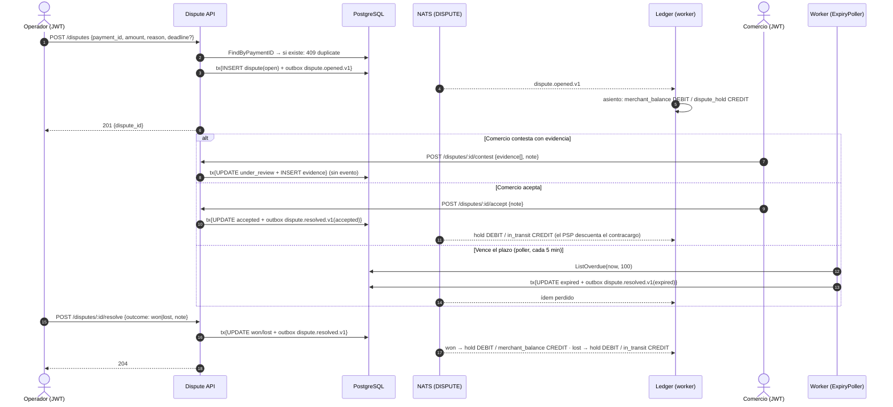
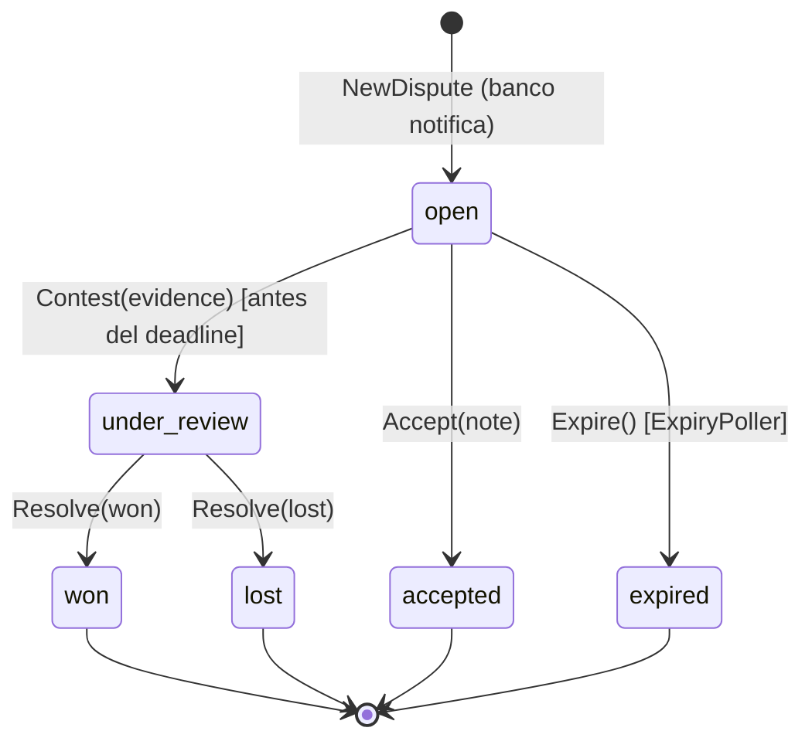
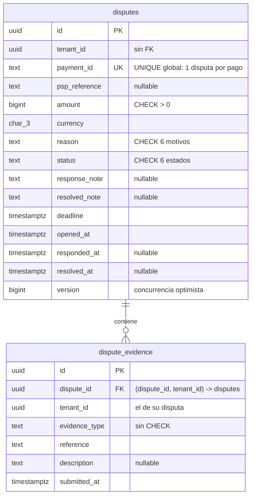

# Disputes & Chargebacks — Documentación técnico-funcional

> **Bounded Context:** `context/dispute`
> **Migraciones:** [`000012_dispute_init`](../../migrations/000012_dispute_init.up.sql), versión para concurrencia optimista en [`000042_dispute_version`](../../migrations/000042_dispute_version.up.sql), RLS en [`000043_dispute_rls`](../../migrations/000043_dispute_rls.up.sql)
> **Stream NATS:** `DISPUTE` (`dispute.>`)

---

## 1. Propósito

Dispute gestiona la **impugnación de un pago por parte del pagador ante su banco**
(chargeback). Cuando el banco/PSP notifica una disputa:

1. El operador registra la disputa en la plataforma.
2. Se emite `dispute.opened.v1` → **Ledger congela los fondos** del comercio
   (`merchant_balance → dispute_hold`).
3. El comercio tiene un **plazo (`deadline`)** para contestar con evidencia o aceptar la disputa.
4. El banco resuelve (ganada/perdida), o el sistema la cierra por vencimiento.
5. Se emite `dispute.resolved.v1` → Ledger libera o debita definitivamente los fondos.

Como Payment, este BC **no mueve dinero directamente**: publica eventos que el
`DisputeConsumer` de Ledger consume para registrar los asientos (consistencia
eventual, ver [LEDGER.md](LEDGER.md) §7).

### Estado actual de las integraciones

| Puerto | Implementación cableada | Comentario |
|---|---|---|
| `DisputeRepository` | `postgres.NewDisputeRepository(pool)` | Tablas `disputes` + `dispute_evidence`; una sola disputa por pago (`UNIQUE(payment_id)`). |
| `EventPublisher` | `outbox.NewEventPublisher[disputedomain.Event]` | Outbox transaccional + relay a JetStream (patrón común a todos los BCs). |
| `TxManager` | `postgres.NewTxManager(pool)` | Setea `app.current_tenant` → RLS activo en escrituras. |
| `PaymentReader` | `postgres.NewPaymentReader(pool)` | Lee la fila del pago disputado en `payments` (BC Payment, sin acoplamiento de código): existencia, estado, tenant, monto y moneda. |
| Notificación del banco | **HTTP manual** (`POST /disputes`) | No existe adaptador PSP ni webhook entrante; el operador carga la disputa a mano. |
| `Clock` | `realClock{}` (`time.Now().UTC()`) | Inyectado en API y worker. |

Cableado en dos procesos:

- **[cmd/api/main.go](../../cmd/api/main.go)** (sección *Disputes & Chargebacks*): los 6 casos de uso HTTP.
- **[cmd/worker/main.go](../../cmd/worker/main.go)** (sección *Dispute: Ledger consumer + ExpiryPoller*):
  `ledger.DisputeConsumer` (stream `DISPUTE`, filtro `dispute.>`) y `disputeapp.ExpiryPoller`
  (un ciclo al arrancar y después cada 5 minutos, en lotes de 100).

### Fuera de alcance (hoy)

- Ingesta automática de disputas desde el PSP (webhooks, API de chargebacks).
- Pre-arbitraje, múltiples rondas de evidencia, fees de chargeback, representación legal.
- Envío real de evidencia al banco (solo se guarda la referencia externa).

---

## 2. Lenguaje ubicuo

| Término | Significado |
|---|---|
| **Disputa / Chargeback** (`Dispute`) | Impugnación de un pago iniciada por el pagador ante su banco. Máximo **una por pago**. |
| **Deadline** | Fecha límite para que el comercio conteste o acepte. Si pasa sin acción → `expired` (default: 7 días al abrir). |
| **Evidencia** (`Evidence`) | Documento enviado al banco para defender el pago (`receipt`, `tracking`, `communication`, `other`); se guarda solo la **referencia externa** (URL/ID). |
| **Contestar** (`Contest`) | Presentar evidencia dentro del plazo → `under_review`. |
| **Aceptar** (`Accept`) | El comercio reconoce la devolución sin pelearla → estado final `accepted` (equivale contablemente a perder). |
| **Resolver** (`Resolve`) | El operador registra el fallo del banco: `won` o `lost`. Solo aplica desde `under_review`. |
| **Expirar** (`Expire`) | Cierre automático por vencimiento del plazo (ExpiryPoller) → `expired`. |
| **`dispute_hold`** | Cuenta del Ledger donde se congelan los fondos mientras la disputa está viva. |
| **Overdue** | Disputa aún `open` cuyo deadline ya pasó (`IsOverdue`); visible en los views hasta que el poller la cierre. |

---

## 3. Flujo funcional



---

## 4. Modelo de dominio

### 4.1 Agregado `Dispute`

Archivo: [domain/dispute.go](../../context/dispute/domain/dispute.go)

| Campo | Notas |
|---|---|
| `id`, `tenantID` | UUIDs; `tenantID` es el del pago disputado. `ReconstituteDispute` no revalida. |
| `paymentID` | Referencia TEXT al pago disputado (sin FK: la tabla es de otro BC). `NewDispute` recibe el `PaymentRef` leído por `PaymentReader` y valida: estado `captured` (`ErrPaymentNotCaptured`), monto disputado ≤ capturado (`ErrAmountExceedsPayment`) y misma moneda (`ErrCurrencyMismatch`). La disputa es **siempre del tenant dueño del pago** (`payment.TenantID`; sin tenant válido → error): abrirla es del operador, cuyo tenant no interviene. |
| `capturedAmount` | Monto capturado al abrir. **No se persiste**: al reconstituir, `capturedAmount = amount` (§10). |
| `version` | Concurrencia optimista: nace en 1, cada transición la incrementa una vez y `Update` exige la leída (§9). |
| `pspReference` | ID de la disputa en el PSP/banco. Opcional. |
| `amount`, `currency` | Monto disputado en centavos (> 0 en `NewDispute`). |
| `reason` | `DisputeReason` (ver §4.4). |
| `status` | `DisputeStatus` (ver §4.2). |
| `evidence []Evidence` | Se acumulan; solo se agregan vía `Contest`. |
| `responseNote` | Nota del comercio al contestar. |
| `resolvedNote` | Nota al cerrar: la del comercio (accept), la del operador (resolve) o una fija en `Expire`. |
| `deadline` | Límite para contestar. Default 7 días si el cmd no lo trae; uno ya vencido → `ErrInvalidDeadline`. |
| `openedAt`, `respondedAt`, `resolvedAt` | Timestamps de ciclo de vida. |
| `events []Event` | Solo `DisputeOpenedEvent` y `DisputeResolvedEvent`. `Contest` **no** emite evento. |

### 4.2 Máquina de estados



Estados finales (`IsFinal()`): `won`, `lost`, `accepted`, `expired`.
Transiciones inválidas → `ErrInvalidTransition` (422).

### 4.3 Impacto contable en Ledger

Implementado en [dispute_consumer.go](../../context/ledger/infrastructure/adapters/inbound/nats/dispute_consumer.go):

| Evento | Asiento (idempotency key) |
|---|---|
| `dispute.opened.v1` | `merchant_balance` DEBIT / `dispute_hold` CREDIT — `dispute_opened_<id>` |
| `dispute.resolved.v1` `won` | `dispute_hold` DEBIT / `merchant_balance` CREDIT (reintegro al comercio) — `dispute_resolved_<id>` |
| `dispute.resolved.v1` `lost`/`accepted`/`expired` | `dispute_hold` DEBIT / `in_transit` CREDIT (el PSP descuenta el contracargo de la liquidación) — `dispute_resolved_<id>` |

### 4.4 Value Objects

Archivo: [domain/vo.go](../../context/dispute/domain/vo.go)

| VO | Valores / reglas |
|---|---|
| `DisputeID`, `EvidenceID`, `TenantID` | Strings tipo UUID; `ParseDisputeID`/`ParseTenantID` validan con `uuid.Parse`. |
| `DisputeStatus` | `open`, `under_review`, `won`, `lost`, `accepted`, `expired`; `IsFinal()`. |
| `DisputeReason` | `fraudulent`, `product_not_received`, `product_unacceptable`, `duplicate`, `credit_not_processed`, `general`. `ParseDisputeReason` → `ErrInvalidDisputeReason`. |
| `ResolutionOutcome` | `won`, `lost`, `accepted`, `expired`. `ParseResolutionOutcome` → `ErrInvalidResolutionOutcome`. `Resolve` solo acepta `won`/`lost`. |
| `Evidence` | `evidenceType` (`receipt`/`tracking`/`communication`/`other`, otro → `ErrInvalidEvidenceType`), `reference` (obligatoria), `description`, `submittedAt`. |

### 4.5 Errores de dominio

Archivo: [domain/errors.go](../../context/dispute/domain/errors.go)

| Error | Cuándo | HTTP |
|---|---|---|
| `ErrDisputeNotFound` | ID inexistente o de otro tenant | 404 |
| `ErrDuplicateDispute` | Ya existe disputa para ese `payment_id` | 409 |
| `ErrDisputeAlreadyClosed` | Definido; nunca lo lanza el dominio (llega `ErrInvalidTransition`) | 409 |
| `ErrInvalidTransition` | Transición fuera de la FSM | 422 |
| `ErrDisputeExpired` | `Contest` después del deadline | 422 |
| `ErrEvidenceRequired` | `Contest` con lista vacía | 422 |
| `ErrPaymentNotCaptured` | El pago no está `captured` | 400 |
| `ErrPaymentNotFound` | El pago a disputar no existe | 404 |
| `ErrAmountExceedsPayment`, `ErrCurrencyMismatch`, `ErrInvalidDeadline`, `ErrInvalidEvidenceType` | Monto mayor al capturado, otra moneda, deadline vencido, tipo de evidencia desconocido | 400 |
| `ErrOptimisticLock` | Otra transición modificó la disputa entre la lectura y el `UPDATE` | 409 |
| `ErrInvalidDisputeReason` / `ErrInvalidResolutionOutcome` | Parseo de enums | 400 |

---

## 5. Casos de uso

Archivo: [application/use_cases.go](../../context/dispute/application/use_cases.go)

| Use case | Puertos | Emite evento | Escritura |
|---|---|---|---|
| `OpenDisputeUseCase` | repo, payments, tx, publisher, clock | `dispute.opened.v1` | Save + Publish |
| `ContestDisputeUseCase` | repo, tx, clock | — | Update + evidence |
| `AcceptDisputeUseCase` | repo, tx, publisher | `dispute.resolved.v1 (accepted)` | Update + Publish |
| `ResolveDisputeUseCase` | repo, tx, publisher | `dispute.resolved.v1 (won/lost)` | Update + Publish |
| `GetDisputeUseCase` / `ListDisputesUseCase` | repo, clock | — | lectura |
| `ExpiryPoller` (worker) | repo, tx, publisher, clock, logger | `dispute.resolved.v1 (expired)` | Update + Publish por disputa |

### 5.1 `OpenDispute`

1. Parsea `reason` (inválido → 400). El comando no lleva tenant.
2. **Idempotencia de negocio**: `FindByPaymentID` → si existe, `ErrDuplicateDispute` (409).
   La barrera real es `UNIQUE(payment_id)` en BD; si la carrera la gana la constraint, `Save` devuelve `ErrDuplicatePaymentKey` (23505 sobre `disputes_payment_id_key`) y el caso de uso responde igual 409.
3. `PaymentReader.FindPayment`: un pago inexistente devuelve `ErrPaymentNotFound` (404).
4. `deadline` cero → `now + 7 días`.
5. `NewDispute` valida el pago (§4.1), `amount > 0` y el deadline, y registra `DisputeOpenedEvent`.
6. `RunInTx` con el **tenant del pago** en el contexto (RLS), no el del operador: `Save` + `Publish` (outbox). Resultado: `{dispute_id}`.

### 5.2 `Contest`

Carga la disputa, **compara tenant** (404 ante mismatch), construye `Evidence` con IDs
nuevos y llama a `Dispute.Contest(evidence, note, now)`:

- desde estado ≠ `open` → `ErrInvalidTransition`;
- `now > deadline` → `ErrDisputeExpired`;
- evidencia vacía → `ErrEvidenceRequired`.

Persiste en tx (`Update` re-inserta la evidencia con `ON CONFLICT DO NOTHING`).
**No publica evento**: el paso a `under_review` es interno del BC.

### 5.3 `Accept` / `Resolve`

Ambos: cargar → mutar agregado → tx{Update + Publish}. Diferencias:

- `Accept` exige el tenant del caller y solo funciona desde `open`; fija
  `resolvedNote`/`resolvedAt` y emite outcome `accepted`.
- `Resolve` lo ejecuta el operador (§6), no recibe `TenantID` y solo puede ejecutarse
  desde `under_review` con outcome `won`/`lost`.

### 5.4 `ExpiryPoller`

Goroutine en `cmd/worker`: un ciclo **al arrancar** y después cada **5 minutos** (`expiryInterval`), así que una disputa se cierra a lo sumo ~5 min después de vencer.

Ciclo: `ListOverdue(now, 100)` como operador → por cada disputa: `Expire()` (se saltea si ya no está `open`) → tx{Update + Publish(`expired`)} con el tenant de la disputa. Repite con el siguiente lote mientras el anterior venga lleno y haya cerrado alguna, hasta 10 lotes (1000 disputas) por ciclo; el resto sigue en el próximo. Si un lote no cierra ninguna (todas fallan), corta: pedirlas otra vez daría las mismas. Los errores por disputa se loguean; `ErrOptimisticLock` (el comercio actuó justo al vencer) se saltea sin error.

### 5.5 Views

`toView(d, now)` produce `DisputeView` (snake_case, timestamps RFC3339) incluyendo
`is_overdue` (abierta y deadline pasado) y la evidencia como `EvidenceView[]`.

---

## 6. API HTTP

Archivo: [inbound/http/handler.go](../../context/dispute/infrastructure/adapters/inbound/http/handler.go)

Rutas bajo `/api/v1/disputes`, grupo `protected` (`JWTMiddleware`). Cada ruta tiene su guard (`RouteGuards`, inyectados desde `cmd/api`; `RegisterRoutes` entra en pánico si falta alguno):

| Guard | Rutas | En producción |
|---|---|---|
| `Operator` | abrir, resolver | `RequireRole(platform_support)`: son acciones del operador cuando el banco notifica o falla. Abrir congela fondos del comercio; la disputa queda a nombre del dueño del pago. |
| `Manage` | contestar, aceptar | `RequirePermission(disputes:manage)`, solo `admin`: aceptar entrega el monto disputado, como un reembolso. |
| `Read` | listar, detalle | `RequirePermission(payments:read)`. |

Sin permiso → 403. El tenant sale del JWT (`postgres.TenantIDFromContext`), salvo al abrir: ahí es el del dueño del pago.

| Método | Ruta | Acción | Éxito |
|---|---|---|---|
| `POST` | `/disputes` | Abrir disputa (operador) | `201 {"dispute_id": "…"}` |
| `GET` | `/disputes?status=&limit=` | Listar del tenant (default limit 50) | `200 {"disputes":[…],"count":n}` |
| `GET` | `/disputes/:disputeID` | Detalle con evidencia | `200 DisputeView` |
| `POST` | `/disputes/:disputeID/contest` | Enviar evidencia | `204` |
| `POST` | `/disputes/:disputeID/accept` | Aceptar la disputa (body opcional `{note}`) | `204` |
| `POST` | `/disputes/:disputeID/resolve` | Registrar fallo del banco | `204` |

### 6.1 Abrir — `POST /disputes`

```json
{
  "payment_id": "8f14e45f-…",
  "amount": 125000,
  "currency": "ARS",
  "reason": "fraudulent",
  "psp_reference": "CHB-2026-0001",
  "deadline": "2026-11-03T14:00:00Z"
}
```

Requeridos: `payment_id`, `amount ≥ 1` (centavos), `currency`, `reason` (uno de §4.4).
Opcionales: `psp_reference`, `deadline` (RFC3339; ausente → now+7d; mal formado → 400 `invalid deadline`; en el pasado → 400).

### 6.2 Contestar — `POST /disputes/:disputeID/contest`

```json
{
  "evidence": [
    { "evidence_type": "receipt", "reference": "https://s3/…/invoice.pdf", "description": "Factura entregada" },
    { "evidence_type": "tracking", "reference": "TRK-99887766" }
  ],
  "note": "El cliente recibió el producto el 12/10."
}
```

`evidence` requerido (≥1 item); por item: `evidence_type` y `reference` requeridos.

### 6.3 Resolución — `POST /disputes/:disputeID/resolve`

Body: `{ "outcome": "won" | "lost", "note": "…" }` (`outcome` requerido).

### 6.4 Ejemplo de `DisputeView`

```json
{
  "id": "…", "tenant_id": "…", "payment_id": "…", "psp_reference": "CHB-2026-0001",
  "amount": 125000, "currency": "ARS", "reason": "fraudulent", "status": "under_review",
  "evidence": [{ "id": "…", "evidence_type": "receipt", "reference": "https://…",
                  "description": "Factura entregada", "submitted_at": "2026-10-27T10:00:00Z" }],
  "response_note": "El cliente recibió el producto…",
  "deadline": "2026-11-03T14:00:00Z", "opened_at": "2026-10-27T09:00:00Z",
  "responded_at": "2026-10-27T10:00:00Z", "is_overdue": false
}
```

### 6.5 Mapeo de errores (`respondError`)

| Condición | HTTP |
|---|---|
| Body inválido / parseo JSON fallido | 400 `invalid request body` |
| `deadline` que no es RFC3339 | 400 `invalid deadline` |
| Reason/outcome inválido, `ErrPaymentNotCaptured` | 400 con mensaje del dominio |
| Monto mayor al capturado, moneda distinta, deadline vencido, tipo de evidencia inválido | 400 con mensaje del dominio |
| Disputa no encontrada (incluye cross-tenant) o pago inexistente | 404 |
| `ErrDuplicateDispute`, `ErrDisputeAlreadyClosed`, `ErrOptimisticLock` (modificada concurrentemente: reintentar) | 409 |
| `ErrInvalidTransition`, `ErrDisputeExpired`, `ErrEvidenceRequired` | 422 |
| Cualquier otro error | 500 `internal server error` |

---

## 7. Eventos

### 7.1 Publicados (stream `DISPUTE`, sujetos `dispute.>`)

| Subject | Payload | Quién lo dispara |
|---|---|---|
| `dispute.opened.v1` | `dispute_id, payment_id, tenant_id, amount, currency, reason, deadline` | `NewDispute` (vía `OpenDispute`) |
| `dispute.resolved.v1` | `dispute_id, payment_id, tenant_id, amount, currency, outcome` (`won\|lost\|accepted\|expired`) | `Accept`, `Resolve`, `Expire` |

Publicación por **outbox transaccional** (`pkg/outbox` → relay JetStream); el `event_id`
es UUID y sirve de `Nats-Msg-Id` (dedupe de 5 min).

### 7.2 Consumidores de los eventos de Dispute

| Consumer | Proceso | Stream/Filtro | Qué hace |
|---|---|---|---|
| `ledger-dispute-consumer` | worker | `DISPUTE` / `dispute.>` | Asientos de hold/liberación (§4.3), idempotente por claves `dispute_opened_*` / `dispute_resolved_*`. `MaxDeliver: 5`. |
| Reporting | worker | `DISPUTE` | Proyección de disputas en el read-model (ver REPORTING.md). |
| Audit | worker | `DISPUTE` | Bitácora. |
| `webhook-dispute-consumer` | worker | `DISPUTE` / `dispute.>` | Entrega `dispute.opened` y `dispute.resolved` a los endpoints suscriptos del comercio (ver WEBHOOK.md). |
| `notification-dispute-consumer` | worker | `DISPUTE` / `dispute.>` | Email al comercio: al abrir, con monto, motivo y plazo para responder; al cerrar, con el resultado (ver NOTIFICATION.md). |

No hay screening de Compliance por tasa de contracargos (§10).

### 7.3 Este BC no consume eventos de otros

La apertura de disputas es 100 % manual por HTTP; no existe adapter inbound NATS en
`context/dispute`.

---

## 8. Persistencia

Archivo: [migrations/000012_dispute_init.up.sql](../../migrations/000012_dispute_init.up.sql)

### 8.1 Tablas



Índices:

- `idx_disputes_tenant_status (tenant_id, status, opened_at DESC)` → listados.
- `idx_disputes_overdue (deadline) WHERE status='open'` → **índice parcial para el ExpiryPoller**.
- `idx_dispute_evidence_dispute (dispute_id)`.

RLS (migración 000043): `disputes` y `dispute_evidence` tienen dos políticas: aislamiento por `NULLIF(current_setting('app.current_tenant', true), '')::uuid` y operador de plataforma (`app.platform_operator = 'on'`) **solo de lectura**. `dispute_evidence` tiene `tenant_id` con FK compuesta a `disputes (id, tenant_id)`. La misma migración agrega a `payments` la política de operador de lectura (y `NULLIF` a la de tenant), para que el operador que abre una disputa lea el pago. Cada método de repositorio corre en la sesión RLS ([rls.go](../../context/dispute/infrastructure/adapters/outbound/postgres/rls.go)); el aislamiento se verifica con un rol sin `BYPASSRLS` (§11).

### 8.2 Queries clave

Archivo: [outbound/postgres/dispute_repo.go](../../context/dispute/infrastructure/adapters/outbound/postgres/dispute_repo.go)

| Método | SQL | Notas |
|---|---|---|
| `Save` | `INSERT INTO disputes (14 cols)` + INSERT evidencia | Usa la conexión del ctx (tx dentro de `RunInTx`). Strings vacíos → NULL (`nullStr`). Evidencia con `ON CONFLICT (id) DO NOTHING` (re-save idempotente). |
| `Update` | `UPDATE disputes SET status, response_note, resolved_note, responded_at, resolved_at, version=<nueva> WHERE id=$1 AND version=<leída>` | 0 filas → `ErrOptimisticLock` (otra transición ganó). No toca `amount`/`deadline`; luego re-inserta toda la evidencia. |
| `ListAll` | `WHERE [status=$1] ORDER BY opened_at DESC LIMIT $n` | Todos los tenants, como operador. **No lo usa ningún caso de uso ni ruta.** |
| `FindByID` / `FindByPaymentID` | `baseSelect WHERE id/payment_id=$1` | Sesión del tenant del llamador; con la marca de operador (abrir, resolver) ve las de cualquier tenant. `pgx.ErrNoRows` → `ErrDisputeNotFound`. |
| `PaymentReader.FindPayment` | `SELECT id, tenant_id, status, amount, currency FROM payments WHERE id=$1` | Sesión del llamador: el operador lee pagos de cualquier tenant por la política de operador de `payments`. |
| `ListByTenant` | `WHERE tenant_id=$1 [AND status=$2] ORDER BY opened_at DESC LIMIT $n` | Sesión del tenant pedido. `statusFilter` no validado (enum desconocido → lista vacía). |
| `ListOverdue` | `WHERE status='open' AND deadline < $1 ORDER BY deadline ASC LIMIT $2` | Como operador (cross-tenant); usado solo por el poller, que escribe cada vencimiento con el tenant de la disputa. |
| scan | `scanWithEvidence` | Carga la evidencia con una query extra **por fila** (N+1 en listings). `COALESCE` para nullable→string. |

---

## 9. Seguridad y multi-tenancy

- **Concurrencia optimista**: cada transición incrementa `version` y el `UPDATE` exige la leída. De dos transiciones concurrentes (contestar y aceptar, resolver dos veces, aceptar justo cuando el poller la vence) gana una: la otra recibe `ErrOptimisticLock` (409) y no publica evento. El poller saltea en silencio la disputa que cambió mientras tanto.
- **Tenant-scoping en aplicación**: `Contest`, `Accept` y `Get` comparan `dispute.TenantID()`
  con el del JWT y responden 404 ante mismatch (no revelan existencia).
- **RLS**: cada lectura y escritura corre en la sesión del tenant que corresponde. Las rutas de operador (abrir, resolver) agregan `platformOperatorScope` después del guard: leen disputas y pagos de otro tenant con la política de operador (solo lectura) y escriben con el tenant de la disputa. El poller lista como operador y vence cada disputa con su tenant.
- **API keys**: el grupo `protected` solo acepta JWT; las disputas no son accesibles
  desde integraciones server-to-server (`X-Api-Key`).
- **Datos sensibles**: solo referencias externas de evidencia (URLs/IDs); no se almacenan
  documentos ni datos del pagador.

---

## 10. Limitaciones conocidas y deuda técnica

| # | Severidad | Tema | Detalle |
|---|---|---|---|
| 1 | Baja | Evidencia: N+1 y una sola ronda | `scanWithEvidence` hace 1 query extra por disputa listada. No hay forma de agregar evidencia en `under_review`. |
| 2 | Baja | Campos de la vista siempre en 0 | `DisputeView` expone `captured_amount` y `version`, pero `toView` no los completa (y `captured_amount` no se persiste). |
| 3 | Producto | Alcance | Sin ingesta automática desde el PSP. Sin vista global para soporte (`ListAll` existe en el repo, sin ruta). Sin alerta de Compliance por tasa de contracargos. Una sola disputa por pago y sin pre-arbitraje. |

---

## 11. Testing

| Capa | Archivos | Tipo |
|---|---|---|
| Dominio | `domain/dispute_test.go`, `events_test.go`, `vo_test.go` | Unitarios: creación y validaciones (tenant del pago, `deadline` en el evento de apertura), cada transición de la FSM, deadline/`ErrDisputeExpired`, evidencia requerida, `IsOverdue`, `IsFinal`, parseo de enums/IDs, reconstitución, eventos registrados. |
| Aplicación | `application/use_cases_test.go`, `expiry_poller_test.go` (+ `mocks_test.go`) | Fakes en memoria de repo/tx/publisher/clock: happy paths, duplicados, cross-tenant, outcomes inválidos, límites de `limit`, mapper `toView`, ciclo del poller (expira, publica, tolera errores, lotes hasta el tope, corte sin avances, primer ciclo al arrancar) y cancelación de contexto. |
| HTTP inbound | `inbound/http/handler_test.go` | Gin + `httptest`: códigos 201/204/400/404/409/422, `RegisterRoutes`, el guard de cada ruta (403; pánico si falta alguno), la marca de operador en abrir y resolver (y no en contestar) y el mapeo de cada error de dominio. |
| Postgres outbound | `outbound/postgres/dispute_repo_test.go`, `integration_test.go` | **pgxmock v4**: SQL exacto de Save/Update (incluido el `WHERE version` y 0 filas → `ErrOptimisticLock`)/finds/ListByTenant/ListOverdue, scan de evidencia, `PaymentReader`, errores de scan/save, `nullStr`. Integración contra PostgreSQL: concurrencia optimista, segunda disputa del mismo pago contra la constraint real (→ `ErrDuplicatePaymentKey`) y RLS con un rol sin `BYPASSRLS` (`dispute_rls_probe`). |
| Ledger (consumidor) | `context/ledger/.../nats/dispute_consumer_test.go` | Asientos generados por `dispute.opened.v1` / `dispute.resolved.v1` según outcome. |

```bash
go test ./context/dispute/... ./context/ledger/infrastructure/adapters/inbound/nats/...
```

`outbound/postgres/integration_test.go` corre contra PostgreSQL (`DATABASE_URL`; se salta si no hay DB): 8 transiciones concurrentes desde la misma versión (gana una) y una foto vieja que ya no escribe. `rls_test.go`, con un rol sin `BYPASSRLS`: aislamiento de disputas y evidencia entre tenants, sin tenant no se ve nada, el operador lee cross-tenant pero no escribe, y el flujo completo operador abre → comercio contesta → operador resuelve. No hay tests contra NATS.

---

## 12. Mapa de código

```text
context/dispute/
├── domain/
│   ├── dispute.go       # Agregado Dispute: FSM (open→under_review/accepted/expired; under_review→won/lost), IsOverdue, PullEvents
│   ├── vo.go            # IDs, DisputeStatus, DisputeReason, ResolutionOutcome, Evidence
│   ├── events.go        # DisputeOpenedEvent, DisputeResolvedEvent (+ baseEvent)
│   └── errors.go        # errores sentinela
├── application/
│   ├── ports.go         # TxManager, DisputeRepository, PaymentReader, EventPublisher, Clock
│   ├── commands.go      # Open/Contest/Accept/Resolve cmds, Get/List queries, DisputeView/EvidenceView
│   └── use_cases.go     # 6 use cases + ExpiryPoller + toView
└── infrastructure/adapters/
    ├── inbound/http/handler.go             # DisputeHandler + RegisterRoutes (6 rutas) + respondError
    ├── outbound/postgres/dispute_repo.go   # Repository (disputes + dispute_evidence, pgx)
    └── outbound/postgres/payment_reader.go # PaymentRef desde la tabla payments

# Colaboradores fuera del BC:
context/ledger/infrastructure/adapters/inbound/nats/dispute_consumer.go  # asientos hold/liberación
cmd/api/main.go        # wiring HTTP (los 6 use cases)
cmd/worker/main.go     # wiring ExpiryPoller + ledger dispute consumer
pkg/eventbus/stream.go # DISPUTE → dispute.>
```

Cableado: el publisher es el genérico `outbox.NewEventPublisher[disputedomain.Event]`;
el reloj inyectado es `realClock{}` (`time.Now().UTC()`). La cuenta `dispute_hold` existe
en Ledger desde `000003_ledger_init.up.sql`.