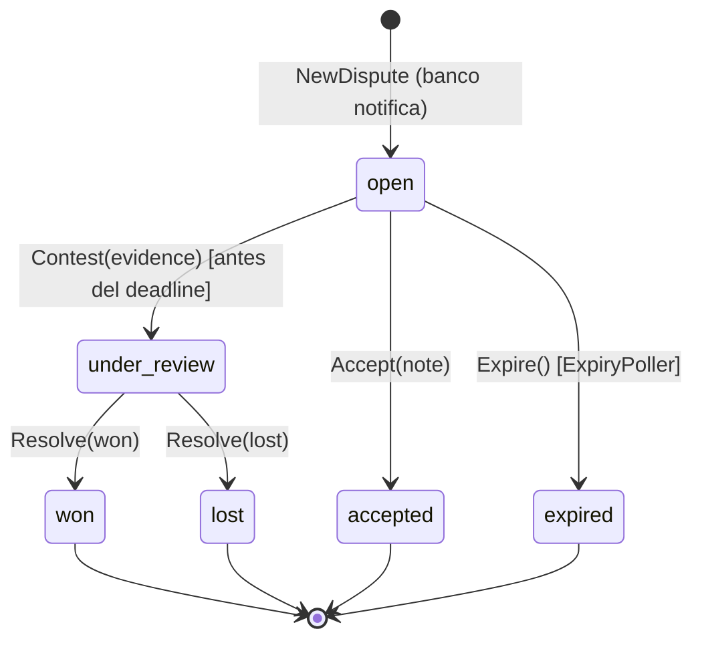
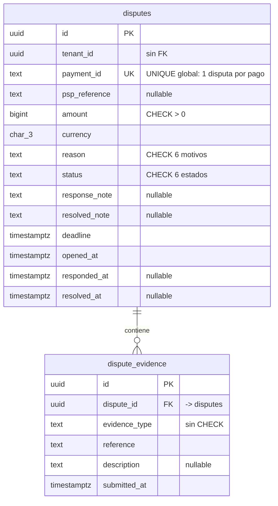

# Disputes & Chargebacks — Documentación técnico-funcional

> **Bounded Context:** `context/dispute`
> **Migración:** [`000012_dispute_init`](../../migrations/000012_dispute_init.up.sql)
> **Stream NATS:** `DISPUTE` (`dispute.>`)

---

## 1. Propósito

Dispute gestiona la **impugnación de un pago por parte del pagador ante su banco**
(chargeback). Cuando el banco/PSP notifica una disputa:

1. El operador registra la disputa en la plataforma.
2. Se emite `dispute.opened.v1` → **Ledger congela los fondos** del comercio
   (`merchant_balance → dispute_hold`).
3. El comercio tiene un **plazo (`deadline`)** para contestar con evidencia o aceptar la disputa.
4. El banco resuelve (ganada/perdida), o el sistema la cierra por vencimiento.
5. Se emite `dispute.resolved.v1` → Ledger libera o debita definitivamente los fondos.

Como Payment, este BC **no mueve dinero directamente**: publica eventos que el
`DisputeConsumer` de Ledger consume para registrar los asientos (consistencia
eventual, ver [LEDGER.md](LEDGER.md) §7).

### Estado actual de las integraciones

| Puerto | Implementación cableada | Comentario |
|---|---|---|
| `DisputeRepository` | `postgres.NewDisputeRepository(pool)` | Tablas `disputes` + `dispute_evidence`; una sola disputa por pago (`UNIQUE(payment_id)`). |
| `EventPublisher` | `outbox.NewEventPublisher[disputedomain.Event]` | Outbox transaccional + relay a JetStream (patrón común a todos los BCs). |
| `TxManager` | `postgres.NewTxManager(pool)` | Setea `app.current_tenant` → RLS activo en escrituras. |
| Notificación del banco | **HTTP manual** (`POST /disputes`) | No existe adaptador PSP ni webhook entrante; el operador carga la disputa a mano. |
| `Clock` | `realClock{}` (`time.Now().UTC()`) | Inyectado en API y worker. |

Cableado en dos procesos:

- **[cmd/api/main.go](../../cmd/api/main.go)** (sección *Disputes & Chargebacks*): los 6 casos de uso HTTP.
- **[cmd/worker/main.go](../../cmd/worker/main.go)** (sección *Dispute: Ledger consumer + ExpiryPoller*):
  `ledger.DisputeConsumer` (stream `DISPUTE`, filtro `dispute.>`) y `disputeapp.ExpiryPoller`
  (ticker de 1 hora, lote de 100).

### Fuera de alcance (hoy)

- Ingesta automática de disputas desde el PSP (webhooks, API de chargebacks).
- Validación de que el `payment_id` exista y esté `captured` (`ErrPaymentNotCaptured` está definido pero **nunca se usa**).
- Pre-arbitraje, múltiples rondas de evidencia, fees de chargeback, representación legal.
- Envío real de evidencia al banco (solo se guarda la referencia externa).
- Webhooks salientes ni notificaciones al comercio por `dispute.*` (ningún BC suscribe ese stream salvo Ledger).
- Concurrencia optimista (contest/accept/resolve simultáneos: last-write-wins).

---

## 2. Lenguaje ubicuo

| Término | Significado |
|---|---|
| **Disputa / Chargeback** (`Dispute`) | Impugnación de un pago iniciada por el pagador ante su banco. Máximo **una por pago**. |
| **Deadline** | Fecha límite para que el comercio conteste o acepte. Si pasa sin acción → `expired` (default: 7 días al abrir). |
| **Evidencia** (`Evidence`) | Documento enviado al banco para defender el pago (`receipt`, `tracking`, `communication`, `other`); se guarda solo la **referencia externa** (URL/ID). |
| **Contestar** (`Contest`) | Presentar evidencia dentro del plazo → `under_review`. |
| **Aceptar** (`Accept`) | El comercio reconoce la devolución sin pelearla → estado final `accepted` (equivale contablemente a perder). |
| **Resolver** (`Resolve`) | El operador registra el fallo del banco: `won` o `lost`. Solo aplica desde `under_review`. |
| **Expirar** (`Expire`) | Cierre automático por vencimiento del plazo (ExpiryPoller) → `expired`. |
| **`dispute_hold`** | Cuenta del Ledger donde se congelan los fondos mientras la disputa está viva. |
| **Overdue** | Disputa aún `open` cuyo deadline ya pasó (`IsOverdue`); visible en los views hasta que el poller la cierre. |

---

## 3. Flujo funcional


---

## 4. Modelo de dominio

### 4.1 Agregado `Dispute`

Archivo: [domain/dispute.go](../../context/dispute/domain/dispute.go)

| Campo | Notas |
|---|---|
| `id`, `tenantID` | UUIDs; `ReconstituteDispute` no revalida. |
| `paymentID` | Referencia TEXT al pago disputado (**sin FK ni validación**). Obligatorio en `NewDispute`. |
| `pspReference` | ID de la disputa en el PSP/banco. Opcional. |
| `amount`, `currency` | Monto disputado en centavos (> 0 en `NewDispute`). |
| `reason` | `DisputeReason` (ver §4.4). |
| `status` | `DisputeStatus` (ver §4.2). |
| `evidence []Evidence` | Se acumulan; solo se agregan vía `Contest`. |
| `responseNote` | Nota del comercio al contestar. |
| `resolvedNote` | Nota del operador al cerrar (accept/resolve; **no** en expire). |
| `deadline` | Límite para contestar. Default 7 días si el cmd no lo trae. |
| `openedAt`, `respondedAt`, `resolvedAt` | Timestamps de ciclo de vida. |
| `events []Event` | Solo `DisputeOpenedEvent` y `DisputeResolvedEvent`. `Contest` **no** emite evento. |

### 4.2 Máquina de estados



Estados finales (`IsFinal()`): `won`, `lost`, `accepted`, `expired`.
Transiciones inválidas → `ErrInvalidTransition` (422).

### 4.3 Impacto contable en Ledger

Implementado en [dispute_consumer.go](../../context/ledger/infrastructure/adapters/inbound/nats/dispute_consumer.go):

| Evento | Asiento (idempotency key) |
|---|---|
| `dispute.opened.v1` | `merchant_balance` DEBIT / `dispute_hold` CREDIT — `dispute_opened_<id>` |
| `dispute.resolved.v1` `won` | `dispute_hold` DEBIT / `merchant_balance` CREDIT (reintegro al comercio) — `dispute_resolved_<id>` |
| `dispute.resolved.v1` `lost`/`accepted`/`expired` | `dispute_hold` DEBIT / `in_transit` CREDIT (el PSP descuenta el contracargo de la liquidación) — `dispute_resolved_<id>` |

### 4.4 Value Objects

Archivo: [domain/vo.go](../../context/dispute/domain/vo.go)

| VO | Valores / reglas |
|---|---|
| `DisputeID`, `EvidenceID`, `TenantID` | Strings tipo UUID; `ParseDisputeID`/`ParseTenantID` validan con `uuid.Parse`. |
| `DisputeStatus` | `open`, `under_review`, `won`, `lost`, `accepted`, `expired`; `IsFinal()`. |
| `DisputeReason` | `fraudulent`, `product_not_received`, `product_unacceptable`, `duplicate`, `credit_not_processed`, `general`. `ParseDisputeReason` → `ErrInvalidDisputeReason`. |
| `ResolutionOutcome` | `won`, `lost`, `accepted`, `expired`. `ParseResolutionOutcome` → `ErrInvalidResolutionOutcome`. `Resolve` solo acepta `won`/`lost`. |
| `Evidence` | `evidenceType` (`receipt`/`tracking`/`communication`/`other` — **sin validación**), `reference`, `description`, `submittedAt`. |

### 4.5 Errores de dominio

Archivo: [domain/errors.go](../../context/dispute/domain/errors.go)

| Error | Cuándo | HTTP |
|---|---|---|
| `ErrDisputeNotFound` | ID inexistente o de otro tenant | 404 |
| `ErrDuplicateDispute` | Ya existe disputa para ese `payment_id` | 409 |
| `ErrDisputeAlreadyClosed` | Definido; nunca lo lanza el dominio (llega `ErrInvalidTransition`) | 409 |
| `ErrInvalidTransition` | Transición fuera de la FSM | 422 |
| `ErrDisputeExpired` | `Contest` después del deadline | 422 |
| `ErrEvidenceRequired` | `Contest` con lista vacía | 422 |
| `ErrPaymentNotCaptured` | Definido; **nunca se usa** (§10.2) | 400 |
| `ErrInvalidDisputeReason` / `ErrInvalidResolutionOutcome` | Parseo de enums | 400 |

---

## 5. Casos de uso

Archivo: [application/use_cases.go](../../context/dispute/application/use_cases.go)

| Use case | Puertos | Emite evento | Escritura |
|---|---|---|---|
| `OpenDisputeUseCase` | repo, tx, publisher | `dispute.opened.v1` | Save + Publish |
| `ContestDisputeUseCase` | repo, tx, clock | — | Update + evidence |
| `AcceptDisputeUseCase` | repo, tx, publisher | `dispute.resolved.v1 (accepted)` | Update + Publish |
| `ResolveDisputeUseCase` | repo, tx, publisher | `dispute.resolved.v1 (won/lost)` | Update + Publish |
| `GetDisputeUseCase` / `ListDisputesUseCase` | repo, clock | — | lectura |
| `ExpiryPoller` (worker) | repo, tx, publisher, clock, logger | `dispute.resolved.v1 (expired)` | Update + Publish por disputa |

### 5.1 `OpenDispute`

1. Parsea `tenant_id` y `reason` (error si inválidos → 400).
2. **Idempotencia de negocio**: `FindByPaymentID` → si existe, `ErrDuplicateDispute` (409).
   La barrera real es `UNIQUE(payment_id)` en BD.
3. `deadline` cero → `now + 7 días`.
4. `NewDispute` valida `payment_id` no vacío y `amount > 0`, y registra `DisputeOpenedEvent`.
5. `RunInTx`: `Save` + `Publish` (outbox). Resultado: `{dispute_id}`.

⚠️ No verifica que el pago exista, esté capturado, ni que el monto disputado sea
coherente con el neto del pago.

### 5.2 `Contest`

Carga la disputa, **compara tenant** (404 ante mismatch), construye `Evidence` con IDs
nuevos y llama a `Dispute.Contest(evidence, note, now)`:

- desde estado ≠ `open` → `ErrInvalidTransition`;
- `now > deadline` → `ErrDisputeExpired`;
- evidencia vacía → `ErrEvidenceRequired`.

Persiste en tx (`Update` re-inserta la evidencia con `ON CONFLICT DO NOTHING`).
**No publica evento**: el paso a `under_review` es interno del BC.

### 5.3 `Accept` / `Resolve`

Ambos: cargar → mutar agregado → tx{Update + Publish}. Diferencias:

- `Accept` exige el tenant del caller y solo funciona desde `open`; fija
  `resolvedNote`/`resolvedAt` y emite outcome `accepted`.
- `Resolve` **no recibe `TenantID` en el comando** (ver §10.1) y solo puede ejecutarse
  desde `under_review` con outcome `won`/`lost`.

### 5.4 `ExpiryPoller`

Goroutine en `cmd/worker`: ticker de **1 hora** (primer ciclo recién a la hora de arrancar).
Ciclo: `ListOverdue(now, 100)` → por cada disputa: `Expire()` (falla silenciosamente si ya
no está `open`) → tx{Update + Publish(`expired`)}. Los errores por disputa se loguean y el
ciclo continúa. Sin paginación: más de 100 vencidas se atienden en ciclos posteriores.

### 5.5 Views

`toView(d, now)` produce `DisputeView` (snake_case, timestamps RFC3339) incluyendo
`is_overdue` (abierta y deadline pasado) y la evidencia como `EvidenceView[]`.

---

## 6. API HTTP

Archivo: [inbound/http/handler.go](../../context/dispute/infrastructure/adapters/inbound/http/handler.go)

Rutas bajo `/api/v1/disputes`, grupo `protected` con **solo `JWTMiddleware`** — sin guards
de permiso ni rol (ver §10.1). El tenant sale del JWT (`postgres.TenantIDFromContext`).

| Método | Ruta | Acción | Éxito |
|---|---|---|---|
| `POST` | `/disputes` | Abrir disputa (operador) | `201 {"dispute_id": "…"}` |
| `GET` | `/disputes?status=&limit=` | Listar del tenant (default limit 50) | `200 {"disputes":[…],"count":n}` |
| `GET` | `/disputes/:disputeID` | Detalle con evidencia | `200 DisputeView` |
| `POST` | `/disputes/:disputeID/contest` | Enviar evidencia | `204` |
| `POST` | `/disputes/:disputeID/accept` | Aceptar la disputa (body opcional `{note}`) | `204` |
| `POST` | `/disputes/:disputeID/resolve` | Registrar fallo del banco | `204` |

### 6.1 Abrir — `POST /disputes`

```json
{
  "payment_id": "8f14e45f-…",
  "amount": 125000,
  "currency": "ARS",
  "reason": "fraudulent",
  "psp_reference": "CHB-2026-0001",
  "deadline": "2026-11-03T14:00:00Z"
}
```

Requeridos: `payment_id`, `amount ≥ 1` (centavos), `currency`, `reason` (uno de §4.4).
Opcionales: `psp_reference`, `deadline` (RFC3339; ausente **o inválido** → now+7d).

### 6.2 Contestar — `POST /disputes/:disputeID/contest`

```json
{
  "evidence": [
    { "evidence_type": "receipt", "reference": "https://s3/…/invoice.pdf", "description": "Factura entregada" },
    { "evidence_type": "tracking", "reference": "TRK-99887766" }
  ],
  "note": "El cliente recibió el producto el 12/10."
}
```

`evidence` requerido (≥1 item); por item: `evidence_type` y `reference` requeridos.

### 6.3 Resolución — `POST /disputes/:disputeID/resolve`

Body: `{ "outcome": "won" | "lost", "note": "…" }` (`outcome` requerido).

### 6.4 Ejemplo de `DisputeView`

```json
{
  "id": "…", "tenant_id": "…", "payment_id": "…", "psp_reference": "CHB-2026-0001",
  "amount": 125000, "currency": "ARS", "reason": "fraudulent", "status": "under_review",
  "evidence": [{ "id": "…", "evidence_type": "receipt", "reference": "https://…",
                  "description": "Factura entregada", "submitted_at": "2026-10-27T10:00:00Z" }],
  "response_note": "El cliente recibió el producto…",
  "deadline": "2026-11-03T14:00:00Z", "opened_at": "2026-10-27T09:00:00Z",
  "responded_at": "2026-10-27T10:00:00Z", "is_overdue": false
}
```

### 6.5 Mapeo de errores (`respondError`)

| Condición | HTTP |
|---|---|
| Body inválido / parseo JSON fallido | 400 `invalid request body` |
| Reason/outcome inválido, `ErrPaymentNotCaptured` | 400 con mensaje del dominio |
| No encontrada (incluye cross-tenant) | 404 |
| `ErrDuplicateDispute`, `ErrDisputeAlreadyClosed` | 409 |
| `ErrInvalidTransition`, `ErrDisputeExpired`, `ErrEvidenceRequired` | 422 |
| Cualquier otro error | 500 `internal server error` |

---

## 7. Eventos

### 7.1 Publicados (stream `DISPUTE`, sujetos `dispute.>`)

| Subject | Payload | Quién lo dispara |
|---|---|---|
| `dispute.opened.v1` | `dispute_id, payment_id, tenant_id, amount, currency, reason` | `NewDispute` (vía `OpenDispute`) |
| `dispute.resolved.v1` | `dispute_id, payment_id, tenant_id, amount, currency, outcome` (`won\|lost\|accepted\|expired`) | `Accept`, `Resolve`, `Expire` |

Publicación por **outbox transaccional** (`pkg/outbox` → relay JetStream); el `event_id`
es UUID y sirve de `Nats-Msg-Id` (dedupe de 5 min).

### 7.2 Consumidores de los eventos de Dispute

| Consumer | Proceso | Stream/Filtro | Qué hace |
|---|---|---|---|
| `ledger-dispute-consumer` | worker | `DISPUTE` / `dispute.>` | Asientos de hold/liberación (§4.3), idempotente por claves `dispute_opened_*` / `dispute_resolved_*`. `MaxDeliver: 5`. |

**Nadie más** consume `dispute.*`: no hay webhook saliente, notificación al comercio,
proyección en Reporting ni screening de Compliance por disputas (§10.4).

### 7.3 Este BC no consume eventos de otros

La apertura de disputas es 100 % manual por HTTP; no existe adapter inbound NATS en
`context/dispute`.

---

## 8. Persistencia

Archivo: [migrations/000012_dispute_init.up.sql](../../migrations/000012_dispute_init.up.sql)

### 8.1 Tablas



Índices:

- `idx_disputes_tenant_status (tenant_id, status, opened_at DESC)` → listados.
- `idx_disputes_overdue (deadline) WHERE status='open'` → **índice parcial para el ExpiryPoller**.
- `idx_dispute_evidence_dispute (dispute_id)`.

RLS: **solo en `disputes`** (`ENABLE ROW LEVEL SECURITY` + policy
`tenant_id = current_setting('app.current_tenant', true)::uuid`). `dispute_evidence`
no tiene RLS (depende del filtro por tenant en la aplicación).

### 8.2 Queries clave

Archivo: [outbound/postgres/dispute_repo.go](../../context/dispute/infrastructure/adapters/outbound/postgres/dispute_repo.go)

| Método | SQL | Notas |
|---|---|---|
| `Save` | `INSERT INTO disputes (14 cols)` + INSERT evidencia | Usa la conexión del ctx (tx dentro de `RunInTx`). Strings vacíos → NULL (`nullStr`). Evidencia con `ON CONFLICT (id) DO NOTHING` (re-save idempotente). |
| `Update` | `UPDATE disputes SET status, response_note, resolved_note, responded_at, resolved_at WHERE id=$1` | No toca `amount`/`deadline`; luego re-inserta toda la evidencia. Sin control de concurrencia. |
| `FindByID` / `FindByPaymentID` | `baseSelect WHERE id/payment_id=$1` | Viaja por la conexión del ctx: dentro de tx queda filtrada por RLS. `pgx.ErrNoRows` → `ErrDisputeNotFound`. |
| `ListByTenant` | `WHERE tenant_id=$1 [AND status=$2] ORDER BY opened_at DESC LIMIT $n` | Corre sobre el **pool directo** (fuera de tx): filtro explícito, no depende de RLS. `statusFilter` no validado (enum desconocido → lista vacía). |
| `ListOverdue` | `WHERE status='open' AND deadline < $1 ORDER BY deadline ASC LIMIT $2` | Pool directo; usado solo por el poller. |
| scan | `scanWithEvidence` | Carga la evidencia con una query extra **por fila** (N+1 en listings). `COALESCE` para nullable→string. |

---

## 9. Seguridad y multi-tenancy

- **Tenant-scoping en aplicación**: `Contest`, `Accept` y `Get` comparan `dispute.TenantID()`
  con el del JWT y responden 404 ante mismatch (no revelan existencia).
- **Huecos**: `Resolve` opera solo por ID, **sin verificar tenant**; ninguna ruta exige rol
  aunque la semántica reserva `Open`/`Resolve` al operador de plataforma (§10.1).
- **RLS**: activa solo en escrituras que corren dentro de `RunInTx` (setea
  `app.current_tenant`); las lecturas de listado van por pool directo con filtro explícito.
- **API keys**: el grupo `protected` solo acepta JWT; las disputas no son accesibles
  desde integraciones server-to-server (`X-Api-Key`).
- **Datos sensibles**: solo referencias externas de evidencia (URLs/IDs); no se almacenan
  documentos ni datos del pagador.

---

## 10. Limitaciones conocidas y deuda técnica

| # | Tema | Detalle | Impacto |
|---|---|---|---|
| 1 | **Sin control de roles** | `POST /disputes` (abrir) y `POST /:id/resolve` (fallo del banco) cuelgan de `protected` sin `RequireRole(RolePlatformSupport)`: cualquier usuario de cualquier tenant puede abrir disputas contra pagos ajenos y resolver disputas. `ResolveDisputeCmd` ni siquiera lleva `TenantID`. | **Alto** |
| 2 | Pago no validado | No se comprueba existencia, estado `captured` ni coherencia del monto; `ErrPaymentNotCaptured` es código muerto. `payment_id` es TEXT sin FK: se puede disputar un pago inexistente. | Alto |
| 3 | Cross-tenant posible en Open | `PaymentID` no se contrasta con la tabla `payments`; la disputa se atribuye al tenant del caller, no al dueño del pago. | Alto |
| 4 | Disputas invisibles fuera de Ledger | Sin webhooks, sin notificación al comercio (que desconoce plazos por el canal oficial), sin proyección en Reporting, sin alerta de Compliance por tasa de chargebacks. | Funcional |
| 5 | Sin concurrencia optimista | `FindByID` fuera de tx + `UPDATE` sin versión: operaciones concurrentes publican dos `resolved.v1` (last-write-wins). La idempotencia del Ledger amortigua el doble asiento, no la doble resolución lógica. | Medio |
| 6 | Race en la idempotencia de apertura | TOCTOU entre `FindByPaymentID` e `INSERT`; si gana la constraint `UNIQUE(payment_id)`, el error genérico se responde **500** en lugar de 409. | Bajo/Medio |
| 7 | Deadline ignorado silenciosamente | Un `deadline` malformado en el JSON se descarta y aplica now+7d sin error. No se rechaza un deadline en el pasado (la disputa nace expirable). | Bajo |
| 8 | Poller: latencia y escala | Ciclo horario ⇒ hasta ~1 h entre vencimiento y cierre; primer ciclo no corre hasta la primera hora; lote fijo de 100 sin paginación. `Expire()` no deja `resolvedNote`. | Bajo |
| 9 | Evidencia: N+1 y sin validación | `scanWithEvidence` hace 1 query extra por disputa listada; `evidence_type` acepta cualquier string. No hay forma de agregar evidencia en `under_review` (una sola ronda). | Bajo |
| 10 | Sin vista operatoria global | No hay endpoint multi-tenant para que soporte vea todas las disputas abiertas de la plataforma (el diseño RLS/filtro lo impide). | Funcional |

---

## 11. Testing

| Capa | Archivos | Tipo |
|---|---|---|
| Dominio | `domain/dispute_test.go`, `events_test.go`, `vo_test.go` | Unitarios: creación y validaciones, cada transición de la FSM, deadline/`ErrDisputeExpired`, evidencia requerida, `IsOverdue`, `IsFinal`, parseo de enums/IDs, reconstitución, eventos registrados. |
| Aplicación | `application/use_cases_test.go`, `expiry_poller_test.go` (+ `mocks_test.go`) | Fakes en memoria de repo/tx/publisher/clock: happy paths, duplicados, cross-tenant, outcomes inválidos, límites de `limit`, mapper `toView`, ciclo del poller (expira, publica, tolera errores) y cancelación de contexto. |
| HTTP inbound | `inbound/http/handler_test.go` | Gin + `httptest`: códigos 201/204/400/404/409/422 y `RegisterRoutes`. |
| Postgres outbound | `outbound/postgres/dispute_repo_test.go` | **pgxmock v4**: SQL exacto de Save/Update/finds/ListByTenant/ListOverdue, scan de evidencia, errores de scan/save, `nullStr`. |
| Ledger (consumidor) | `context/ledger/.../nats/dispute_consumer_test.go` | Asientos generados por `dispute.opened.v1` / `dispute.resolved.v1` según outcome. |

```bash
go test ./context/dispute/... ./context/ledger/infrastructure/adapters/inbound/nats/...
```

No hay tests de integración contra PostgreSQL real (todo pgxmock) ni contra NATS.

---

## 12. Mapa de código

```text
context/dispute/
├── domain/
│   ├── dispute.go       # Agregado Dispute: FSM (open→under_review/accepted/expired; under_review→won/lost), IsOverdue, PullEvents
│   ├── vo.go            # IDs, DisputeStatus, DisputeReason, ResolutionOutcome, Evidence
│   ├── events.go        # DisputeOpenedEvent, DisputeResolvedEvent (+ baseEvent)
│   └── errors.go        # 9 errores sentinela
├── application/
│   ├── ports.go         # TxManager, DisputeRepository, EventPublisher, Clock
│   ├── commands.go      # Open/Contest/Accept/Resolve cmds, Get/List queries, DisputeView/EvidenceView
│   └── use_cases.go     # 6 use cases + ExpiryPoller + toView
└── infrastructure/adapters/
    ├── inbound/http/handler.go             # DisputeHandler + RegisterRoutes (6 rutas) + respondError
    └── outbound/postgres/dispute_repo.go   # Repository (disputes + dispute_evidence, pgx)

# Colaboradores fuera del BC:
context/ledger/infrastructure/adapters/inbound/nats/dispute_consumer.go  # asientos hold/liberación
cmd/api/main.go        # wiring HTTP (los 6 use cases)
cmd/worker/main.go     # wiring ExpiryPoller + ledger dispute consumer
pkg/eventbus/stream.go # DISPUTE → dispute.>
```

Cableado: el publisher es el genérico `outbox.NewEventPublisher[disputedomain.Event]`;
el reloj inyectado es `realClock{}` (`time.Now().UTC()`). La cuenta `dispute_hold` existe
en Ledger desde `000003_ledger_init.up.sql`.