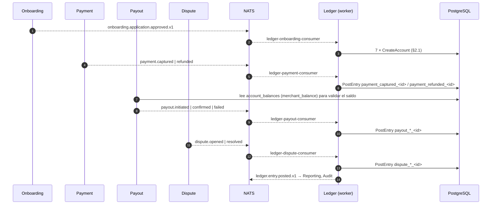
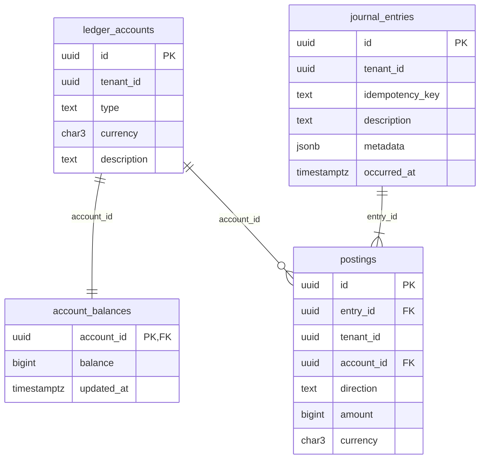

# Ledger (Libro Mayor) — Documentación técnico-funcional

> **Bounded Context:** `context/ledger`
> **Migraciones:** [`000003_ledger_init`](../../migrations/000003_ledger_init.up.sql), ajuste del `CHECK` de tipos en [`000007_payout_init`](../../migrations/000007_payout_init.up.sql)
> **Stream NATS:** `LEDGER` (`ledger.>`)

---

## 1. Propósito

Ledger es el **libro mayor de doble partida** de la plataforma y la **fuente de verdad del dinero**. Registra cada hecho económico (pago capturado, desembolso, disputa) como un **asiento** inmutable compuesto por **postings** que balancean, y mantiene el **saldo** de cada cuenta.

Principios de diseño:

| Principio | Cómo se implementa |
|---|---|
| Doble partida | Validada en el dominio (`validateBalance`) y reforzada en la base por un *constraint trigger* diferido. |
| Append-only | No hay `UPDATE` ni `DELETE` de asientos ni postings: los errores se corrigen con un **asiento de reversa**. |
| Idempotencia | `UNIQUE (tenant_id, idempotency_key)` en `journal_entries` + chequeo previo en el caso de uso. |
| Saldos consistentes | `account_balances` se actualiza en la **misma transacción** que el asiento. |
| Dinero sin flotantes | `int64` en unidades mínimas (centavos) + código ISO 4217. |

Ledger es mayormente **reactivo**: la mayoría de los asientos los generan sus consumers a partir de eventos de Onboarding, Payment, Payout y Dispute. También expone una API HTTP (§6).

---

## 2. Lenguaje ubicuo

| Término | Significado |
|---|---|
| **Cuenta** (`Account`) | Cuenta contable de un tenant, con un tipo y una moneda. Única por `(tenant, tipo, moneda)`. |
| **Asiento** (`JournalEntry`) | Hecho económico completo: ≥ 2 postings que balancean. Agregado raíz. |
| **Posting** | Línea de un asiento: cuenta + dirección (`debit`/`credit`) + monto > 0. |
| **Saldo** | Proyección acumulada por cuenta en `account_balances`. |
| **Clave de idempotencia** | Identifica unívocamente un asiento dentro del tenant (p. ej. `payment_captured_<id>`). |
| **Reversa** | Asiento que invierte débitos↔créditos de otro, dejando el efecto neto en cero. |

### 2.1 Tipos de cuenta

| Tipo | Uso previsto | ¿Quién la crea? |
|---|---|---|
| `merchant_balance` | Saldo disponible del comercio (lo que la plataforma le debe). | Consumer de Onboarding |
| `reserve` | Reserva de garantía (*rolling reserve*). | Consumer de Onboarding (sin movimientos hoy) |
| `dispute_hold` | Fondos congelados por disputas. | Consumer de Onboarding |
| `payout_transit` | Fondos en camino al banco del comercio. | Consumer de Onboarding |
| `payout_sent` | Fondos confirmados como enviados. | Consumer de Onboarding |
| `in_transit` | Fondos cobrados que el PSP aún no liquidó. Saldo negativo: lo que el PSP adeuda. | Consumer de Onboarding |
| `platform_fees` | Comisiones de la plataforma. | Consumer de Onboarding |

---

## 3. Flujo funcional



---

## 4. Modelo de dominio

### 4.1 `Money`

Archivo: [domain/vo.go](../../context/ledger/domain/vo.go)

- `amount int64 ≥ 0` en unidades mínimas; `currency` de 3 letras, normalizada a mayúsculas.
- El sentido del movimiento **no** se expresa con el signo sino con `Direction`.
- `Add` falla si las monedas difieren (`ErrInvalidMoneyOp`).

### 4.2 Agregado `Account`

Archivo: [domain/account.go](../../context/ledger/domain/account.go)

Solo creación: no se modifica ni se elimina. Valida la moneda y la **normaliza a mayúsculas** (`"ars"` → `"ARS"`), para que coincida con la de los postings. Emite `ledger.account.created.v1`. Al persistirla se inicializa su fila en `account_balances` con saldo 0.

### 4.3 Agregado `JournalEntry` y `Posting`

Archivo: [domain/entry.go](../../context/ledger/domain/entry.go)

Invariantes de `NewJournalEntry`:

1. Al menos **2 postings** (`ErrNotEnoughPostings`).
2. Todos con la **misma moneda** (`ErrCurrencyMismatch`).
3. Todo monto **> 0** (`ErrZeroAmount`).
4. **Σ débitos = Σ créditos** (`ErrEntryNotBalanced`).

Al crearse emite `ledger.entry.posted.v1` con todos sus postings.

`BuildReverse(reverseID, key)` genera un asiento con cada posting invertido, descripción `"Reversa de: …"` y metadata `original_entry_id`. **Reemplaza** el evento `entry.posted` por `ledger.entry.reversed.v1`, que lleva los postings de la reversa para quien proyecta movimientos (Reporting).

El agregado no conoce las cuentas. Que existan, pertenezcan al tenant y tengan la moneda del posting lo valida `PostEntry` antes de construirlo (§5.1).

### 4.4 Convención de saldos

Archivo: [balance_repo.go](../../context/ledger/infrastructure/adapters/outbound/postgres/balance_repo.go)

`Apply` aplica la misma regla a **todas** las cuentas, sin importar su tipo:

```
credit → balance += amount
debit  → balance -= amount
```

Los consumers asientan con las direcciones de la contabilidad estándar, así que el saldo se lee igual en todas las cuentas de pasivo e ingreso:

| Cuenta | Saldo positivo significa | Sube con |
|---|---|---|
| `merchant_balance` | Lo que la plataforma le debe al comercio. Payout exige que sea > 0. | Pago capturado, disputa ganada, payout fallido |
| `platform_fees` | Comisiones ganadas. | Pago capturado |
| `dispute_hold` | Fondos congelados por disputas abiertas. | Disputa abierta |
| `payout_transit` | Payouts iniciados sin confirmar. | Payout iniciado |
| `payout_sent` | Total enviado a bancos. | Payout confirmado |

`in_transit` es la única cuenta de activo: queda **negativa** mientras el PSP adeuda la liquidación (un pago la debita; un reembolso o un contracargo la acreditan). Reporting calcula su neto con la misma regla.

### 4.5 Errores

Archivo: [domain/errors.go](../../context/ledger/domain/errors.go)

| Error | HTTP |
|---|---|
| `ErrAccountNotFound` (incluye cuentas de otro tenant), `ErrEntryNotFound` | 404 |
| `ErrEntryNotBalanced`, `ErrCurrencyMismatch`, `ErrAccountCurrencyMismatch`, `ErrNotEnoughPostings`, `ErrZeroAmount`, `ErrInvalidDirection`, `ErrInvalidAccountType`, `ErrInvalidCurrency`, `ErrNegativeAmount` | 422 |
| `ErrEntryAlreadyExists` | 409 (declarado pero **nunca devuelto**) |
| `ErrAccountAlreadyExists` | 409 (en la práctica no llega al HTTP: `CreateAccount` la resuelve devolviendo la cuenta existente) |
| Otros: IDs inválidos, violación de `UNIQUE` de asientos o del trigger, cuenta inexistente en `Apply` | 500 |

---

## 5. Casos de uso

Directorio: [application/](../../context/ledger/application/)

| Caso de uso | Qué hace | Evento |
|---|---|---|
| `CreateAccount` | **Idempotente** por `(tenant, tipo, moneda)`: si ya existe devuelve su ID con `WasExisting=true`, sin evento. Si no existe, crea la cuenta y su saldo en 0 en una transacción. Ante una carrera, el `UNIQUE` → `ErrAccountAlreadyExists` → se relee la cuenta y se devuelve. | `ledger.account.created.v1` (solo si la crea) |
| `PostEntry` | Valida, chequea idempotencia y en **una transacción** guarda el asiento + postings, aplica los saldos y publica en el outbox. | `ledger.entry.posted.v1` |
| `ReverseEntry` | Carga el original, verifica el tenant y la idempotencia (`reverse_<clave original>`), y persiste la reversa igual que `PostEntry`. | `ledger.entry.reversed.v1` |
| `GetBalance` | Devuelve el saldo y la moneda de una cuenta **del tenant**. Una cuenta de otro tenant → `ErrAccountNotFound`. | — |

### 5.1 `PostEntry` en detalle

```
1. idempotency_key no vacía, ≥ 2 líneas, tenant_id válido
2. FindByIdempotencyKey(tenant, key)
     └─ existe → devuelve {entry_id, was_existing: true}   (sin comparar contenido)
3. Parsear líneas → validateAccounts: cada cuenta existe, es del tenant
   (si no → ErrAccountNotFound) y su moneda = la del posting (ErrAccountCurrencyMismatch)
   → NewJournalEntry (invariantes §4.3)
4. RunInTx {
     entryRepo.Save      → journal_entries + postings
     balanceRepo.Apply   → UPDATE account_balances SET balance = balance ± amount
     publisher.Publish   → outbox_messages
   }   // al COMMIT corre el trigger diferido check_entry_balance
```

- Si `occurred_at` viene vacío se usa el reloj. El HTTP siempre lo completa.
- La idempotencia es **check-then-insert**: dos requests concurrentes con la misma clave pasan el chequeo, y la segunda falla con una violación de `UNIQUE` → **500** en lugar de devolver el asiento existente.
- Reusar una clave con **otro contenido** devuelve el asiento original sin avisar.

---

## 6. API HTTP

Directorio: [infrastructure/adapters/inbound/http/](../../context/ledger/infrastructure/adapters/inbound/http/)

Rutas bajo `/api/v1/ledger`, protegidas por JWT. El tenant sale del token. Las rutas de **escritura** pasan además por un `writeGuard` que `cmd/api` inyecta como `RequireRole(platform_support)`, así Ledger no importa Auth. `RegisterRoutes` entra en pánico si el guard es `nil`.

| Método | Ruta | Rol | Éxito |
|---|---|---|---|
| `POST` | `/ledger/accounts` | `platform_support` | `201 {"account_id"}` nueva / `200` si ya existía |
| `GET` | `/ledger/accounts/:accountID/balance` | cualquiera (solo cuentas propias) | `200 {"account_id","balance","currency"}` |
| `POST` | `/ledger/entries` | `platform_support` | `201` nuevo / `200` si la clave ya existía: `{"entry_id","was_existing"}` |
| `POST` | `/ledger/entries/:entryID/reverse` | `platform_support` | `201 {"reverse_entry_id"}` (también si la reversa ya existía) |

Sin el rol → `403 insufficient permissions`. Como el tenant sale del token y `PostEntry` valida el tenant de cada cuenta, un usuario `platform_support` solo puede postear sobre las cuentas **de su propio tenant**. Los ajustes manuales sobre un comercio requieren un endpoint de operador específico, que hoy no existe.

### 6.1 Crear cuenta

```json
{ "account_type": "merchant_balance", "currency": "ARS", "description": "Saldo del comercio" }
```

Si la cuenta ya existe para `(tenant, tipo, moneda)` → `200` con el `account_id` existente.

### 6.2 Registrar asiento

```json
{
  "idempotency_key": "manual_adj_2026_10_001",
  "description": "Ajuste manual",
  "occurred_at": "2026-10-26T12:00:00Z",
  "metadata": { "ticket": "OPS-123" },
  "lines": [
    { "account_id": "…", "direction": "debit",  "amount": 15000, "currency": "ARS" },
    { "account_id": "…", "direction": "credit", "amount": 15000, "currency": "ARS" }
  ]
}
```

Binding HTTP: `idempotency_key` requerido, `lines` mínimo 2, y cada línea con `account_id`, `direction`, `amount ≥ 1` y `currency`. Una cuenta inexistente o de otro tenant → `404`. Una moneda distinta a la de la cuenta → `422`.

### 6.3 Saldo

`GET /ledger/accounts/:accountID/balance` → `{"account_id":"…","balance":-12500,"currency":"ARS"}`. El saldo puede ser negativo: no hay control de sobregiro.

---

## 7. Eventos

### 7.1 Publicados (stream `LEDGER`)

| Subject | Payload | Consumidores |
|---|---|---|
| `ledger.account.created.v1` | `account_id`, `tenant_id`, `account_type`, `currency` | Audit |
| `ledger.entry.posted.v1` | `entry_id`, `tenant_id`, `idempotency_key`, `description`, `postings[]{account_id, direction, amount, currency}` | Audit, **Reporting** (proyección de saldos por comercio) |
| `ledger.entry.reversed.v1` | `reverse_entry_id`, `original_entry_id`, `tenant_id`, `postings[]` (los de la reversa) | Audit, Reporting |

Los headers son los estándar del Outbox (ver ONBOARDING.MD §7).

### 7.2 Consumidos

Todos corren en `cmd/worker` con `MaxDeliver: 5`. Si fallan los 5 intentos, el mensaje se descarta y no queda registro del asiento.

| Durable | Filtro | Asiento (según el código) | Clave de idempotencia |
|---|---|---|---|
| `ledger-onboarding-consumer` | `onboarding.application.approved.v1` | Crea las 7 cuentas (§2.1) en `currency` (default `ARS`). La migración 000036 completó `in_transit` y `platform_fees` a los comercios aprobados antes. | — (no es un asiento) |
| `ledger-payment-consumer` | `payment.>` | **captured:** `in_transit` D (amount − psp_fee) · `merchant_balance` C (amount − platform_fee − psp_fee) · `platform_fees` C platform_fee (si es > 0; sin la cuenta, error). **refunded:** `merchant_balance` D · `in_transit` C, por `refund_amount` (las comisiones no se devuelven). El resto de los eventos se ignora. | `payment_captured_<payment_id>`, `payment_refunded_<payment_id>` |
| `ledger-payout-consumer` | `payout.>` | **initiated:** `merchant_balance` D · `payout_transit` C. **confirmed:** `payout_transit` D · `payout_sent` C. **failed:** `payout_transit` D · `merchant_balance` C | evento `idempotency_key` o `payout_initiated_<id>`; `payout_confirmed_<id>`; `payout_failed_<id>` |
| `ledger-dispute-consumer` | `dispute.>` | **opened:** `merchant_balance` D · `dispute_hold` C. **resolved won:** `dispute_hold` D · `merchant_balance` C. **resolved lost/accepted/expired:** `dispute_hold` D · `in_transit` C (el PSP descuenta el contracargo) | `dispute_opened_<id>`, `dispute_resolved_<id>` |

C = crédito (suma al saldo), D = débito (resta del saldo), según `Apply`.

### 7.3 Lecturas directas de otros BCs

[`payout/.../outbound/ledger/balance_checker.go`](../../context/payout/infrastructure/adapters/outbound/ledger/balance_checker.go) consulta `account_balances` ⨝ `ledger_accounts` (tipo `merchant_balance`) para validar el saldo antes de iniciar un payout: exige **disponible > 0 y ≥ monto**. Como el débito de `payout.initiated.v1` llega de forma asíncrona, el disponible resta los payouts cuyo asiento (`ledger_entry_key`) todavía no está en `journal_entries`, salvo los fallidos. Lee con la conexión de la tx de Payout, que tiene el tenant fijado y el advisory lock. Esto acopla Payout al esquema y a la **convención de signo** de Ledger.

---

## 8. Persistencia



| Tabla | Restricciones clave | RLS |
|---|---|---|
| `ledger_accounts` | `UNIQUE (tenant_id, type, currency)`; `CHECK type IN (…7 tipos)` desde la migración 000007 | Sí (tenant + operador) |
| `account_balances` | PK = `account_id`; `balance BIGINT` (puede ser negativo) | **No** (no tiene `tenant_id`) |
| `journal_entries` | `UNIQUE (tenant_id, idempotency_key)`; índice `(tenant_id, created_at DESC)` | Sí (tenant + operador) |
| `postings` | `amount > 0`; `direction IN ('debit','credit')`; FK a la cuenta (sin chequear el tenant) | Sí (tenant + operador) |

**Trigger `trg_check_entry_balance`**: `CONSTRAINT TRIGGER … AFTER INSERT ON postings DEFERRABLE INITIALLY DEFERRED`. Al hacer COMMIT, por cada posting insertado recalcula Σ débitos y Σ créditos del asiento, y aborta la transacción si hay ≥ 2 postings y no balancean. Es la segunda línea de defensa, por si alguien inserta por fuera del dominio.

**RLS** (migración 000037): cada tabla tiene dos políticas, aislamiento por `NULLIF(current_setting('app.current_tenant', true), '')::uuid` y operador de plataforma (`app.platform_operator = 'on'`, lectura cross-tenant). Los repos fijan el tenant en cada operación con `withTenant` ([rls.go](../../context/ledger/infrastructure/adapters/outbound/postgres/rls.go)): el del argumento, o el del caller en las búsquedas por ID. Dentro de una transacción lo fija el `TxManager` con el tenant del contexto; los consumers lo toman del payload. Sin tenant, las consultas devuelven 0 filas en lugar de fallar. Hoy la app conecta como owner y el RLS no filtra (ONBOARDING.MD §10.2), pero ya funciona con un rol sin `BYPASSRLS`.

---

## 9. Concurrencia

- `UPDATE account_balances SET balance = balance + $delta` es atómico por fila: no se pierden actualizaciones.
- Los postings se aplican en el orden en que llegan, sin ordenar por `account_id`. Dos asientos concurrentes que tocan las mismas cuentas en distinto orden pueden generar un **deadlock**. Postgres aborta uno; el consumer reintenta, y el HTTP devuelve 500.
- Las lecturas de idempotencia y del asiento original (en la reversa) se hacen **fuera** de la transacción.

---

## 10. Limitaciones conocidas y deuda técnica

| # | Severidad | Tema | Detalle |
|---|---|---|---|
| 1 | Media | Idempotencia con carrera | Check-then-insert (§5.1): un duplicado concurrente → 500 en lugar de `was_existing`. Reusar una clave con otro contenido devuelve el asiento original sin avisar. `ErrEntryAlreadyExists` nunca se emite. |
| 2 | Baja | Posible deadlock | Los postings no se ordenan por `account_id` antes de `Apply` (§9). |
| 3 | Baja | Errores técnicos → 500 | IDs inválidos, cuenta inexistente en `Apply`, violaciones de `UNIQUE`. |
| 4 | Baja | Orden de postings no preservado | Se cargan con `ORDER BY id` (UUID aleatorio). |
| 5 | Baja | `account_balances` sin `tenant_id` | Sin RLS propio: depende de que cada query haga join con `ledger_accounts` o valide la cuenta antes (Payout hace el join; `GetBalance` y `PostEntry` validan la cuenta). |
| 6 | Baja | Consumers poco estrictos | Una disputa con `outcome` desconocido se asienta como perdida. Un pago con neto ≤ 0 reintenta 5 veces un error permanente. Tras 5 fallos el mensaje se descarta sin registro. |
| 7 | Producto | Alcance | Las cuentas de plataforma (`platform_fees`, `in_transit`) son por tenant: no hay revenue consolidado ni cuenta del banco del PSP. `reserve` no tiene movimientos. Un reembolso sale entero de `merchant_balance` (no se devuelven comisiones) y no hay reembolsos parciales. Sin control de sobregiro. Sin listado de cuentas, asientos ni extracto. Sin endpoint de operador para ajustes manuales sobre un comercio (§6). |

---

## 11. Testing

| Capa | Archivos | Tipo |
|---|---|---|
| Dominio | `domain/*_test.go` | `Money`, invariantes de `JournalEntry`, `BuildReverse`, eventos. |
| Aplicación | `application/*_test.go` | `CreateAccount` (incluye idempotencia y carrera), `PostEntry` (idempotencia, cuenta inexistente, cuenta de otro tenant, moneda distinta a la de la cuenta), `GetBalance` (aislamiento), `ReverseEntry`. |
| HTTP | `inbound/http/*_test.go` | Handlers, router, `writeGuard` (403 en las escrituras; la lectura no se ve afectada), 404 cross-tenant y mapeo de errores. |
| NATS | `inbound/nats/*_test.go` | Los 4 consumers con repos y casos de uso falsos, más redelivery y reintento parcial del consumer de Onboarding. `convention_test.go` encadena pago, reembolso, disputas y payouts y verifica el saldo de cada cuenta según `Apply`, y que cada consumer ponga el tenant del payload en el contexto (RLS). |
| Postgres | `outbound/postgres/*_test.go` | Integración contra PostgreSQL (`DATABASE_URL`), incluido el mapeo de `23505` → `ErrAccountAlreadyExists`; se saltan si no hay DB. |

```bash
go test ./context/ledger/...
```

Falta un test de integración de punta a punta contra NATS y Postgres: aprobar onboarding → capturar pago → iniciar payout.

---

## 12. Mapa de código

```
context/ledger/
├── domain/
│   ├── vo.go          # IDs, AccountType, Direction, Money
│   ├── account.go     # Agregado Account
│   ├── entry.go       # Agregado JournalEntry + Posting + BuildReverse + validateBalance
│   ├── events.go      # 3 eventos
│   └── errors.go
├── application/
│   ├── ports.go       # AccountRepository, EntryRepository, BalanceRepository, TxManager, EventPublisher, Clock
│   ├── commands.go
│   ├── create_account.go
│   ├── post_entry.go  # PostEntry + GetBalance + RealClock
│   └── reverse_entry.go
└── infrastructure/adapters/
    ├── inbound/http/  # router, account_handler, entry_handler, response
    ├── inbound/nats/  # onboarding, payment, payout, dispute consumers
    └── outbound/postgres/  # account_repo, entry_repo, balance_repo, rls (withTenant)
```

Cableado:

- [cmd/api/main.go](../../cmd/api/main.go): sección `Ledger` (rutas HTTP).
- [cmd/worker/main.go](../../cmd/worker/main.go): los 4 consumers.
