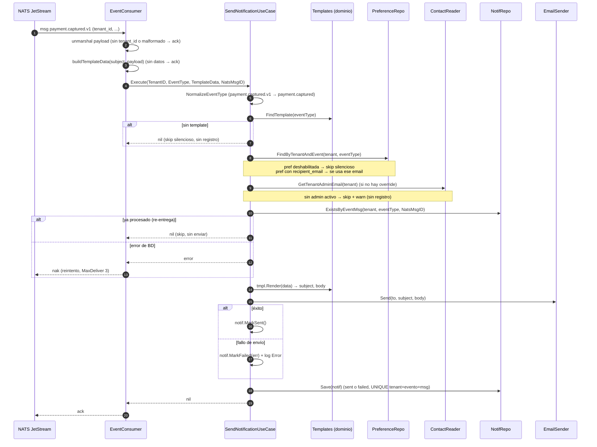

# Notification — Documentación técnico-funcional

> **Bounded Context:** `context/notification`
> **Migraciones:** [`000011_notification_init`](../../migrations/000011_notification_init.up.sql),
> [`000016_notification_dedupe`](../../migrations/000016_notification_dedupe.up.sql),
> [`000028_notification_kyc_template_keys`](../../migrations/000028_notification_kyc_template_keys.up.sql),
> [`000029_notification_rls_nullif`](../../migrations/000029_notification_rls_nullif.up.sql)
> **Streams NATS consumidos:** `PAYMENT` (`payment.>`), `PAYOUT` (`payout.>`), `ONBOARDING` (`onboarding.application.>`), `AUTH` (`auth.tenant.suspended.>`), `DISPUTE` (`dispute.>`)

---

## 1. Propósito

Notification es el contexto que **avisa al comercio por email** cuando ocurre algo relevante
en la plataforma (pago capturado o rechazado, reembolso, payout confirmado o fallido, KYC
aprobado o rechazado, suspensión de cuenta). No publica eventos propios: es un **consumidor
puro** del bus.

Responsabilidades:

1. Suscribirse a eventos de dominio en NATS JetStream (4 consumers).
2. Decidir si el tenant quiere recibir esa notificación (preferencias; default = habilitado).
3. Resolver el destinatario (email override de la preferencia o email del admin del tenant).
4. Renderizar un template hardcodeado por event type.
5. Enviar el email (SMTP o simulado) y **persistir el intento** como log en `notifications`.
6. Exponer API HTTP de historial y preferencias.

Diseño **no crítico pero sin pérdidas silenciosas**: un fallo de envío se registra como
`failed` y no se reintenta (a diferencia de Webhooks). Un fallo transitorio de base de datos
sí hace nak para que JetStream reentregue, y el dedupe evita el doble envío.

### Estado actual de las integraciones

| Puerto | Implementación cableada | Comentario |
|---|---|---|
| `EmailSender` (worker) | `SMTPSender` si `cfg.SMTPHost != ""`, si no `LogSender` | `cmd/worker/main.go` es el único que envía. Sin `SMTP_HOST` (dev) los emails se loguean. |
| API | — | `cmd/api/main.go` solo expone historial y preferencias; no envía. |
| `UserContactReader` | `postgres.ContactReader` | Lee `users ⨝ memberships` (tablas de Auth, misma BD): primer admin `status='active'` por `memberships.created_at ASC`, con sesión RLS del tenant. |
| `NotificationRepository` / `PreferenceRepository` | `postgres.*` | Toda operación fija `app.current_tenant` (§8). |
| `Clock` | reloj real (`cmd`) / fijo (tests) | Fechas de creación, envío y actualización. |
| Consumers NATS | 4, `MaxDeliver: 3` | Nak ante error transitorio; ack en errores permanentes (§7.3). |

### Fuera de alcance (hoy)

- SMS y push (`ChannelSMS`/`ChannelPush` comentados en `vo.go`).
- Reintentos de **envío** (un email `failed` queda registrado y no se reenvía), digest/agregación.
- Publicar eventos propios (ningún outbox de `notification.*`).
- Notificaciones in-app.

---

## 2. Lenguaje ubicuo

| Término | Significado |
|---|---|
| **Notificación** (`Notification`) | Registro (log) de un intento de envío a un destinatario. Una fila por evento procesado. |
| **Preferencia** (`NotificationPreference`) | Configuración por `(tenant, event_type, channel)`: activa/desactivada + email override. Sin fila = default habilitado. |
| **Event type normalizado** | Subject sin sufijo de versión: `payment.captured.v1` → `payment.captured`. Es la **única clave** del pipeline: templates, preferencias (PUT, GET y consumo) y registros. |
| **Template** | Par subject+body HTML con placeholders `{{.key}}`, indexado por event type normalizado. |
| **Destinatario (recipient)** | Email de la preferencia si existe; si no, email del admin del tenant. |
| **Skip silencioso** | No se envía ni se registra: evento sin template, preferencia deshabilitada o sin destinatario. |
| **Dedupe** | Una sola notificación por `(tenant, event_type, nats_msg_id)`: una reentrega del mismo evento no reenvía el email. |

---

## 3. Flujo funcional



---

## 4. Modelo de dominio

### 4.1 Agregado `Notification`

Log de intentos. Invariante de estado:

```
pending ──MarkSent(now)──▶ sent            (sent_at = now)
        ──MarkFailed(reason)──▶ failed     (error_msg = reason; sent_at nil)
```

El caso de uso llama a una sola transición sobre un agregado recién creado; el estado final
se decide en memoria antes de persistir (INSERT único, sin UPDATE). Campos: id (UUID),
tenant_id, event_type (**normalizado**), channel, recipient_email, subject (renderizado),
status, error_msg, sent_at, created_at, nats_msg_id (clave de dedupe; vacío si no viene de
un evento). Las fechas las provee la aplicación (`Clock`).

### 4.2 Entidad `NotificationPreference`

Compuesta por `(tenant_id, event_type, channel)`; `enabled bool` + `recipient_email` opcional
(vacío = usar admin del tenant). Sin máquina de estados: upsert directo.

### 4.3 Value Objects y validaciones

| Elemento | Regla |
|---|---|
| `NotificationID` | UUID v4 (`NewNotificationID`). |
| `TenantID` | `ParseTenantID` exige UUID (`ErrInvalidTenantID`). |
| `Channel` | Solo `"email"`; otro valor → `ErrInvalidChannel` (también al leer de la base). |
| `NotificationStatus` | `pending`/`sent`/`failed`; `ParseStatus` valida al leer de la base (`ErrInvalidStatus`). |
| `NormalizeEventType` | Quita el sufijo `.vN`. |
| `ValidateRecipientEmail` | Trim + minúsculas; formato RFC 5322 (`net/mail`) y longitud máxima. Vacío = sin override. |

### 4.4 Errores (`errors.go`)

| Error | Dónde |
|---|---|
| `ErrInvalidTenantID` | Parseo del tenant. En el consumer es permanente → ack con warning. |
| `ErrPreferenceNotFound` | Repo; el caso de uso lo interpreta como "sin preferencia". |
| `ErrNoRecipientEmail` | `ContactReader` sin admin activo → skip con warning. |
| `ErrNotificationDuplicate` | `Save` ante la UNIQUE de dedupe → skip (reentrega). |
| `ErrInvalidChannel`, `ErrInvalidStatus` | Parseo de VOs (incluida la lectura de la base). |

Errores de aplicación de preferencias (`application/preferences.go`):
`ErrInvalidPreferenceRequest` (400), `ErrEventTypeUnknown` (404), `ErrPreferenceStore` (500).

---

## 5. Casos de uso

### 5.1 `SendNotificationUseCase` (invocado por el consumer)

Firma: `Execute(ctx, SendNotificationCmd{TenantID, EventType, TemplateData, NatsMsgID}) error`.

1. `ParseTenantID` inválido → error (el consumer lo trata como permanente: ack).
2. Normaliza el event type. Sin template → `nil`, sin registro.
3. Preferencia deshabilitada → skip silencioso. Sin admin activo → skip + `Warn`.
4. **Dedupe**: si `NatsMsgID` ya está registrado para `(tenant, event_type)` → skip. Si la
   verificación falla → **error** (nak): se prefiere reintentar antes que arriesgar un doble
   envío.
5. Render, envío, `MarkSent`/`MarkFailed` y `Save`. La UNIQUE de dedupe cierra la carrera
   entre dos entregas concurrentes (`ErrNotificationDuplicate` → skip). Otro fallo de `Save`
   se loguea y no se propaga (el email ya salió).

### 5.2 `ListNotificationsUseCase`

`limit ≤ 0 → 50`, máximo **200**. Proyecta a `NotificationView` con fechas RFC3339.

### 5.3 `UpdatePreferenceUseCase`

- Normaliza el event type; sin template → `ErrEventTypeUnknown` (404).
- `recipient_email` presente → se valida y canonicaliza; inválido → 400.
- **Merge**: `recipient_email` omitido conserva el override existente; `""` explícito lo limpia.
- `channel` siempre `email`; `Upsert` con la sesión RLS del tenant.

### 5.4 `GetPreferencesUseCase`

Une el catálogo de templates con lo guardado: cada event type normalizado con su preferencia
o el default (`enabled=true`, sin override). Tolera filas legacy con sufijo de versión.

---

## 6. API HTTP

Grupo `protected` (JWT) → `/api/v1/notifications`. El tenant sale del token; sin tenant en el
contexto → **403**.

| Método | Ruta | Descripción | Respuestas |
|---|---|---|---|
| `GET` | `/notifications?limit=50` | Historial del tenant, `created_at DESC` (máx. 200). `{notifications:[…], count}` | 200 · 403 · 500 |
| `GET` | `/notifications/preferences` | Preferencias completas (defaults incluidos) | 200 · 403 · 500 |
| `PUT` | `/notifications/preferences/:eventType` | Body `{"enabled":bool,"recipient_email":string?}` | 204 · 400 (body o email inválido) · 403 · 404 (event type sin template) · 500 (sin detalle interno) |

---

## 7. Eventos

### 7.1 Consumidores suscritos

| Consumer | Stream | Filtro | MaxDeliver |
|---|---|---|---|
| `notification-payment-consumer` | `PAYMENT` | `payment.>` | 3 |
| `notification-payout-consumer` | `PAYOUT` | `payout.>` | 3 |
| `notification-onboarding-consumer` | `ONBOARDING` | `onboarding.application.>` | 3 |
| `notification-auth-consumer` | `AUTH` | `auth.tenant.suspended.>` | 3 |
| `notification-dispute-consumer` | `DISPUTE` | `dispute.>` | 3 |

### 7.2 Matriz evento → template → datos

`eventPayload` extrae: `tenant_id, payment_id, amount, refund_amount, currency,
failure_reason, payment_method, bank_reference, rejection_reason, reason, outcome, deadline`.

| Subject recibido | Template | Placeholders |
|---|---|---|
| `payment.captured.v1` | `payment.captured` | payment_id, amount, currency, payment_method |
| `payment.failed.v1` (incluye rechazo por riesgo) | `payment.failed` | payment_id, amount, currency, failure_reason |
| `payment.refunded.v1` | `payment.refunded` | payment_id, amount (`refund_amount`), currency |
| `payout.confirmed.v1` | `payout.confirmed` | amount, currency, bank_reference |
| `payout.failed.v1` | `payout.failed` | amount, currency, failure_reason |
| `onboarding.application.approved.v1` | `onboarding.application.approved` | — |
| `onboarding.application.rejected.v1` | `onboarding.application.rejected` | rejection_reason |
| `auth.tenant.suspended.v1` | `auth.tenant.suspended` | — (motivo genérico, anti tipping-off) |
| `dispute.opened.v1` | `dispute.opened` | payment_id, amount, currency, reason, deadline (`dd/mm/aaaa hh:mm (UTC)`; sin fecha → "sin fecha informada"). El email explica que el monto quedó retenido y que sin respuesta se pierde. |
| `dispute.resolved.v1` | `dispute.resolved` | payment_id, amount, currency, outcome (`won`/`lost`/`accepted`/`expired` traducido) |
| Otros subjects de los streams (`payout.initiated`, `payout.unknown`, `onboarding.application.submitted`, …) | — | ack sin acción |

`TestTemplateCatalogConsistency` exige que cada template sea alcanzable desde su subject
`.v1` y que cada subject manejado tenga template: un renombre de clave no puede volver a
descartar emails en silencio.

Monto: `amount / 100` con dos decimales (§10).

### 7.3 Semántica de ack

| Situación | Resultado |
|---|---|
| Payload malformado o sin `tenant_id` | ack (no se puede procesar nunca) |
| Subject sin template / preferencia deshabilitada / sin destinatario | ack |
| `tenant_id` no UUID (`ErrInvalidTenantID`) | ack + warning (poison message) |
| Fallo verificando el dedupe (BD) | **nak** → reentrega hasta `MaxDeliver: 3` |
| Envío SMTP fallido | ack; registro `failed` |
| Reentrega de un evento ya notificado | ack sin reenviar (dedupe) |

---

## 8. Persistencia

- **`notifications`**: PK `id UUID`; CHECK `status IN ('pending','sent','failed')`; índice
  `(tenant_id, created_at DESC)`; `nats_msg_id` con índice único parcial
  `uq_notifications_tenant_event_msg (tenant_id, event_type, nats_msg_id) WHERE nats_msg_id <> ''`
  (000016).
- **`notification_preferences`**: PK `(tenant_id, event_type, channel)`;
  `recipient_email NULL` = usar admin. Claves normalizadas (000016 migró las filas con `.v1`;
  000028, las de KYC `kyc.*` a `onboarding.application.*`).

**RLS efectivo**: ambas tablas tienen política por tenant con
`NULLIF(current_setting('app.current_tenant', true), '')::uuid` (000029; sin `NULLIF`, una
conexión del pool con la variable vacía fallaba con `22P02`). Todos los métodos de los repos y
el `ContactReader` corren con `withTenant` (`RunWithAppTenant`), que fija la variable en una
tx efímera: el aislamiento no depende solo del `WHERE tenant_id = $1`. Verificado con un rol
sin `BYPASSRLS`.

---

## 9. Seguridad y cumplimiento

- Endpoints detrás de JWT; cada tenant ve y configura solo lo suyo (403 sin tenant).
- `recipient_email` validado (RFC 5322, longitud) y canonicalizado.
- **SMTP**: `buildMessage` rechaza saltos de línea en `From`/`To`/`Subject`
  (`ErrHeaderInjection`); el `Subject` va codificado RFC 2047 y el body en quoted-printable;
  incluye `Date`. En TLS, un rechazo del servidor al cerrar el `DATA` marca el envío como
  `failed` (no como `sent`).
- **PII**: `recipient_email` y `subject` quedan persistidos en claro, sin política de retención.
- La suspensión notifica con un motivo genérico (no revela causas de cumplimiento).
- Credenciales SMTP por env vars (`SMTP_HOST/PORT/USERNAME/PASSWORD/FROM/USE_TLS`).

---

## 10. Limitaciones conocidas y deuda técnica

| # | Tema | Detalle | Tipo |
|---|---|---|---|
| 1 | Cobertura de eventos | `payout.initiated`, `payout.unknown`, `onboarding.application.submitted`/`more_info`, `webhook.*`, `reconciliation.*` no notifican. Qué recibe el comercio por email es una decisión de producto. | Producto |
| 2 | Templates en el binario | Cambiar un texto requiere redeploy; sin edición por operador ni plantillas por tenant. | Fase 4 |
| 3 | Moneda e idioma | Monto siempre `/100` con dos decimales (monedas sin subunidad, como CLP, se verían `1000.00`); HTML embebido sin i18n. | Fase 4 |

---

## 11. Testing

`go test ./context/notification/...`

| Paquete | Enfoque |
|---|---|
| `domain` | Estados de `Notification` con tiempo inyectado, VOs (`ParseChannel`, `ParseStatus`), normalización y `FindTemplate`, render, validación de email, preferencias. |
| `application` | Fakes de repos/sender/contact/clock: skip silencioso, preferencia deshabilitada, override, dedupe (incl. fallo → error), fallo de envío → `failed`, envío de KYC de punta a punta, merge/validación del PUT, defaults del GET, tope de `limit`, fechas desde el `Clock`. |
| `http` | Rutas, binding, 403 sin tenant, mapeo 400/404/500. |
| `nats` | `buildTemplateData` por subject (refund con `refund_amount`), ack/nak, **consistencia catálogo ↔ consumer**. |
| `email` | Servidor SMTP TLS local: STARTTLS/TLS, rechazos (AUTH/MAIL/RCPT/fin de DATA), `Subject` RFC 2047 y body quoted-printable con ida y vuelta, inyección de headers. |
| `postgres` | pgxmock: SQL de cada método dentro de la sesión RLS, dedupe (`23505`), filas corruptas rechazadas. |

---

## 12. Mapa de código

```
context/notification/
├── domain/
│   ├── notification.go     # agregado log: pending→sent/failed (tiempo inyectado)
│   ├── preference.go       # entidad preferencia (default: habilitado)
│   ├── template.go         # catálogo Templates (claves = event type normalizado) + Render
│   ├── email.go            # NormalizeEmail / ValidateRecipientEmail
│   ├── vo.go               # IDs, Channel, Status (+ ParseStatus)
│   └── errors.go
├── application/
│   ├── ports.go            # NotificationRepository, PreferenceRepository, EmailSender, UserContactReader, Clock
│   ├── commands.go         # SendNotificationCmd, UpdatePreferenceCmd, Views
│   ├── send_notification.go# SendNotificationUseCase + ListNotificationsUseCase
│   └── preferences.go      # Update/GetPreferencesUseCase
└── infrastructure/adapters/
    ├── inbound/http/handler.go          # 3 endpoints + RegisterRoutes
    ├── inbound/nats/event_consumer.go   # 4 consumers, eventPayload, buildTemplateData, handledSubjects
    └── outbound/
        ├── email/smtp_sender.go         # SMTPSender (TLS/STARTTLS), LogSender, buildMessage
        └── postgres/repos.go            # repos + ContactReader con sesión RLS (withTenant)
```

Wiring: `cmd/api/main.go` (historial y preferencias) y `cmd/worker/main.go` (consumers NATS,
`SendNotification`, sender SMTP condicional).
