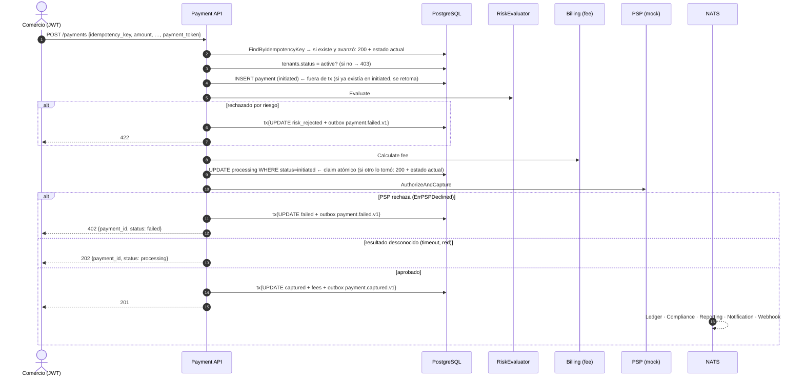
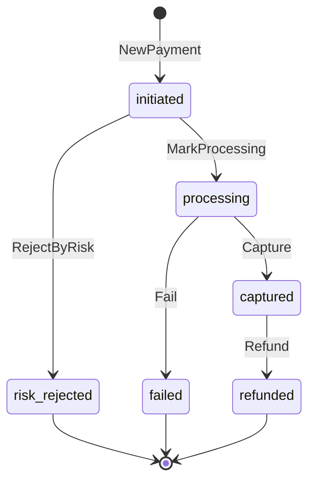

# Payment Processing — Documentación técnico-funcional

> **Bounded Context:** `context/payment`
> **Migraciones:** [`000006_payment_init`](../../migrations/000006_payment_init.up.sql), referencia del reembolso en [`000044_payment_refund_reference`](../../migrations/000044_payment_refund_reference.up.sql)
> **Stream NATS:** `PAYMENT` (`payment.>`)

---

## 1. Propósito

Payment orquesta el **cobro** a un pagador final en nombre de un comercio:

1. Registra el pago con una clave de idempotencia.
2. Evalúa el riesgo.
3. Calcula la comisión de la plataforma.
4. Elige un PSP (proveedor de pagos).
5. Captura los fondos.
6. Publica el resultado.

También permite **reembolsar** un pago capturado.

Payment **no mueve dinero en el Ledger**: publica `payment.captured.v1` y el consumer de Ledger registra el asiento (consistencia eventual, ver LEDGER.MD §7.2).

### Estado actual de las integraciones

| Puerto | Implementación cableada | Comentario |
|---|---|---|
| `PSPRouter` / `PSPAdapter` | `psp.Router` → siempre **`mock`** | El mock aprueba todo salvo dos tokens de prueba: `REJECT` (rechazo definitivo) y `TIMEOUT` (resultado desconocido). Cobra un `psp_fee` = 1,5 % (mínimo 1). El refund siempre es exitoso. |
| `RiskEvaluator` | `risk.PermissiveEvaluator` | Aprueba todo (score 0). |
| `TenantGate` | `tenant.StatusGate` | Lee `tenants.status` y `tenant_compliance_holds` (contexto Auth) y exige `active` sin hold de cumplimiento vigente: KYC aprobado, no suspendido y sin hold preventivo AML. El error al comercio es el mismo en todos los casos (anti tipping-off). |
| `FeeCalculator` | `fees.BillingFeeCalculator` | Llama in-process a `billing.CalculateFeeUseCase` (plan del tenant, o fallback de 300 bps). `FixedRateCalculator` existe pero no está cableado. |

### Fuera de alcance (hoy)

- PSPs reales (Mercado Pago, PayPal, adquirentes) y ruteo por método o tenant.
- Flujo de dos pasos (autorizar y después capturar): `authorized_at` existe pero nunca se setea.
- Reembolsos parciales: `Money.Sub` y `ErrRefundExceedsAmount` existen pero no se usan.
- Checkout: `checkout_id` existe pero nunca se setea.
- Webhooks entrantes del PSP y listados o búsqueda de pagos.

---

## 2. Lenguaje ubicuo

| Término | Significado |
|---|---|
| **Pago** (`Payment`) | Intento de cobro de un monto a un pagador, identificado por `(tenant, idempotency_key)`. |
| **Clave de idempotencia** | La genera el caller. El mismo valor no procesa el cobro dos veces. |
| **PSP** | Proveedor externo que captura los fondos (`AuthorizeAndCapture`) y los devuelve (`Refund`). |
| **Payment token** | Token del SDK del PSP generado en el frontend. **Nunca** datos de tarjeta en crudo. |
| **`platform_fee`** | Comisión de la plataforma (Billing). |
| **`psp_fee`** | Comisión que informa el PSP. |
| **Neto** | `amount − platform_fee − psp_fee` (`Payment.NetAmount()`). |

---

## 3. Flujo funcional



---

## 4. Modelo de dominio

### 4.1 Agregado `Payment`

Archivo: [domain/payment.go](../../context/payment/domain/payment.go)

| Campo | Notas |
|---|---|
| `id`, `tenantID`, `idempotencyKey` | La clave es obligatoria (`NewPayment`). |
| `amount` | `Money` > 0. |
| `platformFee`, `pspFee` | En 0 hasta la captura. Se fijan en `Capture`. |
| `payerInfo` | Nombre, email, tipo y número de documento. Sin datos de tarjeta. |
| `method` | `card`, `wallet`, `transfer`, `qr`. |
| `pspName`, `pspReference` | Se fijan en `Capture`. `Fail` fija solo `pspName`. |
| `status`, `failureReason` | Ver FSM. |
| `metadata` | `map[string]string` libre del caller. |
| `capturedAt`, `failedAt` | `authorizedAt` existe pero nunca se setea. |

### 4.2 Máquina de estados



| Transición | Evento |
|---|---|
| `initiated → processing` | — |
| `initiated → risk_rejected` | `payment.failed.v1` (sin distinguir el motivo de riesgo) |
| `processing → captured` | `payment.captured.v1` |
| `processing → failed` | `payment.failed.v1` |
| `captured → refunded` | `payment.refunded.v1` (monto total) |

`IsFinal()` considera final a `captured`, aunque admita `refunded`.

### 4.3 Value Objects

Archivo: [domain/vo.go](../../context/payment/domain/vo.go)

- `Money`: `NewMoney` exige **monto > 0** y moneda de 3 letras (normalizada a mayúsculas). Las comisiones se construyen con `ReconstituteMoney`, sin validar, porque pueden ser 0.
- `PaymentMethod`: `card` | `wallet` | `transfer` | `qr`.
- `PayerInfo`: sin validaciones (email ni documento).

### 4.4 Errores

Archivo: [domain/errors.go](../../context/payment/domain/errors.go)

| Error | HTTP |
|---|---|
| `ErrPaymentNotFound` | 404 |
| `ErrPaymentAlreadyExists` | Lo devuelve `Save` ante el `UNIQUE (tenant_id, idempotency_key)`; el caso de uso lo resuelve como reintento (nunca llega al cliente) |
| `ErrIdempotencyKeyConflict` (la clave ya se usó con otro monto, moneda o método) | 409 |
| `ErrInvalidFee` (comisión negativa, o comisiones que dejan el neto del comercio ≤ 0, que Ledger no puede registrar) | 500: es un error de configuración de Billing o del PSP, no del cliente |
| `ErrRiskRejected`, `ErrNotCaptured`, `ErrAlreadyCaptured`, `ErrInvalidTransition` | 422 |
| `ErrInvalidAmount`, `ErrInvalidCurrency`, `ErrInvalidMethod` | 400 |
| `ErrPaymentDeclined` (el PSP rechazó: su error envuelve `ErrPSPDeclined`) | **402**, con `payment_id` y `status`; el detalle del PSP no se expone |
| `ErrPaymentPending` (cualquier otro error del PSP: timeout, red, contexto cancelado) | **202**, con `payment_id` y `status: processing`; el pago no se marca `failed` porque el PSP pudo haber capturado |
| `ErrTenantNotActive` | **403**, con mensaje fijo (no revela si el tenant está `pending` o `suspended`) |
| Error de Billing, de riesgo o de ruteo, IDs inválidos, violación de `UNIQUE` | 500 |

---

## 5. Casos de uso

Directorio: [application/](../../context/payment/application/)

### 5.1 `ProcessPayment`

Archivo: [process_payment.go](../../context/payment/application/process_payment.go)

| Paso | Acción | ¿En transacción? | Si falla |
|---|---|---|---|
| 1 | Parsear tenant, clave, `Money` y método | — | 400/500, sin persistir |
| 2 | `FindByIdempotencyKey`: si existe con otro monto, moneda o método → `ErrIdempotencyKeyConflict` (409). Si existe y **no** está en `initiated`, devolverlo (`WasExisting`). Si está en `initiated`, se retoma desde el paso 5 | — | 500 |
| 3 | `TenantGate.EnsureCanProcessPayments` (tenant `active` y sin hold de cumplimiento) | — | 403, sin persistir ni procesar |
| 4 | `NewPayment` + `repo.Save` (**initiated**) | No | Si otro request con la misma clave ganó la carrera (`ErrPaymentAlreadyExists`): se devuelve su pago como reintento, sin procesarlo (lo procesa el que ganó). Otro error: 500 |
| 5 | `risk.Evaluate`; si rechaza → `RejectByRisk` | Sí: Update + outbox | Error del evaluador → queda en `initiated` y **un reintento lo retoma** |
| 6 | `fee.Calculate` (Billing); `MarkProcessing` exige `0 ≤ platform_fee < amount` | — | Queda en `initiated` sin ir al PSP; un reintento lo retoma |
| 7 | `pspRouter.Route` + `MarkProcessing` + **`repo.ClaimProcessing`** (`UPDATE … WHERE status='initiated'`, persiste la comisión de la plataforma) | No (UPDATE atómico) | Si otra ejecución ya lo reclamó: se devuelve el estado actual **sin llamar al PSP** |
| 8 | `psp.AuthorizeAndCapture` (con la misma `idempotency_key`) | — | Rechazo (`ErrPSPDeclined`) → `Fail` + outbox, `ErrPaymentDeclined` (402). Otro error → resultado desconocido: **queda en `processing`**, `ErrPaymentPending` (202) |
| 9 | `Capture(pspName, ref, platformFee, pspFee)` | Sí: Update condicional (`WHERE status='processing'`) + outbox | PSP cobró pero no se persistió: queda en `processing` y lo resuelve el recuperador (§5.4). Si el recuperador ya lo resolvió (`ErrPaymentChanged`), se devuelve el estado que quedó |

Al retomar, los montos, el método y la metadata salen del **pago persistido**, no del comando: un reintento solo se acepta si pide lo mismo (si no, 409). Del comando solo se usan el `payment_token` y la descripción, que no se persisten.

Resultado: `{payment_id, status, psp_reference, amount, currency, platform_fee, captured_at, was_existing}`. Al rechazar, el resultado (con `status: failed`) acompaña al error.

### 5.2 `RefundPayment`

Archivo: [refund_payment.go](../../context/payment/application/refund_payment.go)

1. Busca el pago por ID y verifica el tenant (si es de otro → `ErrPaymentNotFound`).
2. Exige `captured` (si no → `ErrNotCaptured`).
3. `psp.Refund` por el **monto total**, con clave `refund_<idempotency_key>`.
4. `Refund(pspRef)` (guarda la referencia y la fecha) + transacción {Update condicional a `captured` + outbox `payment.refunded.v1`}.

**Concurrencia:** de dos reembolsos simultáneos solo uno escribe y publica `payment.refunded.v1`. El otro recibe el pago ya reembolsado, sin error. Los dos llamaron al PSP con la misma clave (`refund_<idempotency_key>`), así que un PSP real reembolsa una sola vez. Si el PSP reembolsó pero falló el `Update`, el pago sigue `captured`, y reintentar el reembolso lo resuelve: el PSP devuelve el mismo reembolso.

### 5.4 Recuperador de pagos trabados (`ProcessingRecoverer`)

Archivo: [recover_processing.go](../../context/payment/application/recover_processing.go). Corre en `cmd/worker`: un ciclo al arrancar y después cada minuto.

Un pago queda en `processing` cuando el PSP no confirmó el resultado (timeout, red: el request respondió 202), cuando capturó pero falló la persistencia, o cuando el proceso cayó entre el PSP y la base. El recuperador toma hasta 50 pagos en `processing` sin cambios hace más de **2 minutos** (más que el timeout de un request contra el PSP) y le pregunta a cada PSP por la clave de idempotencia (`GetCapture`):

| El PSP responde | Acción |
|---|---|
| Capturado | `Capture` con la comisión fijada en el claim y el `psp_fee` informado → `payment.captured.v1` |
| Rechazado | `Fail` → `payment.failed.v1` |
| Sin registro, hace menos de 30 min | Nada: el PSP todavía puede reflejarla |
| Sin registro, hace 30 min o más | `Fail` (el PSP nunca recibió la operación) → `payment.failed.v1` |
| Error | Nada: se reintenta en el próximo ciclo |

`Capture` valida las comisiones (`psp_fee ≥ 0` y neto > 0). Si el PSP informa una comisión imposible, el pago queda en `processing` y el recuperador registra el error en cada ciclo: requiere intervención manual, porque publicar esa captura dejaría un asiento que Ledger rechaza.

La escritura es condicional a `processing`: si el request original lo resolvió mientras tanto, el recuperador no escribe ni publica. El PSP `mock` no guarda estado y responde siempre *sin registro* (su único resultado desconocido, `TIMEOUT`, simula un timeout antes de capturar).

### 5.3 `GetPayment`

Busca por ID, verifica el tenant y devuelve `PaymentView` (incluye `net_amount`, `psp_fee` y `failure_reason`).

---

## 6. API HTTP

Archivo: [payment_handler.go](../../context/payment/infrastructure/adapters/inbound/http/payment_handler.go)

Las rutas `/api/v1/payments` viven en un grupo propio de `cmd/api` con `JWTOrApiKeyMiddleware`: aceptan **`Authorization: Bearer <jwt>`** (panel del comercio) **o `X-Api-Key`** (integraciones server-to-server). El tenant sale del token o de la key. Cada ruta tiene un guard (`RouteGuards`) que `cmd/api` inyecta con `authttp.RequirePermission`. `RegisterRoutes` entra en pánico si falta alguno.

| Método | Ruta | JWT: rol con permiso | API key: scope | Éxito |
|---|---|---|---|---|
| `POST` | `/payments` | `payments:create` → `admin`, `operator` | `payments:write` | `201` nuevo / `200` si la clave ya existía |
| `GET` | `/payments/:paymentID` | `payments:read` → todos los roles | `payments:read` o `payments:write` | `200 PaymentView` |
| `POST` | `/payments/:paymentID/refund` | `payments:refund` → **solo `admin`** | `payments:write` | `200 {"PaymentID","PSPReference","Status"}` ⚠️ claves en PascalCase (el struct no tiene tags JSON) |

Sin el permiso → `403 insufficient permissions`. Sin credenciales, o con una key inválida → `401`.

### 6.1 Cobrar — `POST /payments`

```json
{
  "idempotency_key": "order-8841",
  "amount": 125000,
  "currency": "ARS",
  "payment_method": "card",
  "payment_token": "tok_from_psp_sdk",
  "description": "Pedido #8841",
  "payer_name": "Ana Pérez",
  "payer_email": "ana@example.com",
  "payer_doc_type": "DNI",
  "payer_doc_num": "30123456",
  "metadata": { "order_id": "8841" }
}
```

Requeridos: `idempotency_key`, `amount ≥ 1`, `currency`, `payment_method`, `payment_token`.

```json
{
  "PaymentID": "…", "Status": "captured", "PSPReference": "MOCK-1a2b3c4d",
  "Amount": 125000, "Currency": "ARS", "PlatformFee": 3750,
  "CapturedAt": "2026-10-26T14:00:00Z", "WasExisting": false
}
```

⚠️ `ProcessPaymentResult` tampoco tiene tags JSON: las claves salen en PascalCase, a diferencia de `PaymentView` (snake_case).

| Caso | HTTP |
|---|---|
| Body inválido | 400 `invalid request body` |
| Método o moneda inválidos | 400 |
| Tenant no habilitado (`pending` o `suspended`) | 403 `tenant is not enabled to process payments` |
| Rechazo por riesgo | 422 |
| Rechazo del PSP (`payment_token: "REJECT"` en el mock) | **402** `{"error":"payment declined by the payment provider","payment_id":"…","status":"failed"}` |
| El PSP no confirmó (timeout, red; `payment_token: "TIMEOUT"` en el mock) | **202** `{"payment_id":"…","status":"processing","detail":"…"}`. El recuperador lo resuelve después (§5.4); consultarlo con `GET /payments/:id` |
| Reintento con la misma clave | 200 con el pago en su estado actual. Si estaba trabado en `initiated`, el reintento lo procesa. También si los dos requests fueron simultáneos |
| Misma clave con otro monto, moneda o método | 409 `idempotency key already used with a different amount, currency or payment method` |

### 6.2 Consultar — `GET /payments/:paymentID`

```json
{
  "id": "…", "tenant_id": "…", "status": "captured",
  "amount": 125000, "currency": "ARS",
  "platform_fee": 3750, "psp_fee": 1875, "net_amount": 119375,
  "payment_method": "card", "psp_name": "mock", "psp_reference": "MOCK-1a2b3c4d",
  "idempotency_key": "order-8841",
  "captured_at": "2026-10-26T14:00:00Z", "created_at": "2026-10-26T14:00:00Z"
}
```

Un pago reembolsado suma `"refund_psp_reference": "MOCK-REF-…"` y `"refunded_at"`.

`failure_reason` contiene el texto crudo del error del PSP.

### 6.3 Reembolsar — `POST /payments/:paymentID/refund`

Sin body. Reembolso total. Si el pago no está `captured` → 422. Si es de otro tenant → 404.

---

## 7. Eventos

Archivo: [domain/events.go](../../context/payment/domain/events.go). Se publican por Outbox en el stream `PAYMENT` con los headers estándar.

| Subject | Payload |
|---|---|
| `payment.captured.v1` | `payment_id`, `tenant_id`, `amount`, `currency`, `platform_fee`, `psp_fee`, `payment_method`, `psp_reference`, `idempotency_key` |
| `payment.failed.v1` | `payment_id`, `tenant_id`, `amount`, `currency`, `failure_reason`, `payment_method` (riesgo **y** PSP) |
| `payment.refunded.v1` | `payment_id`, `tenant_id`, `refund_amount`, `currency`, `psp_reference` (del reembolso) |

### 7.1 Consumidores

| Consumidor | Filtro | Acción |
|---|---|---|
| **Ledger** | `payment.>` | Asientos `payment_captured_<id>` y `payment_refunded_<id>`; el resto se ignora. |
| **Compliance** | `payment.captured.>` | Monitoreo transaccional (AML). |
| **Reporting** | `payment.captured.>` | Proyección de volúmenes y comisiones. |
| **Notification** | `payment.>` | Emails para `captured`, `failed` (incluye el rechazo por riesgo) y `refunded`. |
| **Webhook** | `payment.>` | Entrega a los endpoints del comercio. |

> `payment.refunded.v1` lo consume Ledger (asiento de reversa contra `in_transit`). Reporting y Billing no lo consumen.

### 7.2 Lecturas directas

[Reconciliation](../../context/reconciliation/infrastructure/adapters/outbound/readers/payment_reader.go) lee la tabla `payments` por período (`id`, `psp_reference`, `amount`, `currency`, `status`, `captured_at`) para conciliar contra el PSP. [Dispute](../../context/dispute/infrastructure/adapters/outbound/postgres/payment_reader.go) lee el pago disputado (`id`, `tenant_id`, `status`, `amount`, `currency`) como operador de plataforma.

---

## 8. Persistencia

Tabla `payments` ([migración](../../migrations/000006_payment_init.up.sql)):

| Grupo | Columnas |
|---|---|
| Identidad | `id` PK, `tenant_id`, `idempotency_key`, `checkout_id` |
| Montos | `amount BIGINT > 0`, `currency CHAR(3)`, `platform_fee`, `psp_fee` |
| Pagador | `payer_name`, `payer_email`, `payer_doc_type`, `payer_doc_num` (PII en claro) |
| PSP | `payment_method`, `psp_name`, `psp_reference` |
| Estado | `status` (CHECK con los 6 estados), `failure_reason`, `metadata JSONB` |
| Tiempos | `authorized_at`, `captured_at`, `failed_at`, `created_at`, `updated_at` |
| Reembolso | `refund_psp_reference`, `refunded_at` (000044) |

- `UNIQUE (tenant_id, idempotency_key)`.
- Índices `(tenant_id, status, created_at DESC)` y `psp_reference` (parcial).
- RLS por `tenant_id` con `NULLIF` (no filtra mientras la app conecte como owner). Política de operador de solo lectura para que Dispute lea el pago disputado (migración 000043).
- `Update` reescribe solo estado, PSP, comisiones, motivo y fechas, y es **condicional al estado de partida** (`WHERE id=$1 AND status=<from>`): si otra ejecución ya movió el pago, no escribe y devuelve `ErrPaymentChanged`. `metadata` y los datos del pagador son inmutables.
- `ClaimProcessing` persiste la comisión de la plataforma junto con el paso a `processing`.
- `ListStuckProcessing` (recuperador) lista los pagos en `processing` con `updated_at` anterior al corte, de todos los tenants.

---

## 9. Seguridad y cumplimiento

- **PCI:** el diseño evita datos de tarjeta: solo se recibe un `payment_token`, que no se persiste. Bien.
- **PII:** nombre, email y documento del pagador se guardan **en claro** en `payments`. No viajan en los eventos, pero no hay cifrado en reposo ni política de retención.
- **Autorización:** cobrar requiere `admin`/`operator` o una key con `payments:write`. Reembolsar requiere `admin` o una key con `payments:write`. Consultar está abierto a todos los roles y a keys con `payments:read`/`write`.
- **Habilitación:** solo tenants `active` (KYC aprobado, no suspendidos) pueden cobrar. Los **reembolsos no se bloquean** por estado del tenant, para no perjudicar al pagador.
- **Aislamiento:** `Get` y `Refund` verifican el tenant del pago. `Process` lo toma del token.

---

## 10. Limitaciones conocidas y deuda técnica

| # | Severidad | Tema | Detalle |
|---|---|---|---|
| 1 | Media | RLS no efectiva | La política de `payments` tiene `NULLIF` y operador de lectura (000043), pero el repo y `TenantGate` usan el pool fuera de la sesión RLS (`Save`, `FindByID`, `FindByIdempotencyKey`, `ClaimProcessing`). Funciona solo porque el rol de la app tiene `BYPASSRLS`. |
| 2 | Baja | Contrato de respuesta inconsistente | `ProcessPaymentResult` y `RefundPaymentResult` no tienen tags JSON (PascalCase, y `WasExisting` interno), mientras `PaymentView` usa snake_case. |
| 3 | Baja | Error crudo del PSP expuesto | `failure_reason` guarda el texto del error del PSP y lo expone en `GET /payments/:id`, en `payment.failed.v1` y, por ende, en el email y el webhook al comercio. |
| 4 | Baja | Rechazo por riesgo indistinguible y duplicable | El rechazo por riesgo emite `payment.failed.v1`, igual que el del PSP. Dos ejecuciones concurrentes de un mismo pago en `initiated` pueden rechazarlo dos veces (evento duplicado): `RejectByRisk` se persiste con un `Update` no condicional. |
| 5 | Baja | IDs mal formados → 500 | `GET`/`POST /payments/abc[/refund]`: el error de parseo cae en el `default` de `respondDomainError`. |
| 6 | Baja | Campos y código muerto | `authorized_at`, `checkout_id`, `ErrAlreadyCaptured`, `ErrRefundExceedsAmount`, `Money.Sub`, y un `fmt.Sprintf` descartado en `FixedRateCalculator`. |
| 7 | Producto | Alcance | Sin `GET /payments` con filtros. Sin *sandbox* para tenants `pending`. Sin motivo de rechazo normalizado (`insufficient_funds`, `card_expired`, …) ni diferenciación por ambiente (`env`) hasta que haya PSPs reales. Solo reembolso total. |

---

## 11. Testing

| Capa | Archivos | Tipo |
|---|---|---|
| Dominio | `domain/*_test.go` | FSM, `Money`, eventos. |
| Aplicación | `application/process_payment_test.go`, `refund_payment_test.go` (+ `mocks_test.go`) | Casos de uso con fakes. |
| HTTP | `inbound/http/payment_handler_test.go` | Handlers y mapeo de errores. |
| Fees | `outbound/fees/fees_test.go` | `FixedRateCalculator` y `BillingFeeCalculator` (con Billing real y fakes). |
| PSP / Riesgo | `outbound/psp/**`, `outbound/risk` | Mock, router y evaluador permisivo. |
| Postgres | `outbound/postgres/payment_repo_test.go` | Integración (`DATABASE_URL`); se saltan si no hay DB. |

```bash
go test ./context/payment/...
```

Cubierto: rechazo del PSP (402) vs resultado desconocido (202, el pago queda en `processing`), recuperador (capturado, rechazado, sin registro antes y después de 30 min, error de consulta, resuelto mientras tanto), transiciones condicionales al estado de partida, tenant inactivo (también al retomar), reanudación de un pago en `initiated` (incluido el reintento tras un error de Billing), claim perdido sin llamar al PSP, 402 sin filtrar el detalle del PSP, guards por ruta y adaptador `TenantGate` (con pgxmock). Faltan casos de timeout del PSP (#1) y de refunds concurrentes (#8).

---

## 12. Mapa de código

```
context/payment/
├── domain/
│   ├── payment.go     # Agregado Payment + FSM
│   ├── vo.go          # IDs, PaymentStatus, PaymentMethod, Money, PayerInfo
│   ├── events.go      # captured / failed / refunded
│   └── errors.go
├── application/
│   ├── ports.go       # PaymentRepository, PSPAdapter, PSPRouter, RiskEvaluator, FeeCalculator, …
│   ├── commands.go    # Comandos, resultados y PaymentView
│   ├── process_payment.go
│   ├── recover_processing.go  # ProcessingRecoverer (worker): resuelve pagos trabados en processing
│   └── refund_payment.go   # Refund + GetPayment
└── infrastructure/adapters/
    ├── inbound/http/payment_handler.go
    └── outbound/
        ├── postgres/payment_repo.go
        ├── psp/        # router.go + mock/
        ├── fees/       # billing_calculator.go (cableado), fixed_rate.go
        ├── risk/       # permissive.go
        └── tenant/     # gate.go (TenantGate: lee tenants.status + tenant_compliance_holds)
```

Cableado: [cmd/api/main.go](../../cmd/api/main.go), sección `Payment Processing` (grupo `paymentsAPI` con `JWTOrApiKeyMiddleware` y `RouteGuards`), y [cmd/worker/main.go](../../cmd/worker/main.go), sección `Payment` (el recuperador).
