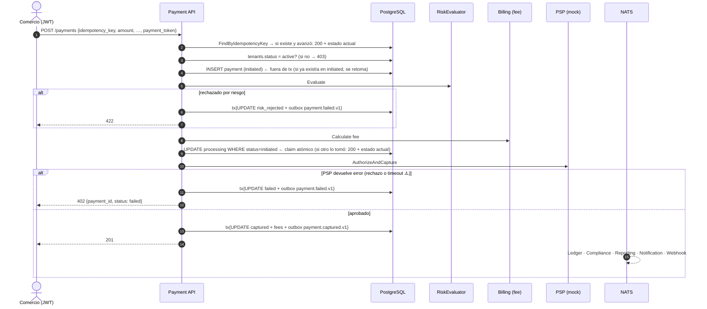
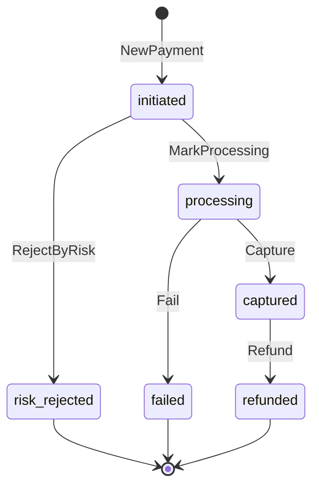

# Payment Processing — Documentación técnico-funcional

> **Bounded Context:** `context/payment`
> **Migración:** [`000006_payment_init`](../../migrations/000006_payment_init.up.sql)
> **Stream NATS:** `PAYMENT` (`payment.>`)

---

## 1. Propósito

Payment orquesta el **cobro** a un pagador final en nombre de un comercio:

1. Registra el pago con una clave de idempotencia.
2. Evalúa el riesgo.
3. Calcula la comisión de la plataforma.
4. Elige un PSP (proveedor de pagos).
5. Captura los fondos.
6. Publica el resultado.

También permite **reembolsar** un pago capturado.

Payment **no mueve dinero en el Ledger**: publica `payment.captured.v1` y el consumer de Ledger registra el asiento (consistencia eventual, ver LEDGER.MD §7.2).

### Estado actual de las integraciones

| Puerto | Implementación cableada | Comentario |
|---|---|---|
| `PSPRouter` / `PSPAdapter` | `psp.Router` → siempre **`mock`** | El mock aprueba todo salvo `payment_token = "REJECT"` y cobra un `psp_fee` = 1,5 % (mínimo 1). El refund siempre es exitoso. |
| `RiskEvaluator` | `risk.PermissiveEvaluator` | Aprueba todo (score 0). |
| `TenantGate` | `tenant.StatusGate` | Lee `tenants.status` y `tenant_compliance_holds` (contexto Auth) y exige `active` sin hold de cumplimiento vigente: KYC aprobado, no suspendido y sin hold preventivo AML. El error al comercio es el mismo en todos los casos (anti tipping-off). |
| `FeeCalculator` | `fees.BillingFeeCalculator` | Llama in-process a `billing.CalculateFeeUseCase` (plan del tenant, o fallback de 300 bps). `FixedRateCalculator` existe pero no está cableado. |

### Fuera de alcance (hoy)

- PSPs reales (Mercado Pago, PayPal, adquirentes) y ruteo por método o tenant.
- Flujo de dos pasos (autorizar y después capturar): `authorized_at` existe pero nunca se setea.
- Reembolsos parciales: `Money.Sub` y `ErrRefundExceedsAmount` existen pero no se usan.
- Checkout: `checkout_id` existe pero nunca se setea.
- Webhooks entrantes del PSP y listados o búsqueda de pagos.

---

## 2. Lenguaje ubicuo

| Término | Significado |
|---|---|
| **Pago** (`Payment`) | Intento de cobro de un monto a un pagador, identificado por `(tenant, idempotency_key)`. |
| **Clave de idempotencia** | La genera el caller. El mismo valor no procesa el cobro dos veces. |
| **PSP** | Proveedor externo que captura los fondos (`AuthorizeAndCapture`) y los devuelve (`Refund`). |
| **Payment token** | Token del SDK del PSP generado en el frontend. **Nunca** datos de tarjeta en crudo. |
| **`platform_fee`** | Comisión de la plataforma (Billing). |
| **`psp_fee`** | Comisión que informa el PSP. |
| **Neto** | `amount − platform_fee − psp_fee` (`Payment.NetAmount()`). |

---

## 3. Flujo funcional



---

## 4. Modelo de dominio

### 4.1 Agregado `Payment`

Archivo: [domain/payment.go](../../context/payment/domain/payment.go)

| Campo | Notas |
|---|---|
| `id`, `tenantID`, `idempotencyKey` | La clave es obligatoria (`NewPayment`). |
| `amount` | `Money` > 0. |
| `platformFee`, `pspFee` | En 0 hasta la captura. Se fijan en `Capture`. |
| `payerInfo` | Nombre, email, tipo y número de documento. Sin datos de tarjeta. |
| `method` | `card`, `wallet`, `transfer`, `qr`. |
| `pspName`, `pspReference` | Se fijan en `Capture`. `Fail` fija solo `pspName`. |
| `status`, `failureReason` | Ver FSM. |
| `metadata` | `map[string]string` libre del caller. |
| `capturedAt`, `failedAt` | `authorizedAt` existe pero nunca se setea. |

### 4.2 Máquina de estados



| Transición | Evento |
|---|---|
| `initiated → processing` | — |
| `initiated → risk_rejected` | `payment.failed.v1` (sin distinguir el motivo de riesgo) |
| `processing → captured` | `payment.captured.v1` |
| `processing → failed` | `payment.failed.v1` |
| `captured → refunded` | `payment.refunded.v1` (monto total) |

`IsFinal()` considera final a `captured`, aunque admita `refunded`.

### 4.3 Value Objects

Archivo: [domain/vo.go](../../context/payment/domain/vo.go)

- `Money`: `NewMoney` exige **monto > 0** y moneda de 3 letras (normalizada a mayúsculas). Las comisiones se construyen con `ReconstituteMoney`, sin validar, porque pueden ser 0.
- `PaymentMethod`: `card` | `wallet` | `transfer` | `qr`.
- `PayerInfo`: sin validaciones (email ni documento).

### 4.4 Errores

Archivo: [domain/errors.go](../../context/payment/domain/errors.go)

| Error | HTTP |
|---|---|
| `ErrPaymentNotFound` | 404 |
| `ErrPaymentAlreadyExists` | 409 (declarado, **nunca devuelto**) |
| `ErrRiskRejected`, `ErrNotCaptured`, `ErrAlreadyCaptured`, `ErrInvalidTransition` | 422 |
| `ErrInvalidAmount`, `ErrInvalidCurrency`, `ErrInvalidMethod` | 400 |
| `ErrPaymentDeclined` (cualquier error del PSP al capturar) | **402**, con `payment_id` y `status`; el detalle del PSP no se expone |
| `ErrTenantNotActive` | **403**, con mensaje fijo (no revela si el tenant está `pending` o `suspended`) |
| Error de Billing, de riesgo o de ruteo, IDs inválidos, violación de `UNIQUE` | 500 |

---

## 5. Casos de uso

Directorio: [application/](../../context/payment/application/)

### 5.1 `ProcessPayment`

Archivo: [process_payment.go](../../context/payment/application/process_payment.go)

| Paso | Acción | ¿En transacción? | Si falla |
|---|---|---|---|
| Paso | Acción | ¿En transacción? | Si falla |
|---|---|---|---|
| 1 | Parsear tenant, clave, `Money` y método | — | 400/500, sin persistir |
| 2 | `FindByIdempotencyKey`: si existe y **no** está en `initiated`, devolverlo (`WasExisting`). Si está en `initiated`, se retoma desde el paso 5 | — | 500 |
| 3 | `TenantGate.EnsureCanProcessPayments` (tenant `active` y sin hold de cumplimiento) | — | 403, sin persistir ni procesar |
| 4 | `NewPayment` + `repo.Save` (**initiated**) | No | 500 |
| 5 | `risk.Evaluate`; si rechaza → `RejectByRisk` | Sí: Update + outbox | Error del evaluador → queda en `initiated` y **un reintento lo retoma** |
| 6 | `fee.Calculate` (Billing) | — | Queda en `initiated`; un reintento lo retoma |
| 7 | `pspRouter.Route` + `MarkProcessing` + **`repo.ClaimProcessing`** (`UPDATE … WHERE status='initiated'`) | No (UPDATE atómico) | Si otra ejecución ya lo reclamó: se devuelve el estado actual **sin llamar al PSP** |
| 8 | `psp.AuthorizeAndCapture` (con la misma `idempotency_key`) | — | → `Fail(pspErr.Error())` + outbox, `ErrPaymentDeclined` (402) |
| 9 | `Capture(pspName, ref, platformFee, pspFee)` | Sí: Update + outbox | PSP cobró pero no se persistió: **queda en `processing`** (§10.2) |

Al retomar, los montos, el método y la metadata salen del **pago persistido**, no del comando: un reintento con otro monto no altera el pago. Del comando solo se usan el `payment_token` y la descripción, que no se persisten.

Resultado: `{payment_id, status, psp_reference, amount, currency, platform_fee, captured_at, was_existing}`. Al rechazar, el resultado (con `status: failed`) acompaña al error.

### 5.2 `RefundPayment`

Archivo: [refund_payment.go](../../context/payment/application/refund_payment.go)

1. Busca el pago por ID y verifica el tenant (si es de otro → `ErrPaymentNotFound`).
2. Exige `captured` (si no → `ErrNotCaptured`).
3. `psp.Refund` por el **monto total**, con clave `refund_<idempotency_key>`.
4. `Refund(pspRef)` + transacción {Update + outbox `payment.refunded.v1`}.

La referencia del reembolso **no se persiste**: solo viaja en el evento y en la respuesta.

### 5.3 `GetPayment`

Busca por ID, verifica el tenant y devuelve `PaymentView` (incluye `net_amount`, `psp_fee` y `failure_reason`).

---

## 6. API HTTP

Archivo: [payment_handler.go](../../context/payment/infrastructure/adapters/inbound/http/payment_handler.go)

Las rutas `/api/v1/payments` viven en un grupo propio de `cmd/api` con `JWTOrApiKeyMiddleware`: aceptan **`Authorization: Bearer <jwt>`** (panel del comercio) **o `X-Api-Key`** (integraciones server-to-server). El tenant sale del token o de la key. Cada ruta tiene un guard (`RouteGuards`) que `cmd/api` inyecta con `authttp.RequirePermission`. `RegisterRoutes` entra en pánico si falta alguno.

| Método | Ruta | JWT: rol con permiso | API key: scope | Éxito |
|---|---|---|---|---|
| `POST` | `/payments` | `payments:create` → `admin`, `operator` | `payments:write` | `201` nuevo / `200` si la clave ya existía |
| `GET` | `/payments/:paymentID` | `payments:read` → todos los roles | `payments:read` o `payments:write` | `200 PaymentView` |
| `POST` | `/payments/:paymentID/refund` | `payments:refund` → **solo `admin`** | `payments:write` | `200 {"PaymentID","PSPReference","Status"}` ⚠️ claves en PascalCase (el struct no tiene tags JSON) |

Sin el permiso → `403 insufficient permissions`. Sin credenciales, o con una key inválida → `401`.

### 6.1 Cobrar — `POST /payments`

```json
{
  "idempotency_key": "order-8841",
  "amount": 125000,
  "currency": "ARS",
  "payment_method": "card",
  "payment_token": "tok_from_psp_sdk",
  "description": "Pedido #8841",
  "payer_name": "Ana Pérez",
  "payer_email": "ana@example.com",
  "payer_doc_type": "DNI",
  "payer_doc_num": "30123456",
  "metadata": { "order_id": "8841" }
}
```

Requeridos: `idempotency_key`, `amount ≥ 1`, `currency`, `payment_method`, `payment_token`.

```json
{
  "PaymentID": "…", "Status": "captured", "PSPReference": "MOCK-1a2b3c4d",
  "Amount": 125000, "Currency": "ARS", "PlatformFee": 3750,
  "CapturedAt": "2026-10-26T14:00:00Z", "WasExisting": false
}
```

⚠️ `ProcessPaymentResult` tampoco tiene tags JSON: las claves salen en PascalCase, a diferencia de `PaymentView` (snake_case).

| Caso | HTTP |
|---|---|
| Body inválido | 400 `invalid request body` |
| Método o moneda inválidos | 400 |
| Tenant no habilitado (`pending` o `suspended`) | 403 `tenant is not enabled to process payments` |
| Rechazo por riesgo | 422 |
| Rechazo del PSP (`payment_token: "REJECT"` en el mock) | **402** `{"error":"payment declined by the payment provider","payment_id":"…","status":"failed"}` |
| Reintento con la misma clave | 200 con el pago en su estado actual. Si estaba trabado en `initiated`, el reintento lo procesa |

### 6.2 Consultar — `GET /payments/:paymentID`

```json
{
  "id": "…", "tenant_id": "…", "status": "captured",
  "amount": 125000, "currency": "ARS",
  "platform_fee": 3750, "psp_fee": 1875, "net_amount": 119375,
  "payment_method": "card", "psp_name": "mock", "psp_reference": "MOCK-1a2b3c4d",
  "idempotency_key": "order-8841",
  "captured_at": "2026-10-26T14:00:00Z", "created_at": "2026-10-26T14:00:00Z"
}
```

`failure_reason` contiene el texto crudo del error del PSP.

### 6.3 Reembolsar — `POST /payments/:paymentID/refund`

Sin body. Reembolso total. Si el pago no está `captured` → 422. Si es de otro tenant → 404.

---

## 7. Eventos

Archivo: [domain/events.go](../../context/payment/domain/events.go). Se publican por Outbox en el stream `PAYMENT` con los headers estándar.

| Subject | Payload |
|---|---|
| `payment.captured.v1` | `payment_id`, `tenant_id`, `amount`, `currency`, `platform_fee`, `psp_fee`, `payment_method`, `psp_reference`, `idempotency_key` |
| `payment.failed.v1` | `payment_id`, `tenant_id`, `amount`, `currency`, `failure_reason`, `payment_method` (riesgo **y** PSP) |
| `payment.refunded.v1` | `payment_id`, `tenant_id`, `refund_amount`, `currency`, `psp_reference` (del reembolso) |

### 7.1 Consumidores

| Consumidor | Filtro | Acción |
|---|---|---|
| **Ledger** | `payment.captured.v1` | Asiento `payment_captured_<id>`. ⚠️ Hoy falla siempre (LEDGER.MD §10.1). |
| **Compliance** | `payment.captured.>` | Monitoreo transaccional (AML). |
| **Reporting** | `payment.captured.>` | Proyección de volúmenes y comisiones. |
| **Notification** | `payment.>` | Emails para `captured`, `failed` y `refunded`. También escucha `payment.risk_rejected.v1`, **que nunca se emite**. |
| **Webhook** | `payment.>` | Entrega a los endpoints del comercio. |

> **Nadie con impacto contable consume `payment.refunded.v1`**: ni Ledger, ni Reporting, ni Billing.

### 7.2 Lecturas directas

[Reconciliation](../../context/reconciliation/infrastructure/adapters/outbound/readers/payment_reader.go) lee la tabla `payments` por período (`id`, `psp_reference`, `amount`, `currency`, `status`, `captured_at`) para conciliar contra el PSP.

---

## 8. Persistencia

Tabla `payments` ([migración](../../migrations/000006_payment_init.up.sql)):

| Grupo | Columnas |
|---|---|
| Identidad | `id` PK, `tenant_id`, `idempotency_key`, `checkout_id` |
| Montos | `amount BIGINT > 0`, `currency CHAR(3)`, `platform_fee`, `psp_fee` |
| Pagador | `payer_name`, `payer_email`, `payer_doc_type`, `payer_doc_num` (PII en claro) |
| PSP | `payment_method`, `psp_name`, `psp_reference` |
| Estado | `status` (CHECK con los 6 estados), `failure_reason`, `metadata JSONB` |
| Tiempos | `authorized_at`, `captured_at`, `failed_at`, `created_at`, `updated_at` |

- `UNIQUE (tenant_id, idempotency_key)`.
- Índices `(tenant_id, status, created_at DESC)` y `psp_reference` (parcial).
- RLS por `tenant_id` (no filtra mientras la app conecte como owner).
- `Update` reescribe solo estado, PSP, comisiones, motivo y fechas. `metadata` y los datos del pagador son inmutables.

---

## 9. Seguridad y cumplimiento

- **PCI:** el diseño evita datos de tarjeta: solo se recibe un `payment_token`, que no se persiste. Bien.
- **PII:** nombre, email y documento del pagador se guardan **en claro** en `payments`. No viajan en los eventos, pero no hay cifrado en reposo ni política de retención.
- **Autorización:** cobrar requiere `admin`/`operator` o una key con `payments:write`. Reembolsar requiere `admin` o una key con `payments:write`. Consultar está abierto a todos los roles y a keys con `payments:read`/`write`.
- **Habilitación:** solo tenants `active` (KYC aprobado, no suspendidos) pueden cobrar. Los **reembolsos no se bloquean** por estado del tenant, para no perjudicar al pagador.
- **Aislamiento:** `Get` y `Refund` verifican el tenant del pago. `Process` lo toma del token.

---

## 10. Limitaciones conocidas y deuda técnica

| # | Tema | Detalle | Impacto |
|---|---|---|---|
| 1 | **Timeout del PSP = rechazo** | Cualquier error de `AuthorizeAndCapture` (timeout, error de red, contexto cancelado) marca el pago `failed` y publica `payment.failed.v1`, aunque el PSP pudo haber capturado. El pagador queda cobrado sin pago registrado, y un reintento con la misma clave devuelve el `failed`. Hay que distinguir *rechazo* de *resultado desconocido*: dejar `processing` y resolverlo consultando al PSP o vía webhook. | **Crítico (dinero)** |
| 2 | Pagos trabados — (a) ✅ **resuelto**, (b) pendiente | (a) ~~Un pago que quedó en `initiated` nunca se procesaba~~: ahora un reintento con la misma clave lo **retoma**, y el claim atómico de `processing` evita dos llamadas al PSP si hay reintentos concurrentes. (b) **Pendiente:** si el PSP capturó pero falla el `Update` final (o el proceso cae), el pago queda en **`processing`** con dinero cobrado y sin `payment.captured.v1`. No hay job de recuperación; depende del diseño de #1 (consultar al PSP o webhook). Además, dos ejecuciones concurrentes de un mismo pago en `initiated` pueden rechazarlo por riesgo dos veces (evento `payment.failed.v1` duplicado). | **Alto** (b) |
| 3 | **El reembolso no impacta el Ledger** | Nadie contable consume `payment.refunded.v1`. El `merchant_balance` sigue incluyendo un pago ya devuelto al pagador, y el comercio podría retirarlo por payout. No se valida el saldo ni disputas abiertas antes de reembolsar. La comisión de la plataforma no se revierte. | **Alto (dinero)** |
| 4 | ~~Sin control de KYC ni estado del tenant~~ ✅ **Resuelto** | `TenantGate` exige `tenants.status = active` para cobrar (y para retomar un pago trabado). Pendiente de producto: un *sandbox* para tenants `pending` (hoy no pueden probar cobros), y diferenciar por ambiente (`env`) cuando haya PSPs reales. | — |
| 5 | ~~Rechazo del PSP → 500~~ ✅ **Resuelto** | `ErrPaymentDeclined` → 402 con `payment_id` y `status`, sin el detalle del PSP. Como cualquier error del PSP se trata como rechazo, un **timeout** también responde 402 (ver #1). Falta un motivo normalizado (`insufficient_funds`, `card_expired`, …) cuando haya PSPs reales. | — |
| 6 | ~~Autorización y API keys~~ ✅ **Resuelto** | Payments acepta JWT o API key (`JWTOrApiKeyMiddleware`) y autoriza por permiso de rol o por scope (`RequirePermission`). El reembolso es solo para `admin`. Pendiente en Auth: que `ApiKeyMiddleware` verifique que el `<env>` de la key coincida con el guardado (ver AUTH.MD). | — |
| 7 | Idempotencia con carrera | Check-then-insert: dos requests concurrentes con la misma clave → la segunda falla con `UNIQUE` → 500 (`ErrPaymentAlreadyExists` nunca se emite). No se compara el contenido al reusar una clave (otro monto devuelve el pago original). | Medio |
| 8 | Reembolso sin protección de concurrencia ni persistencia segura | Dos refunds concurrentes pasan el chequeo de `captured` y llaman dos veces al PSP (solo los protege la idempotencia del PSP). Si el PSP reembolsa y falla el `Update`, el pago queda `captured`. La referencia del reembolso no se persiste. Solo reembolso total. | Medio |
| 9 | Comisiones sin validar | Nada impide `platform_fee + psp_fee ≥ amount` (neto ≤ 0, que Ledger rechaza). `psp_fee` se acepta sin validar (`ReconstituteMoney`). | Medio |
| 10 | Contrato de respuesta inconsistente | `ProcessPaymentResult` y `RefundPaymentResult` no tienen tags JSON (PascalCase), mientras `PaymentView` usa snake_case. | Bajo (pero romper el contrato después cuesta) |
| 11 | Filtrado de información | `failure_reason` guarda y expone el texto crudo del error del PSP. | Bajo |
| 12 | Evento de riesgo indistinguible | El rechazo por riesgo emite `payment.failed.v1`. Notification espera `payment.risk_rejected.v1`, que no existe. | Bajo |
| 13 | Campos sin uso | `authorized_at`, `checkout_id`, `ErrAlreadyCaptured`, `ErrRefundExceedsAmount`, `Money.Sub`; código muerto en `FixedRateCalculator` (`fmt.Sprintf` descartado). | Bajo |
| 14 | Sin listados | No hay `GET /payments` con filtros. | Funcional |

---

## 11. Testing

| Capa | Archivos | Tipo |
|---|---|---|
| Dominio | `domain/*_test.go` | FSM, `Money`, eventos. |
| Aplicación | `application/process_payment_test.go`, `refund_payment_test.go` (+ `mocks_test.go`) | Casos de uso con fakes. |
| HTTP | `inbound/http/payment_handler_test.go` | Handlers y mapeo de errores. |
| Fees | `outbound/fees/fees_test.go` | `FixedRateCalculator` y `BillingFeeCalculator` (con Billing real y fakes). |
| PSP / Riesgo | `outbound/psp/**`, `outbound/risk` | Mock, router y evaluador permisivo. |
| Postgres | `outbound/postgres/payment_repo_test.go` | Integración (`DATABASE_URL`); se saltan si no hay DB. |

```bash
go test ./context/payment/...
```

Cubierto: tenant inactivo (también al retomar), reanudación de un pago en `initiated` (incluido el reintento tras un error de Billing), claim perdido sin llamar al PSP, 402 sin filtrar el detalle del PSP, guards por ruta y adaptador `TenantGate` (con pgxmock). Faltan casos de timeout del PSP (#1) y de refunds concurrentes (#8).

---

## 12. Mapa de código

```
context/payment/
├── domain/
│   ├── payment.go     # Agregado Payment + FSM
│   ├── vo.go          # IDs, PaymentStatus, PaymentMethod, Money, PayerInfo
│   ├── events.go      # captured / failed / refunded
│   └── errors.go
├── application/
│   ├── ports.go       # PaymentRepository, PSPAdapter, PSPRouter, RiskEvaluator, FeeCalculator, …
│   ├── commands.go    # Comandos, resultados y PaymentView
│   ├── process_payment.go
│   └── refund_payment.go   # Refund + GetPayment
└── infrastructure/adapters/
    ├── inbound/http/payment_handler.go
    └── outbound/
        ├── postgres/payment_repo.go
        ├── psp/        # router.go + mock/
        ├── fees/       # billing_calculator.go (cableado), fixed_rate.go
        ├── risk/       # permissive.go
        └── tenant/     # gate.go (TenantGate: lee tenants.status + tenant_compliance_holds)
```

Cableado: [cmd/api/main.go](../../cmd/api/main.go), sección `Payment Processing` (grupo `paymentsAPI` con `JWTOrApiKeyMiddleware` y `RouteGuards`).
