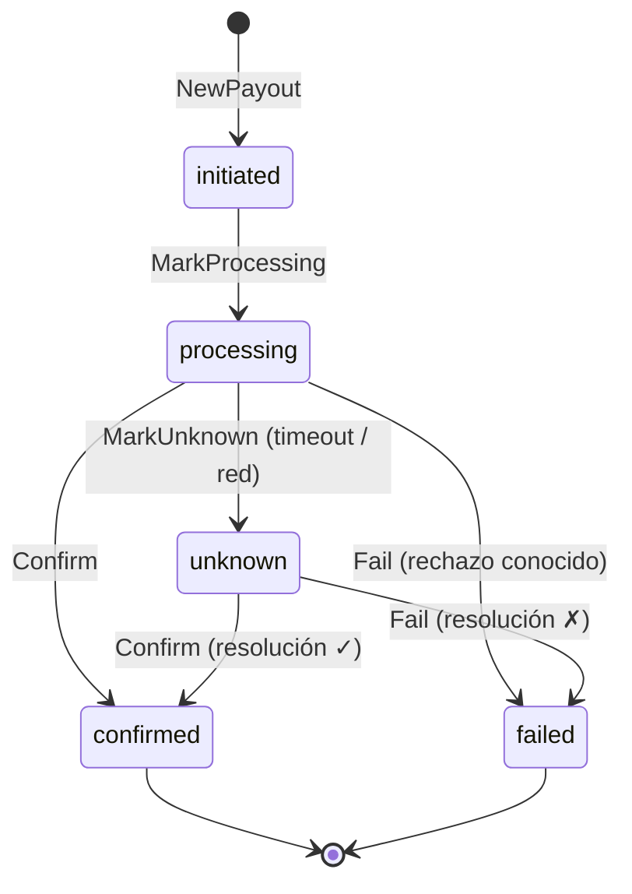
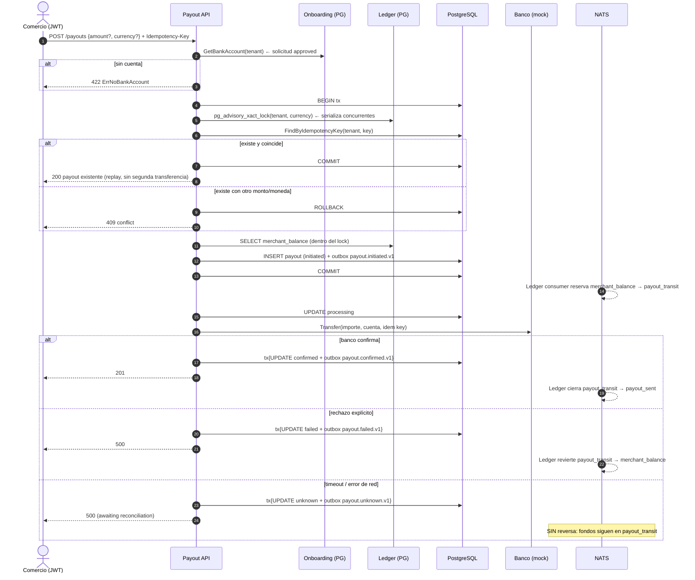

# Payout — Documentación técnico-funcional

> **Bounded Context:** `context/payout`
> **Migraciones:** [`000007_payout_init`](../../migrations/000007_payout_init.up.sql) · [`000015_payout_idempotency`](../../migrations/000015_payout_idempotency.up.sql)
> **Stream NATS:** `PAYOUT` (`payout.>`)

---

## 1. Propósito y alcance

Payout orquesta el **desembolso** de fondos desde la plataforma hacia la cuenta bancaria del comercio: cierra el ciclo del dinero iniciado en Payment (captura → Ledger acredita `merchant_balance` → Payout transfiere al banco).

1. Obtiene la cuenta bancaria del comercio registrada en Onboarding.
2. Verifica el saldo disponible contra el Ledger, con un lock contable por `(tenant, moneda)` que serializa payouts concurrentes.
3. Registra el payout con una clave de idempotencia obligatoria y publica `payout.initiated.v1` (el Ledger reserva los fondos: `merchant_balance → payout_transit`).
4. Ejecuta la transferencia bancaria vía `BankTransferAdapter`.
5. Cierra el resultado: confirmado, rechazado o —si el banco no respondió— **indeterminado**, delegando la resolución a reconciliación.

### Estado actual de las integraciones

| Puerto | Implementación cableada | Comentario |
|---|---|---|
| `BankTransferAdapter` | `transfer/mock.Adapter` | Confirma siempre, salvo cuenta `REJECT` (rechazo explícito). El `IdempotencyKey` de la transferencia es `transfer_<payout_id>`; el mock lo ignora. **Nunca usar en producción.** |
| `BalanceChecker` / `BalanceLocker` | `ledger.BalanceChecker` | Query directa a `account_balances` (cuenta `merchant_balance` del tenant) menos los payouts aún no asentados en el Ledger, con la conexión de la tx + `pg_advisory_xact_lock` por `(tenant, currency)`. |
| `BankAccountProvider` | `onboarding.BankAccountProvider` | Query directa a `onboarding_bank_accounts` unida a solicitudes `approved`. ⚠️ No filtra `verified` ni moneda (§10.6). |
| `PayoutGate` | `tenant.PayoutGate` | Lee `tenants.status` y `tenant_compliance_holds` (contexto Auth): exige tenant `active` sin hold de cumplimiento vigente. |
| `EventPublisher` | `outbox.NewEventPublisher` | Publicación transaccional vía Outbox (ver LEDGER.MD §7). |
| `TxManager` | `pkg/postgres` | `RunInTx` propaga la tx por el contexto; `ConnFromContext` hace que repo y publisher participen de la misma transacción. |

### Fuera de alcance (hoy)

- Bancos reales (MP Transfers, Prex, adquirentes): solo existe el mock.
- Comisión de desembolso: no se descuenta ningún fee del monto transferido.
- Job de resolución de payouts `unknown`: no hay consulta al banco ni webhook entrante que los cierre (§10.3).
- Payouts parciales programados / retiros automáticos (scheduled payouts).
- Filtros por estado en `GET /payouts`; paginación real (solo `limit`).

---

## 2. Lenguaje ubicuo

| Término | Significado |
|---|---|
| **Payout / Desembolso** | Transferencia de fondos desde la plataforma a la cuenta bancaria del comercio. |
| **Clave de idempotencia** | La genera el caller (header `Idempotency-Key`). Obligatoria: un retry con la misma clave retorna el payout existente en lugar de desembolsar dos veces. |
| **Saldo disponible** | Saldo de la cuenta `merchant_balance` del tenant en el Ledger, para una moneda dada. |
| **`payout_transit`** | Cuenta del Ledger donde quedan "reservados" los fondos mientras la transferencia está en vuelo. |
| **`payout_sent`** | Cuenta del Ledger donde los fondos quedan una vez que el banco confirmó la acreditación. |
| **Resultado indeterminado (`unknown`)** | El banco no respondió (timeout/red). NO es un fallo: puede que los fondos hayan salido. Requiere resolución. |
| **`ledger_entry_key`** | Clave de idempotencia del asiento contable inicial (`payout_initiated_<id>`); viaja en `payout.initiated.v1`. |

---

## 3. Modelo de dominio

### 3.1 Agregado `Payout`

Archivo: [domain/payout.go](../../context/payout/domain/payout.go)

| Campo | Notas |
|---|---|
| `id`, `tenantID` | UUID. |
| `amount` | `Money` > 0, en unidades mínimas (centavos). Si el cmd trae `amount = 0`, se usa el saldo completo. |
| `bankAccount` | `BankAccountInfo` persistido como **snapshot** al momento del payout (auditoría). |
| `status` | Ver FSM (§3.2). |
| `bankReference` | Referencia del banco al confirmar. |
| `failureReason` | Motivo técnico; se persiste pero **no** se expone el detalle del banco en códigos HTTP distintos de 500. |
| `idempotencyKey` | Clave de negocio, única por `(tenant, key)`. |
| `ledgerEntryKey` | Idempotencia del asiento inicial en Ledger. |
| `initiatedAt` / `confirmedAt` / `failedAt` | `initiatedAt` se setea al pasar a `processing` (nombre histórico). |

`NewPayout` exige clave de idempotencia no vacía (`ErrIdempotencyKeyRequired`) y emite `PayoutInitiatedEvent`.

### 3.2 Máquina de estados



| Transición | Evento publicado | Efecto en Ledger |
|---|---|---|
| `initiated → processing` | — | — |
| creación (`initiated`) | `payout.initiated.v1` | `merchant_balance` DEBIT / `payout_transit` CREDIT |
| `processing → confirmed` | `payout.confirmed.v1` | `payout_transit` DEBIT / `payout_sent` CREDIT |
| `processing → failed` | `payout.failed.v1` | **Reversa**: `payout_transit` DEBIT / `merchant_balance` CREDIT |
| `processing → unknown` | `payout.unknown.v1` | **Ninguno**: los fondos permanecen en `payout_transit` hasta la resolución |
| `unknown → confirmed / failed` | `payout.confirmed.v1` / `payout.failed.v1` | Como en el camino normal (los asientos son idempotentes por clave) |

`IsFinal()` solo considera finales `confirmed` y `failed`: **`unknown` no es final** y exige intervención.

### 3.3 Value Objects

Archivo: [domain/vo.go](../../context/payout/domain/vo.go)

- `Money`: `NewMoney` exige monto > 0 e ISO-4217 de 3 letras (normalizada a mayúsculas).
- `PayoutStatus`: `initiated` | `processing` | `confirmed` | `failed` | `unknown`.
- `BankAccountInfo`: el número de cuenta es **campo privado**. Solo dos caminos de lectura:
  - `AccountNumber()` — restringido al camino outbound (adaptador bancario y persistencia del snapshot).
  - `MaskedAccountNumber()` — único permitido en respuestas HTTP y logs (`••••••••••••••••7370`).
  - `NewBankAccountInfo` valida (vacío o > 64 chars → `ErrNoBankAccount`); `MustBankAccountInfo` reconstituye desde datos ya persistidos sin revalidar.

### 3.4 Errores

Archivo: [domain/errors.go](../../context/payout/domain/errors.go)

| Error | HTTP |
|---|---|
| `ErrPayoutNotFound` | 404 |
| `ErrInsufficientBalance`, `ErrNoBankAccount`, `ErrInvalidTransition` | 422 |
| `ErrInvalidAmount`, `ErrInvalidCurrency`, `ErrIdempotencyKeyRequired` | 400 |
| `ErrPayoutsNotAllowed` (tenant no activo, suspendido o en hold de cumplimiento) | 403, mensaje genérico `payouts are not available for this account` |
| `ErrIdempotencyKeyConflict` (misma clave, otro monto/moneda), `ErrPayoutAlreadyExists` (carrera perdida contra el UNIQUE) | 409 |
| Rechazo explícito del banco, errores de infra | 500 (sin filtrar detalle interno) |

`ErrBankTransferUnknown` acompaña (con `errors.Join`) al error de un resultado indeterminado; la capa HTTP lo responde 500 porque el request **no pudo completarse**, pero el payout queda persistido en `unknown` y el dinero sigue reservado.

---

## 4. Flujo funcional



---

## 5. Casos de uso

Directorio: [application/](../../context/payout/application/)

### 5.1 `InitiatePayoutUseCase`

Archivo: [initiate_payout.go](../../context/payout/application/initiate_payout.go)

| Paso | Acción | ¿En tx? | Si falla |
|---|---|---|---|
| 1 | Parsear tenant; exigir `IdempotencyKey` no vacía | — | 400/500, sin persistir |
| 1b | `gate.EnsurePayoutsAllowed`: tenant `active` y sin hold de cumplimiento. Va antes del replay: un hold también bloquea reintentos. Moneda default `ARS` | — | 403 `ErrPayoutsNotAllowed`, sin persistir |
| 2 | `bankProvider.GetBankAccount` (cuenta de solicitud `approved`) | — | 422/500, sin persistir |
| 3a | `BalanceLocker.LockBalance` — `pg_advisory_xact_lock` keyed por `(tenant, currency)` | Sí | aborta la tx |
| 3b | Replay: `FindByIdempotencyKey`; si existe y `MatchesRequest` → devolverlo (`Replayed: true`); si existe con otro monto/moneda → `ErrIdempotencyKeyConflict` | Sí | 409 |
| 3c | `GetAvailableBalance` **con el lock tomado**; monto efectivo = `cmd.Amount` o saldo completo si es 0; exige `0 < monto ≤ disponible` | Sí | 422 `ErrInsufficientBalance` |
| 3d | `NewPayout` + `repo.Save` + publish `payout.initiated.v1` | Sí (misma tx) | UNIQUE violado → `ErrPayoutAlreadyExists` (409; el retry encontrará el registro) |
| 4 | `MarkProcessing` + `repo.Update` | No | 500; payout queda `initiated` con fondos reservados |
| 5 | `transferAdapter.Transfer` (`IdempotencyKey: transfer_<payout_id>`) | — | ver abajo |
| 6a | OK → `Confirm(ref)` + tx{Update + publish `payout.confirmed.v1`} | Sí | 500; queda `processing` (§10.5) |
| 6b | Rechazo conocido → `Fail(reason)` + tx{Update + publish `payout.failed.v1`} | Sí | — |
| 6c | Indeterminado ([transfer_errors.go](../../context/payout/application/transfer_errors.go): `DeadlineExceeded`, `Canceled`, `net.Error.Timeout()`, EOF/conexión caída y hints de mensaje) → `MarkUnknown` + tx{Update + publish `payout.unknown.v1`} | Sí | — |

El clasificador `isIndeterminate` distingue estructuralmente *no sabemos* de *el banco dijo que no*: solo el rechazo conocido revierte fondos. Tratar un timeout como fallo definitivo era el bug crítico original (§10.3).

Resultado: `{payout_id, amount, currency, status, bank_reference, replayed}` (struct sin tags JSON → claves PascalCase, igual que `ProcessPaymentResult` en PAYMENT.MD §10.10).

### 5.2 Consultas

Archivo: [query_payouts.go](../../context/payout/application/query_payouts.go)

- `GetPayoutUseCase`: busca por ID; si es de otro tenant → `ErrPayoutNotFound` (no revela existencia).
- `ListPayoutsUseCase`: `ORDER BY created_at DESC LIMIT n` (default 20).
- Ambos devuelven `PayoutView` con la cuenta **enmascarada** (`MaskedAccountNumber`).

---

## 6. API HTTP

Archivo: [payout_handler.go](../../context/payout/infrastructure/adapters/inbound/http/payout_handler.go)

Las rutas `/api/v1/payouts` cuelgan del grupo `protected` de `cmd/api` con `JWTMiddleware` (solo JWT; **no** aceptan API key y **no** tienen guards por permiso — ver §10.8). El tenant sale del token.

| Método | Ruta | Descripción | Éxito |
|---|---|---|---|
| `POST` | `/payouts` | Solicita un desembolso | `201` nuevo / `200` replay idempotente |
| `GET` | `/payouts?limit=20` | Lista payouts del tenant | `200` |
| `GET` | `/payouts/:payoutID` | Consulta un payout | `200` |

### 6.1 Desembolsar — `POST /payouts`

Header **`Idempotency-Key: payout-2026-10-27-01`** (obligatorio; alternativa: campo `idempotency_key` en el body). Body opcional:

```json
{ "amount": 0, "currency": "ARS" }
```

`amount = 0` (u omitido) → desembolsa el **saldo disponible completo**.

```json
// 201
{ "PayoutID": "…", "Amount": 125000, "Currency": "ARS", "Status": "confirmed", "BankReference": "MOCK-BANK-1a2b3c4d", "Replayed": false }
```

| Caso | HTTP |
|---|---|
| Sin clave de idempotencia | 400 |
| Moneda inválida / monto ≤ 0 tras resolver el default | 400 |
| Tenant sin cuenta bancaria aprobada | 422 |
| Saldo insuficiente | 422 |
| Retry con la misma clave, mismo monto/moneda | **200** con el payout existente (no se transfiere dos veces) |
| Misma clave con otro monto/moneda | 409 |
| Carrera contra el UNIQUE (otra tx commiteó primero) | 409 — el cliente debe reintentar |
| Timeout del banco | 500 `"transfer result unknown, awaiting reconciliation"`; el payout queda `unknown` |

### 6.2 Consultar — `GET /payouts/:payoutID`

```json
{
  "id": "…", "tenant_id": "…", "amount": 125000, "currency": "ARS",
  "status": "confirmed",
  "bank_account_type": "CBU", "bank_account_number": "••••••••••••••••7370",
  "holder_name": "Comercio SA",
  "bank_reference": "MOCK-BANK-1a2b3c4d",
  "initiated_at": "2026-10-27T14:00:00Z", "confirmed_at": "2026-10-27T14:00:01Z",
  "created_at": "2026-10-27T14:00:00Z"
}
```

⚠️ `failure_reason` expone el texto crudo del error del banco (§10.10).

---

## 7. Eventos y consumidores

Archivo: [domain/events.go](../../context/payout/domain/events.go). Se publican por Outbox en el stream `PAYOUT` (`payout.>`), subject por evento.

| Subject | Payload |
|---|---|
| `payout.initiated.v1` | `payout_id`, `tenant_id`, `amount`, `currency`, `idempotency_key` (= `ledger_entry_key`) |
| `payout.confirmed.v1` | `payout_id`, `tenant_id`, `amount`, `currency`, `bank_reference` |
| `payout.failed.v1` | `payout_id`, `tenant_id`, `amount`, `currency`, `failure_reason` |
| `payout.unknown.v1` | `payout_id`, `tenant_id`, `amount`, `currency`, `failure_reason` (motivo técnico) |

### 7.1 Consumidores

| Consumidor | Filtro | Acción |
|---|---|---|
| **Ledger** ([payout_consumer.go](../../context/ledger/infrastructure/adapters/inbound/nats/payout_consumer.go)) | `payout.>` | Asientos de initiated / confirmed / reversa de failed (ver tabla FSM §3.2). Ignora `payout.unknown.v1` — correcto: no hay reversa. Cada asiento es idempotente por clave (`payout_initiated_…`, `payout_confirmed_…`, `payout_failed_…`). |
| **Notification** | `payout.>` | Emails en `payout.confirmed.v1` y `payout.failed.v1`. ⚠️ No hay plantilla para `unknown`: el comercio no es notificado del estado ambiguo. |
| **Webhook** | `payout.>` | Entrega a endpoints suscriptos a `payout.confirmed` / `payout.failed`. |
| Compliance / Reporting | — | **No consumen eventos de payout** hoy. |

Consistencia eventual: el payout **no espera** al Ledger; la reserva de fondos puede materializarse unos instantes después del commit (ver LEDGER.MD §7 por outbox).

---

## 8. Persistencia

Tabla `payouts` ([000007](../../migrations/000007_payout_init.up.sql) + [000015](../../migrations/000015_payout_idempotency.up.sql)):

| Grupo | Columnas |
|---|---|
| Identidad | `id` PK, `tenant_id`, `idempotency_key` (agregada en 000015) |
| Monto | `amount BIGINT CHECK (> 0)`, `currency CHAR(3)` |
| Cuenta destino (snapshot) | `bank_acct_type`, `bank_acct_num` (en claro, ver §9), `bank_name`, `holder_name` |
| Estado | `status` CHECK `('initiated','processing','confirmed','failed','unknown')`, `bank_reference`, `failure_reason`, `ledger_entry_key` |
| Tiempos | `initiated_at`, `confirmed_at`, `failed_at`, `created_at`, `updated_at` |

- `UNIQUE (tenant_id, idempotency_key) WHERE idempotency_key <> ''` (índice parcial; permite legados sin clave).
- Índice `(tenant_id, status, created_at DESC)`.
- RLS por `tenant_id` (no filtra mientras la app conecte como owner — ver LEDGER.MD).
- `Update` reescribe solo estado, referencia, motivo y fechas; monto y snapshot bancario son inmutables.
- Migraciones de ledger: `000007` amplía el CHECK de `ledger_accounts.type` con `payout_transit` y `payout_sent` (las crea el consumer de Onboarding).

---

## 9. Seguridad y cumplimiento

- **Datos bancarios:** el número de cuenta vive encapsulado en `BankAccountInfo`; la API de lectura solo expone `MaskedAccountNumber()`. El snapshot en `payouts.bank_acct_num` queda **en claro** (necesario para reproducir la transferencia y auditar); no hay cifrado en reposo (§10.9).
- **Autorización:** cualquier usuario autenticado del tenant (todos los roles) puede iniciar payouts — no hay permiso `payouts:create` ni guard por ruta (§10.8). Un desembolso es una operación sensible: debería requerir `admin` (y doble aprobación en el futuro).
- **Aislamiento:** `Get` verifica el tenant del payout; `List` y `Initiate` toman el tenant del token.
- **Estado del comercio y AML:** `PayoutGate` bloquea desembolsos de tenants no activos, suspendidos o en hold preventivo de cumplimiento (ver [COMPLIANCE.md](COMPLIANCE.md) §7.3). El mensaje no revela el motivo (anti tipping-off). Un payout iniciado antes del hold sigue su curso.
- **Reserva contable:** el lock advisory por `(tenant, currency)` dentro de la misma tx que lee el saldo e inserta el payout serializa los requests concurrentes (§10.4). Como el Ledger debita `merchant_balance` de forma asíncrona, el disponible descuenta los payouts cuyo asiento de `initiated` todavía no existe (salvo los fallidos): sin eso, dos payouts seguidos antes de que corriera el consumer leían el mismo saldo.
- **Idempotencia de extremo a extremo:** clave de negocio (HTTP) → UNIQUE (PG) → `transfer_<payout_id>` (banco) → `ledger_entry_key` (asiento). Cuatro capas: retries del caller nunca duplican dinero.

---

## 10. Limitaciones conocidas y deuda técnica

| # | Tema | Detalle | Estado |
|---|---|---|---|
| 1 | ~~Sin idempotencia de negocio~~ | Retries del caller podían desembolsar dos veces. Ahora: clave obligatoria (`400` si falta), replay `200`, conflicto de contenido `409`, UNIQUE como red de seguridad. | ✅ Resuelto (000015) |
| 2 | ~~Check-then-insert con carrera~~ | Dos requests concurrentes con la misma clave colisionan en el UNIQUE → `ErrPayoutAlreadyExists` → 409; el retry encuentra el registro. | ✅ Resuelto |
| 3 | ~~Timeout del banco tratado como fallo~~ | Un timeout revirtaba el asiento cuando el banco quizá acreditó los fondos (dinero regalado al comercio). Ahora `MarkUnknown` + `payout.unknown.v1` **sin reversa**; `unknown` admite `Confirm`/`Fail` como resolución. **Pendiente:** job/webhook que consulte al banco y resuelva payouts `unknown` — hoy quedan trabados manualmente. | ✅ Parcial (falta el resolver) |
| 4 | ~~TOCTOU entre leer saldo y reservar~~ | `LockBalance` (`pg_advisory_xact_lock` por tenant+moneda) serializa saldo + INSERT en la misma tx. Pendiente: test de integración concurrente real (requiere Postgres). | ✅ Resuelto |
| 5 | Payout trabado en `processing` | Si el proceso cae entre el UPDATE a `processing` y el cierre, no hay job de recuperación (mismo problema que PAYMENT.MD §10.2b). Depende del resolver de #3. | Alto |
| 6 | Cuenta bancaria sin filtrar `verified` ni moneda | El provider toma la primera cuenta de una solicitud `approved` **aunque `verified = false`** y sin casar `oba.currency` con la moneda del payout. Riesgo: transferir a una cuenta no validada o en otra moneda. Corregir en la query (y decidir política multi-cuenta). | Medio |
| 7 | Notificación de `unknown` | Notification no tiene plantilla para `payout.unknown.v1`: el comercio no sabe que su retiro está en estado ambiguo. | Bajo |
| 8 | Sin autorización granular | `/payouts` vive en `protected` con JWT genérico: sin permiso `payouts:create/read`, sin soporte de API key, sin guards (`RouteGuards`) como Payments. Cualquier rol del tenant puede desembolsar. | Medio |
| 9 | Snapshot bancario en claro | `bank_acct_num` persiste el CBU sin cifrar (necesario para la transferencia). Falta cifrado en reposo / política de retención. | Medio |
| 10 | Filtrado de información | `failure_reason` guarda y expone en `PayoutView` el texto crudo del banco. Contrato inconsistente: `InitiatePayoutResult` sin tags JSON (PascalCase) vs `PayoutView` snake_case. | Bajo |
| 11 | Sin comisión de desembolso | No existe `payout_fee`; el monto transferido es exactamente el retirado. Definir producto antes de cablearlo al Ledger. | Funcional |
| 12 | Mock ignora su idempotencia | El adapter recibe `transfer_<payout_id>` pero no la usa; un banco real sí debe honrarla. El clasificador `isIndeterminate` depende de tipos/mensajes de error estándar: un banco real necesitará errores tipados propios. | Bajo |

---

## 11. Testing

| Capa | Archivos | Cobertura relevante |
|---|---|---|
| Dominio | `domain/payout_test.go`, `vo_test.go`, `events_test.go` | FSM completa incluida `unknown → confirmed/failed`, máscara de cuenta, claves de idempotencia, payloads de eventos. |
| Aplicación | `application/initiate_payout_test.go` (+ `mocks_test.go`, `query_payouts_test.go`) | 26 subtests: happy path, saldo completo, replay idempotente, conflicto de clave, rejection→failed, timeout/network→unknown (sin reversa), fallos de cada paso. |
| HTTP | `inbound/http/payout_handler_test.go` | Mapeo de errores (400/404/409/422/500), header `Idempotency-Key`, 200 vs 201, respuesta enmascarada. |
| Adapters | `outbound/ledger/balance_checker_test.go`, `outbound/onboarding/bank_account_provider_test.go`, `outbound/transfer/mock/adapter_test.go` | Query de saldo, lock requiere tx activa, cuenta aprobada, mock confirm/reject. |
| Postgres | `outbound/postgres/payout_repo_test.go` | pgxmock: INSERT de 18 columnas con NULLs, mapeo de UNIQUE → `ErrPayoutAlreadyExists`, Update, scans. Tests de integración con `DATABASE_URL` se saltan sin DB. |
| Ledger (cross-BC) | `context/ledger/.../payout_consumer_test.go` | Asientos de initiated/confirmed/reversa de failed. |

```bash
go test ./context/payout/...
```

Faltan: test de concurrencia real del advisory lock (#4, requiere Postgres) y pruebas de resolución de `unknown` cuando exista el resolver (#3).

---

## 12. Mapa de código

```
context/payout/
├── domain/
│   ├── payout.go          # Agregado Payout + FSM (incl. unknown)
│   ├── vo.go              # IDs, PayoutStatus, Money, BankAccountInfo (encapsulado)
│   ├── events.go          # initiated / confirmed / failed / unknown
│   └── errors.go
├── application/
│   ├── ports.go           # PayoutRepository, PayoutGate, BalanceChecker, BalanceLocker,
│   │                      # BankAccountProvider, BankTransferAdapter, TxManager, EventPublisher
│   ├── commands.go        # InitiatePayoutCmd/Result, PayoutView
│   ├── initiate_payout.go # Caso de uso principal (lock + idempotencia + unknown)
│   ├── query_payouts.go   # GetPayout, ListPayouts
│   └── transfer_errors.go # isIndeterminate: timeout ≠ rechazo
└── infrastructure/adapters/
    ├── inbound/http/payout_handler.go
    └── outbound/
        ├── postgres/payout_repo.go
        ├── transfer/mock/adapter.go
        ├── ledger/balance_checker.go        # saldo + pg_advisory_xact_lock
        ├── tenant/gate.go                   # PayoutGate: tenant activo y sin hold AML
        └── onboarding/bank_account_provider.go
```

Consumidor contable: [context/ledger/.../nats/payout_consumer.go](../../context/ledger/infrastructure/adapters/inbound/nats/payout_consumer.go).
Cableado: [cmd/api/main.go](../../cmd/api/main.go) sección `Payouts`; consumers en [cmd/worker/main.go](../../cmd/worker/main.go).
