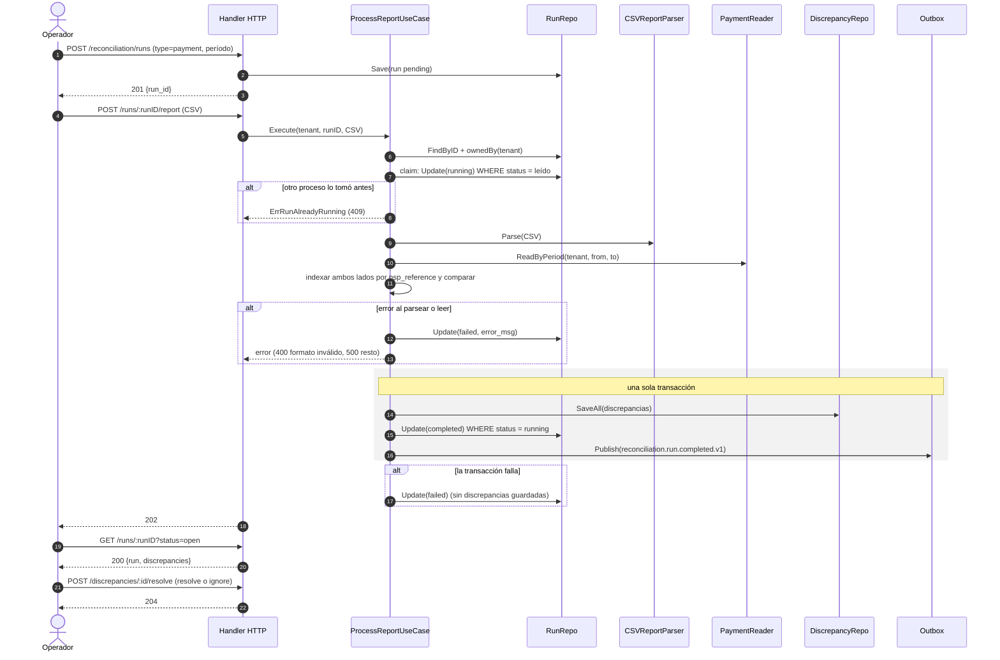
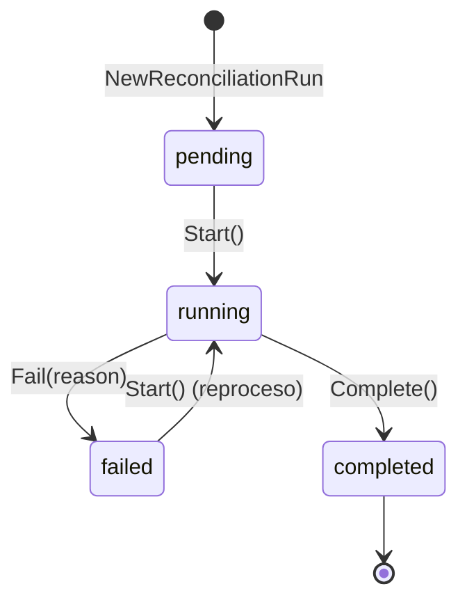

# Reconciliation — Documentación técnico-funcional

> **Bounded Context:** `context/reconciliation`
> **Migraciones:** [`000010_reconciliation_init`](../../migrations/000010_reconciliation_init.up.sql),
> [`000030_reconciliation_rls`](../../migrations/000030_reconciliation_rls.up.sql)
> **Stream NATS publicado:** `RECONCILIATION` (`reconciliation.>`) vía outbox — no consume eventos
> **Lee tablas de otros BCs:** `payments` (Payment), `journal_entries` + `postings` (Ledger)

---

## 1. Propósito

Reconciliation es el contexto que **verifica que lo registrado por la plataforma coincide
con la realidad**, y deja cada diferencia como una **discrepancia** para que un operador la
revise. No corrige nada: detecta y registra.

Hay dos tipos de conciliación (un *run* por período y tipo):

| Tipo | Compara | Origen externo |
|---|---|---|
| `payment` | Pagos del sistema (`payments`) contra el informe del PSP | CSV que sube el operador |
| `internal_ledger` | `SUM(créditos) == SUM(débitos)` de los asientos del período | — (chequeo interno) |

Responsabilidades:

1. Crear runs de conciliación para un período `[period_from, period_to)`.
2. Comparar pago por pago contra el CSV del PSP (matching por `psp_reference`).
3. Verificar el balance de doble partida del Ledger en el período.
4. Persistir las discrepancias y exponer el reporte del run.
5. Permitir al operador **resolver** o **ignorar** cada discrepancia con notas.
6. Publicar `reconciliation.run.completed.v1` y `reconciliation.discrepancy.resolved.v1`
   (los consume Audit).

### Fuera de alcance (hoy)

- Ingesta automática del informe del PSP (API o SFTP) y ejecución programada: todo es manual vía HTTP.
- Conciliación de **payouts** contra el banco: Payout deja los payouts `unknown` "a la espera de
  conciliación", pero no existe un tipo de run que los resuelva.
- Corrección de los datos: resolver una discrepancia solo cambia su estado.
- Runs **globales** (sin tenant) desde la API: el dominio y la RLS los soportan, pero el handler
  exige tenant.

---

## 2. Lenguaje ubicuo

| Término | Significado |
|---|---|
| **Run** (`ReconciliationRun`) | Una ejecución de conciliación de un tipo sobre un período. Tiene estado y contadores. |
| **Período** | Intervalo semiabierto `[period_from, period_to)`, con `period_from < period_to`. |
| **Run global** | Run sin `tenant_id`: abarca todos los tenants. Solo para procesos internos de plataforma. |
| **Claim** | Paso del run a `running` con un UPDATE condicionado al estado leído: de dos procesos simultáneos, solo uno lo toma. |
| **Informe del PSP** | CSV con las transacciones que el PSP dice haber procesado. |
| **`psp_reference`** | Referencia del pago en el PSP. Es la clave de matching (`transaction_id` en el CSV). |
| **Discrepancia** | Diferencia detectada en un run. Queda `open` hasta que un operador la resuelve o la ignora. |
| **Match** | Pago presente en ambos lados con el mismo monto y sin un desacuerdo crítico de estado. |
| **Imbalance** | Créditos menos débitos del Ledger en el período, en centavos. `0` = balanceado. |

---

## 3. Flujo funcional

El operador crea el run y después lo procesa en un segundo request (subiendo el CSV o pidiendo
el chequeo interno). El procesamiento es **síncrono**: cuando el request responde, el run ya
terminó.



`internal_ledger` sigue el mismo esqueleto con `POST /runs/:runID/process-internal`: en lugar de
CSV y `PaymentReader`, el `LedgerChecker` calcula el imbalance. Si no es cero se crea **una**
discrepancia `ledger_imbalance`.

Un run `failed` se puede volver a procesar: el fallo no deja discrepancias guardadas.

### Reglas de matching (`payment`)

Ambos lados se indexan por referencia. Los pagos del sistema sin `psp_reference` (no llegaron al
PSP) se descartan del índice.

| Situación | Resultado |
|---|---|
| En el sistema, no en el PSP | `missing_in_psp` (`system_value` = JSON del pago) |
| En el PSP, no en el sistema | `missing_in_system` (`external_value` = JSON del registro) |
| En ambos, monto distinto | `amount_mismatch` (`"<monto> <moneda>"` de cada lado) |
| En ambos, estado crítico distinto | `status_mismatch` |
| Resto | match |

Solo tres pares de estado (sistema → PSP) cuentan como críticos: `captured`→`rejected`,
`captured`→`failed` y `failed`→`captured`. Cualquier otra combinación es match (por ejemplo,
`captured` en el sistema y `refunded` en el PSP: el reembolso puede no haberse procesado aún).

Contadores: `total_records = max(registros del CSV, pagos del sistema)`, `matched_count` = pagos
del sistema que matchean, `discrepancy_count` = discrepancias creadas.

---

## 4. Modelo de dominio

### 4.1 Agregado `ReconciliationRun`

| Campo | Notas |
|---|---|
| `id`, `tenant_id` | `tenant_id` vacío = run global. |
| `type` | `payment` \| `internal_ledger`. |
| `status` | Ver la máquina de estados. |
| `period_from`, `period_to` | Validados en el constructor (`ErrInvalidPeriod`). |
| `total_records`, `matched_count`, `discrepancy_count` | Se fijan en `Complete`; `Fail` los vuelve a cero. |
| `error_msg` | Se fija en `Fail`; `Start` lo limpia. |
| `created_at`, `completed_at` | `completed_at` se fija en `Complete` y en `Fail`. |



- `Start()` solo desde `pending` o `failed`; desde `running` o `completed` devuelve
  `ErrRunAlreadyRunning`.
- `Complete()` registra `ReconciliationCompletedEvent`. `Fail()` no emite evento y descarta los
  eventos pendientes.

### 4.2 Entidad `Discrepancy`

| Campo | Notas |
|---|---|
| `run_id`, `tenant_id` | Tenant copiado del run. |
| `type` | `missing_in_psp`, `missing_in_system`, `amount_mismatch`, `status_mismatch`, `ledger_imbalance`. |
| `record_id` | `psp_reference` del pago, o `"global"` para `ledger_imbalance`. |
| `system_value`, `external_value` | Texto libre: JSON o `"<monto> <moneda>"`. |
| `status` | `open` → `resolved` \| `ignored`. |
| `resolved_by`, `notes`, `resolved_at` | Se fijan al resolver o ignorar. `resolved_by` es el usuario autenticado. |

`Resolve` e `Ignore` solo desde `open` (si no, `ErrDiscrepancyAlreadyResolved`) y registran
`DiscrepancyResolvedEvent`.

### 4.3 Value Objects y errores

| VO | Validación |
|---|---|
| `RunID`, `DiscrepancyID`, `TenantID` | UUID (`Parse*`). El error **no** es un sentinel del dominio. |
| `ReconciliationType` | `ParseReconciliationType` (error no tipado). |
| `RunStatus`, `DiscrepancyStatus`, `DiscrepancyType` | Constantes; sin `Parse` (se reconstituyen desde la base). |

| Error | HTTP |
|---|---|
| `ErrRunNotFound`, `ErrDiscrepancyNotFound` | 404 (también cuando el recurso es de otro tenant) |
| `ErrRunAlreadyRunning`, `ErrDiscrepancyAlreadyResolved` | 409 (incluye perder el claim contra otro proceso) |
| `ErrInvalidPeriod`, `ErrEmptyReport`, `ErrInvalidReportFormat` | 400 |
| `ErrRunNotCompleted` | Declarado, sin uso |
| Cualquier otro (incluidos los `Parse*`) | 500 |

---

## 5. Casos de uso

| Caso de uso | Qué hace |
|---|---|
| `StartReconciliationUseCase` | Valida tipo, período y tenant, y guarda el run en `pending`. |
| `ProcessReportUseCase` | Claim → parsea el CSV → lee `payments` del período → compara → en una transacción: discrepancias + `Complete` + evento. |
| `ProcessInternalUseCase` | Claim → `CheckBalance` → 0 o 1 discrepancia → misma transacción de cierre (`total=1`, `matched` = 1 si balancea). |
| `ResolveDiscrepancyUseCase` | Busca la discrepancia, verifica el tenant, aplica `resolve` o `ignore` y, en una transacción, la guarda y publica el evento. |
| `GetReportUseCase` | Run + discrepancias, con filtro opcional por estado (`limit` por defecto 100). |
| `ListRunsUseCase` | Runs del tenant, `created_at DESC` (`limit` por defecto 20). |

**Aislamiento en la aplicación:** `ownedBy` compara el `tenant_id` del run con el del caller. Un
tenant nunca ve runs de otro ni globales, y un caller sin tenant solo ve globales. El mismo
criterio aplica a las discrepancias. Si el recurso no pertenece al caller, la respuesta es
"no encontrado". La RLS lo refuerza en la base (§9).

**Atomicidad y concurrencia:**

- El claim es un `UPDATE … WHERE id=$1 AND status=<leído>`. Si afecta 0 filas, otro proceso tomó
  el run y la respuesta es 409.
- Discrepancias, cierre del run y evento comparten transacción: o queda todo o nada.
- Si el parseo, la lectura o la transacción de cierre fallan, el run pasa a `failed` sin
  resultados. Si tampoco se puede guardar el fallo, el error lo informa y el run queda `running`.

---

## 6. API HTTP

Grupo `protected` (JWT) → `/api/v1/reconciliation`. El tenant sale del token; sin tenant en el
contexto → **401**. Los guards de rol se inyectan desde `cmd/api` (`RouteGuards`) y
`RegisterRoutes` entra en pánico si falta alguno. Las API keys no tienen rol, así que no acceden.

| Guard | Roles |
|---|---|
| `Read` | `admin`, `accountant`, `operator` |
| `Operate` | `admin`, `accountant` |

| Método | Ruta | Guard | Descripción | Respuestas |
|---|---|---|---|---|
| `POST` | `/runs` | Operate | Body `{"type","period_from","period_to"}` (RFC3339) → `{run_id}` | 201 · 400 · 401 · 403 · 500 (tipo inválido) |
| `GET` | `/runs?limit=20` | Read | `{runs:[…], count}` | 200 · 401 · 403 · 500 |
| `GET` | `/runs/:runID?status=open&limit=100` | Read | `{run, discrepancies:[…]}` | 200 · 401 · 403 · 404 · 500 |
| `POST` | `/runs/:runID/report` | Operate | CSV del PSP en el body (máx. 50 MB) | 202 · 400 · 401 · 403 · 404 · 409 · 500 |
| `POST` | `/runs/:runID/process-internal` | Operate | Chequeo de balance del Ledger | 202 · 401 · 403 · 404 · 409 · 500 |
| `POST` | `/discrepancies/:discrepancyID/resolve` | Operate | Body `{"action":"resolve"\|"ignore","notes"}`; firma el usuario autenticado | 204 · 400 · 401 · 403 · 404 · 409 · 500 |

### Formato del CSV

```
transaction_id,amount,currency,status,processed_at
PSP-REF-001,10000,ARS,captured,2026-06-01T12:00:00Z
PSP-REF-002,5000,ARS,rejected,2026-06-01T12:05:00Z
```

- Encabezados obligatorios: `transaction_id`, `amount`, `currency`, `status`. `processed_at`
  (RFC3339) es opcional. No importan mayúsculas ni orden, y las columnas extra se ignoran.
- `amount` en centavos (entero). `currency` se normaliza a mayúsculas, `status` a minúsculas.
- Una fila mal formada (comillas sin cerrar, cantidad de columnas distinta) invalida el informe
  completo con `ErrInvalidReportFormat`.

---

## 7. Eventos

### 7.1 Publicados

| Subject | Cuándo | Payload |
|---|---|---|
| `reconciliation.run.completed.v1` | Al completar un run (con o sin discrepancias) | `run_id`, `tenant_id`, `type`, `total_records`, `matched_count`, `discrepancy_count` |
| `reconciliation.discrepancy.resolved.v1` | Al resolver o ignorar una discrepancia | `discrepancy_id`, `run_id`, `tenant_id`, `type`, `status` (`resolved`\|`ignored`), `resolved_by` |

Se publican por el outbox (`pkg/outbox`), dentro de la misma transacción que el cambio de estado.
El único consumidor es **Audit** (`audit-reconciliation-consumer`): registra
`reconciliation_run` y `reconciliation_discrepancy` (con `resolved_by` como actor). Notification
no los notifica. No hay evento para runs fallidos.

### 7.2 Consumidos

Ninguno.

---

## 8. Persistencia

| Tabla | Claves e índices | Checks |
|---|---|---|
| `reconciliation_runs` | PK `id`; `idx_recon_runs_tenant (tenant_id, created_at DESC) WHERE tenant_id IS NOT NULL`; `idx_recon_runs_created (created_at DESC)` | `type`, `status`, `period_from < period_to` |
| `reconciliation_discrepancies` | PK `id`; FK `run_id` → runs; `idx_recon_disc_run (run_id, status)`; `idx_recon_disc_tenant` | `type` (5 valores), `status` |

`tenant_id` es nullable en ambas tablas (runs globales).

**RLS** (`000030`), en las dos tablas:

| Política | Condición |
|---|---|
| `*_isolation` | `tenant_id = NULLIF(current_setting('app.current_tenant', true), '')::uuid` |
| `*_platform_operator` | `current_setting('app.platform_operator', true) = 'on'` — única vía a los runs globales |

Cada método de los repos corre en una sesión con `app.current_tenant` fijado (`withTenant` →
`RunWithAppTenant`). Escrituras: tenant de la entidad. Lecturas por ID o por run: tenant del
caller. Dentro de `RunInTx` la variable ya la fija el `TxManager`.

### Lecturas de otros BCs

| Adapter | Query |
|---|---|
| `PaymentReader` | `payments` con `created_at` en el período (todos los estados), filtrado por `tenant_id` si el run no es global |
| `LedgerChecker` | `SUM(credit) - SUM(debit)` de `postings` unidos a `journal_entries` con `created_at` en el período |

Ambas fijan `app.current_tenant` con el tenant del run: esas tablas tienen RLS por tenant.

---

## 9. Seguridad y multi-tenancy

- **Autenticación:** JWT (grupo `protected`). Sin tenant → 401.
- **Autorización:** guards de rol por operación (§6). `read_only` y API keys no acceden.
- **Aislamiento:** en la aplicación (`ownedBy` y el check de tenant de la discrepancia) y en la
  base (RLS en las tablas propias y en las leídas de Payment y Ledger). Verificado con un rol
  sin `BYPASSRLS`: un tenant no ve runs ni discrepancias de otro, ni pidiéndolas por ID.
- **Atribución:** `resolved_by` es el actor autenticado del contexto; lo que mande el body se
  ignora. Queda en la discrepancia y en el audit log.
- **Runs globales:** sin tenant, las lecturas de `payments` y `postings` no fijan variable. Hoy
  no hay ruta que los procese; un proceso interno que lo haga necesitará
  `WithPlatformOperator` y políticas de operador en esas tablas.

---

## 10. Limitaciones conocidas y deuda técnica

| # | Severidad | Tema | Detalle |
|---|---|---|---|
| 1 | Media | Tipo de run no validado | Se puede subir un CSV a un run `internal_ledger` o pedir `process-internal` sobre un run `payment`: ambos se ejecutan y completan el run con el tipo equivocado. |
| 2 | Media | Matching incompleto | No compara moneda (mismo monto en otra moneda = match). Solo 3 pares de estado son críticos: `processing`↔`captured` o `refunded`↔`captured` pasan como match. Referencias duplicadas (en el CSV o en `payments`) se pisan en silencio. Los pagos se filtran por `created_at`, pero el CSV no se filtra por período: los bordes generan `missing_*` falsos. `total_records` cuenta pagos sin `psp_reference` que nunca se comparan. |
| 3 | Media | Errores de cliente como 500 | IDs con formato inválido, `type` inválido y `action` inválida responden 500. Un `amount` no entero en el CSV también da 500 (y deja el run `failed`, reprocesable). Un `status` de filtro inválido devuelve la lista vacía. |
| 4 | Media | Chequeo del Ledger débil | El trigger de la base ya garantiza el balance de cada asiento, así que el chequeo casi no puede fallar. Además suma todas las monedas juntas. No cruza Ledger contra pagos capturados. |
| 5 | Baja | Run trabado en `running` | Si el proceso muere entre el claim y el cierre (o no puede guardar el fallo), el run queda `running` para siempre: no hay timeout ni forma de liberarlo. |
| 6 | Baja | `limit` sin tope | `GET /runs` y `GET /runs/:runID` aceptan cualquier `limit`. |
| 7 | Baja | Síncrono con 202 | El CSV (hasta 50 MB) se procesa dentro del request y la respuesta es 202 aunque el trabajo ya terminó. |
| 8 | Baja | Dominio y limpieza | `Complete` y `Fail` no validan el estado previo. `Fail` no emite evento. El dominio usa `time.Now()`. Código muerto: `ErrRunNotCompleted` y el campo `runRepo TxManager` de `StartReconciliationUseCase`. `processed_at` se parsea pero no se usa. |
| 9 | Producto | Alcance | Sin runs programados ni ingesta automática del informe. Sin conciliación de payouts (`unknown`). Sin runs globales vía API. Un único formato de CSV. |

---

## 11. Testing

`go test ./context/reconciliation/...` (100 % de cobertura de sentencias en los cinco paquetes).

| Paquete | Enfoque |
|---|---|
| `domain` | Máquina de estados del run (incluido el reproceso desde `failed` y el reseteo en `Fail`), validación de período, `Resolve`/`Ignore` con su evento, VOs. |
| `application` | Fakes de repos, reader, parser, `TxManager` y publisher: cada tipo de discrepancia, `ownedBy`, claim perdido (409), rollback ante fallo de guardado, update o publish, run marcado `failed`, resolución con evento. |
| `http` | Binding, 401 sin tenant, firma con el actor autenticado (ignora `resolved_by` del body), guard correcto por ruta, pánico sin guards, mapeo de errores. |
| `postgres` | pgxmock: SQL de cada método dentro de la sesión RLS con el tenant que corresponde, UPDATE condicionado (0 filas → `ErrRunAlreadyRunning`), `ErrNoRows` → not found. |
| `readers` | Parser CSV y SQL de `PaymentReader`/`LedgerChecker` dentro de la sesión RLS, con y sin tenant. |

La RLS y la concurrencia se verificaron además contra Postgres con un rol sin `BYPASSRLS`
(30 rondas de dos uploads simultáneos: siempre uno procesa y el otro recibe 409). Esa prueba no
está automatizada.

---

## 12. Mapa de código

```
context/reconciliation/
├── domain/
│   ├── run.go              # agregado ReconciliationRun: pending→running→completed/failed (failed reprocesable)
│   ├── discrepancy.go      # entidad Discrepancy: open→resolved/ignored + evento
│   ├── events.go           # ReconciliationCompletedEvent, DiscrepancyResolvedEvent
│   ├── vo.go               # IDs, ReconciliationType, RunStatus, DiscrepancyType/Status
│   └── errors.go
├── application/
│   ├── ports.go            # repos (Update condicionado), PaymentReader, ReportParser, LedgerChecker, TxManager, EventPublisher
│   ├── commands.go         # comandos, queries y views
│   ├── start_reconciliation.go
│   ├── process_report.go   # ProcessReport (matching) + ProcessInternal + claim/complete/fail
│   └── resolve_discrepancy.go # Resolve + GetReport + ListRuns
└── infrastructure/adapters/
    ├── inbound/http/handler.go          # 6 endpoints, RouteGuards, RegisterRoutes
    └── outbound/
        ├── postgres/run_repo.go, discrepancy_repo.go, rls.go   # sesión RLS (withTenant)
        └── readers/
            ├── csv_parser.go            # CSVReportParser
            ├── payment_reader.go        # PaymentReader (payments) + LedgerChecker (postings)
            └── rls.go                   # sesión RLS para las lecturas cross-BC
```

Wiring: `cmd/api/main.go` (repos, readers, `TxManager`, outbox, casos de uso, guards y rutas). El
worker no tiene nada de Reconciliation: los eventos los consume Audit.
