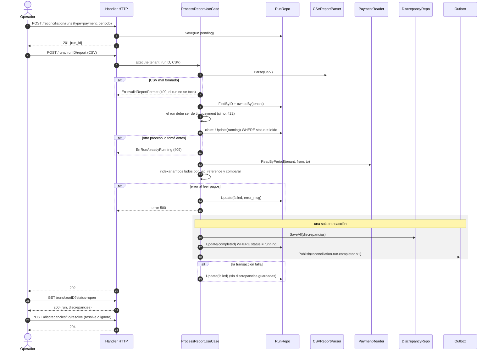
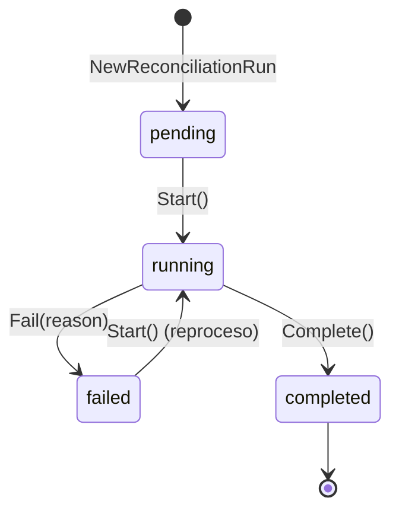

# Reconciliation — Documentación técnico-funcional

> **Bounded Context:** `context/reconciliation`
> **Migraciones:** [`000010_reconciliation_init`](../../migrations/000010_reconciliation_init.up.sql),
> [`000030_reconciliation_rls`](../../migrations/000030_reconciliation_rls.up.sql),
> [`000031_reconciliation_duplicate_reference`](../../migrations/000031_reconciliation_duplicate_reference.up.sql),
> [`000032_reconciliation_missing_in_ledger`](../../migrations/000032_reconciliation_missing_in_ledger.up.sql)
> **Stream NATS publicado:** `RECONCILIATION` (`reconciliation.>`) vía outbox — no consume eventos
> **Lee tablas de otros BCs:** `payments` (Payment), `journal_entries` + `postings` (Ledger)

---

## 1. Propósito

Reconciliation es el contexto que **verifica que lo registrado por la plataforma coincide
con la realidad**, y deja cada diferencia como una **discrepancia** para que un operador la
revise. No corrige nada: detecta y registra.

Hay dos tipos de conciliación (un *run* por período y tipo):

| Tipo | Compara | Origen externo |
|---|---|---|
| `payment` | Pagos del sistema (`payments`) contra el informe del PSP | CSV que sube el operador |
| `internal_ledger` | Cada asiento del período balancea por moneda, y cada pago capturado tiene su asiento | — (chequeo interno contra `payments`) |

Responsabilidades:

1. Crear runs de conciliación para un período `[period_from, period_to)`.
2. Comparar pago por pago contra el CSV del PSP (matching por `psp_reference`).
3. Verificar el Ledger del período: doble partida por asiento y moneda, y un asiento por cada captura.
4. Persistir las discrepancias y exponer el reporte del run.
5. Permitir al operador **resolver** o **ignorar** cada discrepancia con notas.
6. Publicar `reconciliation.run.completed.v1` y `reconciliation.discrepancy.resolved.v1`
   (los consume Audit).

### Fuera de alcance (hoy)

- Ingesta automática del informe del PSP (API o SFTP) y ejecución programada: todo es manual vía HTTP.
- Conciliación de **payouts** contra el banco: Payout deja los payouts `unknown` "a la espera de
  conciliación", pero no existe un tipo de run que los resuelva.
- Corrección de los datos: resolver una discrepancia solo cambia su estado.
- Runs **globales** (sin tenant) desde la API: el dominio y la RLS los soportan, pero el handler
  exige tenant.

---

## 2. Lenguaje ubicuo

| Término | Significado |
|---|---|
| **Run** (`ReconciliationRun`) | Una ejecución de conciliación de un tipo sobre un período. Tiene estado y contadores. |
| **Período** | Intervalo semiabierto `[period_from, period_to)`, con `period_from < period_to`. |
| **Run global** | Run sin `tenant_id`: abarca todos los tenants. Solo para procesos internos de plataforma. |
| **Claim** | Paso del run a `running` con un UPDATE condicionado al estado leído: de dos procesos simultáneos, solo uno lo toma. |
| **Informe del PSP** | CSV con las transacciones que el PSP dice haber procesado. |
| **`psp_reference`** | Referencia del pago en el PSP. Es la clave de matching (`transaction_id` en el CSV). |
| **Discrepancia** | Diferencia detectada en un run. Queda `open` hasta que un operador la resuelve o la ignora. |
| **Match** | Pago presente en ambos lados con el mismo monto y sin un desacuerdo crítico de estado. |
| **Desenlace** | Traducción común del estado de un pago en cada lado: `pending`, `captured`, `failed`, `refunded`. Es lo que se compara. |
| **Imbalance** | Créditos menos débitos de un asiento en una moneda, en centavos. `0` = balanceado. |

---

## 3. Flujo funcional

El operador crea el run y después lo procesa en un segundo request (subiendo el CSV o pidiendo
el chequeo interno). El procesamiento es **síncrono**: cuando el request responde, el run ya
terminó.



`internal_ledger` sigue el mismo esqueleto con `POST /runs/:runID/process-internal` (sin CSV): el
`LedgerChecker` revisa el período y cada hallazgo es una discrepancia (ver "Chequeo del Ledger").

Un run `failed` se puede volver a procesar: el fallo no deja discrepancias guardadas.

### Reglas de matching (`payment`)

Ambos lados se indexan por referencia. Los pagos del sistema sin `psp_reference` (no llegaron al
PSP) no se evalúan. Las referencias se recorren en orden alfabético.

| Situación | Resultado |
|---|---|
| Referencia repetida en el informe o en `payments` | `duplicate_reference` (`system_value` y `external_value` = JSON de todos los registros de cada lado) |
| En el sistema, no en el PSP | `missing_in_psp` (`system_value` = JSON del pago) |
| En el PSP, no en el sistema, `processed_at` dentro del período o vacío | `missing_in_system` (`external_value` = JSON del registro) |
| En el PSP, no en el sistema, `processed_at` fuera del período | No se evalúa: queda para el run de su período |
| En ambos, monto o moneda distintos | `amount_mismatch` (`"<monto> <moneda>"` de cada lado; la moneda se compara sin distinguir mayúsculas) |
| En ambos, desenlaces distintos | `status_mismatch` |
| Resto | match |

Un registro del PSP fuera del período que sí tiene su pago en el período se compara igual (el
pago se creó dentro y el PSP lo procesó después del corte).

Desenlaces:

| Desenlace | Sistema | PSP |
|---|---|---|
| `pending` | `initiated`, `processing` | `pending` |
| `captured` | `captured` | `captured` |
| `failed` | `failed`, `risk_rejected` | `failed`, `rejected` |
| `refunded` | `refunded` | `refunded` |

Un estado fuera de la tabla nunca coincide. Un reembolso registrado de un solo lado es
`status_mismatch`: el operador decide si es un desfase temporal.

Contadores: `total_records` = referencias evaluadas, y siempre vale `matched_count +
discrepancy_count`.

### Chequeo del Ledger (`internal_ledger`)

| Hallazgo | Discrepancia |
|---|---|
| Asiento creado en el período cuyos créditos ≠ débitos en alguna moneda, o sin postings | `ledger_imbalance`, una por asiento (`record_id` = `entry_id`, `external_value` = p. ej. `"100 ARS, -100 USD (créditos - débitos)"` o `"sin postings"`) |
| Pago `captured` o `refunded` con `captured_at` en el período sin el asiento `payment_captured_<payment_id>` del tenant | `missing_in_ledger` (`record_id` = `payment_id`, `system_value` = JSON del pago) |

El trigger de la base solo valida asientos con dos o más postings y suma todas las monedas juntas.
Este chequeo detecta lo que se le escapa: asientos de un solo posting, sin postings o que se
compensan entre monedas. `total_records` = asientos + capturas revisados.

El Ledger asienta las capturas de forma asíncrona (consumer de `payment.captured.v1`): una
captura de los últimos instantes del período puede aparecer como `missing_in_ledger` si el
consumer viene atrasado.

---

## 4. Modelo de dominio

### 4.1 Agregado `ReconciliationRun`

| Campo | Notas |
|---|---|
| `id`, `tenant_id` | `tenant_id` vacío = run global. |
| `type` | `payment` \| `internal_ledger`. |
| `status` | Ver la máquina de estados. |
| `period_from`, `period_to` | Validados en el constructor (`ErrInvalidPeriod`). |
| `total_records`, `matched_count`, `discrepancy_count` | Se fijan en `Complete`; `Fail` los vuelve a cero. |
| `error_msg` | Se fija en `Fail`; `Start` lo limpia. |
| `created_at`, `completed_at` | `completed_at` se fija en `Complete` y en `Fail`. |



- `Start()` solo desde `pending` o `failed`; desde `running` o `completed` devuelve
  `ErrRunAlreadyRunning`.
- `Complete()` registra `ReconciliationCompletedEvent`. `Fail()` no emite evento y descarta los
  eventos pendientes.

### 4.2 Entidad `Discrepancy`

| Campo | Notas |
|---|---|
| `run_id`, `tenant_id` | Tenant copiado del run. |
| `type` | `missing_in_psp`, `missing_in_system`, `amount_mismatch`, `status_mismatch`, `duplicate_reference`, `ledger_imbalance`, `missing_in_ledger`. |
| `record_id` | `psp_reference` del pago; `entry_id` para `ledger_imbalance`; `payment_id` para `missing_in_ledger`. |
| `system_value`, `external_value` | Texto libre: JSON o `"<monto> <moneda>"`. |
| `status` | `open` → `resolved` \| `ignored`. |
| `resolved_by`, `notes`, `resolved_at` | Se fijan al resolver o ignorar. `resolved_by` es el usuario autenticado. |

`Resolve` e `Ignore` solo desde `open` (si no, `ErrDiscrepancyAlreadyResolved`) y registran
`DiscrepancyResolvedEvent`.

### 4.3 Value Objects y errores

| VO | Validación |
|---|---|
| `RunID`, `DiscrepancyID`, `TenantID` | UUID (`Parse*`; error `ErrInvalidArgument`). |
| `ReconciliationType` | `ParseReconciliationType` (error `ErrInvalidArgument`). |
| `RunStatus`, `DiscrepancyStatus`, `DiscrepancyType` | Constantes; sin `Parse` (se reconstituyen desde la base). |

| Error | HTTP |
|---|---|
| `ErrRunNotFound`, `ErrDiscrepancyNotFound` | 404 (también cuando el recurso es de otro tenant) |
| `ErrRunAlreadyRunning`, `ErrDiscrepancyAlreadyResolved` | 409 (incluye perder el claim contra otro proceso) |
| `ErrInvalidPeriod`, `ErrEmptyReport`, `ErrInvalidReportFormat`, `ErrInvalidArgument` | 400 (`ErrInvalidArgument`: IDs, tipo de run, acción, filtro de estado) |
| `ErrRunTypeMismatch` | 422: la operación no corresponde al tipo del run |
| `ErrRunNotCompleted` | Declarado, sin uso |
| Cualquier otro | 500 |

---

## 5. Casos de uso

| Caso de uso | Qué hace |
|---|---|
| `StartReconciliationUseCase` | Valida tipo, período y tenant, y guarda el run en `pending`. |
| `ProcessReportUseCase` | Parsea el CSV → verifica tipo `payment` → claim → lee `payments` del período → compara → en una transacción: discrepancias + `Complete` + evento. |
| `ProcessInternalUseCase` | Verifica tipo `internal_ledger` → claim → `LedgerChecker.Check` → una discrepancia por hallazgo → misma transacción de cierre. |
| `ResolveDiscrepancyUseCase` | Busca la discrepancia, verifica el tenant, aplica `resolve` o `ignore` y, en una transacción, la guarda y publica el evento. |
| `GetReportUseCase` | Run + discrepancias, con filtro opcional por estado (`open`, `resolved`, `ignored`; otro valor → 400). `limit` por defecto 100. |
| `ListRunsUseCase` | Runs del tenant, `created_at DESC` (`limit` por defecto 20). |

**Aislamiento en la aplicación:** `ownedBy` compara el `tenant_id` del run con el del caller. Un
tenant nunca ve runs de otro ni globales, y un caller sin tenant solo ve globales. El mismo
criterio aplica a las discrepancias. Si el recurso no pertenece al caller, la respuesta es
"no encontrado". La RLS lo refuerza en la base (§9).

**Atomicidad y concurrencia:**

- El claim es un `UPDATE … WHERE id=$1 AND status=<leído>`. Si afecta 0 filas, otro proceso tomó
  el run y la respuesta es 409.
- Discrepancias, cierre del run y evento comparten transacción: o queda todo o nada.
- Un CSV mal formado se rechaza antes del claim: el run sigue `pending`.
- Si la lectura de datos o la transacción de cierre fallan, el run pasa a `failed` sin
  resultados. Si tampoco se puede guardar el fallo, el error lo informa y el run queda `running`.

---

## 6. API HTTP

Grupo `protected` (JWT) → `/api/v1/reconciliation`. El tenant sale del token; sin tenant en el
contexto → **401**. Los guards de rol se inyectan desde `cmd/api` (`RouteGuards`) y
`RegisterRoutes` entra en pánico si falta alguno. Las API keys no tienen rol, así que no acceden.

| Guard | Roles |
|---|---|
| `Read` | `admin`, `accountant`, `operator` |
| `Operate` | `admin`, `accountant` |

| Método | Ruta | Guard | Descripción | Respuestas |
|---|---|---|---|---|
| `POST` | `/runs` | Operate | Body `{"type","period_from","period_to"}` (RFC3339) → `{run_id}` | 201 · 400 · 401 · 403 · 500 |
| `GET` | `/runs?limit=20` | Read | `{runs:[…], count}` | 200 · 401 · 403 · 500 |
| `GET` | `/runs/:runID?status=open&limit=100` | Read | `{run, discrepancies:[…]}` | 200 · 400 · 401 · 403 · 404 · 500 |
| `POST` | `/runs/:runID/report` | Operate | CSV del PSP en el body (máx. 50 MB) | 202 · 400 · 401 · 403 · 404 · 409 · 422 · 500 |
| `POST` | `/runs/:runID/process-internal` | Operate | Chequeo del Ledger | 202 · 400 · 401 · 403 · 404 · 409 · 422 · 500 |
| `POST` | `/discrepancies/:discrepancyID/resolve` | Operate | Body `{"action":"resolve"\|"ignore","notes"}`; firma el usuario autenticado | 204 · 400 · 401 · 403 · 404 · 409 · 500 |

### Formato del CSV

```
transaction_id,amount,currency,status,processed_at
PSP-REF-001,10000,ARS,captured,2026-06-01T12:00:00Z
PSP-REF-002,5000,ARS,rejected,2026-06-01T12:05:00Z
```

- Encabezados obligatorios: `transaction_id`, `amount`, `currency`, `status`. `processed_at`
  (RFC3339) es opcional. No importan mayúsculas ni orden, y las columnas extra se ignoran.
- `amount` en centavos: entero positivo. `currency` se normaliza a mayúsculas, `status` a
  minúsculas.
- `processed_at` vacío o sin columna = se asume dentro del período.
- Cualquier fila inválida (comillas sin cerrar, cantidad de columnas distinta, monto no entero o
  no positivo, `processed_at` ilegible) invalida el informe completo con `ErrInvalidReportFormat`
  y el número de fila.

---

## 7. Eventos

### 7.1 Publicados

| Subject | Cuándo | Payload |
|---|---|---|
| `reconciliation.run.completed.v1` | Al completar un run (con o sin discrepancias) | `run_id`, `tenant_id`, `type`, `total_records`, `matched_count`, `discrepancy_count` |
| `reconciliation.discrepancy.resolved.v1` | Al resolver o ignorar una discrepancia | `discrepancy_id`, `run_id`, `tenant_id`, `type`, `status` (`resolved`\|`ignored`), `resolved_by` |

Se publican por el outbox (`pkg/outbox`), dentro de la misma transacción que el cambio de estado.
El único consumidor es **Audit** (`audit-reconciliation-consumer`): registra
`reconciliation_run` y `reconciliation_discrepancy` (con `resolved_by` como actor). Notification
no los notifica. No hay evento para runs fallidos.

### 7.2 Consumidos

Ninguno.

---

## 8. Persistencia

| Tabla | Claves e índices | Checks |
|---|---|---|
| `reconciliation_runs` | PK `id`; `idx_recon_runs_tenant (tenant_id, created_at DESC) WHERE tenant_id IS NOT NULL`; `idx_recon_runs_created (created_at DESC)` | `type`, `status`, `period_from < period_to` |
| `reconciliation_discrepancies` | PK `id`; FK `run_id` → runs; `idx_recon_disc_run (run_id, status)`; `idx_recon_disc_tenant` | `type` (7 valores), `status` |

`tenant_id` es nullable en ambas tablas (runs globales).

**RLS** (`000030`), en las dos tablas:

| Política | Condición |
|---|---|
| `*_isolation` | `tenant_id = NULLIF(current_setting('app.current_tenant', true), '')::uuid` |
| `*_platform_operator` | `current_setting('app.platform_operator', true) = 'on'` — única vía a los runs globales |

Cada método de los repos corre en una sesión con `app.current_tenant` fijado (`withTenant` →
`RunWithAppTenant`). Escrituras: tenant de la entidad. Lecturas por ID o por run: tenant del
caller. Dentro de `RunInTx` la variable ya la fija el `TxManager`.

### Lecturas de otros BCs

| Adapter | Query |
|---|---|
| `PaymentReader` | `payments` con `created_at` en el período (todos los estados), filtrado por `tenant_id` si el run no es global |
| `LedgerChecker` | Cantidad de `journal_entries` del período y los que no balancean por moneda (`LEFT JOIN postings`, `GROUP BY` asiento y moneda); cantidad de capturas del período y las que no tienen `journal_entries.idempotency_key = 'payment_captured_' \|\| payments.id` |

Ambos fijan `app.current_tenant` con el tenant del run: esas tablas tienen RLS por tenant.

---

## 9. Seguridad y multi-tenancy

- **Autenticación:** JWT (grupo `protected`). Sin tenant → 401.
- **Autorización:** guards de rol por operación (§6). `read_only` y API keys no acceden.
- **Aislamiento:** en la aplicación (`ownedBy` y el check de tenant de la discrepancia) y en la
  base (RLS en las tablas propias y en las leídas de Payment y Ledger). Verificado con un rol
  sin `BYPASSRLS`: un tenant no ve runs ni discrepancias de otro, ni pidiéndolas por ID.
- **Atribución:** `resolved_by` es el actor autenticado del contexto; lo que mande el body se
  ignora. Queda en la discrepancia y en el audit log.
- **Runs globales:** sin tenant, las lecturas de `payments` y `postings` no fijan variable. Hoy
  no hay ruta que los procese; un proceso interno que lo haga necesitará
  `WithPlatformOperator` y políticas de operador en esas tablas.

---

## 10. Limitaciones conocidas y deuda técnica

| # | Severidad | Tema | Detalle |
|---|---|---|---|
| 1 | Baja | Run trabado en `running` | Si el proceso muere entre el claim y el cierre (o no puede guardar el fallo), el run queda `running` para siempre: no hay timeout ni forma de liberarlo. |
| 2 | Baja | `limit` sin tope | `GET /runs` y `GET /runs/:runID` aceptan cualquier `limit`. |
| 3 | Baja | Síncrono con 202 | El CSV (hasta 50 MB) se procesa dentro del request y la respuesta es 202 aunque el trabajo ya terminó. |
| 4 | Baja | Dominio y limpieza | `Complete` y `Fail` no validan el estado previo. `Fail` no emite evento. El dominio usa `time.Now()`. Código muerto: `ErrRunNotCompleted` y el campo `runRepo TxManager` de `StartReconciliationUseCase`. |
| 5 | Producto | Alcance | Sin runs programados ni ingesta automática del informe. Sin conciliación de payouts (`unknown`). Sin runs globales vía API. Un único formato de CSV. |

---

## 11. Testing

`go test ./context/reconciliation/...` (100 % de cobertura de sentencias en los cinco paquetes).

| Paquete | Enfoque |
|---|---|
| `domain` | Máquina de estados del run (incluido el reproceso desde `failed` y el reseteo en `Fail`), validación de período, `Resolve`/`Ignore` con su evento, VOs con `ErrInvalidArgument`. |
| `application` | Fakes de repos, reader, parser, ledger, `TxManager` y publisher: cada tipo de discrepancia, tabla de desenlaces, moneda, duplicados, período por `processed_at`, invariante de contadores, hallazgos del Ledger, tipo de run, CSV inválido sin tocar el run, `ownedBy`, claim perdido (409), rollbacks, resolución con evento. |
| `http` | Binding, 401 sin tenant, 400 por cada error de cliente, 422 por tipo de run, firma con el actor autenticado, guard correcto por ruta, pánico sin guards, mapeo de errores. |
| `postgres` | pgxmock: SQL de cada método dentro de la sesión RLS con el tenant que corresponde, UPDATE condicionado (0 filas → `ErrRunAlreadyRunning`), `ErrNoRows` → not found. |
| `readers` | Parser CSV (montos y `processed_at` inválidos con número de fila) y SQL de `PaymentReader`/`LedgerChecker` dentro de la sesión RLS, con y sin tenant. |

La RLS, la concurrencia y el SQL del chequeo del Ledger se verificaron además contra Postgres con
un rol sin `BYPASSRLS`: 30 rondas de dos uploads simultáneos (siempre uno procesa y el otro
recibe 409), y asientos de un posting, sin postings y cruzados entre monedas, más capturas sin
asiento. Esas pruebas no están automatizadas.

---

## 12. Mapa de código

```
context/reconciliation/
├── domain/
│   ├── run.go              # agregado ReconciliationRun: pending→running→completed/failed (failed reprocesable)
│   ├── discrepancy.go      # entidad Discrepancy: open→resolved/ignored + evento
│   ├── events.go           # ReconciliationCompletedEvent, DiscrepancyResolvedEvent
│   ├── vo.go               # IDs, ReconciliationType, RunStatus, DiscrepancyType/Status
│   └── errors.go
├── application/
│   ├── ports.go            # repos (Update condicionado), PaymentReader, ReportParser, LedgerChecker (LedgerCheck), TxManager, EventPublisher
│   ├── commands.go         # comandos, queries y views
│   ├── start_reconciliation.go
│   ├── process_report.go   # ProcessReport (matching, desenlaces) + ProcessInternal + claim/complete/fail
│   └── resolve_discrepancy.go # Resolve + GetReport + ListRuns
└── infrastructure/adapters/
    ├── inbound/http/handler.go          # 6 endpoints, RouteGuards, RegisterRoutes
    └── outbound/
        ├── postgres/run_repo.go, discrepancy_repo.go, rls.go   # sesión RLS (withTenant)
        └── readers/
            ├── csv_parser.go            # CSVReportParser
            ├── payment_reader.go        # PaymentReader (payments) + LedgerChecker (asientos y capturas)
            └── rls.go                   # sesión RLS para las lecturas cross-BC
```

Wiring: `cmd/api/main.go` (repos, readers, `TxManager`, outbox, casos de uso, guards y rutas). El
worker no tiene nada de Reconciliation: los eventos los consume Audit.
