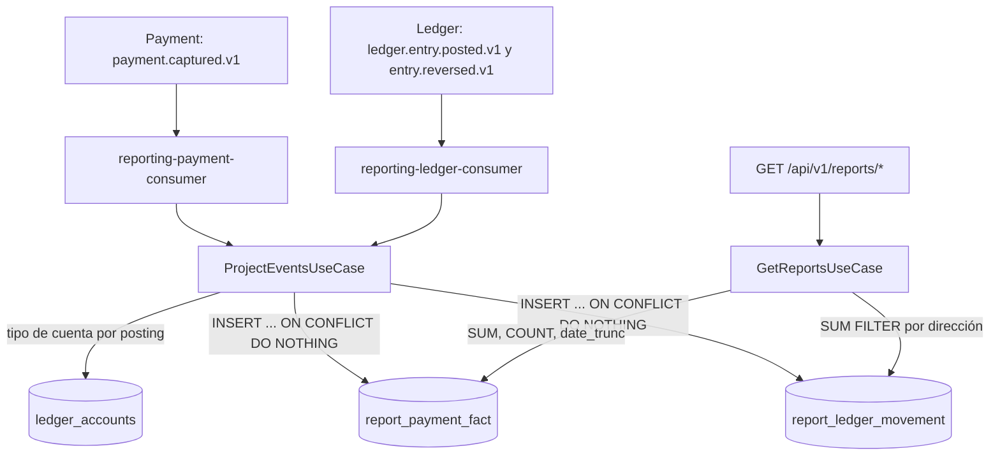

# Reporting — Documentación técnico-funcional

> **Bounded Context:** `context/reporting`
> **Migraciones:** [`000013_reporting_init`](../../migrations/000013_reporting_init.up.sql),
> [`000034_reporting_rls_nullif`](../../migrations/000034_reporting_rls_nullif.up.sql)
> **Streams NATS consumidos:** `PAYMENT` (`payment.captured.>`), `LEDGER` (`ledger.entry.>`) — no publica eventos
> **Lee tablas de otros BCs:** `ledger_accounts` (Ledger)

---

## 1. Propósito

Reporting es el **read-model (CQRS)** del dashboard del comercio. No tiene agregados ni reglas de
negocio y no mueve dinero: consume eventos de otros contextos, guarda **hechos inmutables** y los
agrega al momento de consultar.

Responsabilidades:

1. Proyectar cada pago capturado como un hecho (`report_payment_fact`).
2. Proyectar cada posting de un asiento del Ledger, incluidas las reversas, como un movimiento
   (`report_ledger_movement`), con el tipo de cuenta denormalizado.
3. Responder tres consultas del tenant autenticado: volumen transaccional por período, comisiones
   (revenue) y saldos por tipo de cuenta.

### Fuera de alcance (hoy)

- Reembolsos, disputas, payouts y pagos fallidos: no se proyectan (ver §10).
- Reportes de plataforma (cross-tenant) y exportación (CSV, PDF).
- Saldos a una fecha de corte: los saldos son siempre el acumulado total.

---

## 2. Lenguaje ubicuo

| Término | Significado |
|---|---|
| **Hecho** (*fact*) | Fila inmutable que representa algo que ya ocurrió (un pago capturado, un posting). Nunca se actualiza. |
| **Proyección** | Traducción de un evento de dominio a hechos del read-model. |
| **Bucket** | Intervalo de la serie de volumen: día, semana o mes (`date_trunc`). |
| **Volumen** | Cantidad de pagos y monto bruto capturado, por bucket y moneda. |
| **Revenue** | Monto bruto, comisión de la plataforma y comisión del PSP, por moneda y período. |
| **Saldo** (*balance*) | Débitos, créditos y neto por tipo de cuenta y moneda, sumando todos los movimientos del tenant. |

---

## 3. Flujo funcional



- **Escritura (worker):** dos consumers durables. Cada evento se traduce a hechos y se inserta
  de forma idempotente.
- **Reversas:** el Ledger no emite `entry.posted` para una reversa sino `ledger.entry.reversed.v1`,
  que trae los postings de la reversa (los del original con la dirección invertida). Se proyectan
  como cualquier asiento, bajo el `reverse_entry_id`, y compensan al original en los saldos.
- **Lectura (API):** las métricas se calculan en cada consulta; no hay contadores precalculados.

### Por qué hechos y no contadores

JetStream entrega *al menos una vez*. Un contador incremental se duplicaría con cada re-entrega.
Un hecho con clave natural (`payment_id`, o `entry_id + account_id + direction`) se inserta con
`ON CONFLICT DO NOTHING`: proyectar dos veces el mismo evento no cambia nada.

### Fecha de los hechos

`captured_at` y `posted_at` toman el header `occurred-at` que agrega el relay del outbox: la hora
en que ocurrió el hecho, no la hora de proyección. Así una re-entrega tardía o un replay agregan
en el período correcto. Si el header falta o es inválido, se usa el reloj del worker.

---

## 4. Modelo de dominio

### 4.1 Hechos (`facts.go`)

| Hecho | Origen | Clave natural | Campos |
|---|---|---|---|
| `PaymentFact` | `payment.captured.v1` | `payment_id` | `tenant_id`, `currency`, `amount` (bruto), `platform_fee`, `psp_fee`, `payment_method`, `captured_at` |
| `LedgerMovement` | `ledger.entry.posted.v1` y `ledger.entry.reversed.v1`, un hecho por posting | `(entry_id, account_id, direction)` (en una reversa, `entry_id` = `reverse_entry_id`) | `tenant_id`, `account_type`, `currency`, `amount` (siempre > 0), `posted_at` |

Montos en centavos.

### 4.2 Vistas (`views.go`)

| Vista | Campos |
|---|---|
| `VolumePoint` | `bucket`, `currency`, `payment_count`, `gross_amount` |
| `RevenueSummary` | `currency`, `payment_count`, `gross_amount`, `platform_fees`, `psp_fees` |
| `TenantBalance` | `account_type`, `currency`, `debits`, `credits`, `net` = `debits - credits` |

`Granularity`: `day` (default si viene vacío), `week`, `month`. `ParseGranularity` valida.

### 4.3 Errores

| Error | Uso |
|---|---|
| `ErrInvalidFact` | Evento sin `tenant_id` o sin ID. Es permanente: el consumer lo descarta (ack) y lo loguea. |
| `ErrInvalidRange` | `from` posterior a `to` → 400. |

---

## 5. Casos de uso

| Caso de uso | Qué hace |
|---|---|
| `ProjectEventsUseCase.ProjectPaymentCaptured` | Valida `payment_id` y `tenant_id` y guarda el `PaymentFact`. |
| `ProjectEventsUseCase.ProjectEntryPosted` | Valida `entry_id` y `tenant_id`; por cada posting con cuenta, busca el tipo de cuenta en `ledger_accounts` (con el tenant del evento) y guarda el `LedgerMovement`. Una cuenta inexistente se proyecta con tipo vacío. Lo usan los asientos y las reversas. |
| `GetReportsUseCase.GetVolume` | Valida el rango y delega la serie agregada. |
| `GetReportsUseCase.GetRevenue` | Valida el rango y delega el resumen por moneda. |
| `GetReportsUseCase.GetBalances` | Delega los saldos del tenant (sin rango). |

Los postings de un asiento se insertan uno por uno, sin transacción. Si uno falla, el evento se
reintenta completo; los que ya estaban se ignoran por la clave natural.

---

## 6. API HTTP

Grupo `protected` (JWT) → `/api/v1/reports`. El tenant sale del token. Todas las rutas exigen el
permiso `reports:read` (`RouteGuards.Read`, inyectado desde `cmd/api`; `RegisterRoutes` entra en
pánico sin él): sin permiso → 403.

| Método | Ruta | Respuesta | Códigos |
|---|---|---|---|
| `GET` | `/volume?from=&to=&granularity=day` | `{granularity, points:[VolumePoint]}` | 200 · 400 · 401 · 403 · 500 |
| `GET` | `/revenue?from=&to=` | `{revenue:[RevenueSummary]}` | 200 · 400 · 401 · 403 · 500 |
| `GET` | `/balances` | `{balances:[TenantBalance]}` | 200 · 401 · 403 · 500 |

- `from` y `to` en RFC3339, opcionales. Rango semiabierto `[from, to)`: períodos contiguos no
  cuentan dos veces un hecho del límite. Sin `from` o sin `to`, ese extremo queda abierto.
- `granularity`: `day`, `week` o `month`; otro valor → 400.
- Los buckets se calculan con `date_trunc` en la zona horaria de la sesión de Postgres (UTC).

---

## 7. Eventos

### 7.1 Consumidos

| Consumer | Stream | Filtro | Proyección |
|---|---|---|---|
| `reporting-payment-consumer` | `PAYMENT` | `payment.captured.>` | `payment.captured.v1` → `PaymentFact` |
| `reporting-ledger-consumer` | `LEDGER` | `ledger.entry.>` | `ledger.entry.posted.v1` y `ledger.entry.reversed.v1` → `LedgerMovement` por posting |

`MaxDeliver: 5`. Semántica de ack:

| Situación | Resultado |
|---|---|
| Proyección OK, o hecho ya existente | ack |
| Payload ilegible o sin `tenant_id` | ack, sin log |
| `ErrInvalidFact` (falta el ID) | ack + warn |
| Reversa sin postings (publicada antes de que el evento los llevara) | ack + warn: no se proyecta |
| Error de base u otro transitorio | nak → reintento |
| Otro subject del filtro | ack silencioso |

### 7.2 Publicados

Ninguno.

---

## 8. Persistencia

Migración `000013_reporting_init`:

| Tabla | Clave | Índice |
|---|---|---|
| `report_payment_fact` | PK `payment_id` | `(tenant_id, captured_at)` |
| `report_ledger_movement` | PK `(entry_id, account_id, direction)`; `CHECK direction IN ('debit','credit')` | `(tenant_id, account_type, currency)` |

Ambas tienen RLS por `tenant_id = NULLIF(current_setting('app.current_tenant', true), '')::uuid`
(`000034`). Cada método de los repositorios y del `AccountReader` corre en una sesión con
`app.current_tenant` fijado (`withTenant` → `RunWithAppTenant`): las escrituras con el tenant del
hecho y las consultas con el del token.

---

## 9. Seguridad y multi-tenancy

- **Autenticación:** JWT (grupo `protected`). Las API keys no llegan a estas rutas.
- **Autorización:** permiso `reports:read` (`admin`, `accountant`, `read_only`,
  `platform_support`) o el scope `reports:read` de una API key. `operator` no accede.
- **Aislamiento:** el `WHERE tenant_id = $1` explícito de cada consulta y la RLS de las tablas del
  read-model y de `ledger_accounts`. Verificado con un rol sin `BYPASSRLS`: la proyección inserta,
  el tipo de cuenta se resuelve y un tenant no ve los datos de otro.

---

## 10. Limitaciones conocidas y deuda técnica

| # | Severidad | Tema | Detalle |
|---|---|---|---|
| 1 | Media | Signo del neto | `net = debits - credits`, al revés que el saldo del Ledger (`credits - debits`). El mismo saldo sale con signo opuesto en `/ledger` y en `/reports/balances`. No se puede alinear solo de este lado: la convención del propio Ledger es inconsistente (los consumers debitan `merchant_balance` cuando el comercio gana, ver [LEDGER.md §10.3](LEDGER.md)), y hoy el neto de Reporting es el que da positivo para el comercio. Se resuelve junto con ese punto. |
| 2 | Media | Reembolsos y disputas | `payment.refunded.v1` y `dispute.*` no se proyectan: volumen y revenue siguen contando el bruto y las comisiones de pagos reembolsados o contracargados. |
| 3 | Media | Sin tenant → 500 | El handler ignora si hay tenant en el contexto; con tenant vacío la consulta falla por UUID inválido y responde 500 en lugar de 401/403. |
| 4 | Baja | Zona horaria | Los buckets de `day`/`week`/`month` se cortan en UTC; para un comercio en Argentina el "día" empieza a las 21:00. No hay parámetro de zona. |
| 5 | Baja | Descartes silenciosos | Un payload ilegible o sin tenant se descarta sin log. Una cuenta que no se encuentra se proyecta con `account_type` vacío sin aviso, y su saldo aparece bajo un tipo vacío. |
| 6 | Baja | Consultas sin tope | Sin `from`/`to` se agrega todo el histórico; con `granularity=day` sobre años, la serie no tiene límite de puntos. |
| 7 | Baja | Comentarios desactualizados | La migración describe `captured_at`/`posted_at` como "momento de proyección"; hoy son la hora del evento. |
| 8 | Producto | Alcance | Saldos sin fecha de corte. Sin métricas de payouts, pagos fallidos ni tasa de aprobación. Sin reportes de plataforma ni exportación. |

---

## 11. Testing

`go test ./context/reporting/...` (100 % de cobertura de sentencias en los cinco paquetes).

| Paquete | Enfoque |
|---|---|
| `domain` | `ParseGranularity` (vacío → `day`, valores inválidos), contrato JSON de las vistas, errores. |
| `application` | Proyección con fakes: validación de IDs, fecha del hecho desde el evento o el reloj, tipo de cuenta por posting con el tenant del evento, postings sin cuenta, errores del writer y del lector; consultas con validación de rango. |
| `http` | Parseo de `from`/`to` y `granularity`, 400 por formato o rango, 500 sin detalle interno, guard en cada ruta y pánico sin guard. |
| `nats` | Traducción de cada payload (incluida la reversa bajo `reverse_entry_id`), header `occurred-at`, ack/nak según el error, reversa sin postings, subjects ajenos. |
| `postgres` | pgxmock: SQL idempotente de cada inserción y cada consulta dentro de la sesión RLS, error al fijar la sesión, armado del `WHERE` con rango semiabierto, agregaciones y cálculo del neto. |

La RLS se verificó además contra Postgres con un rol sin `BYPASSRLS`: proyección de un pago (con
re-entrega), un asiento y su reversa, tipo de cuenta resuelto, saldos compensados y aislamiento
entre tenants. Esa prueba no está automatizada.

---

## 12. Mapa de código

```
context/reporting/
├── domain/
│   ├── facts.go            # PaymentFact, LedgerMovement (hechos inmutables)
│   ├── views.go            # Granularity, VolumePoint, RevenueSummary, TenantBalance
│   └── errors.go           # ErrInvalidFact, ErrInvalidRange
├── application/
│   ├── ports.go            # ProjectionWriter, AccountTypeReader, ReportReader, queries
│   ├── project_events.go   # ProjectEventsUseCase (+ Clock)
│   └── get_reports.go      # GetReportsUseCase
└── infrastructure/adapters/
    ├── inbound/http/handler.go          # 3 endpoints, RouteGuards, RegisterRoutes
    ├── inbound/nats/event_consumer.go   # 2 consumers (pagos; asientos y reversas), payloads, ack/nak
    └── outbound/postgres/
        ├── projection_repo.go           # inserciones idempotentes
        ├── report_repo.go               # agregaciones (Volume, Revenue, Balances)
        ├── account_reader.go            # tipo de cuenta desde ledger_accounts
        └── rls.go                       # sesión RLS (withTenant)
```

Wiring: `cmd/api/main.go` (consultas, guard `reports:read` y rutas) y `cmd/worker/main.go`
(proyección y consumers).
