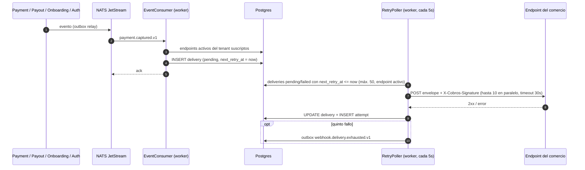

# Webhook (Webhooks salientes) — Documentación técnico-funcional

> **Bounded Context:** `context/webhook`
> **Migraciones:** [`000009_webhook_init`](../../migrations/000009_webhook_init.up.sql)
> **Stream NATS:** `WEBHOOK` (`webhook.>`)

---

## 1. Propósito

Webhook entrega los eventos de dominio de la plataforma al **endpoint HTTP del comercio**. El comercio registra una URL y los tipos de evento que le interesan. Cada vez que ocurre uno de esos eventos en su tenant, la plataforma le hace un `POST` firmado con HMAC-SHA256 y reintenta con backoff si el endpoint falla.

| Principio | Cómo se implementa |
|---|---|
| Consumer desacoplado del comercio | El consumer NATS solo **crea** la delivery (`pending`). El POST lo hace el `RetryPoller`, así que un endpoint lento no frena el ack a NATS. |
| Idempotencia por evento | `UNIQUE (endpoint_id, event_id)`. Además hay un chequeo previo en `DispatchEvent`, y una re-entrega de NATS no duplica la delivery. |
| Autenticidad | `X-Cobros-Signature: sha256=<HMAC-SHA256(secret, body)>` con un secret `whsec_…` que se muestra **una sola vez** al registrar. |
| Entrega *at-least-once* | Si falla la persistencia después del POST, la delivery se vuelve a despachar. El comercio debe deduplicar por `delivery_id` (o por `event_id`). |
| Historial | Cada intento HTTP queda en `webhook_delivery_attempts`: status, primeros 500 bytes de la respuesta, error y duración. |

Fuera de alcance: webhooks **entrantes** (del PSP), edición o reactivación de endpoints, rotación del secret, reenvío de deliveries agotadas (§10).

---

## 2. Lenguaje ubicuo

| Término | Significado |
|---|---|
| **Endpoint** | URL del comercio más la lista de tipos de evento suscriptos. Agregado raíz `WebhookEndpoint`. |
| **Secret** | Clave HMAC del endpoint (`whsec_` + 64 hex). Se devuelve solo en la respuesta del alta. |
| **Secret hint** | `...` + últimos 4 caracteres del secret, para identificarlo sin exponerlo. |
| **Delivery** | La entrega de **un** evento a **un** endpoint. Entidad `WebhookDelivery` con su máquina de estados. |
| **Attempt** | Un POST concreto de una delivery, con su resultado. |
| **Envelope** | Cuerpo JSON que recibe el comercio: metadatos de la entrega más el evento original en `data`. |
| **Tipo de evento** | Subject NATS sin versión: `payment.captured.v1` → `payment.captured`. Las suscripciones se guardan así y matchean cualquier versión. |

---

## 3. Flujo funcional



1. Un BC publica un evento por outbox, y el relay lo envía a su stream.
2. El `EventConsumer` toma `tenant_id` del payload y busca los endpoints **activos** del tenant suscriptos a ese tipo. Por cada uno crea una delivery `pending`, disponible de inmediato. Si un endpoint falla, sigue con los demás y al final hace *nak*. En la re-entrega solo se crean las que faltan.
3. El `RetryPoller` despacha las deliveries vencidas. Si el endpoint responde 2xx, queda `delivered`. Si no, queda `failed` con el próximo reintento programado (§4.3). El quinto fallo la deja `exhausted` y emite `webhook.delivery.exhausted.v1`.
4. El comercio puede ver el historial y forzar un reintento manual (§6).

---

## 4. Modelo de dominio

### 4.1 Agregado `WebhookEndpoint`

| Campo | Regla |
|---|---|
| `url` | Obligatoria; URL absoluta `http`/`https` con host (`validateURL`). No se valida el destino (§10). |
| `events` | Al menos uno. Se normalizan con trim, sin versión y sin duplicados (`normalizeEvents`). No se validan contra un catálogo. |
| `secret` / `secretHint` | Generado por `SecretGenerator` (`crypto/rand`, 32 bytes). Se guarda **en claro**. |
| `active` | `true` al crear; `Deactivate()` lo pasa a `false`. No hay reactivación. |

- `SubscribesTo(eventType)` compara sin versión.
- `ComputeSignature(payload)` devuelve el HMAC-SHA256 hex.
- Eventos: `EndpointRegisteredEvent` y `EndpointDeactivatedEvent`.

### 4.2 Entidad `WebhookDelivery`

```
pending ──2xx──────────────► delivered   (final)
pending ──fallo────────────► failed      (next_retry_at programado)
failed  ──2xx──────────────► delivered
failed  ──fallo────────────► failed
failed  ──5º fallo─────────► exhausted   (final, emite DeliveryExhaustedEvent)
```

- `RecordAttempt(attempt, now)` incrementa `attemptCount`, agrega el intento y decide el estado. Es éxito si el status es 2xx, y falla en un estado final.
- `MarkReadyForRetry` (`failed → pending`) existe en el dominio, pero ningún caso de uso la llama: el poller despacha `failed` directamente.

### 4.3 Reintentos

| Intento | Cuándo |
|---|---|
| 1 | Inmediato (`next_retry_at = created_at`) |
| 2 | 30 s después del fallo 1 |
| 3 | 2 min después del fallo 2 |
| 4 | 10 min después del fallo 3 |
| 5 | 1 h después del fallo 4 |
| — | Fallo 5 → `exhausted` |

`MaxAttempts = len(RetrySchedule) + 1`; un test lo fija. Los reintentos manuales cuentan contra el mismo presupuesto.

### 4.4 Errores

| Error | HTTP |
|---|---|
| `ErrEndpointNotFound`, `ErrDeliveryNotFound` (incluye recurso de otro tenant) | 404 |
| `ErrEndpointURLEmpty`, `ErrInvalidEndpointURL`, `ErrNoEventsSubscribed` | 400 |
| `ErrDeliveryNotRetryable` (delivery `delivered`/`exhausted`), `ErrEndpointInactive` | 422 |
| Cualquier otro (incluidos IDs mal formados, §10) | 500 |

`ErrDuplicateDelivery` está declarado pero no se usa.

---

## 5. Casos de uso

| Caso de uso | Disparador | Qué hace |
|---|---|---|
| `RegisterEndpoint` | `POST /webhooks/endpoints` | Genera el secret, crea el endpoint y, en la misma tx, publica `webhook.endpoint.registered.v1`. Devuelve el secret. |
| `DeactivateEndpoint` | `DELETE /webhooks/endpoints/:id` | Verifica el tenant, `Deactivate()`, `UPDATE` y publica `webhook.endpoint.deactivated.v1` en tx. |
| `ListEndpoints` | `GET /webhooks/endpoints` | Endpoints del tenant (sin secret). |
| `DispatchEvent` | Consumer NATS | Crea una delivery por endpoint suscripto (§3). |
| `RetryDelivery.Execute` | `POST /webhooks/deliveries/:id/retry` | Reintento manual **síncrono**: despacha dentro del request (hasta 30 s). Acepta `pending` y `failed`. |
| `RetryDelivery.dispatch` | `RetryPoller` y el anterior | Carga el endpoint (si está inactivo devuelve `ErrEndpointInactive` sin registrar intento), hace el POST, `RecordAttempt`, `UPDATE` y publica el evento de agotada si corresponde. |
| `ListDeliveries` / `GetDelivery` | `GET /webhooks/deliveries[/:id]` | Historial del tenant (lista sin intentos, detalle con intentos). |

---

## 6. API HTTP

Todas las rutas están en el grupo `protected` (`/api/v1`, `JWTMiddleware`) y **sin guard de permisos** (§10).

| Método | Ruta | Respuesta |
|---|---|---|
| `POST` | `/webhooks/endpoints` | 201 `{endpoint_id, secret, secret_hint, note}` |
| `GET` | `/webhooks/endpoints` | 200 `{endpoints, count}` |
| `DELETE` | `/webhooks/endpoints/:endpointID` | 204 |
| `GET` | `/webhooks/deliveries?limit=50` | 200 `{deliveries, count}`: más recientes primero, sin intentos |
| `GET` | `/webhooks/deliveries/:deliveryID` | 200 delivery con `attempts` |
| `POST` | `/webhooks/deliveries/:deliveryID/retry` | 204 (el resultado del POST queda en la delivery) |

```json
POST /api/v1/webhooks/endpoints
{ "url": "https://comercio.example.com/hooks", "events": ["payment.captured", "payout.confirmed"], "description": "Producción" }
```

### 6.1 Lo que recibe el comercio

```
POST <url>
Content-Type:       application/json
User-Agent:         cobros-platform-webhooks/1.0
X-Cobros-Signature: sha256=<hex HMAC-SHA256(secret, body)>
X-Cobros-Event:     payment.captured            (sin versión)
X-Cobros-Delivery:  <delivery_id>
X-Cobros-Timestamp: <unix, momento del intento> (no firmado, §10)
```

```json
{
  "event_type":  "payment.captured.v1",
  "event_id":    "<id del evento de dominio>",
  "delivery_id": "<delivery_id>",
  "occurred_at": "2026-10-30T12:00:00Z",
  "data":        { "payment_id": "…", "tenant_id": "…", "amount": 10000, "currency": "ARS", "…": "…" }
}
```

- `event_type` lleva la versión, a diferencia del header.
- `event_id` es el `Nats-Msg-Id`, o sea el ID del evento de dominio. Ningún evento de los streams consumidos serializa `id` ni `event_id`.
- `occurred_at` sale del header `occurred-at` que agrega el relay, y si falta se usa `now`.
- `data` es el payload interno del evento **tal cual**: el contrato público queda acoplado al interno.
- El body se guarda como `JSONB`, así que el orden de las claves y los espacios pueden diferir del original. La firma se calcula sobre los bytes que efectivamente se envían.

Verificación en el comercio: `hmac.compare_digest(hex(HMAC-SHA256(secret, raw_body)), header[7:])`.

---

## 7. Eventos

### 7.1 Publicados (stream `WEBHOOK`)

| Evento | Cuándo | Payload | Consumidores |
|---|---|---|---|
| `webhook.endpoint.registered.v1` | Alta | `endpoint_id`, `tenant_id`, `url`, `events` | Audit |
| `webhook.endpoint.deactivated.v1` | Baja | `endpoint_id`, `tenant_id` | Audit |
| `webhook.delivery.exhausted.v1` | Quinto fallo | `delivery_id`, `endpoint_id`, `tenant_id`, `event_type` | Nadie |

Los dos primeros se publican por outbox en la tx del caso de uso. El de agotada se publica **fuera de tx** y su error se descarta (§10).

### 7.2 Consumidos

| Durable | Stream | Filtro | `MaxDeliver` |
|---|---|---|---|
| `webhook-payment-consumer` | `PAYMENT` | `payment.>` | 3 |
| `webhook-payout-consumer` | `PAYOUT` | `payout.>` | 3 |
| `webhook-onboarding-consumer` | `ONBOARDING` | `onboarding.>` | 3 |
| `webhook-auth-consumer` | `AUTH` | `auth.tenant.>` | 3 |

- Los tipos que llegan son, por ejemplo, `payment.{captured,failed,refunded}`, `payout.{initiated,confirmed,failed,unknown}`, `onboarding.application.{submitted,sent_for_review,approved,rejected,more_info,reopened}` y `auth.tenant.{created,activated,suspended}`.
- No se consumen `dispute.*`, `ledger.*`, `billing.*`, `compliance.*` ni `reconciliation.*`. Compliance queda afuera a propósito (anti *tipping-off*, ver AUTH.md §7.2).
- El consumer hace *ack* sin reintentar si el payload no es JSON, si no trae `tenant_id` o si el `tenant_id` es inválido. Un error de base de datos hace *nak*.

---

## 8. Persistencia

| Tabla | Clave / restricciones | Notas |
|---|---|---|
| `webhook_endpoints` | PK `id`; índices `(tenant_id, active)` y GIN sobre `events` | `secret` en texto claro. |
| `webhook_deliveries` | PK `id`; FK `endpoint_id`; `UNIQUE (endpoint_id, event_id)`; `CHECK status` | `payload JSONB` (el envelope). Índice parcial `next_retry_at WHERE status IN ('pending','failed')` para el poller. |
| `webhook_delivery_attempts` | PK `id`; FK `delivery_id`; `UNIQUE (delivery_id, attempt_num)` | Sin `tenant_id`. `response_body` son los primeros 500 bytes. |

- **RLS:** `webhook_endpoints` y `webhook_deliveries` tienen una política `tenant_id = current_setting('app.current_tenant', true)::uuid`, sin `NULLIF` ni política de operador. `webhook_delivery_attempts` no tiene RLS.
- El consumer y el poller corren sin tenant en la sesión, y las lecturas del API van al pool fuera de la sesión RLS: hoy funcionan porque el rol de la app tiene `BYPASSRLS` (§10).
- `FindActiveByTenantAndEvent` busca `events @> ARRAY[tipo]` con y sin versión.
- `ListDueForRetry` hace `JOIN` con los endpoints activos, así que las deliveries de un endpoint desactivado no ocupan el batch, pero quedan `pending`/`failed` para siempre.

---

## 9. Concurrencia

- **Consumer:** hay un durable por stream. Si dos re-entregas del mismo evento compiten, el `UNIQUE (endpoint_id, event_id)` hace fallar a la segunda, que vuelve a entrar por *nak* y encuentra la delivery ya creada.
- **Poller:** cada ciclo despacha hasta 50 deliveries con 10 POST simultáneos y espera a que terminen antes del siguiente tick, así que dentro de un proceso no hay ciclos superpuestos. No reclama las filas (sin `FOR UPDATE SKIP LOCKED` ni versión), así que un reintento manual o una segunda réplica del worker despachan la misma delivery en paralelo (§10).
- **Persistencia del intento:** `UPDATE` de la delivery e `INSERT` del intento van sin transacción (§10).

---

## 10. Limitaciones conocidas y deuda técnica

| # | Severidad | Tema | Detalle |
|---|---|---|---|
| 1 | Alta | Sin autorización | Las rutas `/webhooks/*` solo exigen JWT: no tienen `RequirePermission`. Cualquier usuario del tenant (`read_only`, `operator`, `accountant`) puede registrar una URL propia y recibir todos los pagos y payouts, desactivar los endpoints del comercio, leer los payloads de las deliveries y forzar reintentos. `webhooks:manage` (solo `admin`) y el scope `webhooks:write` existen en Auth pero no se usan. |
| 2 | Alta | SSRF | `validateURL` acepta cualquier host: `localhost`, IPs privadas, `169.254.169.254` y nombres internos de docker (`postgres`, `nats`). El worker hace el POST desde la red interna, y los primeros 500 bytes de la respuesta se le devuelven al tenant en `GET /deliveries/:id`. |
| 3 | Alta | Redirects | El `http.Client` sigue redirects. Ante 301/302/303, Go repite el request como **GET sin body**: si el destino responde 2xx, la delivery queda `delivered` sin que el comercio reciba el evento. Verificado: POST → 302 → GET vacío → 200 → `delivered`. Además permite saltar cualquier filtro de destino (#2). |
| 4 | Media | Persistencia del intento | `RetryDelivery.dispatch` hace el `UPDATE` de la delivery y el `INSERT` del intento sin tx, y publica `webhook.delivery.exhausted.v1` fuera de tx descartando el error. El body de la respuesta se corta en 500 bytes y puede partir un carácter UTF-8; un body con bytes inválidos o `NUL` tampoco entra en `TEXT`. Verificado: respuesta 2xx de 501 bytes con `ñ` al final → la delivery queda `delivered` y el intento se pierde (`SQLSTATE 22021`). |
| 5 | Media | Despacho concurrente | Ni el poller ni el reintento manual reclaman la delivery. El reintento manual acepta `pending`, justo lo que el poller está por despachar. Resultado: doble POST, choque en `UNIQUE (delivery_id, attempt_num)` (se pierde un intento) y *last-write-wins*, que puede volver un `delivered` a `failed` y reenviarlo. Con dos réplicas del worker, cada delivery sale dos veces. |
| 6 | Media | RLS no efectiva | Las políticas no tienen `NULLIF` ni operador, y `webhook_delivery_attempts` no tiene RLS ni `tenant_id`. El consumer no pone el tenant en el contexto, el poller es cross-tenant y las lecturas del API van al pool fuera de la sesión RLS. Con un rol sin `BYPASSRLS`, el consumer no encontraría endpoints y descartaría los eventos en silencio. |
| 7 | Media | Firma sin timestamp | `X-Cobros-Timestamp` viaja pero no se firma: un request capturado se puede reenviar al comercio indefinidamente con firma válida, y el comercio no tiene cómo rechazar los viejos. |
| 8 | Baja | IDs inválidos → 500 | `DELETE /endpoints/abc`, `GET`/`POST /deliveries/abc[/retry]`: el error de parseo cae en el `default` de `respondError`. |
| 9 | Baja | `limit` sin tope | `GET /deliveries?limit=1000000` carga todo el historial del tenant. |
| 10 | Baja | Desactivar dos veces | `DeactivateEndpoint` sobre un endpoint ya inactivo vuelve a emitir `webhook.endpoint.deactivated.v1` y pisa `updated_at`. |
| 11 | Baja | Suscripciones sin catálogo | `events` acepta cualquier string: un typo o un tipo que no existe (el README anterior documentaba `kyc.approved`) da un endpoint que nunca recibe nada, sin error. |
| 12 | Producto | Alcance | Secret en claro y sin rotación. Endpoints sin edición ni reactivación. No se puede reenviar una delivery `exhausted`, y las de un endpoint desactivado quedan colgadas. El reintento manual es síncrono y consume el presupuesto de reintentos. Un endpoint caído (timeout de 30 s) ocupa el batch y demora a todos los tenants: no hay *circuit breaker* ni cola por endpoint. `data` expone el evento interno tal cual. Se permite `http`. Historial sin paginación, filtros ni retención. `webhook.delivery.exhausted.v1` no lo consume nadie (no se avisa al comercio). |

---

## 11. Testing

| Capa | Archivos | Tipo |
|---|---|---|
| Dominio | `domain/*_test.go` | Validación de URL y eventos, firma (vector RFC 4231), FSM de la delivery, schedule y `MaxAttempts`, truncado del body. |
| Aplicación | `application/*_test.go` | Alta y baja con publicación en tx, `DispatchEvent` (idempotencia, fallo parcial), `RetryDelivery` (tenant ajeno, final, endpoint inactivo, exhausted), poller con concurrencia, listados. |
| HTTP | `inbound/http/webhook_handler_test.go` | Handlers y mapeo de errores. |
| NATS | `inbound/nats/event_consumer_test.go` | Extracción de tenant, `event_id` y `occurred_at`; casos que hacen *ack* sin reintentar. |
| Dispatcher | `outbound/http/dispatcher_test.go` | Headers, firma y errores de red contra `httptest`. |
| Postgres | `outbound/postgres/repo_test.go` | Solo `pgxmock`: no hay integración contra una base real. |

```bash
go test ./context/webhook/...
```

---

## 12. Mapa de código

```
context/webhook/
├── domain/
│   ├── endpoint.go     # WebhookEndpoint, validateURL, normalizeEvents, ComputeSignature
│   ├── delivery.go     # WebhookDelivery: RecordAttempt, FSM
│   ├── vo.go           # IDs, DeliveryStatus, RetrySchedule, MaxAttempts, DeliveryAttempt
│   ├── events.go       # webhook.endpoint.{registered,deactivated}, webhook.delivery.exhausted
│   └── errors.go
├── application/
│   ├── ports.go        # repos, HTTPDispatcher, SecretGenerator, EventPublisher, Clock, IncomingEvent
│   ├── register_endpoint.go   # RegisterEndpoint + DeactivateEndpoint
│   ├── dispatch_event.go      # WebhookEnvelope + DispatchEvent
│   ├── retry_delivery.go      # RetryDelivery + RetryPoller
│   └── list_deliveries.go     # ListDeliveries, GetDelivery, ListEndpoints
└── infrastructure/adapters/
    ├── inbound/http/webhook_handler.go     # rutas /webhooks/*
    ├── inbound/nats/event_consumer.go      # 4 durables
    └── outbound/
        ├── http/dispatcher.go              # POST firmado, timeout 30s
        ├── crypto/secret_generator.go      # whsec_<64 hex>
        └── postgres/{endpoint,delivery}_repo.go
```

Wiring: `cmd/api/main.go` (rutas; el `DispatchEvent` se construye pero no se usa) y `cmd/worker/main.go` (4 consumers + `RetryPoller` cada 5 s).
